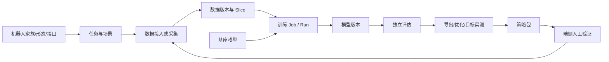

# 01 · 产品与领域设计

## 1. 产品边界

EmbodiedBein 管理从机器人资产到可追溯策略包的非实时生命周期：



平台统一生命周期、语义约束、血缘和证据，不强行统一不同机器人的动作向量、传感器、控制器或任务指标。

平台不做：

- 不进入 25–1000Hz 实时控制回路，不发送关节目标或转发实时遥操作。
- 不改写外部项目，不在 API 进程内运行训练或处理大文件。
- 不用一个“支持”开关代替模型、数据、机器人和设备的逐项能力验证。
- 不因源代码、权重或配置文件存在就宣称可运行。

## 2. 核心对象

| 对象 | 职责与不变量 |
|---|---|
| `Embodiment` | 机器人家族及资产来源，如 SO101、G1、BHL |
| 形态/资产版本 | 单臂、双足、全身等物理形态及 URDF/USD/MJCF 依赖 |
| `EmbodimentEnv` | 版本化控制接口：观测、动作、频率、坐标系、传感器、限制与仿真/真机绑定 |
| `Robot` | 真实设备实例、序列号、固件、标定与当前包；没有硬件就不创建在线实例 |
| `Task` | 行为目标、成功/失败判定、超时及适用接口；不是一次训练作业 |
| `Scenario` | 物体、地形、初始分布、随机化和语言模板的不可变清单 |
| `RuntimeProfile` | 镜像 digest、架构、依赖、设备要求与能力 probe |
| `Dataset` / `DatasetVersion` | 逻辑集合 / 已发布不可变内容与索引 |
| `DataSlice` | 固定成员、划分、采样权重、mask 与 normalization |
| `ModelVersion` | 权重、processor、norm、动作头、来源 Run 和能力证据 |
| `Pipeline` / `PipelineRun` | 冻结模板 / 一次有稳定身份的管线执行 |
| `Job` / `Run` | 逻辑作业 / 一次执行尝试；重试创建新 Run |
| `EvalSuite` / `EvalReport` | 冻结评估条件 / 逐 case 证据与判定 |
| `Bundle` | 绑定模型、接口、目标设备与评估证据的交付物 |
| `Artifact` / `LineageEdge` | 内容寻址产物 / 不可变血缘边 |

首期复用现有表和 JSON manifest；只有稳定、高频的跨版本查询才值得新增实体。逐帧数据不进入 PostgreSQL。

## 3. 本体接口

`EmbodimentEnv` 是训练数据、模型和运行时之间的语义契约。草稿可编辑；发布后内容和 `spec_hash` 不变，修改必须 clone 新版本。

最小内容：

- 有序 `joint_names`，并区分驱动关节、观测关节、DOF、策略动作维度和夹爪通道。
- 观测项的名称、shape、dtype、历史窗口、缺失规则与是否拼接；图像等模态不伪装成向量维度。
- 动作表示、单位、坐标系、absolute/delta、scale/offset、夹爪方向；组合动作由多个 term 显式组成。
- 物理步长、控制频率、策略频率、action chunk 长度和消费规则。
- 传感器逻辑名、设备映射、内外参、畸变、颜色布局和时间基准。
- frame 父子关系、轴向、单位、四元数顺序，及软/硬限制的执行者。
- 仿真任务、资产和真实端控制器/固件绑定。

兼容性按结构、语义、时序、实际运行四级验证。不同接口只能通过登记了输入输出、误差报告和版本的转换器连接，不凭 shape 自动补零或重排。

BHL 已发布接口保持不变：

| ID | obs | action | policy_hz | 特点 |
|---|---:|---:|---:|---|
| `ee_bhl_humanoid_22dof_v1` | 75 | 22 | 25 | 全身运控 |
| `ee_bhl_biped_12dof_v1` | 45 | 12 | 25 | 双足 |
| `ee_bhl_wbc_22dof_v1` | 85 | 22 | 50 | 多 term 动作 |
| `ee_bhl_fixedhand_10dof_v1` | 10 + image | 10 | 20 | `concat=false` |

## 4. JobSpec、状态与幂等

`JobSpec` 是控制面与执行面的统一意图描述，包含 kind、接口/任务、版本化输入、代码快照、镜像、参数、资源、策略、输出与门禁。adapter 将它翻译成栈命令；领域层不保存某个训练栈的命令行细节。

核心状态遵循现有有限状态机：

```text
draft/blocked → queued → admitted → preparing → running
running → succeeded | failed | timeout | cancelled | infra_failed | preempted
preempted/infra_failed → queued（仅符合策略时）
```

- Job 成功要求输出校验和发布完成，不等于容器 exit 0。
- 每次重试产生新 Run，源 Run 不覆盖；TrainJob 只是业务投影，Job/Run 是执行真源。
- 幂等键绑定 principal、operation 和规范化输入 hash；同键不同输入返回冲突。
- Pipeline 首期只支持顺序、有限 `map(shards)` 和全必需 `join`，不接受任意脚本 DSL。
- 资产登记、血缘和节点成功在一个数据库事务提交；文件已完成但事务失败时由 reconcile 按 manifest 重放。

## 5. 五类门禁

为避免与 G1 机器人混淆，正文称“Gate 1–5”。

| 门禁 | 时机 | 校验 | 失败结果 |
|---|---|---|---|
| Gate 1 | 提交 Job | 任务、接口、数据、模型、配置绑定 | 拒绝入队并返回字段级 diff |
| Gate 2 | 数据发布 | action/state、关节顺序、单位、频率、时序 | 标记用途不兼容；不得训练 |
| Gate 3 | 模型注册 | 实际权重/导出物 I/O 与接口、processor/norm | 拒绝能力提升或注册 |
| Gate 4 | 导出/签包 | 模型、部署配置、接口、hash、评估证据一致 | 拒绝签名 |
| Gate 5 | 现场使用前 | 设备形态、固件、标定、目标延迟和端侧安全条件 | 阻断交付状态提升 |

门禁没有 Agent override。现场人工记录可以形成新的外部证据，但不能通过改数据库把失败改成通过。

## 6. 版本与血缘

所有正式消费对象以稳定 ID、revision 和内容 hash 标识。名称、标签和 UI 排序不进入内容身份。核心血缘包括：

- source → dataset version → slice → train run → model version；
- model version + suite → eval report；
- model version → optimized variant → bundle；
- run → resumed_from run，train job → derived_from train job；
- 现场失败/遥测 → 候选数据版本。

删除元数据不等于删除外部源。GC 必须重新检查引用和活动租约，已发布对象只允许按明确保留策略回收，血缘与 tombstone 保留。
