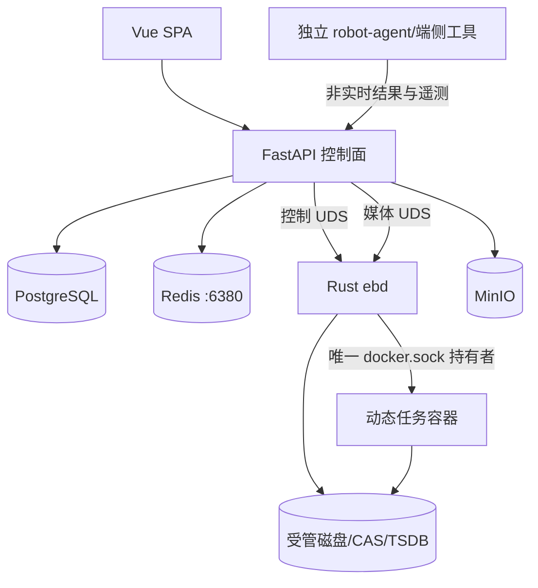

# 02 · 系统架构

## 1. 部署与进程

EmbodiedBein 是单机系统，`make up` / Docker Compose 是唯一平台部署入口。



Compose 常驻服务只有 API、`ebd`、PostgreSQL、Redis、MinIO，以及可选 Caddy。训练、采集、转换和评估容器由 `ebd` 按 Run 动态创建，带 `eb.run_id` 标签，不写入 Compose。

固定内部端口/套接字：

| 服务 | 地址 |
|---|---|
| API / Web | `:8000` |
| PostgreSQL | `:5432` |
| Redis | `:6380`，避让 Ray 默认 6379 |
| MinIO | `:9000` / `:9001` |
| ebd 控制 | `/run/eb/ebd.sock` |
| ebd 媒体 | `/run/eb/ebd-http.sock` |

## 2. Python 与 Rust 边界

Python 控制面负责鉴权、领域校验、元数据、准入、编排、adapter、门禁、Agent 和页面 API。领域模块保持纯逻辑，不执行文件遍历、网络请求或子进程。

Rust 数据面负责：

- 宿主/GPU probe，任务容器生命周期、挂载/设备/网络限制与重认领；
- 代码内容快照、文件扫描、hash、CAS、产物收集与原子发布；
- 日志、指标、Range 媒体和大文件流式处理；
- 路径 canonicalize、符号链接逃逸、写根和输出 manifest 校验。

现有 Rust workspace 的 `eb-runner`、`eb-collector`、`eb-scanner`、`eb-artifact`、`eb-tsdb`、`eb-probe`、`eb-cli` 是内部 crate，部署仍只有 `ebd` 与 `ebctl` 二进制。不要把 crate 拆成常驻服务。

需要 Python/HDF5/LeRobot/ffmpeg/Isaac/RLinf 的处理在受控工具容器内执行。FastAPI 禁止 `subprocess` 跑训练，也不把视频或 checkpoint 读入内存后再转发。

## 3. 执行流程

```text
API 校验并冻结 JobSpec
→ PG 幂等创建 Job
→ 调度器检查 GPU/CPU/RAM/shm/磁盘/镜像
→ 创建 Run 与资源租约
→ ebd 生成内容快照和独占 Run 目录
→ ebd 创建受限任务容器
→ 采集日志/指标/输出 manifest
→ ebd 校验产物
→ PG 事务登记 Artifact/Lineage 并终结 Job
```

任务容器必须：

- 无 `docker.sock`、无平台密钥、无未声明设备；默认无出网或仅 recipe 允许的目的地。
- 外部源码和输入以只读、最小路径挂载；输出只写自己的 Run 目录。
- 使用镜像 digest，不以可变 tag 作为复现身份。
- 默认独立网络命名空间；Ray 不跨 Job 自动发现。确需 host network 时租用完整端口集合，不能只散列一个 head port。
- CPU、RAM、shm、GPU、磁盘和超时都有显式上限。

调度器以 PostgreSQL 状态和租约为真源。服务重启后通过固定 run_id/container label 重认领；内存锁和 Redis 消息都不能作为唯一状态。

## 4. 存储布局

```text
${EB_HOST_STATE_DIR:-/data/kk/embodiedbein}/
  runs/<run_id>/          # spec、resolved config、日志、独占输出
  snapshots/<hash>/       # 代码/配置内容快照
  cas/<prefix>/<hash>/    # 小型不可变 Artifact 与历史兼容
  tsdb/<run_id>/          # 指标
  media/                  # 可重建预览，不是训练原始图像
  staging/<run_id>/       # 未发布输出
${EB_HOST_MODELS_DIR:-/data/kk/models}/
${EB_HOST_DATA_DIR:-/data/kk/data}/
```

PostgreSQL 保存事务性元数据和可查询摘要；磁盘/MinIO 保存大对象；Redis 只做队列、事件或缓存，不保存唯一事实。CAS 使用 SHA-256 分层布局；大数据集可保留受管不可变目录加 manifest，不为“全面 CAS”重复复制数十 GB 数据。

外部 `/data/kk/Berkeley-Humanoid-Lite`、`/data/kk/RLinf`、`/data/kk/berkeley_ego_data` 及接入的 LeIsaac/IsaacLab/LeRobot/OpenPI 源码均只读。允许读取的前缀与允许写入的根是两套规则；“在白名单路径内”不代表可写。

## 5. 无 Git 复现

运行身份使用内容快照，不依赖工作区 Git 状态：

1. `ebd` 从允许文件集复制或 reflink 到 `snapshots/`；不 hardlink 可写源。
2. 排除 `.git`、缓存和输出，显式包含实际导入源码、配置与资产依赖。
3. 复制前后检测源变更；不稳定则失败重试。
4. 记录每文件 SHA-256、依赖清单和总内容 hash，作为 `code_ref`。
5. 运行期缓存、`.pyc` 和生成文件写入 Run/缓存目录，不能回写源码。

普通只读 bind mount 加 mtime 检查不等于冻结。正式训练输入必须是不可变副本、可靠文件系统快照或等价的对象版本。

## 6. 发布、备份与恢复

每个 writer 在独占 staging 完成 flush 后写 manifest，最后原子写完成标记。`ebd` 校验后在同一文件系统 rename；跨文件系统则复制到目标 staging、重新校验再 rename。数据库只能引用已完成路径。

备份最少覆盖 PostgreSQL、资产 manifest/hash、密钥材料和无法重建的受管数据。CAS/数据/模型可以分层备份，但恢复验收必须确认媒体、模型、Run 和血缘都能定位，不能只验证数据库启动。

## 7. 故障与降级

- PostgreSQL 不可用：停止创建/终结作业，运行中容器可由 `ebd` 继续守护，恢复后 reconcile。
- Redis 不可用：降级轮询；不得丢失 Job 终态或资产发布。
- MinIO 不可用：受影响产物保持待发布，不伪造成功。
- API 重启：不影响任务容器和机器人端控制；调度器从 PG/ebd 恢复。
- `ebd` 重启：按容器标签和 Run 记录重认领，未知容器不擅自删除。
- 磁盘逼近安全余量：停止新 shard/checkpoint，完成可提交写入，不能撑满 PG 所在分区。
- 平台整体离线：机器人端继续按本地 runtime 和安全机制运行，平台不是其可用性前提。

## 8. 平台可观测性

每个请求、Job、Run、容器、Artifact 和 Agent 工具调用共享 trace/run 标识。平台自身至少暴露 API/DB/队列延迟、调度等待、容器创建失败、磁盘余量、事件积压和 reconcile 结果；研究指标与平台运维指标分开命名和存储。

日志必须结构化并脱敏，终态和错误原因持久化到 PG；TSDB 或日志丢失不能改写 Job 事实。健康检查分别报告依赖可达性和能力 probe，不能因 API 返回 200 就宣称 GPU 渲染、训练镜像或评估资产健康。

## 9. 安全基线

用户会话与 API key 都映射到明确 principal/actor type；所有资源读写、媒体和异步动作在服务端鉴权。非本机访问必须由 Caddy 或等价入口终止 TLS，`ebd` 与数据库不直接暴露公网。

所有状态变更记录 actor、对象、前后值、trace 和审批引用。secret 只以引用注入需要它的最小容器，不进入 JobSpec、日志、快照或前端。`docker.sock` 只挂给 `ebd`；即使 API 或任务容器被攻破，也不应因此获得宿主容器控制权。
