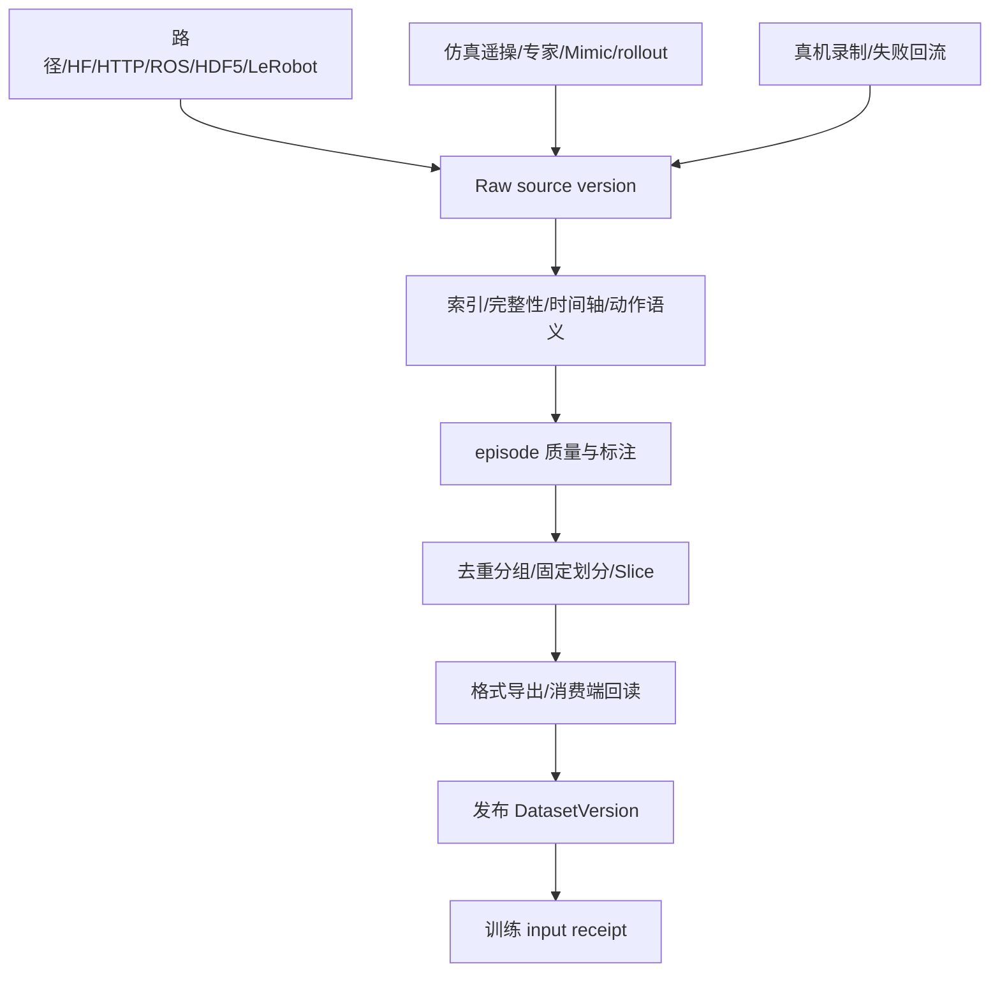

# 03 · 数据与采集设计

## 1. 目标与分层

数据管线的输出不是“下载完成的文件夹”，而是不可变来源、可查询 episode、质量证据、固定划分、训练可读版本和完整血缘。

保留六层语义，但不强迫六次物理复制：

| 层 | 含义 |
|---|---|
| L0 DataSource | 来源、revision、许可、凭据引用和只读根 |
| L1 RawArchive | 原始文件、全部尝试、失败与 manifest |
| L2 CanonicalEvent | 有时间边界的事件、接触、接管和语言 |
| L3 Scenario | 可实例化场景、随机化与成功判据 |
| L4 DatasetVersion | 校验通过、不可变、绑定接口和索引的数据资产 |
| L5 DataSlice | 固定成员、split、权重、mask 与 normalization |

机器人原生 episode 可以从 L1 直接索引到 L4；人类 ego 数据只有获得真实有效的机器人动作后才可成为训练版本，场景数量不能冒充示教数量。

## 2. Episode 最小契约

每个 episode 至少记录：

- 身份：episode/source/session/attempt、父 episode、sim/real/human/generated、机器人家族/形态/实例和接口 revision。
- 条件：Task/Scenario、seed、随机化实值、policy/controller、操作者匿名 ID、语言指令和成功判据 revision。
- 时间：每路 stream 的时钟域、时间戳、映射、帧数、有效区间、媒体 offset、标定引用。
- 语义：observation/action schema、单位、坐标系、`action_requested`、`action_applied`、`state_measured`。
- 结果：success、failure、timeout、aborted、invalid 或 unknown，终止原因、质量规则、标注 revision、许可和 split group。

`unknown != failure != invalid`。策略失败但数据完整的 episode 仍可用于评估或失败分析；缺动作、错时间或损坏的数据不得静默混入监督训练。

## 3. 时间与多模态对齐

- 仿真同时记录 physics/control/inference/render 时间；真机区分 capture、receive 和 clock domain。
- 训练时刻只能使用当时已可获得、且在 age budget 内的观测；禁止最近邻选到未来帧。
- 不同频率 stream 不要求行数相等。缺帧用 mask 表达，不能用零值伪造。
- 连续状态插值不得引入未来信息；离散动作不线性插值；姿态转换固定 frame 与四元数顺序。
- `fps` 元数据不能代替重采样。必须保留真实时间间隔、原索引和下采样方法。
- action chunk 不跨 reset；尾部 padding 或丢弃规则和 loss mask 必须显式。

每个接口定义可调的 `max_observation_age_ms` 和 `max_alignment_error_ms`。默认值只能用于诊断，发布门限需由具体任务和采集证据确定。

## 4. 质量、划分与发布

质量报告按文件、schema、时序、物理、任务、分布、消费七层给出逐规则结果；不压成一个无法解释的总分。规则结果包含版本、严重级别、对象/时间区间、observed、expected 和 evidence ref。

漏斗必须标注统计单位和分母。attempt 的互斥主结果与可重叠问题标签分开；删除失败媒体不能改变采集成功率。

划分顺序固定为：来源谱系与近重复分组 → group 级 split → train 内增广/采样 → train-only normalization。Mimic 子样本与祖先不得跨 train/test；量化 calibration 不得与最终 acceptance 或其亲缘样本重叠。

许可和用途是发布门禁的一部分。每个来源保留许可证、授权范围与人工审查证据；合并数据不抹平逐来源限制。内部研究、训练、公开分享和对外交付分别判定，不能靠重命名、压缩模型或匿名分享链接绕过限制。

发布顺序：

1. shard 独占 staging，写完 manifest 和完成标记；
2. `ebd` 校验文件、hash、schema、接口和必需 shard；
3. 原子移动到不可变位置；
4. PG 事务登记 DatasetVersion、质量、引用和血缘；
5. 用目标训练镜像的真实 loader 回读并写 `input_receipt`。

状态至少区分 `discovered`、`indexed`、`validated`、`training_ready` 和 `published`。未知格式可登记浏览，但不能显示为 0 episode 或 ready。

## 5. 来源、下载与格式

支持按实际需求实现 reader：LeRobot v2.1/v3、Isaac HDF5、ROS bag/MCAP、原始视频+状态、人类 ego manifest。内部复用原 payload 加版本化索引和 sidecar；不再发明一种全量 tensor 格式。

- LeRobot v3 按 metadata 和共享分片 offset 定位 episode，禁止猜 `episode_12.mp4` 文件名。
- 导出格式由目标模型 recipe 决定，字节布局相同不等于 feature key、norm、mask 或动作语义兼容。
- 外部 pickle、自定义 loader 和远程代码只在无凭据、无出网、受限挂载的工具容器执行。
- HTTP 每次重定向都重新做 SSRF 检查；默认拒绝 loopback、云 metadata 和未登记内网。
- HF 固定 dataset repo type 和 revision；token 只以 secret ref 注入，不写入 URL、日志或 Pipeline。
- 解压阻止路径穿越、符号链接逃逸、设备节点、文件数/字节超限和压缩炸弹。

下载由持久 Job 管理，支持 ETag/Last-Modified、Range 和断点；源变化时重建 staging，不能把完整响应追加到 partial。API `create_task` 不能承担大数据生命周期。

## 6. 采集

`CollectionRecipe` 固定机器人接口、任务/场景、来源策略、覆盖计划、记录计划、停止预算、输出条件和执行画像。每个 Session 展开为有限 shard Job；资源失败重试 shard，任务失败登记为有效 attempt。

停止条件必须同时包含目标合格数和至少一种硬上限：`max_attempts`、墙钟、GPU 小时或输出字节。预算耗尽但样本不足时状态是 `budget_exhausted`，原始数据可发布，训练 Slice 不自动成功。

三类机器人差异：

- SO101：状态机专家、示教→Mimic、policy rollout 共用 episode 和版本出口；浏览器不转发真机实时指令。
- G1 EDU：只做仿真。locomotion/操作环境先固定具体资产、控制器和接口，再接 RLinf bridge；不宣称真机能力。
- BHL：优先复用已有严格 Reach 采集协议；fixedhand、WBC/biped、ego 路径分别用适用 recipe，不把 10 维 Reach 特例推广到全部接口。

## 7. 数据工作台验收

用户必须能从版本统计下钻到固定成员、episode 和问题时间段。Episode 页面以共享游标展示多相机、状态、requested/applied action、事件、指令、质量规则和 3D；每路显示实际 PTS、age、缺帧和同步误差。

浏览器同步只是诊断预览，不宣称帧精确。精确样本通过索引读取。大列表 cursor 分页，曲线由 `ebd` 分桶保留 min/max 尖峰；浏览器不得一次加载完整 HDF5 或视频分片。

最小验收覆盖：多频传感器和未来帧检测、LeRobot v3 共享媒体、祖先泄漏、下载中断/源变化、writer 被杀、失败 attempt 分母，以及合法 episode 从导入到目标 loader 回读的闭环。
