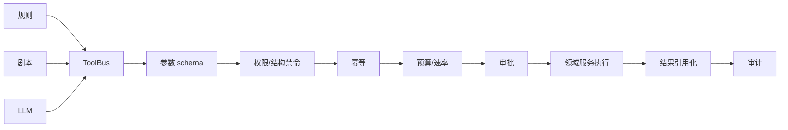

# 06 · Agent 与安全设计

## 1. Agent 只是受限用户

平台 Agent 没有特权通道。前端、规则、剧本和 LLM 最终都调用同一领域逻辑；Agent 额外受工具白名单、预算、速率、审批和审计约束。关闭或更换 LLM 不影响平台主流程。

Agent 的定位是值班与重复性操作：查询状态、容量估算、失败归类、按批准模板提交任务和生成报告。研究方向、奖励函数、真机放行和安全结论仍由人决定。

决策顺序是确定性规则 → 剧本 → LLM。能由规则可靠完成的工作不交给 LLM；LLM 输出也不获得额外权限。

## 2. ToolBus 唯一收口

工具定义是 schema、风险等级、速率、审批策略、文档和实现的单一真源。所有非只读工具必须有幂等语义；大结果保存为资源并返回 `ref_id + summary`，不把日志、媒体或大 JSON 塞进上下文。

ToolBus 的护栏必须在模型外执行。提示词中的“不要做”不是安全边界。每次调用记录 principal、session/turn、tool/version、规范化参数 hash、决策、审批、结果 ref、成本和 trace。

## 3. 结构性禁止

Agent 永久禁止：

- shell/exec、任意文件系统访问、任意 HTTP 出网、直连数据库/SQL；
- 获取 `docker.sock`、设备文件、平台密钥或任务容器逃逸能力；
- 发布或修改已发布本体接口；允许的扫描只读，草稿 clone 也必须走领域服务；
- `gate.override`、真机放行、策略远程激活或任何实时控制；
- 自定义执行器、宿主绝对路径、原始 secret、任意 URL；
- 删除被引用资产、改变已发布版本或绕开审计。

当前结构性禁令至少包含 `deploy.release`、`embodiment_env.publish`、`gate.override`。它们不能通过人工审批变为可用工具；需要的现场动作发生在平台外，并以证据导入。

## 4. 预算、审批与取消

- Session/turn 有 token、工具次数和墙钟上限；工具执行可取消，取消信号传入 Job。
- costly 工具扣减独立 GPU-hour/存储/外部模型 token 预算；预算以主体和周期持久化，不能靠内存列表。
- 低风险、受限范围的模板任务可自动执行；超出 GPU、时长、数据量或并发阈值时请求人审批。
- 审批展示 dry-run：冻结输入、资源、预计成本、写路径和影响对象。批准绑定请求 hash，修改参数后必须重新审批。
- 子任务若开放，深度与总预算共享，不能通过派生主体放大权限。

危险操作默认拒绝而非“请求确认后直接执行”。是否可审批由工具定义决定，结构性禁止项没有审批路径。

## 5. 感知、上下文与隐私

Agent 只读取结构化查询、TSDB 聚合、日志尾部/异常摘要和已登记失败知识；不能浏览任意宿主路径。上下文使用固定版本、时间范围和 ref，避免当前状态与历史证据混淆。

数据、媒体和日志沿用资产访问权限；敏感路径、token、环境变量和外部凭据不进入提示、磁带或错误信息。来自数据集、日志和模型卡的文本视为不可信内容，不能把其中指令解释为工具调用授权。

## 6. 剧本与回放

剧本是版本化、有限步骤的领域流程，不是任意 Python/shell：例如失败诊断、容量检查、数据质量日报、训练监控、评估汇总。每个分支声明输入、停止条件、允许工具和最大成本。

Agent 测试以 ToolBus 输入输出磁带为核心：固定事件和查询结果，回放规则/剧本/模型输出，断言工具序列、参数、禁止项和审计。磁带不包含 secret 或大对象，只保留 hash/ref 和必要摘要。

LLM 若使用本地 GPU，必须作为正式、可抢占、低优先级 Job 申报资源；默认使用外部托管模型时，也必须经过出网代理、隐私策略和独立 token 预算。Agent 不可常驻占用训练卡。
