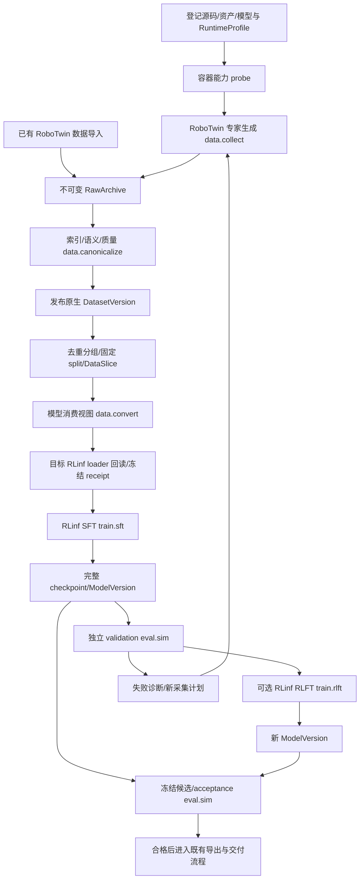

# 08 · RoboTwin 数据生成、RLinf 训练与评测接入

日期：2026-09-16，修订：2026-09-17。本文是接入设计，不代表功能已实现或已通过 GPU 实测。

遵循 [01 · 产品与领域](01-product-domain.md)、[02 · 系统架构](02-system-architecture.md)、[03 · 数据与采集](03-data-collection.md)、[04 · 模型与训练](04-model-training.md)、[05 · 评估与交付](05-evaluation-delivery.md)。本文补充 RoboTwin 的具体绑定，不降低既有不可变版本、门禁、容器化与外部仓只读约束。

## 1. 目标、范围与决策

接入两种来源：RoboTwin 已有数据的导入，以及平台调度的 RoboTwin 专家仿真生成。两者进入同一数据管线，最终由 **RLinf 完成 SFT**，注册模型并进行独立 RoboTwin 闭环评测；有单独能力证据的模型还可通过 RLinf 做 RLFT。不能用“平台启动厂商训练脚本”冒充 RLinf 训练。

用户列出的模型全部保留为目标：LingBot-VLA-2、π0.5、GR00T-N1.7、星海图 G0、原力灵机 DM0.5、Xiaomi-Robotics-1。`pi0l.5` 暂按 π0.5、`DM05` 按 DM0.5、`xiaomi-robotic-1` 按 Xiaomi-Robotics-1 解释；不自动降级到 LingBot-VLA-1、GR00T-N1.6、DM0 或 XR-0，也不把 G0 换成 G0.5。

范围假设：首期使用 RoboTwin 原生 ALOHA/AgileX 双臂，先完成一项任务，再扩任务和模型。BHL/SO101/G1 的迁移是明确的后续阶段，不声称双臂数据可直接控制它们。此假设及模型名称已向用户询问；截至本版撰写未获答复，属于可调整的范围假设，不是已确认偏好。所有模型的 RLFT、官方分数复现、真机部署均不作为数据接入完成的隐含条件。

### 1.1 方案比较

| 方案 | 得失 | 决策 |
|---|---|---|
| 在既有 Job/Run、数据资产、RLinf adapter 上增加 recipe | 生命周期一致；需要补数据绑定和模型接口 | **采用** |
| 把 RoboTwin/XPolicyLab 的训练脚本逐个包装成平台 Job | 演示较快，但训练绕开 RLinf，恢复与模型产物分裂 | 不采用；可复用其 reader、模型和转换函数 |
| 新建 RoboTwin 常驻服务及独立工作流引擎 | 重复调度、权限、存储和故障恢复 | 不采用 |

首期不建设任意任务代码生成平台、通用模型 SDK、多机调度或统一大 tensor 格式；已有 payload + 索引 + manifest 足够。六个模型独立准入，单个模型适配受阻不阻止其他模型完成管线。

## 2. 已核实的基础与缺口

### 2.1 仓内实现依据

本节针对本次读取的工作区，不把未提交改动当成干净 upstream。外部 `/data/kk/RLinf` HEAD 为 `2ae69459b1a7410add75a7e03e8ecd1c1797996f`，且 `rlinf/workers/env/env_worker.py` 有工作区修改；运行复现必须记录内容快照，不能只保存该 commit。

| 本地依据 | 已有能力 | 本次接入需要补齐 |
|---|---|---|
| `backend/eb/domain/job.py` | 已有 `data.collect/convert/canonicalize/slice`、`train.sft/rlft`、`eval.sim` | 复用 kind，以受控 recipe 区分，不新增 `robotwin.train` |
| `backend/eb/pipelines.py` | 有限顺序 steps、PipelineRun、节点幂等；绑定仅 `model_directory → inputs.base_model` | 数据版本、Slice、模型版本与 Suite 的类型化绑定；不能声称目前已经支持 map/join |
| `backend/eb/adapters/__init__.py`、`adapters/rlinf.py` | 已有栈分发、模板与挂载 | 增加受控 RoboTwin 采集分发和 RLinf 模板；不能让采集默认误入 Isaac adapter |
| `backend/eb/runners/rlinf_entry.py` | 配置解析、receipt、checkpoint/恢复出口 | 当前执行逻辑限 `pi05_libero`，需要按受控 recipe 分派；不能只加一个表单选项 |
| `backend/eb/api/routes_eval.py`、`orchestrator/collect.py` | LIBERO eval plan、case 校验和产物认领 | 复用公共协议，分离 benchmark-specific 校验，移除新路径对 `libero_` 前缀的依赖 |
| RLinf `examples/sft/config/robotwin_sft_openpi_pi05.yaml` | π0.5 RoboTwin SFT 配置；`pi05_aloha_robotwin`、14 维 action、3 路图像 | 平台 recipe、冻结数据与真实 loader 回读、4 卡以内资源实测 |
| RLinf `rlinf/envs/robotwin/robotwin_env.py` | RoboTwin VectorEnv、观测提取、seed 管理、rollout | 固定 case 调度、终止/步数核验、三相机/动作映射和完整 receipt |
| RLinf `rlinf/models/__init__.py` | 已注册 `gr00t_n1d7`，以及旧 `lingbotvla`、`dexbotic_dm0` | 注册名不证明新版本或 RoboTwin 任务可运行 |
| RLinf `rlinf/workers/sft/fsdp_vla_sft_worker.py` | OpenPI、旧 Lingbot 等 SFT loader 分支 | 当前无 GR00T SFT loader 分支；VLA SFT 内置 validation output 也未实现，需独立 validation Job |
| RLinf `rlinf/models/embodiment/gr00t/simulation_io.py` | N1.7 有 LIBERO/ManiSkill/Isaac 映射 | 当前无 RoboTwin 映射，须实现后再做 closed-loop probe |

另外，本地 `examples/sft/train_vla_sft.py::validate_berkeley_sft_paths` 直接访问 `actor.model.openpi.config_name`，非 OpenPI recipe 必须在受管入口消除该假设，不能直接重用入口后期待 LingBot/GR00T 自动通过。修正放在平台维护的扩展或受管派生源码中，禁止写 `/data/kk/RLinf`。

### 2.2 上游版本边界

RoboTwin 当前主线的采集输出已采用 XPolicyLab HDF5，旧版原始 HDF5 的布局不同；官方同时提供 LeRobot v2.1/v3 转换。RLinf 文档指向 RoboTwin `RLinf_support` 分支。两者不能仅因都叫 RoboTwin 2.0 就视为同一环境。[官方采集说明](https://robotwin-platform.github.io/doc/usage/collect-data.html)、[RLinf RoboTwin 指南](https://rlinf.readthedocs.io/en/latest/rst_source/examples/embodied/robotwin.html)

每条 recipe 固定一个兼容元组：

```text
RoboTwin 内容快照 + RLinf 内容快照 + 平台扩展快照
+ 资产 manifest + embodiment/controller/camera 配置
+ planner/SAPIEN/CUDA/渲染依赖 + 模型依赖 + image digest
+ source schema + converter revision + ModelRecipe revision
```

分支名只用于发现，提交时解析为内容身份。首个 RLinf 闭环优先固定 `RLinf_support`；其采集入口若不满足完整 attempt 记录，就增加受控采集 wrapper，而不是假定主线命令在该分支可用。主线/XPolicyLab 数据仍可作为另一来源导入，需验证语义和环境绑定后用于训练。生成、训练与评测可以有不同镜像，但接口/任务的一致性必须有证据。

RoboTwin 分支 README 与 RLinf 文档对部分任务的支持清单已有差异，例如 `place_fan`。目录以锁定快照内的任务注册、reward/success 函数和 probe 为准，不硬编码“全部 50 项已支持”。[分支支持说明](https://github.com/RoboTwin-Platform/RoboTwin/blob/RLinf_support/README.md)

## 3. 端到端管线与职责



图中的失败反馈是创建有新身份、新预算的下一次采集/Pipeline，不是在一个 Pipeline 内无限循环。acceptance 数据/场景的失败不直接回流本轮训练。若据此改进，必须声明该 acceptance 已被用于开发，另建独立最终套件。

| 组件 | 职责 |
|---|---|
| API / 控制面 | 鉴权、受控表单、版本解析、门禁、Pipeline/Job、元数据与血缘事务 |
| `ebd` / Rust | 路径与快照、GPU 租约对应设备、容器、日志、大字节传输、hash、原子发布、重认领 |
| RoboTwin 工具容器 | 专家规划/重放/记录、attempt 清单、仿真 probe；无平台密钥与 docker.sock |
| 数据工具容器 | HDF5/视频读取、索引、质量、转换、normalization；只写本 Run staging |
| RLinf 任务容器 | 实际 loader、SFT/RLFT、模型与 optimizer、checkpoint；受控扩展在 worker 内运行 |
| RLinf 评测容器 | 使用同一模型处理链和 RoboTwin bridge，输出固定 case 证据；不伪装成 TrainJob |

没有新的常驻服务。依旧 `make up` 部署平台、`make images` 构建任务镜像；只有 `ebd` 持有 `docker.sock`，Redis 仍为 6380。

## 4. 上游资产与本体接口

### 4.1 资产清单

登记 RoboTwin 源码、机器人模型、objects、textures、task 配置、planner 配置和语言模板。模型基座、tokenizer、视觉/深度 teacher 分开登记。下载复用持久 Job 和允许源；在隔离工具容器完成，记录 repo type、resolved revision、文件 hash、许可及用途，不在训练中临时联网下载。

仿真资产登记为既有 `DatasetVersion` 的 `usage=sim_asset`，用 asset manifest 说明内容类型，不伪造 episode 数；benchmark case/seed 集另为 `usage=eval`，二者可共享相同不可变资产文件。数据来源、代码、资产和权重的许可分别记录，衍生版本继承限制。

### 4.2 RoboTwin 接口

新增独立的 RoboTwin 双臂家族，并按官方五种 asset 分别建立草稿本体/接口；首期为 `emb_robotwin_aloha_agilex`、`ee_robotwin_aloha_joint14_v1`，随后是 Piper、Franka-Panda、ARX-X5、UR5-WSG。它们不能共享一个笼统的 `robotwin` 接口。上述是拟议 ID；每个接口发布前必须填写并验证完整通道，本文不发布 YAML，也不修改任何 BHL 接口。

| 项 | 必须冻结的内容 |
|---|---|
| 身份 | 实际 robot asset hash、机械结构与控制器；`ROBOT_PLATFORM=ALOHA` 只是上游运行选择，不是资产等价证明 |
| 原生 joint profile | 左 6 关节、左夹爪、右 6 关节、右夹爪的有序 14 通道；具体名称来自资产；夹爪逻辑通道与指节 DOF 分开 |
| 状态/动作 | measured qpos 与 requested joint target 区分；absolute/delta、rad/m、夹爪方向/范围、scale、限位和 applied action 来源 |
| 图像 | head、left_wrist、right_wrist 三个逻辑视角；RGB 顺序、分辨率、内外参、帧时间与缺失策略 |
| 时间 | physics dt、控制周期、保存采样周期、策略调用周期、chunk 预测长度及实际执行长度分别记录 |
| 末端 | 左右 TCP、base/world frame、位置单位、旋转表示；用于需要 EEF 的模型和回读检查 |

14 维是候选 ALOHA joint profile，不是所有 RoboTwin 或 VLA 的统一维度。Piper、Franka-Panda、ARX-X5、UR5-WSG 的维度和通道顺序必须从固定 asset/config 和样本 probe 取得，禁止按机器人商品名猜测。频率不能从 `save_freq=15` 推测为 15Hz，也不能照搬 BHL 的 20/25/50Hz。容器 probe 必须输出采样时间、控制器解释和单通道测试证据；缺实值时 Gate 1/2 阻断正式训练。

本地 `robotwin_adjust_bottle.yaml` 的基础配置含 `piper,piper,0.6`、单头相机等设置；最终由 Hydra defaults/override 解析后的配置决定实际资产与相机。不能把基础配置或 `action_dim=14` 当作 ALOHA 三相机已经一致。若最终资产确为 Piper，登记独立接口和映射，不借用 ALOHA 的 ID。

joint→EEF 可以用固定机器人资产、base transform 和 FK 派生，但 measured state 与 action target 要分别变换，保留来源标记及误差报告。EEF→joint 必须绑定可达性、IK、碰撞与控制器；不可仅截取向量。不存在的身体部位只有在模型官方 mask/固定值约定允许时才能填充，不能把填充当成测量。

### 4.3 Task 与 Scenario

Task 绑定具体任务类、成功函数、失败/超时规则、允许接口和 reward revision；Scenario 固定物体/材质、初始分布、相机、光照、桌面、语言模板及随机化参数。`demo_clean` 与 `demo_randomized` 是不同 revision，必须保存展开后的配置及实际随机化值。

首个工程验证采用 `adjust_bottle + joint14 + 三相机 + π0.5`；若锁定元组 probe 不通过，保持 blocked 并修复该元组，不静默替换本体或减少相机。跨任务训练时保存明确的 Task 成员集合；复用既有 task spec 表达有限多任务配方，不把首项任务 ID 冒充整个数据集。

## 5. 数据生成与导入

### 5.1 CollectionRecipe

recipe 包含：源码/资产/runtime 引用、接口、task/scenario 成员、专家/planner revision、种子计划、语言计划、记录模态、每项目标数、有限 shard 列表和预算。目标数按 task × scenario × embodiment 分配，不能以容易任务的富余数抵消困难任务缺口。

硬上限至少有 `max_attempts`、`max_wall_time`、`max_output_bytes`；GPU-hour 可附加。seed 计划在运行前冻结到具体列表，各 shard 不相交；不同进程不能都从 seed 0 开始。重试延用原 attempt 身份，改变计划则新建采集运行。

RoboTwin 专家生成包含 seed 搜索/规划与轨迹重放两阶段。[主线采集器](https://github.com/RoboTwin-Platform/RoboTwin/blob/main/scripts/collect_data.py) 以成功数为循环条件，因此平台必须在阶段边界增加持久 attempt 记录、预算检查与取消检查，不能直接依赖上游成功目录统计。

```text
冻结 plan → attempt started 持久化 → seed/场景初始化
→ expert 规划 → 检查成功与限位 → 重放/记录
→ 逐 episode 完整性校验 → attempt terminal 持久化
→ 满足目标或硬预算停止 → shard manifest → 汇合/发布
```

每次尝试记录 `attempt_id, generation_plan_hash, shard_id, seed, task/scenario/interface_ref, phase, outcome, reason, timestamps, output_refs`。互斥结果为 success、task_failure、timeout、invalid、infra_failed、aborted；规划成功但重放失败不能计为成功 episode。基础设施重试是同一逻辑尝试的不同 execution，不虚增任务成功率分母；同时展示物理执行次数。

取消与崩溃保留已提交 episode 和 attempt 元数据；半写文件停留在 staging。Run 重试创建新目录，已完成 episode 通过不可变 manifest 引用复用，不能只凭文件名存在跳过。每个 shard 独占 `seed.txt`、轨迹缓存、场景和 instruction 输出；禁止多个 writer 共写上游 `data/`。

预算不足时 CollectionSession 记 `budget_exhausted`；沿用现有 Job FSM，生产 Job 为 failed 并带该 reason，Pipeline 停止自动下游。已验证原始片段可独立归档，不能当成目标已经完成。用户若接受不足的数据量，需显式派生新 Slice/新 Pipeline，不能修改原计划目标。

### 5.2 已有数据来源

接受受管根内的快照、登记的只读路径、固定 revision 的 HF 数据集，以及经过允许源校验的下载。分别识别旧版 RoboTwin HDF5、当前 XPolicyLab HDF5、已转换 LeRobot 和厂商派生格式；不能只按目录或扩展名识别版本。

reader 在工具容器扫描实际 keys、dtype、shape、时间轴、编码图像和语言 sidecar，输出 `source_schema_id + revision + detected_features`。reader 不匹配则保存 raw 并标 `unsupported_schema`，不默认为空数据集。外部数据缺少失败尝试时 `attempt_count=unknown`，不能从成功 episode 反推出 100% 生成成功率。

外部数据不完整的 action/time/asset provenance 作为具体质量缺口；允许浏览和补充有来源的元数据，禁止伪造。训练用途仅在相应 recipe 所需语义齐全时开放。预收集数据与自己生成的数据可混合，但必须保留各来源权重、许可和基座模型可能已见该数据的说明。

### 5.3 现有 RoboTwin 数据目录与原生本体

截至 2026-09-16，[官方 RoboTwin2.0 数据仓](https://huggingface.co/datasets/TianxingChen/RoboTwin2.0)在 50 个任务目录下发布按本体和场景组织的轨迹压缩包。[当前主线本体配置](https://github.com/RoboTwin-Platform/RoboTwin/blob/main/env_cfg/task_config/_embodiment_config.yml)登记五种仿真本体：`aloha-agilex`、`piper`、`franka-panda`、`ARX-X5`、`ur5-wsg`。下表是平台需要登记的数据族，不把相同轨迹的不同封装重复计算为新数据。

| 数据族/常见文件名 | 场景与标称规模 | 原生本体 | 可直接监督/闭环的本体 | 其他本体的用途 |
|---|---|---|---|---|
| `aloha-agilex_clean_50.zip`、`aloha-agilex_randomized_500.zip` | clean 50、randomized 500 条/任务 | RoboTwin ALOHA/AgileX 双臂 | **仅同一 RoboTwin ALOHA/AgileX asset、控制器和接口 revision** | 可进入支持本体标签/mask 的跨本体联合预训练；不能直接作为 Piper、Franka、ARX-X5、UR5、R1、G1、SO101 或 BHL 的动作监督 |
| `piper_clean_50.zip`、`piper_randomized_500.zip` | 同上 | RoboTwin Piper 双臂 | **仅同一 RoboTwin Piper 接口 revision** | 同上；即使也是双臂、维度碰巧相同，也必须使用 Piper mapping，不能冒充 ALOHA |
| `franka_clean_50.zip`、`franka_randomized_500.zip` | 同上 | RoboTwin Franka-Panda 双臂 | **仅同一 RoboTwin Franka-Panda 接口 revision** | 可提供视觉/任务先验；对其他本体的动作 loss 必须 mask，或先完成有回放证据的 retarget |
| `arx-x5_clean_50.zip`、`arx-x5_randomized_500.zip` | 同上 | RoboTwin ARX-X5 双臂 | **仅同一 RoboTwin ARX-X5 接口 revision** | 同上；不能因 DM0.5 另有 ARX checkpoint 就把该 checkpoint 或数据视为 ALOHA 兼容 |
| `ur5_clean_50.zip`、`ur5_randomized_500.zip` | 同上 | RoboTwin UR5-WSG 双臂 | **仅同一 RoboTwin UR5-WSG 接口 revision** | 同上；WSG 夹爪和 UR5 关节顺序必须独立登记 |
| 每任务 `demo_clean.zip` | 当前官方标准下载别名 | 当前仓内归一到 `data/demo_clean/<task>/aloha_agilex`，因此按 ALOHA/AgileX 登记 | 与对应 ALOHA clean 源相同 | 是别名/重打包，去重后不能跨 split，也不能算新增示教 |
| `RoboTwin_lerobot_v21.zip`、`RoboTwin_lerobot_v30.zip` | 官方 LeRobot v2.1/v3.0 转换包 | **由包内 metadata 和样本 manifest 决定**；不得从 `LeRobot` 名称推断本体 | 只有 probe 证明与某一上述原生接口一致时，才对该接口直接可用 | 格式转换不改变本体；v2.1/v3.0 也不是两个新的本体数据集 |
| `Dexmal/robotwin2-full` | clean/randomized，JSONL + 三路视频 | 官方 OpenDM profile 明确为 ALOHA RoboTwin2、14 维 state/action、absolute joint | ALOHA/AgileX；并且只对匹配 OpenDM 字段/norm 的 recipe 直接可用 | 是 DM0.5 消费视图，不获得对其他本体的直接动作兼容性 |

`clean_50` 和 `randomized_500` 是发布命名/目标规模，实际登记仍以固定 HF revision 的文件树和逐包 episode manifest 为准；不能假定每个任务、每个本体、每个 revision 都恰好有 50/500 条。导入前枚举真实对象并记录 `missing/partial/present`。任务目录当前共 50 个：

```text
adjust_bottle, beat_block_hammer, blocks_ranking_rgb, blocks_ranking_size,
click_alarmclock, click_bell, dump_bin_bigbin, grab_roller, handover_block,
handover_mic, hanging_mug, lift_pot, move_can_pot, move_pillbottle_pad,
move_playingcard_away, move_stapler_pad, open_laptop, open_microwave,
pick_diverse_bottles, pick_dual_bottles, place_a2b_left, place_a2b_right,
place_bread_basket, place_bread_skillet, place_burger_fries, place_can_basket,
place_cans_plasticbox, place_container_plate, place_dual_shoes, place_empty_cup,
place_fan, place_mouse_pad, place_object_basket, place_object_scale,
place_object_stand, place_phone_stand, place_shoe, press_stapler,
put_bottles_dustbin, put_object_cabinet, rotate_qrcode, scan_object,
shake_bottle, shake_bottle_horizontally, stack_blocks_three, stack_blocks_two,
stack_bowls_three, stack_bowls_two, stamp_seal, turn_switch
```

平台中的目录键为 `(source_revision, task, scenario, native_embodiment, interface_revision, schema_revision)`。同任务同场景但不同本体是不同 DatasetVersion 或明确分组的成员，不能仅以 task 名合并 action；同一原始轨迹的 HDF5、LeRobot、JSONL/视频只是有血缘的派生 view。

### 5.4 “数据适配本体”的判定

“跨本体模型能读取”不等于“这份数据直接适配目标本体”。平台按以下三级记录，训练提交时显示具体等级：

| 等级 | 含义 | 可做的训练 |
|---|---|---|
| `native_direct` | 数据的 robot asset、state/action 通道、单位、frame、控制器、相机和时序与目标接口一致 | 可做目标本体动作监督，并在同接口闭环评测 |
| `cross_embodiment_prior` | 模型明确支持多本体标签、独立 normalization 和有效维 mask；数据保持其原生本体身份 | 可与目标本体数据联合训练视觉、语言、任务或多本体策略先验；该样本的动作 loss 只属于原生本体 |
| `retargeted_verified` | 有版本化 FK/IK/坐标/夹爪/可达性转换，并在目标仿真完成逐轨迹 replay/碰撞/成功语义验证 | 可作为新的目标本体派生 DatasetVersion；保留源数据与误差血缘 |

不满足以上任一项就是 `incompatible`。补零、截断、相同 action 维度、换成 LeRobot、模型宣称 generalist，均不能提升等级。对 BHL、Galaxea R1 Lite/Pro、Unitree G1、SO100/101 及其他非 RoboTwin 五本体，当前这些数据最多先登记为 `cross_embodiment_prior`；没有目标本体数据或经验证 retarget 时，禁止作为其直接动作监督。

## 6. 数据契约、划分与训练视图

### 6.1 原生数据与 sidecar

保留原始 HDF5/媒体；平台加版本化索引和 sidecar，不先统一成某个模型的 feature。每个 episode 继承 03 的契约，并增加 RoboTwin 源码/资产、planner、seed、任务配置、成功检查、相机以及原始字段映射。没有真实 `action_applied` 时明确 absent，不能复制 requested action 冒充。

发布产物最少包括：

| 产物 | 内容与验证 |
|---|---|
| raw manifest | 文件路径/hash/大小、源码/资产/来源、attempt 账本、完成标记 |
| episode index | episode 与 payload/媒体 offsets、有效时间、Task/Scenario、语义与质量引用 |
| mapping manifest | 源字段→逻辑通道、单位、frame、时间偏移、FK/重采样/图像处理及版本 |
| quality report | 文件/schema/时序/物理/任务/分布/消费逐规则结果；缺失、NaN、越限及区间 |
| split manifest | 固定 episode/group 成员及用途，语言 split、去重算法/阈值和重复组 |
| view manifest | 输入 Slice、ModelRecipe、转换器、输出格式/keys、mask、norm、样本与行映射 |

每份 manifest 均有 schema version、producer Run、输入 hash 和内容 hash。大索引在受管分片中，PG 只存可查摘要；媒体预览走 `ebd`，FastAPI 不打开 HDF5/视频。

### 6.2 时间与动作对齐

首先验证 `observation(t) → action(t..t+H)` 的因果关系，不把 `qpos[t+1]` 默认当专家命令。上游轨迹若仅存状态，需要对应记录器代码和 replay 验证证明它能形成哪种训练标签；不满足的用途拒绝。

相机按 capture/仿真时间对齐，不取未来帧；压缩图像先验证可解码、RGB 布局与时间跨度。`frame_index / fps` 仅在固定采样证据充分时可重建时间，并记录 derivation；否则时间 unknown。降采样、重复帧、尾部 padding 与 loss mask 写入 view，chunk 不跨 episode、reset 或不同语言段。

EEF view 额外检验 FK/旋转连续性和坐标系；动作反归一化后的夹爪、关节和末端回放都要核验。无效模态不能简单填零后训练；模型支持的 missing mask 和确实存在的静止零值分开。

### 6.3 Split 与污染防护

顺序固定为祖先/近重复分组 → group 级划分 → train 增广/采样 → train-only normalization。group 至少含原 episode 祖先、场景实例/seed lineage；同一轨迹的语言改写、主线/分支再导出、不同分辨率和转换副本不能跨 split。相同 seed 在不同环境不必相同场景，但重放亲缘及配置派生仍需归组。

五类用途分别冻结：`train`、`validation`、`rl_rollout`、`calibration`、`acceptance`。RL rollout 可来自训练分布，但不得使用 acceptance case；validation 不进入 optimizer，calibration 不与 acceptance 亲缘重叠。上游 seen/unseen 指令分别记录，不能把 unseen 文本经增广混入 seen-only 训练。指令自动生成如需 LLM，应独立受控 Job，不从采集容器任意出网。

统计报告保留每 task、clean/randomized、来源、相机、时长、success/failure、split 的计数。SFT 默认取质量合格的成功专家 episode；失败轨迹只进入明确支持失败标签/纠正学习的 recipe，不能把失败策略动作当成功示教。

### 6.4 训练消费视图

一个原生版本可派生多个 view，但仅生成实际模型需要的格式。优先复用官方 reader/转换器；LeRobot 是共享候选，**不强迫全部六模型使用同一 LeRobot 版本**。DM0.5 和 XR-1 可以保留其官方 JSON/视频消费布局，通过相同 Slice 索引追溯。

首个 π0.5 view 选择本地 `LeRobotAlohaDataConfig` 声明的 **LeRobot v2.1**，冻结 `observation.state`、`action`、`observation.images.cam_high/cam_left_wrist/cam_right_wrist`、任务文本、episode boundary 与 norm asset ID。v3 来源通过真正转换得到 v2.1 view；以后直接使用 v3 必须有新 loader 回读证据，不能修改 metadata 版本号伪装兼容。norm 在 train split 计算；基座自带统计若要沿用，必须作为显式 `norm_source=base_model` 记录并验证，而不是静默回退。

数据图像与标注重排必须输出逐样本来源映射。归一化统计在该模型实际使用的动作空间中计算：先按固定顺序完成单位/通道/坐标变换及模型要求的 relative/delta 变换，再统计；推理执行严格逆变换。不能用 absolute joint 的统计去归一化 delta action，也不能对已变换的 view 再应用一次 delta。

view 的身份为 `(Slice hash, model recipe revision, converter snapshot, interface/mapping hash, preprocessing, normalization, format revision)` 的规范化 hash。image digest 和 loader probe receipt 另绑定消费能力；升级任一语义因素产生新 view/能力证据。

原生 DatasetVersion 的 `published` 表示不可变发布，不能推出所有模型都 `training_ready`。`training_ready` 按 `(version/Slice/view, recipe, runtime)` 的兼容性记录，必须完成目标容器内真实 loader probe；正式 train Job 在启动时重新核对同一 receipt。view 以派生 DatasetVersion/Artifact 复用现有实体，DataSlice 的主成员保持不变。

probe 至少读取首尾窗口、多任务/各来源样本、短 episode 和 chunk 尾部；检查实际 batch feature、mask、采样成员、dtype、有限值、norm 和输入路径。输出可核实 sample IDs 及 tensor 摘要，不能只验证文件存在。六模型的对比使用相同来源成员；若模型因模态过滤掉成员，显示其有效成员差异，不能仍声称同数据公平对比。

## 7. 六个模型的 RLinf 接入

### 7.1 能力矩阵（调研结论，非运行验收）

| 指定目标 | 核实依据 | RLinf 现状与需补工作 | 首次能力目标 |
|---|---|---|---|
| π0.5 | 本地已有 RoboTwin SFT/PPO/eval 配置 | 复用 `openpi`；补平台 recipe、数据/norm 注入、非 LIBERO runner 和完整评测 | SFT + closed_loop_eval；随后 PPO RLFT |
| LingBot-VLA-2 | 官方独立 v2 仓、RoboTwin 数据映射和 checkpoint [M1] | 本地 `lingbotvla` 是旧版；增加 v2 独立 builder、loader、loss、processor 和 policy bridge | SFT + closed_loop_eval；RLFT 另验 |
| GR00T-N1.7 | 官方 `n1.7-release` [M2]；本地 `gr00t_n1d7` | 复用 N1.7 builder；补 SFT loader/loss 路径、双臂 modality/tag、RoboTwin obs/action 映射 | SFT + closed_loop_eval；RLFT 需重新验 |
| 星海图 G0 | `OpenGalaxea/G0-VLA` 权重卡 [M3]；GalaxeaVLA 的历史 G0 代码 | 本地未发现相应 builder；锁定 G0 历史源码/配置而非当前 G0.5 main；接入 action expert loss 与双臂 I/O | SFT + closed_loop_eval；全套高层 planner 能力单列 |
| 原力灵机 DM0.5 | OpenDM 的 DM05、RoboTwin2 SFT/评测资料 [M4] | 本地 `dexbotic_dm0` 不能代替 DM0.5；新增 OpenDM 模型/loss/loader 与 RoboTwin profile | SFT + closed_loop_eval；优先探测小显存可行微调方式 |
| Xiaomi-Robotics-1 | 官方 XR-1 post-training 代码、5B checkpoint 与数据协议 [M5] | 本地未发现 XR-1 builder；增加 EEF/状态/异步 chunk 处理、loss/loader、推理 bridge | SFT + closed_loop_eval；RLFT 另验 |

“未发现”限于本次本地 RLinf 扫描，不断言上游永远不支持。六者均须有独立验收 Run；旧模型可作为工程诊断基线，但不能勾掉指定版本的完成项。

来源：

- [M1 · LingBot-VLA-2 官方仓](https://github.com/Robbyant/lingbot-vla-v2)、[RoboTwin feature mapping](https://github.com/Robbyant/lingbot-vla-v2/blob/main/configs/robot_configs/robotwin.yaml)。
- [M2 · GR00T N1.7 官方分支](https://github.com/NVIDIA/Isaac-GR00T/tree/n1.7-release)、[官方权重卡](https://huggingface.co/nvidia/GR00T-N1.7-3B)。
- [M3 · G0-VLA 权重卡](https://huggingface.co/OpenGalaxea/G0-VLA)、[GalaxeaVLA 官方仓及版本历史](https://github.com/OpenGalaxea/GalaxeaVLA)。
- [M4 · OpenDM](https://github.com/dexmal/opendm)、[DM05 RoboTwin2 训练与评测](https://github.com/dexmal/opendm/blob/main/docs/en/dm05_robotwin2.md)。
- [M5 · XR-1 post-training](https://github.com/XiaomiRobotics/Xiaomi-Robotics-1/blob/main/xr1/README.md)、[XR-1 数据协议](https://github.com/XiaomiRobotics/Xiaomi-Robotics-1/blob/main/xr1/docs/data_format.md)。

#### 7.1.1 跨本体能力与现有数据可用范围

跨本体能力拆成三件事分别取证：模型曾用多种本体训练、架构能为新本体建立独立 profile、具体 checkpoint 能否在目标本体零样本或微调后闭环。前两项不能推出第三项；GR00T N1.7 官方 FAQ 也明确否定“新本体无需微调即可可靠工作”的一般假设。

| 模型 | 跨本体性质 | 当前有官方/本地依据的 RoboTwin 数据族 | 其余四个 RoboTwin 原生本体 | 非 RoboTwin 本体 |
|---|---|---|---|---|
| LingBot-VLA-2 | **架构与预训练支持跨本体**；内部统一表示仍依赖每本体 robot config | 官方 RoboTwin config 是三相机、14 维双臂映射，先只准入经 probe 识别的 ALOHA 数据族 | `conditional`：为 Piper/Franka/ARX-X5/UR5 分别增加 robot config、norm、mask、解码和闭环 probe 后可用 | `conditional`；必须有目标本体 profile 和目标数据/verified retarget，不能把 55 维内部表示当万能控制接口 |
| π0.5 | **多本体基座，可适配；不承诺新本体零样本控制** | 当前 RLinf `pi05_aloha_robotwin` 与 OpenPI ALOHA 14 维 transform 只直接覆盖 ALOHA 数据族 | `conditional`：每种本体新增 DataConfig、输入/输出 transform、norm 与环境 bridge | 同左；当前对 BHL/R1/G1/SO101 均无直接 RoboTwin 动作监督 |
| GR00T-N1.7 | **明确的 cross-embodiment 模型**，以 embodiment tag/modality config 区分 | 当前没有 RoboTwin 专用 tag、SFT loader 和 bridge，因此五个数据族均未到 `native_direct` | `conditional`：五种本体分别建 tag/config；不得共用 `NEW_EMBODIMENT` projector 冒充同一物理本体 | 支持新本体微调路径；具体 checkpoint 是否能运行仍由目标数据和闭环结果决定 |
| 星海图 G0 | **有限跨本体**：Stage 1 做跨本体表征预训练；Stage 2/动作后训练依赖统一的 Galaxea R1 Lite 本体，官方材料显示本体专用阶段更关键 | G0 没有公开的 RoboTwin profile；五个数据族均不可直接训练其 R1 动作头 | 可作为研究性的预训练来源；要做 RoboTwin 动作模型，必须为每一本体新增官方等价 action view 与 bridge | R1 Lite 是其原生动作目标；R1 Pro/G0.5 的 RoboTwin 能力不能回填给 G0，其他本体均需新适配 |
| 原力灵机 DM0.5 | **架构支持 multi-embodiment robot control**，profile 按 robot type/state description 分离 | `Dexmal/robotwin2-full` 和 `DM05-robotwin2` 明确直接覆盖 ALOHA RoboTwin2 14 维 absolute joint | `conditional`：Piper/Franka/ARX-X5/UR5 各自登记 robot type/state desc/norm 并验证；ARX RoboDojo checkpoint 不是 RoboTwin ARX 数据兼容证明 | 可微调到 SO101、ARX 等已有示例本体；BHL/R1/G1 仍需各自 profile、数据与闭环证据 |
| Xiaomi-Robotics-1 | **预训练为 embodiment-free，后训练明确使用 cross-embodiment data** | 官方仓当前没有 RoboTwin adapter；五个数据族均未到 `native_direct` | `conditional`：需为每种本体生成其要求的 joint/EEF/夹爪语义、60 维相对 action view 和控制 bridge | 可做跨本体 post-training，但目标本体仍需完整 mapping、数据或 verified retarget；补零到 60 维不算适配 |

因此，首期可执行矩阵只有三条“数据族 → 模型”直接路径：ALOHA 数据 → π0.5、ALOHA 数据 → LingBot-VLA-2、`Dexmal/robotwin2-full` → DM0.5；它们仍要经过本文规定的 loader/replay/闭环门禁。GR00T-N1.7、G0、XR-1 以及其余四种 RoboTwin 本体先保持 `conditional/blocked`，完成独立 mapping 后逐项升级，不能用模型的跨本体宣传一次性放开整张矩阵。

### 7.2 必须保持的模型差异

**π0.5**：使用 `pi05_aloha_robotwin` 对应的 repack、图像、动作转换和 normalization，不能沿用 `pi05_libero` 的单臂 action 或 norm 路径。本地配置启用 `extra_delta_transform=True`，只对左右关节取相对当前 state 的 delta，夹爪保持 absolute；`adapt_to_pi` 对齐规则及输出逆变换一并冻结，必须通过单通道往返/replay 验证。预测 chunk、执行 horizon 和尾部 mask 从 recipe 冻结；上游示例 batch/GPU 数不是本机默认值。

**LingBot-VLA-2**：官方使用 55 维模型内部表示，RoboTwin mapping 分别取左右 6 关节与夹爪，图像为顶视与两腕。这只是模型内部映射，环境仍保持其原生接口。v2 的视觉 backbone、native depth、teacher、MoE 辅助项及 optimizer 依赖必须按所选配置冻结。不能把 v1 Qwen2.5 的 wrapper 改个名称继续用；辅助 future supervision 不得泄漏到推理输入。官方 FP32/BF16 评测差异也要求 precision 纳入比较条件。[M1]

**GR00T-N1.7**：modality 配置、embodiment tag、processor、state/action 分组和训练 loss 均须匹配 N1.7 代码。RoboTwin 双臂不能走 LIBERO 7 维 action 路径；recipe 级 LoRA/冻结策略必须实际支持，不沿用 N1.5 的假设。[M2]

**G0**：首期 SFT 范围是 G0-VLA 动作模型；若使用完整双系统，必须额外绑定高层 planner、子任务文本/边界和其更新频率，不能由 RoboTwin 成功标签臆造 reasoning/subtask 标注。先探测历史 G0 的官方数据 key、动作语义与可微调模块，再发布 profile。权重卡的使用许可与当前仓库代码许可分开核验；G0Plus/G0.5 的能力不转移给 G0。[M3]

**DM0.5**：官方 RoboTwin profile 是三相机、14 维状态/绝对关节动作，JSONL/视频与 norm 一起使用。复用 reader 和 loss；关闭运行时向源码目录自动写 norm 的行为，改为消费 train-only 冻结统计或写受管转换输出。官方完整训练参考配置为多节点大 batch，不作为 4×4090 可运行承诺；本地 LoRA/冻结微调是独立 recipe，需先验证 OpenDM 与 RLinf 的兼容性。[M4]

**XR-1**：官方数据包含三路视频、左右关节/夹爪/EEF 位姿，并将动作转换成带保留位的 60 维相对动作 chunk，统计含 chunk 位置维。不能把 joint14 补零为 60 维。需固定 FK/TCP、旋转矩阵/轴角、相对动作参考时刻、缺失 waist/base 的官方语义，以及从预测 EEF 经控制器执行的路径。异步 action prefix、延迟采样与状态重置是 recipe 的一部分；先以明确的同步 profile 验证可行性，若改动官方异步训练配置需单独记录，不能当作官方等价复现。[M5]

每个未定 profile 的发布前置物是：官方源码/权重确切 revision、字段 mapping manifest、至少一条可回放样本、loader/forward/backward/checkpoint/闭环证据。缺任何一项显示具体 blocked reason，不用待填参数进入正式队列。

### 7.3 RLinf 扩展边界

RLinf 的逐文件补丁面、模型目录、Hydra 配置和 smoke 文件以 [`../rlinf/01-robotwin-multimodel-sft.md`](../rlinf/01-robotwin-multimodel-sft.md) 为准。本节只定义平台与 RLinf 的稳定边界，避免同一文件清单在两处漂移。

平台维护最小补丁集，随任务镜像和代码快照发布；外部 RLinf 与模型仓均只读。镜像构建复制固定 RLinf 快照并应用补丁，记录 upstream revision、完整内容 hash、补丁 hash、依赖 lock 和最终镜像 digest。不得直接写 `/data/kk/RLinf`，不得运行期 monkeypatch，也不得从训练容器下载模型或依赖。模型必须先下载到 `/data/kk/models/<model-id>/<revision>/`、完成 manifest/hash 注册，再以相同绝对路径只读挂载。

| 扩展点 | 契约 |
|---|---|
| model builder | 加载精确模型、processor、norm；缺分片/错误版本硬失败；登记可训练参数集合 |
| SFT loader | 只读 view，使用冻结成员/采样器，返回模型实际 batch 和 mask；rank 分片与游标可追溯 |
| SFT forward | 支持 RLinf `ForwardType.SFT`，返回可微分 loss 与明确归约指标；保留所选原生目标和辅助 loss |
| policy inference | 将标准逻辑观测映射到该模型，解码成接口声明的动作，明确 chunk 有效长度；reset 清理历史/prefix |
| RLFT | 独立实现目标算法需要的 log-prob/value/reward/trajectory mask 与梯度路径；纯 inference server 不构成 RL 支持 |
| checkpoint | 保存模型、processor/norm、可训练模块及 RLinf trainer state；可重新装载，模型注册只认完整 manifest |

**训练循环、分布式 worker、optimizer step、checkpoint 与恢复必须归 RLinf 管理。** 厂商 Trainer、Lightning/VeOmni 训练主循环不能被藏在扩展里另起训练。复用原生数学 loss 可以，改换 loss/optimizer/异步目标必须成为有对照验证的新 recipe。

公共改动坚持最小范围：注册模型、分派 builder、分派 SFT loader；现有 `SFTRunner`、通用 FSDP SFT worker、optimizer 和 checkpoint 默认复用。FSDP wrap 或参数组只有真实模型加载证明现有能力不足时才做窄分支。π0.5 作为不改通用训练循环的基线；其余模型逐个加入，不建设第二套通用训练框架。

每个模型先做相同输入/seed 的原生函数与 RLinf wrapper 对照：预处理张量、loss 分项、梯度非零、更新后参数、动作解码、保存/重载。数值容差由 dtype/算法预先写入 recipe，不能看到误差后放宽。

分布式 loss 按全局有效 token/action 数归约，尾部 padding、缺失通道和不同 rank 的有效长度不能改变样本权重；保留官方模型特有的 loss 归约语义并作对照。`DistributedSampler` 的尾部重复、`drop_last` 和 epoch seed 都写入 receipt，报告实际采样量，不能把重复样本当新增数据。支持的 checkpoint export 需包含 LoRA 基座引用/增量或合并权重，以及 processor/norm；仅保存 optimizer 分片不算可评测 ModelVersion。

## 8. 编排、冻结绑定与产物事务

### 8.1 复用有限 Pipeline

首期顺序执行即可完成全链路；六个模型分别从同一冻结 Slice 派生训练 Pipeline。大采集才启用设计已有的有限 shard map + 全必需 join；实现前可以把有限 shard 展开为顺序节点，不增加任意 DAG/脚本 DSL。

需要增加的绑定语义如下；这是待实现协议，不是当前 API 已接受的 JSON：

| producer output | consumer | 校验 |
|---|---|---|
| `raw_archive_ref` / `dataset_version_ref` | 索引/转换 Job 的 `inputs.datasets` | 不可变 revision/hash、来源 Run、usage、权限和完成标记 |
| `data_slice_ref` | 转换/训练 Job 输入中的 Slice 引用 | 固定成员、split、接口与训练用途 |
| `training_view_ref` | `train.sft.inputs.datasets` | 目标 recipe/runtime probe 与 norm/processor identity |
| `model_version_ref` | 后续训练/eval 的 `inputs.base_model` | 完整权重/配置/processor/norm；消费前由服务端解析为受控只读挂载 |
| `eval_suite_ref` | `eval.sim` 冻结参数 | suite revision/hash、usage、case 集与接口兼容性 |
| `eval_report_ref` | 管线 qualification/模型能力 | 报告完整性与阈值判定；不能只看 producer exit code |

inputs 的引用以 ID/revision/hash 表达；运行时真实路径由服务端解析。现有 `base_model` 字符串与 dataset dict 可渐进兼容，但不能向用户开放任意路径绑定。typed binding 只接受更早节点及声明的输出类型；缺失、跨权限、hash 变动或 usage 不匹配立即拒绝。计划冻结模板和外部输入，动态产物在节点成功后物化进子 JobSpec，再运行 Gate 1；不得以未解析 placeholder 提交训练。

Pipeline 成功只表示各必需执行节点成功，另保存 `qualification=pass|fail|incomplete`；评测执行成功但模型不合格，不自动进入签包。可选 RLFT 用独立固定模板选择，不根据结果自动生成任意训练算法。

### 8.2 幂等与恢复

同一主体/operation/idempotency key 的相同规范化输入返回既有结果，不同输入 409。规范化使用稳定 JSON 编码和内容 hash，不依赖 dict repr。节点 key 绑定 PipelineRun、节点与逻辑 shard；retry 新 Run，已发布输出不覆盖。

文件提交遵循 staging → flush/manifest/完成标记 → `ebd` 校验 → 同盘 rename（跨盘先复制复验）→ PG 单事务登记资产/血缘/节点成功。文件发布后 DB 失败，由 reconcile 幂等认领；缺 manifest 或部分 shard 不发布训练版本。重启从 PG、容器标签与完成清单恢复，不以 API 内存游标为真源。

train/eval 排队时即持有数据、模型、代码、资产租约；取消后等容器终止和产物处理完再释放。只保留 latest checkpoint 的策略不能删掉已选 best、被 eval/模型版本引用或被恢复任务租用的 checkpoint；新模型必须已有独立不可变发布文件。

恢复沿用 `exact / trainer_state / warm_start`：loader 游标、rank RNG 等均可验证才宣称 exact；RoboTwin 未持久化仿真状态时 RLFT 最多 trainer_state，从 episode 边界重建。更换数据、接口、world size、映射或模型版本属于新训练语义，不能静默 exact resume。

### 8.3 证据链

```text
source/code/assets → generation Run → raw/version → Slice → view
→ input receipt → RLinf train Run → checkpoint → ModelVersion
→ model + Suite + runtime → EvalReport →（合格后）Bundle
```

`input_receipt` 同时记录声明值与真实装载值：数据成员/hash、真实 loader 类及版本、首批 sample IDs、模型/processor/norm hash、接口、task/scenario、resolved config、映射、GPU/依赖、seed 和 sampler。不能只把 API 注入的 receipt 原样写盘就称完成消费验证。

## 9. RoboTwin 独立评测

本节定义通用不变量；运行架构、模型 policy bridge、API、证据字段和分阶段验收详见 [09 · RoboTwin 独立评估接入设计](09-robotwin-evaluation.md)。

### 9.1 Suite 与 case

复用 `EvalSuite/EvalReport` 与 `eval.sim`。Suite 冻结 benchmark snapshot、robot/controller、task/scenario、clean/randomized、语言 seen/unseen、seed/case 列表、动作 chunk 消费规则、超时、成功函数、reward revision、precision、重复次数和阈值。训练 reward 与评测成功率分开。

定义两种有清晰标签的评测：

- **平台固定套件**：首个任务开始，逐项扩展；准确列出覆盖与缺项。
- **官方协议复现**：仅在 branch/assets/task count、seed 筛选、语言和步数等均匹配对应官方 revision 时使用此标签；不能将 RLinf 子集成绩称为完整 RoboTwin 官方成绩。

smoke 只验证协议，不进入标准榜。validation 用于 checkpoint 选择；acceptance 在候选冻结后运行。预训练/第三方 SFT checkpoint 的历史数据重叠若未知，报告 `pretraining_overlap=unknown`，只保证本平台新增数据划分，不能宣称绝对未见测试集。

### 9.2 防止静默漏 case

本地 `partition_success_seeds` 按 worker/group 取整，并且环境在 seed 文件缺失时会回退随机采样。正式评测必须显式分配 case，不允许丢余数、循环复用种子或缺文件回退。非整除 case 以尾批有效 mask 或顺序单 case 完成；实际 reset seed、scene hash、case_id 必须与计划对账。

固定 reset、禁止跨 case 自动重置，success 与 terminated 分开取证；不能把所有 terminated 当成功。记录 action index、实际执行步数与 sim time，chunk 中间成功/超时后不执行后续动作，不用“请求了 H 步”代替“实际执行了 H 步”。对于 RLFT，此区别还影响 reward 对齐、bootstrapping 和终止 mask，须单独验收。

上游使用专家可解 seed 集时，保留选择协议并标明是条件分布，不能外推为所有随机场景成功率。允许在模型参评前按冻结规则生成可解 case，但不能根据被测模型的失败换 seed。环境初始化故障有限重试同一 case，耗尽后 incomplete；模型失败不作为 infra error 重跑挑最好结果。

### 9.3 报告

逐 case JSONL 包含计划/实际 seed、模型/接口/runtime identity、success/task_failure/timeout/invalid/infra_failed/cancelled、仿真步数、原因、instruction、metrics 和媒体引用。缺失、重复、未知 case、非法数值使报告不完整/无效。

同时显示 planned、completed、valid、invalid、infra_failed、cancelled，成功率分母包含有效 task failure 与任务 timeout；基础设施未完成不能从完整性要求中消失。提供每 task 与 clean/randomized/语言分项、固定权重 aggregate、Wilson 区间；亲缘/重复样本使用 group 统计或 cluster bootstrap。`qualification` 独立于 Job 执行状态。

比较键包含 Suite、环境/资产、数据成员、观测/控制协议、训练预算及模型推理设置。模型内部维度可以不同，只要输出符合相同环境接口；使用 EEF 控制器与 joint 控制器的实验需不同 profile，不强行同榜。报告 checkpoint 的来源、参数更新量、实际采样数、GPU-hours 和峰值资源，不只展示成功率。

## 10. 运行、资源与安全

### 10.1 镜像与目录

RoboTwin collection/runtime 与各模型 RLinf 镜像可独立构建，共享必要基础层但不把互相冲突的模型依赖全塞进一个镜像。固定 Python/Torch/CUDA/SAPIEN/planner/LeRobot/transformers 与离线模型依赖。API 容器仍只做控制面。

源码/资产在 `/workspace/...` 只读挂载，Run 输出、编译缓存、HF cache、临时配置和上游相对 `data/` 映射到该 Run 的受管可写目录。需要运行目录配置时生成有限 sandbox 工作目录并引用只读资产，不能 chmod 外部仓、覆盖源配置或把整个 `/data/kk` 暴露给任务容器写入。平台发布的源码快照始终不可变。

RoboTwin 和新模型仓一经接入也遵循外部源码只读；既有三个外部目录绝不写。所有任务无 docker.sock、secret 仅按需要注入、默认无出网、无真机设备。Python HDF5/视频/FK 处理允许在工具容器内执行，不迁入 FastAPI。

### 10.2 4×4090 准入

采集与评測需要实际图形能力，不能只测 `torch.cuda.is_available()`。probe 覆盖 Vulkan/EGL、SAPIEN、三相机可辨识图像、planner、单 episode、显存/主机内存/shm 与 shader cache；租用设备还要验证 graphics workload 没跑到其他 GPU。

先进行小数据加载和单 optimizer step，再测小规模训练/闭环。每个模型建立 1/2/4 卡独立画像，核算加载峰值、actor/rollout/env/teacher、optimizer、activation、offload、视频缓存、I/O 和磁盘余量。24GB×4 不当成单块 96GB。上游 8 卡、多节点配置不原样提交。

LoRA、冻结 backbone、减 batch、grad accumulation、offload 仅在模型和 RLinf 都支持且语义已声明时使用。没有可行画像则 `no_fit`，不宣称六模型都能全参数训练。数据规模先用代表任务 pilot 实测 bytes/episode 与 seconds/attempt 后估算；容量预算包含 raw、view、视频、cache、checkpoint 与发布临时空间，避免转换峰值撑满磁盘。

每 Run 默认独立网络命名空间，Ray 不连平台 Redis、不自动发现其他 Job。确需 host network 时租用 Ray/GCS/worker/object-manager/推理等完整端口集合。采集与训练默认分时整卡占用；资源不足排队，不超卖 GPU。

### 10.3 门禁与 Agent

Gate 1 检查所有冻结输入/兼容元组/保护参数；Gate 2 检查数据语义、许可和用途；Gate 3 验证实际模型与 processor/norm；Gate 4/5 沿用导出、目标与现场验证要求。RoboTwin 成功不能升级 BHL 真机能力。

Agent 通过 ToolBus 查询来源/能力、预览和提交批准 recipe、查看质量及申请有限重试；不能传源码片段、任意 URL/path、修改 reward/success、绕过门禁或发布本体。UI/API/Agent 走相同鉴权、幂等、预算与审计。

## 11. 工作台与 API

不新增 RoboTwin 一级导航，在既有模块中呈现：

| 页面 | 接入后的行为 |
|---|---|
| 环境 | 登记 RoboTwin/模型 runtime，显示依赖、图形/规划/模型 probe 和具体 blocked reason |
| 机器人 | 独立 RoboTwin 本体、控制接口、相机与 Task/Scenario；BHL 迁移能力分开 |
| 数据新建 | 选择“导入 RoboTwin 数据”或“RoboTwin 仿真生成”；预览冻结配置、覆盖、预算、预估资源 |
| 采集/Pipeline 详情 | 展示两阶段进度、attempt 分母、成功数、规划/重放失败、shard、预算、取消/恢复 |
| 数据版本/episode | 三相机同步、joint/EEF/夹爪、指令、seed/场景、质量问题；不同模型的 view 与回读证据 |
| 训练 | 选择已发布 Slice 与具体模型版本；分别显示 SFT/RLFT/闭环能力；不兼容项不可提交并给字段级原因 |
| 模型 | 六个指定版本各自能力矩阵、processor/norm、源数据/Run/评测血缘 |
| 评估 | 选 RoboTwin Suite、模型、profile；预览实际 case 与差异；完成度、分项成功率、失败墙与比较 |

API 沿用 `/api/v1` 的 datasets、pipeline、train、eval 和环境资源。新行为落入资源字段和受控 operation/recipe，不另建平行 `/robotwin/train`。耗时工作返回 `202 + stable Job/PipelineRun id`；预览和提交复用 renderer，提交携带 preview hash，过期或输入变化返回 409。

针对本次错误保留结构化 reason，如 `runtime_mismatch`、`missing_modality`、`action_semantics_mismatch`、`model_recipe_blocked`、`split_leakage`、`budget_exhausted`、`incomplete_cases`。接口通用错误结构仍为 `code/message/field_path/retryable/evidence_ref`。

### 11.1 训练模板的“未就绪”语义

模板状态是服务端根据证据派生的只读结果，不能由 bootstrap 布尔值手工宣告。训练页把四种情况分开显示：

| 页面状态 | 含义 | 行为 |
|---|---|---|
| `未就绪` | recipe 自身缺 builder、loader、loss、mapping、模型文件或 smoke 证据 | 不可提交；显示全部 reason code、字段路径和处理入口 |
| `输入待选择` | recipe 已具备能力，但尚未选择兼容 DatasetVersion/ModelVersion | 允许选择输入，不报模板故障 |
| `配置无效` | 已选环境、任务、数据、模型或 overrides 不满足契约 | 字段级提示；preview 与 submit 返回同一 violations |
| `可提交` | 所有冻结输入、状态和兼容检查通过 | 允许生成 preview hash 并提交 |

“模型已经下载”只解决 `model_files_incomplete`，不能自动解决 `sft_loader_missing` 或 `action_mapping_unverified`。模板就绪至少要求精确模型版本已注册、RLinf recipe 的真实 loader/forward/backward/checkpoint smoke 通过、运行镜像 digest 匹配。Job 提交还要额外要求本体环境与任务均为 `active`、DatasetVersion 已发布且训练 view 兼容、基座 ModelVersion 可用。

环境或任务为 `draft` 时不得进入可提交选项。Task 的 `incompatible_env_ids` 是必填列表，bootstrap、迁移和 API 响应即使无排除项也必须写 `[]`；历史缺值在读取边界归一化并通过迁移固化，不能让 Pydantic 缺字段错误泄漏到页面。模型兼容必须比较精确 architecture/version、embodiment/action profile、processor/norm、数据 schema 和 recipe，不能只比较显示名称。

preview 和 submit 调用同一服务端校验函数。submit 必须重新计算 readiness 和 preview hash；状态变化返回结构化 409，不返回序列化后的内部异常字符串。前端不得把可提交模板切换为另一个模板、清空数据/模型或显示“未就绪”而不展示原因。

## 12. 实施边界与交付次序

这是分阶段设计验收边界，不在本次执行代码实现、下载大模型或启动训练。

| 阶段 | 产出 | 退出条件 |
|---|---|---|
| P0 · 固定兼容元组 | RoboTwin/RLinf/资产/runtime、双臂草稿接口、首任务、各模型源身份 | 容器三相机/规划/单 episode probe；接口实值齐全；没有把 main 与 RLinf_support 混用 |
| P1 · 数据闭环 | 一次导入、一次有预算的专家生成、质量/划分/view/loader receipt | 两条来源都到同一受管数据体系；失败/中断不丢账；π0.5 loader 消费真实样本 |
| P2 · π0.5 纵向闭环 | RLinf SFT → 完整模型 → 独立评测 → 可选 PPO | 真实 optimizer 更新、重载、完整 case 报告和血缘；此阶段不等于六模型完成 |
| P3 · 指定模型扩展 | GR00T-N1.7、LingBot-VLA-2、DM0.5、G0、XR-1 的独立 RLinf recipe | **逐个**通过 SFT/保存重载/闭环验收；缺能力显式阻断；所有六项通过才称目标模型全部打通 |
| P4 · 扩规模与本体迁移 | 多任务 clean/randomized、有限并行采集、失败驱动新版本；BHL/SO101/G1 独立迁移 | 比较条件和数据划分可靠；迁移接口/规划/控制有独立证据；真机仍走 05 |

P3 优先级可按 pilot 实测调整；不是把后列模型无限延期。G0 历史代码对应关系、XR-1 EEF 控制适配及 4 卡资源画像是明确的实施前置，须以具体探测结果关项，不能用通用 adapter 占位完成。

拟修改范围控制在以下职责，不做无关重构：

- `backend/eb/adapters/`：RoboTwin 采集 adapter 与既有转换/RLinf adapter 的 recipe 分发。
- `backend/eb/runners/` 和工具 worker：采集、数据 reader/映射、RLinf 受控入口/模型 worker、RoboTwin eval；复用 receipt/checkpoint 公共逻辑。
- `backend/eb/pipelines.py`、orchestrator、dataset/model/eval API：类型化绑定、事务发布、租约与 report 对账。
- `contracts/`、bootstrap/template 数据：新本体/任务/套件草稿，发布走既有人工领域流程。
- `deploy/images/`：所需任务镜像、冻结依赖与 probe；不向 Compose 加任务服务。
- `deploy/patches/rlinf/`（实现时新增）：固定 RLinf 快照的最小补丁及 manifest；目标路径和验收见 [`docs/rlinf`](../rlinf/README.md)，运行时不修改外部仓。
- 现有数据/训练/评估/环境前端视图及相应测试；Rust 只补确实缺少的执行/产物通用能力，不写 RoboTwin 模型业务。

### 12.1 BHL 等本体迁移的边界

RoboTwin 桌面双臂数据可用于经验证的跨本体预训练或表征迁移，但不能作为 BHL fixedhand/whole-body 直接动作监督。迁移必须建立目标 URDF/碰撞/TCP、相机、任务可达性、专家规划器、控制器与新接口，并重新生成目标示教，或使用有输入输出/误差/可达性证据的 retarget converter。只有语义等价的可执行子任务进入目标训练 Slice；不可达任务明确 unsupported。发布的 BHL 接口保持不变。

## 13. 验收矩阵

以下检查在受控容器执行；开发机读取配置不作为运行证据。工程 smoke 的示例规模可取单任务 10 条合格示教、20 个 optimizer step、5 个独立 case，用于证明链路，不作为成功率结论；标准样本量和阈值必须在 Suite 提交前冻结。

| 检查 | 必须观察到的结果 |
|---|---|
| 来源与格式 | legacy HDF5、XPolicyLab HDF5、所选 LeRobot profile 分别识别；未知 schema 阻断；原文件 hash 未变 |
| 真实生成 | 有规划与重放证据、三相机可解码、状态/动作非空且时序可验；一次规划失败保留在分母 |
| 语义反例 | 左右相机/关节互换、夹爪反向、rad/degree、未来图像、状态冒充命令、错 FK/TCP 均能被对应规则或 replay probe 检出 |
| 划分 | 同 seed 亲缘重放、语言改写与重新导出不跨 split；norm 与 calibration 不使用 acceptance |
| 消费 | 从已发布 view 读出的 sample IDs 属于冻结 Slice；缺图/缺 norm 不回退默认；短 episode 与 chunk 尾部 mask 正确 |
| 六模型 SFT | 每模型有 RLinf worker/step 证据、有限 loss、非零梯度、预期参数改变；保存重载后动作在预先容差内一致 |
| 本体兼容 | 五种原生数据族均带 native embodiment/interface；别名和转换 view 正确去重；跨本体样本不产生错误 action loss；每次 `conditional → native_direct/retargeted_verified` 都有 mapping、loader、replay 和闭环证据 |
| 公平比较 | 同成员/协议才可同榜；模型特有过滤、precision、控制器或预处理变化明确形成不同 profile |
| 独立评测 | 成功/失败/超时各有真实 case；case 数非 worker/group 整数倍也完整；seed 缺失不得随机回退；chunk 中途终止计数准确 |
| 故障注入 | writer kill、API/ebd 重启、DB 发布失败、磁盘不足、任务取消、重复提交后无半成品训练和重复登记 |
| Pipeline | 数据与模型引用能贯穿全部节点；恢复仅重跑必要失败节点；绑定 hash/权限/usage 错误在执行前拒绝 |
| checkpoint/恢复 | 缺分片拒绝；best/eval 租约阻止清理；exact 恢复首批 sample IDs 与连续运行一致，做不到则诚实降级 |
| 隔离 | 无外部仓写入、无 docker.sock/真机设备、无未授权出网；两个 Job 的 GPU/Ray/缓存/seed 输出互不污染 |
| 回归 | 现有 BHL 与 LIBERO 模板/preview/产物/评测仍符合原设计；新增模型不执行 LIBERO 特例 |

SFT smoke 成功不保证模型性能提升；标准验证比较训练前后同 Suite 报告，保留负结果。RoboTwin 仿真通过不保证 Orin 或真机通过。

## 14. 多轮反思与修订记录

此处记录本次设计审查发现及修订，不作为实现进度。

### 第一轮：上下游与语义

| 追问 | 发现的遗漏/风险 | 已纳入设计 |
|---|---|---|
| “接上 RoboTwin”是否只接了一个下载器？ | 缺生成、动作语义、模型消费与独立评测 | §3–9 的双来源完整闭环与 receipt |
| 官方 LeRobot 转换是否就等于六模型可训练？ | 模型 schema/norm/EEF 与 loss 各异 | §6 多视图与 §7 逐模型 RLinf 接口 |
| 模型注册就代表支持新版？ | 旧 Lingbot/DM0、N1.7 无 RoboTwin I/O/SFT loader | §2/7 分版本能力与缺口，禁止别名替换 |
| 14 维是否等于同一本体？ | Piper/ALOHA、joint/EEF、夹爪及时序可能不同 | §4 最终配置核验，独立接口与 replay |
| 统计量是否与真实训练张量一致？ | π0.5 对关节执行 delta，直接套 absolute 统计会出错 | §6.4 明确 v2.1 与变换/统计顺序，§7.2 单通道往返验证 |

### 第二轮：故障、资源与生命周期

| 追问 | 发现的遗漏/风险 | 已纳入设计 |
|---|---|---|
| 上游只收成功数据，会不会永远运行？ | 无限成功搜索、丢失败分母 | §5 持久 attempt、硬预算与不足状态 |
| 挂载只读源就可复现吗？ | 源会变；分支与当前工作区有修改 | §2 快照 hash、§10 Run 私有写区 |
| Pipeline 是否已有数据绑定？ | 当前仅模型目录；exit 0 不等于资产发布 | §8 typed binding、事务认领与 reconcile |
| 四卡能否照抄官方训练？ | teacher/加载峰值、多节点配方、图形 GPU 竞争 | §10 逐模型资源 probe/no_fit；不承诺全参数复现 |
| latest 清理是否会损坏评测？ | 被引用 best/checkpoint 可被删除 | §8 引用租约与不可变模型版本 |
| 失败反馈是否形成无限管线？ | 流程图闭环可能被误解为同一运行自动重试 | §3 明确新 Pipeline 身份和预算 |

### 第三轮：评测、公平性与范围

| 追问 | 发现的遗漏/风险 | 已纳入设计 |
|---|---|---|
| seed 文件是否保证评测完整？ | 取整漏 case、缺文件随机回退、重复 seed | §9 精确 case 调度与实际 reset 对账 |
| 汇总 success_once 是否足够？ | 分母/超时/infra/中途终止不清楚 | §9 逐 case 状态、实际步数、qualification |
| 测试 seed 不同是否就无泄漏？ | 语言/重放亲缘、官方基座预训练重叠 | §6 group split；§9 历史 overlap unknown |
| 六模型比较是否只是同一数据集名？ | 有效成员、控制器、相机、precision 不同 | §6 消费成员对账和 §9 比较键 |
| 成功是否等于 BHL 可用？ | 原生双臂与 BHL 的身体/控制差异 | §12.1 单独迁移路径与真机门禁 |
| 新框架是否绕开 RLinf？ | 包装原生 Trainer 可能产生第二训练系统 | §7.3 明确 RLinf 必须拥有训练循环和恢复 |
| mask 和多卡尾批是否影响训练比较？ | rank 有效长度不同、重复采样与裸分片导出 | §7.3 全局有效权重、真实 sampler 计数与可重载导出 |

### 第四轮：数据目录与跨本体边界

| 追问 | 发现的遗漏/风险 | 已纳入设计 |
|---|---|---|
| RoboTwin 现成数据是否只有 ALOHA？ | 官方仓已按五种仿真本体发布 clean/randomized 数据族；旧设计只展开 ALOHA | §5.3 增加五本体、两场景、50 任务及派生格式目录 |
| LeRobot/JSONL 是否成为新本体数据？ | 格式副本容易被重复计数并错误扩大兼容范围 | §5.3 以原始轨迹血缘去重，格式 view 继承 native embodiment |
| 跨本体模型是否可直接吃全部数据并控制任意机器人？ | 架构能力、数据可读、checkpoint 闭环能力被混为一谈 | §5.4 的三级判定和 §7.1.1 的逐模型准入矩阵 |
| G0 是否应简单标为可/不可跨本体？ | 其 Stage 1 跨本体，但动作能力高度依赖 R1 Lite 单本体阶段 | §7.1.1 标为有限跨本体，不转借 G0.5 的 RoboTwin 能力 |
| 同为双臂或同维度是否兼容？ | 关节顺序、夹爪、frame、控制器和资产仍可能不同 | §5.4 明确同维、补零、改格式均不构成兼容证据 |

### 第五轮：RLinf 改动面与页面就绪状态

| 追问 | 发现的遗漏/风险 | 已纳入设计 |
|---|---|---|
| RLinf 需要改哪些具体文件？ | 只描述 extension 契约会让实现者在平台 runner、上游仓和厂商 Trainer 之间任意选路 | §7.3 固定派生源码策略；[`docs/rlinf`](../rlinf/README.md) 列出必改、条件改和明确复用的路径 |
| 下载基座模型是否等于模板就绪？ | 模型文件、RLinf builder/loader/loss、action mapping 和 smoke 是不同能力 | §11.1 定义派生 readiness 和稳定 reason code |
| 为什么提交时才发现 draft 环境/任务或缺字段？ | 页面选项与提交校验使用不同条件，历史 Task 还可能缺 `incompatible_env_ids` | §11.1 要求统一 preview/submit 校验、active 过滤和空列表归一化 |
| 如何保证仍由 RLinf 训练？ | 每个厂商 wrapper 都可能偷偷启动自己的 Trainer | §7.3 和 RLinf 子设计固定 RLinf forward/backward/optimizer/checkpoint 所有权 |
| 是否需要为五个模型先造插件框架？ | 当前模型集合固定，已有显式 registry 和 loader switch 足够 | RLinf 子设计只改 3 个共享文件，FSDP 核心保持条件改动 |

### 14.1 尚需实施证据的确定事项

这不是留给实现者自由选择的空白清单，而是能力提升的硬前置：

1. **用户范围**：确认上述型号拼写与是否首期要求 BHL；未确认时按 §1 假设交付设计。
2. **兼容元组**：实施时锁定可下载的 RoboTwin/RLinf/模型/资产确切 revision 和 digest，运行兼容性 probe；设计不编造尚未构建的 digest。
3. **数据语义**：提供各源版本的最小合法样本与记录器证据，确定时间/动作解释；不齐则该 source/profile 阻断。
4. **模型适配**：G0 历史源码与权重配对；v2/DM0.5/XR-1 原生 loss 到 RLinf 的对照；N1.7 SFT 与 RoboTwin I/O，逐项验证。
5. **本机可行性**：逐模型 4 卡以内实测，记录微调方式及不可行理由；没有证据时 `dependency_ready` 也不能升为 `smoke_passed`。
6. **标准目标**：正式训练规模、模型预算和每 Suite 的样本量/成功阈值在 pilot 后由实验计划冻结，不能引用厂商宣传分数作为平台验收结果。

## 15. 调研证据的复核边界

网页核查日期为 2026-09-16；上述上游链接可能继续变化，运行时必须固定 revision。本文未下载或加载大模型、未执行 RoboTwin 仿真、未改变外部仓，也未进行 git 提交。

关键本地文件 SHA-256（本次读取时）：

| 文件 | SHA-256 |
|---|---|
| `backend/eb/pipelines.py` | `df3fc2041522f1c90d3f83a13866a0cd73fee2f25d8e1b64b9d02d736cccd8bb` |
| `backend/eb/runners/rlinf_entry.py` | `6c4dfe8fe28f6fae09f8f647851cba56f13ffe41f5905fa8604d4664991f94a1` |
| `/data/kk/RLinf/rlinf/models/__init__.py` | `9a26146812b43980c45ed1f1ee28080f85662f27f9504987423c5d1f1a6b379b` |
| `/data/kk/RLinf/rlinf/workers/sft/fsdp_vla_sft_worker.py` | `922a5b984d3942dd8345376e6d2ed277fd25391ded7d4dcbfdb60393f4080c35` |
| `/data/kk/RLinf/rlinf/models/embodiment/gr00t/simulation_io.py` | `c4e5499f065b3551dae5b5c8403c96292207507bec5b208a615ecdc65369f3cd` |

这些 hash 用于界定调研依据，不代替完整训练代码/配置/依赖快照。实现结果与运行证据另写 `docs/progress/`，不修改本设计来迁就缺失能力。
