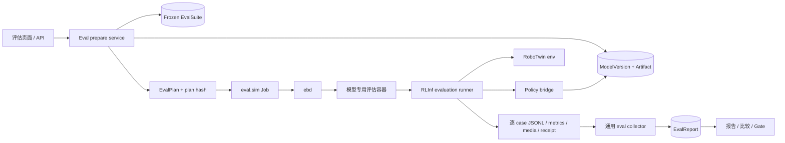

# 09 · RoboTwin 独立评估接入设计

## 1. 目标与结论

本设计把 EmbodiedBein 已训练或已登记的机器人策略接入 RoboTwin 做闭环仿真评估。它细化 [08 · RoboTwin 接入](08-robotwin-integration.md) 第 9 节，并服从 [05 · 评估与交付](05-evaluation-delivery.md) 的通用约束。

首期采用一条最短且可审计的路径：

> **平台冻结模型、套件、case 和证据协议；RLInf 在受管任务容器内加载模型并驱动 RoboTwin rollout；平台校验逐 case 证据并生成 `EvalReport`。**

不新增 RoboTwin 专用业务系统，不让 FastAPI 启动仿真，不直接调用每个模型仓各自的评估脚本。复用现有 `EvalSuite → eval.sim Job → Run → EvalReport` 管线和模型、血缘、资源、日志、媒体页面。

首期运行形态是“一个评估 Job、一个模型专用任务容器、一个 RLInf Ray 集群”。Job 可显式申请 `1/2/4` 张 GPU；RLInf 在同一容器内按 GPU 展开 `env` 与 `rollout` worker。策略和 RoboTwin 环境同容器运行，避免提前建设 policy server、跨容器 RPC 和多机调度。只有实测表明依赖冲突或吞吐无法接受时，才另行设计策略服务拆分。

## 2. 范围与非目标

### 2.1 首期范围

- RoboTwin ALOHA / AgileX 双臂仿真本体；接口版本必须精确到 observation、action、相机、控制器和频率。
- 已接入训练链路的 π0.5、LingBot-VLA-2、GR00T-N1.7、原力灵机 DM0.5、Xiaomi-Robotics-1。
- 平台固定 `smoke / validation / standard / acceptance` 套件。
- 当且仅当上游 revision、资产、case、seed、任务配置和计分方法全部匹配时，允许登记 `official_reproduction` 套件。
- 逐 case 证据、完整性校验、分项成功率、失败媒体、模型比较和血缘。

### 2.2 暂不包含

- 星海图 G0：模型文件、精确 RoboTwin action profile 和可验证推理入口尚未齐备，保持 `blocked`。
- 真机评估或真机放行。RoboTwin 通过不能提升 BHL、ALOHA 或其他真机的安全状态。
- 用训练 loss、离线 action 误差或 SFT smoke 代替闭环成功率。
- 将平台固定子集成绩命名为“RoboTwin 官方完整成绩”。
- 为吞吐预建多机 Ray、远程策略服务或新的评估微服务。

## 3. 现状与缺口

当前训练 smoke 只证明数据加载、forward、backward、optimizer 和 checkpoint 路径成立。闭环评估还必须证明模型能从 RoboTwin 实时 observation 产生动作，并按正确 frame、单位、控制模式和 chunk 语义施加到环境。

现有评估实现已经具备 Job/Run、预览 hash、checkpoint 冻结、逐案例 JSONL、部分报告和完整性校验，但具体入口目前绑定 LIBERO。RoboTwin 接入应修正这些共享边界，而不是复制一套平行业务代码。

| 现有能力 | 可复用 | RoboTwin 缺口 |
|---|---|---|
| `EvalSuite.spec` | 冻结套件及 case | RoboTwin revision、资产、控制器、显式 seed/case 清单 |
| `ModelVersion/Artifact` | 不可变模型与血缘 | 完整 processor/norm/action profile 和运行时 package receipt |
| `/api/v1/evals` | 预览、提交、列表、详情、进度 | 去除 LIBERO 专用限制，按 benchmark 分派 prepare |
| `eval.sim` Job/Run | 调度、重试、日志、资源 | RoboTwin recipe、图形 probe、模型专用镜像 |
| RLInf adapter/entry | 受控 argv、挂载和入口 | RoboTwin evaluation-only 分支及 policy bridge |
| 逐 case collector | 缺失/重复/未知 case 校验 | benchmark 中立字段和 RoboTwin 状态、指标 |
| 评估页面 | Suite、checkpoint、报告 | 模型版本、就绪原因、RoboTwin 分项和可比性 |

## 4. 总体架构



边界固定如下：

1. **控制面**只解析受管 ID、计算 readiness、冻结计划并提交 Job。
2. **`ebd`** 是唯一创建任务容器、持有 `docker.sock`、采集任务产物的组件。
3. **RLInf** 负责模型推理调度和 RoboTwin rollout；RoboTwin 提供环境、观测、成功判据和仿真状态。
4. **模型 policy bridge** 只处理该模型的加载、预处理、推理、action 解码和 receipt；不得改变 Suite 的 seed、成功函数或超时。

RLInf 上游入口必须由 Job 类型唯一决定，模板和页面不得自行指定近似入口：

| Job 类型 | 上游入口 | Runner |
|---|---|---|
| `train.sft` | `examples/sft/train_vla_sft.py` | `SFTRunner` |
| `train.rlft` | `examples/embodiment/train_embodied_agent.py` | `EmbodiedRunner` |
| `eval.sim` | `evaluations/eval_embodied_agent.py` | `EmbodiedEvalRunner` |

受管容器入口可以在上游入口外围增加输入回执、逐 case 证据和分片聚合，但必须在预览阶段同时校验 `JobKind`、模板 kind、`runner.task_type` 与 `runner.only_eval`。任一不一致均拒绝执行；评估不能以训练脚本作为回退入口。
5. **collector** 以冻结计划为真源对账，容器退出码为 0 不能单独产生有效报告。

## 5. 不可变输入

### 5.1 ModelVersion

评估只接受 `model_version_id`，禁止接受浏览器传入的宿主路径或任意 checkpoint URL。当前 `WeightModel` 属于过渡登记记录；训练产物必须先按 [04 · 模型与训练](04-model-training.md) 提升为不可变 `ModelVersion + Artifact`，才能进入正式评估。

模型包至少包含：

- 完整权重文件集、大小和 SHA-256；
- 精确 architecture/model revision；
- processor/tokenizer、图像 resize/crop/color/order；
- state/action normalization 及统计量；
- observation modality、相机名称和顺序；
- action profile、frame、单位、关节顺序、夹爪语义、chunk 长度和 mask；
- 训练 Run、数据版本、基座模型、recipe、代码和镜像血缘；
- 可加载 package manifest 与完成标记。

提交时冻结 artifact hash、镜像 digest 和模型 package receipt，并持有租约直至 Run 和产物收集结束。评估容器只读挂载模型包。

### 5.2 EvalSuite

RoboTwin Suite 继续使用现有 `EvalSuite` 表，详细协议放入不可变 `spec`；首期不新建表。Suite 至少冻结：

```yaml
benchmark: robotwin
protocol: platform_fixed       # 或 official_reproduction
robotwin_revision: <commit>
rlinf_revision: <commit>
assets_manifest_sha256: sha256:...
embodiment_env_id: ee_robotwin_aloha_joint14_v1
robot_platform: ALOHA
controller_profile: aloha_joint14_position_v1
observation_profile: robotwin_aloha_3cam_joint14_v1
domain: clean                  # randomized 必须是另一 suite 或明确 strata
tasks:
  - task_id: adjust_bottle
    task_config_sha256: sha256:...
case_manifest_sha256: sha256:...
cases:
  - case_id: adjust_bottle/clean/000001
    task_id: adjust_bottle
    seed: 12345
    scenario: clean
success_definition:
  name: robotwin_success_once
  code_sha256: sha256:...
max_episode_steps: 200
action_chunk:
  consume_rule: stop_on_success_timeout_or_termination
# num_action_chunks 属于模型推理设置，在 EvalPlan 中冻结
precision: bf16
repeats: 1
qualification:
  metric: success_rate
  threshold: 0.0
```

`clean` 与 `randomized` 默认分为不同 Suite，避免聚合掩盖差异。需要总分时，在 suite spec 中冻结 strata 权重，报告仍保留分项。

### 5.3 Case manifest

平台在模型参评前物化有序 case manifest 并计算 hash。worker 只消费分配给自己的互斥切片：

- 禁止运行时随机挑 case；
- seed 文件缺失时禁止回退随机采样；
- case 数不能整除 worker 数时，由最后一批有效 mask 或顺序执行余数；
- 禁止丢余数、循环复用 seed、因模型失败换 seed；
- 环境初始化故障可有限重试**同一 case**，耗尽后记 `infra_failed`；
- 每次 reset 回写实际 seed、scene hash 和 task config hash。

上游 success seed 是“专家已证明可解”的条件分布。报告必须保留此选择协议，不能外推为任意随机场景成功率。

### 5.4 EvalPlan

preview 将 Suite、ModelVersion、policy bridge、runtime、镜像、资源和 profile 解析成唯一 `EvalPlan`。规范化 JSON 的 SHA-256 是 `plan_hash`。submit 必须重新解析并比对；模型、套件、镜像或 capability 变化后返回 409，不能沿用旧预览。

计划至少包含：

- suite ID/spec/hash 和显式 case 列表；
- model version/artifact/package hashes；
- 模型 recipe、policy bridge revision、推理精度和 chunk 参数；
- RoboTwin、RLInf、资产、成功函数和任务配置 revision；
- image digest、GPU/RAM/shm、graphics probe profile；
- 输出协议、媒体策略、超时和有限 infra retry；
- `profile=smoke|validation|standard|acceptance|official_reproduction`。

## 6. 模型 policy bridge

不建设动态插件框架。固定模型使用显式分派和各自的小型 bridge；共享的只有输入输出 receipt、case 生命周期和错误结构。每个 bridge 必须完成 `load → reset → infer → decode`，并报告实际装载的权重、processor、norm、modality 和 action profile。

| 模型 | 训练 smoke | RoboTwin 闭环接入 | 首期判定 |
|---|---|---|---|
| π0.5 | 已有 | 使用精确 OpenPI RoboTwin ALOHA config、三相机/state 预处理、对应 norm，解码 joint14 action chunk | 第一条纵向链路 |
| LingBot-VLA-2 | 已有 | 使用 VLA-2 的真实 processor/权重与 RoboTwin mapping；不得拿 RLInf 旧 LingBotVLA loader 冒充 VLA-2 | bridge + 单 case probe 后开放 |
| GR00T-N1.7 | 已有 | 固定 N1.7 modality config/tag、processor、norm 和 ALOHA action 解码 | bridge + 单 case probe 后开放 |
| 原力灵机 DM0.5 | 已有 | 固定 OpenDM 模型/processor、robot/state description、norm 和 ALOHA action 解码 | bridge + 单 case probe 后开放 |
| Xiaomi-Robotics-1 | 已有 | 模型训练 view 使用 60 维相对 EEF 动作；闭环必须提供经验证的 EEF 控制器或从 60D 到 RoboTwin command 的 IK/控制 bridge | `controller_bridge_unverified`，验证前阻断 |
| 星海图 G0 | 未形成可验证模型包 | 缺精确模型、RoboTwin action profile 和可运行 loader | `model_recipe_blocked` |

训练中用 FK 将 joint 轨迹转换为相对 EEF action，只能证明监督目标可构造，不能证明闭环逆向控制成立。Xiaomi-Robotics-1 的评估 bridge 必须明确 TCP、世界/基座/末端 frame、旋转表示、左右臂顺序、夹爪、限位、IK 不可解和 chunk 中断语义；没有这些证据时不允许通过维度补零或借用 π0.5 joint14 profile。

每个模型的 `train.sft` 与 `closed_loop_eval` capability 独立。模型已下载、已注册或 SFT smoke 通过，都不能自动把评估模板改成就绪。

### 6.1 评估就绪条件

模型对某个 Suite 的 readiness 由服务端实时派生，至少要求：

1. ModelVersion 和全部 artifact 完整、hash 可复验；
2. 精确 model/processor/norm/action profile 匹配；
3. 模型专用评估镜像已固定 digest；
4. policy loader 在目标镜像加载成功；
5. observation mapping 实测 shape/dtype/range/相机顺序正确；
6. action decode 实测维度、关节/frame、单位、有限值和边界正确；
7. 单 case graphics + environment + inference probe 成功；
8. 同一 package 重新加载后输出协议一致；
9. Suite、任务、本体和 controller profile 兼容。

状态为 `blocked / adapter_ready / dependency_ready / smoke_passed / validated`，并附证据时间、recipe/image/interface revision 和结构化原因。

## 7. 执行协议

### 7.1 Job 生命周期

```text
选择 ModelVersion + RoboTwin Suite + profile
→ readiness 与兼容性检查
→ preview 生成 EvalPlan/plan_hash/资源估算
→ 携带 preview_hash 提交 eval.sim Job
→ ebd 准入并动态创建模型专用容器
→ RLInf evaluation-only runner 加载模型和显式 cases
→ RoboTwin 逐 case reset/rollout
→ 原子写逐 case JSONL、metrics、receipt、媒体 manifest
→ ebd 收集，控制面严格对账
→ EvalReport + lineage + qualification
```

评估任务不进入 Compose。源码、资产、模型和 case manifest 只读；只有该 Run 的 output/cache/tmp 可写。任务容器无 `docker.sock`、无真机设备、默认无网络，不得写 `/data/kk/RLinf` 或其他外部仓。

### 7.2 容器与资源

- 构建一个固定 RoboTwin/RLInf 评估基础层；各模型镜像只添加自身依赖和 bridge，避免把五套冲突依赖塞进一个镜像。
- probe 必须覆盖 NVIDIA device、EGL/Vulkan、SAPIEN、三相机非空且可区分图像、模型加载、一次 inference、一次 env step、shm 和 shader cache。
- 1/2/4 卡分别建资源画像。页面选择运行档位和已验证资源变体，不直接提交 GPU 数；训练需要 4 卡不表示评估也必须 4 卡。
- 每个资源变体同时冻结 GPU 数、总并发环境数和容器内存。Policy Worker 数固定为 `1`；服务端解析 Env Worker 数、每 Worker 环境数和推理 micro-batch。未验证的组合在控制面拒绝，不能等到 SAPIEN 以 `cannot create buffer` 或容器 OOM 崩溃。
- GPU 数、总并发环境数、Env Worker 拓扑、推理 micro-batch、headless/offscreen/video 设置都进入冻结 `EvalPlan` 与预览 hash。
- 调度器必须一次性分配 Job 请求的全部 GPU；资源不足时整单排队，不自动降卡、不超卖。`ebd` 仍只启动一个容器，并通过 `--gpus device=...` 暴露已分配设备。
- 同一个 Eval Job 使用一个 Ray 集群和一个常驻 Policy Worker。多卡 placement 分离为 `rollout:0` 与 `env:0-(N-1)`；GPU 数只扩展 Env Worker 和环境渲染，不复制模型。多个 Env Worker 的 observation 由唯一 Policy Worker 合并、分 micro-batch 推理，再按来源拆回 action。
- case 分片只作为进程内执行 wave，不得为每个 wave 启动新的 RLInf 子进程。不同 task 在同一容器和同一 Ray 集群内依次切换，只重建环境与 renderer，Policy Worker、processor、norm stats 和模型 receipt 在完整 Suite 内保持不变。完整 RLInf 补丁与验收见 [`../rlinf/02-robotwin-single-policy-eval.md`](../rlinf/02-robotwin-single-policy-eval.md)。
- CPU、内存、显存和 shm 由包含模型、GPU、Env Worker、总并发环境数、相机规格和 micro-batch 的实测资源画像决定；预览展示解析后的实际资源。资源画像未验证时，对应组合不可提交。
- 首期模型与环境同容器。只有测量证明单容器无法满足依赖或显存时，才设计 policy server 分离。

#### 7.2.1 已验证运行档位与高级资源配置

页面固定展示三个产品档位：`memory_saver_sync`（单 Policy、同步）、
`balanced_async`（单 Policy、动态批处理）和 `throughput_async`（多 Policy 分片）。
档位展示不等于可提交；只有运行语义已经实现且绑定不可变 probe 回执的精确资源组合才是
`ready`。尚未实现或未通过 probe 的档位保留在目录中并返回结构化 blocker，不能通过高级配置绕过。

运行档位由控制面维护，客户端只提交 `runtime_profile_id` 与该档位允许的
`resource_variant_id`。一个资源变体必须同时冻结 GPU 数、Policy/Env Worker 数、环境并发、
micro-batch、最大在途 batch、调度模式、容器 `memory_gb` 和 `shm_gb`。容器内存不是自由文本；
高级配置只列出同一档位下已经通过显存、主机内存、吞吐和完整性 probe 的资源变体。

probe 回执至少包含镜像、模型类别、GPU 型号与数量、拓扑、case 集、峰值 RAM/显存、shm、
吞吐、持续时间、结果完整性和回执摘要。预览把档位、资源变体及 probe 摘要写入 EvalPlan，
并以服务端解析出的资源创建 JobSpec；提交时重新解析，禁止客户端直接覆盖 memory/shm 或 placement。

兼容期内，旧的 `gpus + parallel_envs` 只允许映射到完全相同的同步白名单组合；新页面不再发送这组字段。
`balanced_async` 和 `throughput_async` 在 RLInf 对应执行路径及 probe 回执到位前必须显示为未就绪。

### 7.3 确定性进程内 wave

`EvalPlan.cases` 仍是完整评估真源，GPU 数只影响执行吞吐，不改变 case、seed、成功函数或报告分母。分片必须遵循：

```json
{
  "model": {
    "runtime": {
      "gpu_count": 4,
      "policy_worker_count": 1,
      "env_worker_count": 4,
      "envs_per_worker": 4,
      "parallel_envs": 16,
      "inference_micro_batch_size": 4,
      "max_inflight_batches": 1,
      "headless": true,
      "offscreen_rendering": true,
      "save_video": false,
      "reuse_policy_across_tasks": true
    }
  }
}
```

`parallel_envs` 是派生的最大同时环境数，Policy Worker 数固定为 1。`inference_micro_batch_size` 只控制唯一模型的一次前向规模，不创建模型副本。客户端只选择档位和已验证资源变体，不能直接提交 GPU、内存、placement、Policy Worker 数或 Channel 队列深度。

1. 先按 `task_id` 分组；同一 RLInf 进程顺序切换 task，只重建 Env Worker 持有的 VectorEnv 和 renderer；
2. 对每个任务按冻结 case 顺序形成 wave；完整 wave 大小为 `parallel_envs`；
3. 尾 wave 只启用实际需要的 env slot，固定 Policy Worker 和 Env Worker placement，不补虚假 case、不丢 case、不为尾波重启 Ray；
4. 例如 4 个 Env Worker、总并发 16 且剩余 6 个 case 时，6 个 case 确定性分配到已有 worker 的 6 个 slot，其余 slot 保持 inactive；
5. 每个 wave 显式写入 `wave_id`、task、case 范围、启用 slot 和输出证据位置；所有 wave 引用同一个 policy receipt；
6. 旧计划可以读取和展示，但不能按旧的多模型副本语义提交新 Job；继续执行前必须重新 preview 并生成新 plan hash。

Suite Coordinator 只在所有计划 case 恰好出现一次、所有 task/wave 引用同一 policy receipt 且指标加权归并一致时生成完整报告。任一 wave 失败时 Job 失败，已产生的日志和证据保留用于诊断；不得以部分结果冒充完整评估。

### 7.4 Action chunk

runner 记录 `chunk_requested` 和 `chunk_executed`。chunk 内一旦成功、timeout、terminated 或 invalid，立即停止后续动作。`terminated` 不是成功的别名；成功以冻结 success function 为准。记录 action index、实际仿真步数和 sim time，不能用请求 chunk 长度代替实际执行长度。

## 8. 证据、指标与报告

### 8.1 逐 case 记录

每个计划 case 必须恰有一条终态记录：

```json
{
  "run_id": "run_...",
  "plan_hash": "sha256:...",
  "case_id": "adjust_bottle/clean/000001",
  "task_id": "adjust_bottle",
  "scenario": "clean",
  "seed_planned": 12345,
  "seed_actual": 12345,
  "scene_hash": "sha256:...",
  "status": "success",
  "success_once": true,
  "termination_reason": "success",
  "env_steps": 173,
  "sim_seconds": 8.65,
  "chunk_requested": 50,
  "chunk_executed": 23,
  "instruction": "adjust the bottle",
  "model_version_id": "mv_...",
  "policy_receipt_sha256": "sha256:...",
  "media": []
}
```

状态固定为：

- `success`：冻结成功函数在超时前为真；
- `task_failure`：执行完整但未成功；
- `timeout`：达到冻结超时，计入有效失败分母；
- `invalid`：动作或测量非法，报告无效；
- `infra_failed`：环境、GPU 或运行时故障，报告不完整；
- `cancelled`：用户取消，报告不完整。

非有限 action、维度不符、越过硬边界或未知 controller command 立即标 `invalid` 并停止 case。不得 clip 后隐藏协议错误；Suite 明确允许的物理安全 clip 需在 receipt 中记录 clip 前后值和次数。

### 8.2 完整性与聚合

collector 以 EvalPlan 对账：case 缺失、重复、未知、seed 不符、plan hash 不符、非法数值或 aggregate 与逐 case 不一致都会使报告 `invalid` 或 `incomplete`。

报告至少显示：

- `planned / completed / valid / invalid / infra_failed / cancelled / not_started`；
- `successes / task_failures / timeouts / success_rate`；
- 每 task、clean/randomized、语言 strata 分项；
- 分母和 Wilson 区间；
- 模型、Suite、controller、runtime、镜像和资源 identity；
- GPU-hours、峰值显存/RAM、实际仿真步数与吞吐；
- failure reason 和媒体引用。

有效成功率为：

```text
success_rate = success / (success + task_failure + timeout)
```

`infra_failed` 不进入模型表现分母，但不能从完整性中消失。存在必需 case 未完成时，`qualification=incomplete`。Job `succeeded` 只表示执行和报告完整；模型 `qualification=pass|fail|incomplete` 独立。

RoboTwin/RLInf 的 `success_once` 表示轨迹过程中至少一次达到成功条件。只有真实采集了 episode-end success 时才能额外报告 `success_at_end`，不得由 `success_once` 推导。

### 8.3 可比性

报告只有在以下键全部相同时才可进入同一比较组：

```text
suite_hash + robotwin/assets revision + embodiment/interface
+ controller/action profile + observation profile + domain
+ success function + case manifest + inference settings
```

模型内部 action 维度可以不同，但最终环境控制协议必须相同。joint controller 与 EEF controller 属于不同 profile，默认禁止混榜。smoke 只验证执行与证据链，不排名；validation 可用于选 checkpoint；acceptance 必须在候选冻结后运行，不能回流训练。

## 9. API 与页面

继续使用 `/api/v1/evals`，不新增 `/robotwin/eval`：

| API | 设计 |
|---|---|
| `GET /api/v1/evals/suites?benchmark=robotwin` | 返回冻结套件、profile、case 数、协议和资产状态 |
| `GET /api/v1/evals/candidates?suite_id=...` | 返回 ModelVersion 兼容性、closed-loop readiness 和全部 blocker |
| `GET /api/v1/evals/runtime-profiles?benchmark=robotwin` | 返回三个运行档位、可提交状态、blockers，以及已验证的容器内存/shm 资源变体 |
| `POST /api/v1/evals/previews` | 输入 name、suite_id、profile、model_version_id、runtime_profile_id、resource_variant_id；返回计划 hash、case 摘要、解析后拓扑、镜像、资源、probe 回执和 blockers |
| `POST /api/v1/evals/jobs` | 携带 preview_hash 和幂等键提交；服务端重新校验 |
| `GET /api/v1/evals/jobs...` | 复用列表、详情、进度、日志和取消 |
| `GET /api/v1/evals/reports...` | 复用报告、case、媒体和比较 |

LIBERO 原有 `checkpoint_run_id + checkpoint_step` 请求在兼容期保留；RoboTwin 新请求必须使用 `model_version_id`。后续 LIBERO 也应收敛到 ModelVersion，但不阻塞本接入。

评估新建页增加 benchmark、模型版本、Suite、profile、GPU 数和 RoboTwin 总并发环境数。页面只提供已通过资源画像的 GPU/并发组合；模型选择项同时显示：

- `训练就绪` 与 `闭环评估就绪` 两个独立状态；
- 具体 blocker、字段路径和处理入口；
- observation/action/controller profile；
- 模型包、镜像、Suite 和资产 revision。

预览分别显示计划 case 数、GPU 数、Policy Worker 固定为 1、Env Worker 数、总并发环境数、推理 micro-batch、headless/offscreen/video、task/domain 分布、资源、超时和比较组，不能把计划 case 总数显示成并发环境数。未就绪项可查看，不能提交。报告页保留部分报告和失败证据；比较页只允许选择可比性键一致的报告。GPU 数和并发拓扑不进入模型成绩比较键，但必须保留在 Run provenance 中供性能和重现诊断。

错误统一为 `code / message / field_path / retryable / evidence_ref`。首期原因码：

- `eval_recipe_blocked`
- `model_package_incomplete`
- `policy_loader_missing`
- `observation_mapping_unverified`
- `action_mapping_unverified`
- `controller_bridge_unverified`
- `suite_assets_missing`
- `seed_manifest_invalid`
- `runtime_probe_failed`
- `graphics_probe_failed`
- `graphics_buffer_exhausted`
- `checkpoint_runtime_mismatch`
- `incomplete_cases`
- `duplicate_case`
- `unknown_case`
- `non_finite_action`
- `action_out_of_bounds`

## 10. 代码边界

实施应改共享根因，避免复制 LIBERO 路径：

| 路径 | 责任 |
|---|---|
| `backend/eb/api/routes_eval.py` | 将 prepare 拆为共享冻结流程 + benchmark 分支；增加候选模型和 RoboTwin Suite；保留 LIBERO 兼容 |
| `backend/eb/orchestrator/collect.py` | 把逐 case 对账、部分报告和聚合中的 LIBERO 通用部分改为 benchmark 中立；RoboTwin 仅提供字段校验/指标适配 |
| `backend/eb/domain/rlinf_form.py` | 登记每个已验证模型的 RoboTwin eval recipe 和 readiness，不用 SFT readiness 代替 |
| `backend/eb/adapters/rlinf.py` | 渲染 RoboTwin eval argv，挂载只读 source/assets/model/case manifest，写 Run 私有 output/cache |
| `backend/eb/runners/rlinf_entry.py` | 增加受控 RoboTwin eval dispatch |
| `backend/eb/runners/robotwin_eval.py` | evaluation-only case loop、证据和 receipt；不包含业务提交逻辑 |
| `backend/eb/runners/robotwin_*_policy.py` | 仅为存在真实差异的模型实现显式 bridge；不建设通用插件框架 |
| `backend/eb/bootstrap.py` | 只登记有固定 revision/hash 的 RoboTwin Suite；缺资产的套件保持 blocked/draft |
| `frontend/src/views/EvalNew.vue` | benchmark、模型、Suite、profile、readiness、preview |

`/data/kk/RLinf` 外部仓保持只读。RLInf 已有 `cluster.component_placement`、多 rank `EnvWorker`、`MultiStepRolloutWorker` 和 observation 合并/action 拆分能力；缺少的单 Policy 跨 wave/task 生命周期、环境清理屏障和评估 micro-batch 通过固定内容快照上的最小补丁提供，详见 `docs/rlinf/02-robotwin-single-policy-eval.md`。调度器与 `ebd` 已支持为一个 Run 分配并传入多个 GPU，不新建调度子系统。
| `frontend/src/views/EvalJobs.vue`、`EvalJobDetail.vue` | RoboTwin 进度、identity、case 完整性和失败原因 |
| `frontend/src/views/EvalReports.vue`、`EvalReport.vue`、`EvalCompare.vue` | 分项、媒体、qualification 和可比性限制 |
| `deploy/images/` | 一个 RoboTwin eval 基础层和最少的模型专用派生镜像；构建仍由 `make images` 触发 |

首期不需要数据库新表。使用现有 `EvalSuite.spec`、`Job.spec.params.eval_plan`、`EvalReport.metrics/gate_results`、`ModelVersion.card/io_signature/artifact_id` 和 `Artifact`。只有 JSON 查询形成可测量瓶颈后再增加索引或拆表。

RLInf 外部仓保持只读。需要修复上游行为时，以补丁文件、来源 revision、patch hash 和应用顺序进入平台镜像；详细逐文件补丁继续维护在 `docs/rlinf/`，不能直接修改 `/data/kk/RLinf`。

## 11. 测试与验收

### 11.1 最小自动检查

- plan hash 对 key 顺序稳定，任何冻结输入变化都会改变 hash；
- seed 文件缺失、重复 case、未知 case、非整除 worker 数均有确定结果；
- preview 与 submit 使用同一 readiness/renderer，过期 preview 返回 409；
- policy receipt 中 model/processor/norm/action profile 与 ModelVersion 一致；
- 非有限/错维/越界 action 被阻断；
- chunk 中间成功、timeout、terminated 后不继续执行；
- case 缺失、重复、未知或 aggregate 不一致不能生成 complete 报告；
- infra failure 保存 partial report，模型失败不触发换 seed 重试；
- 两个评估 Job 的 GPU、Ray 端口、output 和 cache 隔离；
- 1/2/4 卡分片覆盖全部 case 且无重复，尾批对任意余数均不补 case、不漏 case；
- 多卡分片的 `total_num_envs` 可被 active GPU 数整除，placement 只引用容器内可见 GPU；
- 单卡、双卡和四卡 smoke 产生相同 case 集与计划级证据结构；至少双卡和四卡完成真实 RoboTwin smoke；
- 外部源码、资产和模型挂载只读，任务无 docker.sock 和网络。

### 11.2 分阶段交付

| 阶段 | 内容 | 退出条件 |
|---|---|---|
| E0 协议 | 固定 RoboTwin/RLInf revision、资产、ALOHA 接口、case manifest、probe 和 Suite | 单环境 reset/step/success receipt 可复验 |
| E1 π0.5 smoke | 选择上游已支持的单任务，运行 5 个互异冻结 case | 5/5 case 有终态证据，报告 complete；成绩不作要求 |
| E2 π0.5 standard | 扩展冻结 task/case，运行平台标准套件 | 完整性、重跑确定性和资源画像通过 |
| E3 三模型 | LingBot-VLA-2、GR00T-N1.7、DM0.5 各运行 5-case smoke | 每个模型独立 package/bridge/receipt/报告通过 |
| E4 Xiaomi | 完成 60D EEF controller/IK bridge | frame/单位/限位/不可解/中断测试和 5-case smoke 通过 |
| E5 G0 | 模型与 action profile 齐备后接入 | 不借用 G0.5/π0.5 profile，独立证据通过 |

每个模型的 smoke 可以使用其官方适配已声明支持的一个任务；smoke 不用于模型间排名。建立共同榜单前，必须选择所有参评 bridge 都支持且 controller profile 相同的公共 Suite。

### 11.3 验收口径

RoboTwin 评估功能“跑通”必须同时满足：

1. 页面只能选择受管 ModelVersion 和冻结 Suite；
2. preview 展示真实 resolved argv、镜像、case、资源和挂载摘要；
3. `ebd` 启动受管容器，RLInf 驱动 RoboTwin 完成显式 case；
4. 每个 case 的 seed、状态、步数、success 和模型/runtime identity 可追溯；
5. collector 对账通过并产生 `EvalReport`；
6. Job 状态、报告完整性和 qualification 分开；
7. 相同计划重跑可解释，输入变化产生不同 plan hash；
8. 模型、Suite、Job、Run、报告和媒体血缘可导航；
9. 失败不修改外部仓、模型包或已发布 Suite；
10. 没有 closed-loop 证据的模型仍显示未就绪及准确 blocker。

## 12. 多轮设计复核

### 第一轮：是否需要新评估系统

不需要。现有 `EvalSuite/eval.sim/EvalReport` 已覆盖业务对象；新增 RoboTwin 顶级 API、表和导航会复制生命周期、权限和报告逻辑。设计改为扩展 benchmark recipe。

### 第二轮：是否可直接运行上游模型脚本

不可以作为平台评估真源。各仓脚本的 seed、case、超时和输出不同，无法稳定比较或审计。保留模型 loader/processor 代码，case 分配和证据协议由平台冻结，执行仍通过 RLInf。

### 第三轮：SFT smoke 是否足以宣布评估就绪

不够。训练只有 action target；闭环还缺 observation mapping、action decode/controller、chunk 终止和环境成功判据。设计把 `train.sft` 与 `closed_loop_eval` capability 分开，尤其阻断 Xiaomi 60D EEF 的未经验证逆向控制。

### 第四轮：上游 success seed 是否可直接按 worker 使用

存在静默漏 case、重复 seed 和缺文件随机回退的历史风险。设计改为平台提前物化 manifest、worker 互斥切片、实际 reset 回执和严格对账，非整除余数也必须完成。

### 第五轮：是否能称为官方 RoboTwin 成绩

只有完全固定并匹配对应上游 revision、资产、任务、seed 筛选、domain、步数和指标时才可标 `official_reproduction`。其余统一标 `platform_fixed`，防止把 RLInf 子集或 smoke 冒充官方总榜。

### 第六轮：五个模型是否应一次共用同一镜像和控制桥

不应。它们的 processor、依赖和 action 语义不同；一个大镜像和万能 bridge 会扩大故障面。设计采用共享评估协议、模型专用薄 bridge 和最少派生镜像。首期按 π0.5 → 三个直接 ALOHA bridge → Xiaomi controller bridge 的顺序交付。

### 第七轮：多卡应拆平台子 Job，还是复用 RLInf 原生调度

不拆子 Job。父子 Job 会引入取消、重试、血缘和部分报告的新状态机，而 RLInf 已原生支持 `env/rollout` 多卡 placement 和按 world size 分摊环境。设计保持一个 Job、一个 Run、一个容器和一份报告，在每个同任务分片内部使用 RLInf 多卡；不同分片串行运行，避免同容器多个 Ray 集群互相发现和争抢端口。

## 13. 上游依据

- RLInf 官方 RoboTwin 评估指南给出 `RLinf_support` 分支、ALOHA 环境设置、`evaluations/robotwin/` 配置、success seed 和 `success_once` 口径：<https://github.com/RLinf/RLinf/blob/main/docs/source-zh/rst_source/evaluations/guides/robotwin.rst>
- RLInf RoboTwin 环境实现显示 seed、并行环境和随机回退等实际执行语义：<https://github.com/RLinf/RLinf/blob/main/rlinf/envs/robotwin/robotwin_env.py>
- RLInf 的 seed 分配问题记录说明评估必须固定并核验实际 case 分配，而不能依赖版本不明的 worker 行为：<https://github.com/RLinf/RLinf/issues/1175>
- RoboTwin 官方仓当前评估入口和策略适配以其具体 revision 为准：<https://github.com/robotwin-Platform/robotwin>

RoboTwin 主仓当前评估路径与 RLInf 的 `RLinf_support` 路径不是同一协议。平台首期固定后者以保持“最终通过 RLInf 执行”的总管线；未来若接入主仓当前策略接口，必须登记为新的 runtime/protocol revision，并与既有 Suite 做等价性验证，不能静默替换。
