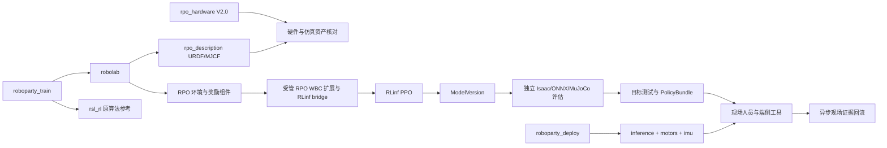

# 10 · RoboParty RPO V2.0 接入、RLinf WBC 训练与真机交付

日期：2026-09-20。性质：接入设计与源码调研，**不是已经训练成功或真机验证通过的报告**。

遵循 [01 · 产品与领域](01-product-domain.md)、[02 · 系统架构](02-system-architecture.md)、[03 · 数据与采集](03-data-collection.md)、[04 · 模型与训练](04-model-training.md)、[05 · 评估与交付](05-evaluation-delivery.md)、[06 · Agent 与安全](06-agent-security.md)。本设计新增 RPO 绑定，不改变这些设计的不变量。本次只产出文档，不修改训练/部署代码，不做 Git 提交。

## 1. 结论与已确认范围

**可以接入，但不是增加一个机器人名称、再运行原仓训练脚本就完成。** 最短可信路径是：复用 RoboParty 的 RPO 资产、Isaac Lab 环境组件、MuJoCo 资产和端侧驱动，补齐 RLinf 环境桥与运动控制策略 recipe，再沿平台现有生命周期完成独立评估、ONNX 导出、目标板测试、签包和现场验证。

用户已确认：

- 硬件是 [`rpo_hardware`](https://github.com/Roboparty/rpo_hardware) 的 **V2.0 / RPO（Roboto Origin）**，不是 RP1，也不是 V1.0。
- 首个 WBC 的目标是**行走时控制上半身**。
- 正式训练最终由 **RLinf** 执行，整体管线保持一致。

本设计采用的首期范围假设：平地、无负载接触操作；输入为底盘速度与双臂、腰部关节目标；不要求灵巧手、抓物、末端力控、跳跃或全身动作模仿。双臂各 5 关节、腰 1 关节，共 11 个上半身参考通道；初始课程腰和肘 yaw 可固定，最终验收必须覆盖声明为可控的通道。用户尚未确认主控板、具体电机/固件/IMU批次及遥操作输入设备，见 §12；这些不妨碍设计完成，但会阻断相应的目标板或现场能力提升。

这里的 WBC 是**学习式全身协调控制**，不是承诺实现一个接触力优化/QP 控制器。策略看到上半身目标和全身状态，输出全身关节目标，协调双足稳定与上半身跟踪。若以后要求带负载接触、笛卡尔刚度或严格力约束，应新增任务/接口与控制方案。

### 1.1 推荐路线与替代方案

| 路线 | 适用性与代价 | 决策 |
|---|---|---|
| RPO 原生环境组件 + 目标条件化全身策略 + RLinf PPO | 对齐行走与上半身目标；需要新任务、RLinf bridge 和端侧观测项 | **首期正式路线** |
| RLinf 复现 `RPO-Interrupt`，上层直接接管部分手臂 | 最接近已有遥操能力；目标对策略不可见，存在 8/10 关节差异，不含腰部接管 | 可做对照/诊断，不作为完整 WBC 交付 |
| BeyondMimic / AMP / MimicLite / UFO 全身模仿或通用运控 | 需要动作库或额外算法迁移；部分成熟路径是 G1，不是 RPO | 有新需求再引入，不作为本任务前置 |

禁止用 RLinf 进程启动 RSL-RL `OnPolicyRunner.learn()` 来冒充 RLinf 训练。环境可以引用上游配置类型，正式 rollout、GAE/PPO、optimizer、权重同步和 checkpoint 必须属于 RLinf。

## 2. 调研范围、版本与证据边界

### 2.1 所有公开仓库的覆盖口径

以 2026-09-20 实时 [GitHub API 公开仓库列表](https://api.github.com/orgs/Roboparty/repos?per_page=100&type=public) 为基线，返回 **58 个公开仓库**，数量小于单页上限 100；逐一检查仓库元数据及可读 README，核心依赖进一步读取文件树、子模块引用和源码。组织网页的缓存分页曾显示 48，不能以缓存数替代这次清单。完整的 58 项职责与取舍在附录 A。

“分析所有仓库”在这里指全部清点和依赖筛选；不声称审计过所有 CAD、固件、二进制或每行代码。缺 README 的仓库以文件树/源码判断；空仓、不可访问子模块及外围研究项目没有被当成可运行证据。研究下载仅放在临时目录，外部工作区保持只读。

### 2.2 固定来源

以下为本次核实的 commit。正式 Run 还须记录文件内容 hash、实际补丁和依赖锁，不能只依赖分支名或 commit。

| 来源 | revision / 固定引用 | 用途 |
|---|---|---|
| `rpo_hardware` | [`4272767a0ab06e238f61f4c50d5ab1d25825d585`](https://github.com/Roboparty/rpo_hardware/tree/4272767a0ab06e238f61f4c50d5ab1d25825d585/V2.0) | 用户指定的 V2.0 硬件 |
| `roboparty_train` | [`92008a6317d6d0efe8b58abc2fb3c630c75992c0`](https://github.com/Roboparty/roboparty_train/tree/92008a6317d6d0efe8b58abc2fb3c630c75992c0) | 训练聚合仓 |
| `robolab` | [`6b1c3d9988497c8961dcba77892de32edc1770e1`](https://github.com/Roboparty/robolab/tree/6b1c3d9988497c8961dcba77892de32edc1770e1) | 上述 train 锁定的环境子模块 |
| `rsl_rl` | [`6986d4d1b9fbab96fb61d51f07de419bc95432f1`](https://github.com/Roboparty/rsl_rl/tree/6986d4d1b9fbab96fb61d51f07de419bc95432f1) | 原算法/导出行为参考，不作正式 trainer |
| train 内 `rpo_description` | [`aa332a3c0a3c8a9d77e6df73c4c9698af0678b32`](https://github.com/Roboparty/rpo_description/tree/aa332a3c0a3c8a9d77e6df73c4c9698af0678b32) | robolab 的嵌套资产子模块 |
| `rpo_description` 当前头 | [`37aac9ca665e92731444a1618320078e7ba21569`](https://github.com/Roboparty/rpo_description/tree/37aac9ca665e92731444a1618320078e7ba21569) | 比较对象，不自动替换上项 |
| `roboparty_deploy` | [`a8a0f1557cc5d085234b8bac248a8f543342f531`](https://github.com/Roboparty/roboparty_deploy/tree/a8a0f1557cc5d085234b8bac248a8f543342f531) | 部署聚合仓 |
| deploy 内 inference / motors / imu | `ac448b12c382e3fab42c0e8467a6943987223c4b` / `118e569aa89ea0dff23219709320523526a6e8df` / `7a6e6d2eeef8ff3513cee54a8fa833773efd42f3` | 作为同一组解析，不能全部换成各仓 HEAD |
| inference 当前头 | [`c4238d1560bc795e61226074f4ee4b0a256a8901`](https://github.com/Roboparty/roboparty_inference/tree/c4238d1560bc795e61226074f4ee4b0a256a8901) | 下文端侧源码分析基线 |
| 本地 RLinf | `/data/kk/RLinf`，HEAD `018e6a9e0da60f96eeda8b11008543911027d414` | 实际可接入代码；另有工作区修改，不视为干净 upstream |

train 的 `robolab → rpo_description` 和 deploy 的 `src/inference/motors/imu` 都必须递归冻结。检查的 `robot.yaml`、`interrupt.yaml`、`inference_node.cpp` 在上述 deploy-pinned inference 与当前头内容相同；**这不代表所有依赖版本等价**。

证据等级：`源码事实` 为静态读取/解析所得；`设计决策` 为本次提出；`待实测` 必须有容器、仿真或设备回执后才可提升状态。本次没有运行 Isaac、RLinf 训练、ONNX 推理或真机。

## 3. 上游究竟提供了什么

### 3.1 训练与部署依赖关系



[`roboparty_train` README](https://github.com/Roboparty/roboparty_train/blob/92008a6317d6d0efe8b58abc2fb3c630c75992c0/README.md) 指向 Python 3.11、Isaac Sim 5.1.0、Isaac Lab main；这不是完整版本锁。原生主入口是 `robolab/scripts/rsl_rl/train.py`，不能直接成为本设计的最终训练入口。

`RPO-Flat`、`RPO-Rough`、`RPO-Interrupt` 是实际注册任务；AMP、BeyondMimic、Parkour 为另外的任务族。首期从 Flat 的机器人、观测、PD、奖励组件出发，**明确换成平面场景**：源码名叫 Flat，实际 `terrain_generator` 却设置为 `GRAVEL_TERRAINS_CFG`，不能仅凭任务名认定已是纯平地。[基础任务配置](https://github.com/Roboparty/robolab/blob/6b1c3d9988497c8961dcba77892de32edc1770e1/robolab/tasks/direct/base/rpo_env_cfg.py)

### 3.2 `RPO-Interrupt` 可参考，但不能直接当作目标 WBC

| 项目 | 源码事实 | 对本任务的影响 |
|---|---|---|
| 本体 | 23 个受控关节：双腿 12、腰 1、双臂 10 | 不能沿用 BHL 的 22 维环境 |
| Flat actor | 单帧 78，10 帧历史，展平 780 | “78 维模型”忽略了历史，不能用于导出校验 |
| Interrupt actor | 单帧 79，10 帧历史，展平 790 | 多出的 1 是 interrupt flag，不是手臂目标 |
| Flat / Interrupt critic | 单帧 139 / 140，默认各 10 帧 | 有特权状态，不能与 actor 观测混用 |
| 训练侧接管 | 两臂的 pitch/roll/yaw 与 elbow pitch，共 8 个 | elbow yaw、torso 不在接管集合 |
| 端侧接管 | `interrupt_action_.assign(10, ...)`，覆盖末尾 10 关节 | 与训练侧 8 个不一致；腰仍不在集合 |
| 外部参考观测 | 当前 actor 看全身测量、速度指令、上次策略输出和接管 flag | 对未来上肢目标没有显式条件，主要学习扰动适应 |

依据：[训练接管配置](https://github.com/Roboparty/robolab/blob/6b1c3d9988497c8961dcba77892de32edc1770e1/robolab/tasks/direct/interrupt/rpo_interrupt_env_cfg.py)、[训练接管实现](https://github.com/Roboparty/robolab/blob/6b1c3d9988497c8961dcba77892de32edc1770e1/robolab/tasks/direct/interrupt/interrupt_env.py)、[端侧接管实现](https://github.com/Roboparty/roboparty_inference/blob/c4238d1560bc795e61226074f4ee4b0a256a8901/src/inference_node.cpp)。

接管实现还包含链式布尔索引赋值，例如 `targets[mask][:, ...] = ...`。按 PyTorch 索引语义，这类写入可能只修改临时 tensor，不能把其注释中的“避碰裁剪”视为已生效。若复用这一路径，必须增加数值检查，确认裁剪实际作用于返回目标；首期正式路线不用这段随机接管器。

### 3.3 最重要的硬件资产差异

本次对 XML 进行只读结构比较：V2.0 硬件 URDF 与 train 锁定的 `rpo_description` 都有同名同序 23 个非固定关节，inertial mass 字段之和均为约 **33.7569 kg**。这是模型字段合计，不是整机称重结果，也不证明惯量、碰撞或装配与实机一致。

| 字段示例 | 硬件 V2.0 URDF | train 使用的 description URDF |
|---|---:|---:|
| 大关节 effort / velocity | 80 N·m / 10.47 rad/s | 120 N·m / 25 rad/s |
| 小关节 effort / velocity | 18 N·m / 3.7692 rad/s | 27 N·m / 8 rad/s |
| 左肩 roll | [-0.25, 1.0] rad | [-0.25, 3.14] rad |
| 双肩 pitch | [-1.57, 1.57] rad | [-3.14, 1.57] rad |
| 双髋 pitch | [-1.57, 1.57] rad | [-2.094, 0.7854] rad |

来源：[V2.0 原始 URDF](https://github.com/Roboparty/rpo_hardware/blob/4272767a0ab06e238f61f4c50d5ab1d25825d585/V2.0/roboto_origin_mechanic/03_URDF/urdf/roboto_origin.urdf)、[训练 URDF](https://github.com/Roboparty/rpo_description/blob/aa332a3c0a3c8a9d77e6df73c4c9698af0678b32/urdf/rpo.urdf)。训练 [`RPO_CFG`](https://github.com/Roboparty/robolab/blob/6b1c3d9988497c8961dcba77892de32edc1770e1/robolab/assets/robots/roboparty.py) 的 actuator 也显式使用 120/27 和 25/8，**只改 URDF 还不够**。

因此需生成一次逐关节资产差异报告，并由实机 BOM、驱动器设定、减速/传动关系、标定和安全包络确定允许值。训练、MJCF、端侧配置统一采用批准的版本；不能默认选更大的值，也不能把 URDF 的 effort 当成连续额定力矩。参数未确认时允许完整 RLinf 仿真训练，但产物保持 `simulation_unverified`，不能发布 `hardware_matched` 真机基线或进入现场部署。

V2.0 提及腰部机械限位和销钉标定，而两个 XML 的 torso 区间仍为 ±3.14；文档、模型和实物必须再核对，不能据 XML 允许真机转满该范围。RBE V2.0 是电源/USB-CAN 集成板，不等于推理主控，无法从“V2.0”推断 Orange Pi、RDK 或 Orin。[硬件说明](https://github.com/Roboparty/rpo_hardware/blob/4272767a0ab06e238f61f4c50d5ab1d25825d585/README.md)、[RBE 板说明](https://github.com/Roboparty/rpo_hardware/blob/4272767a0ab06e238f61f4c50d5ab1d25825d585/V2.0/roboto_origin_pcb/README.md)

### 3.4 版本和运行时不能混用

旧 `roboto_origin` 总仓 README 对应 Isaac Sim 4.5.0 / Lab 2.1.1 / Python 3.10；新 `roboparty_train` 指向 Sim 5.1.0 / Python 3.11。前者用于追溯历史，不拼进后者镜像。训练镜像与 ROS 2 Humble 端侧可以使用不同 Python 版本，通过 ONNX 和固定 manifest 交付，不共享一个 Python 环境。

`MimicLite` 组织仓是项目导航；UFO 的成熟基线也是 G1；`roboparty_teleop_wam` 当前主体含 RP1 24/28-DoF profile。不能把这些项目的演示或权重当作 RPO V2.0 兼容性证明。原 [`roboparty_xr_teleop`](https://github.com/Roboparty/roboparty_xr_teleop) 更贴近 RPO 双臂 IK，但其文档里的旧部署配置名亦需重新绑定。

## 4. EmbodiedBein 中的对象与管线

### 4.1 复用现有对象

| 对象 | 本次建议绑定（尚未创建） | 约束 |
|---|---|---|
| Embodiment | `emb_roboparty_rpo` | 家族名不是组织名；RP1 不混入 |
| 形态版本 | `rpo_v2_23dof` | V2.0、批准的 URDF/MJCF、质量/惯量/限制 manifest |
| EmbodimentEnv | `ee_rpo_v2_wbc_23dof_v1` | 新建草稿，发布后不可变；不覆盖 BHL |
| Task | `tsk_rpo_walk_upperbody_tracking` | 同时评估行走、上半身跟踪、稳定与约束 |
| Scenario | 平地速度/上肢轨迹与扰动分布版本 | train/validation/acceptance 固定划分 |
| ModelRecipe | `rpo_v2_wbc_ppo` | RLinf PPO、运动控制 MLP、ONNX 导出 |
| RuntimeProfile | RPO 训练 / MuJoCo / 实际目标板 | 镜像 digest、依赖锁、能力 probe 分开 |
| Robot | 现场确认序列号后登记 | 硬件、固件、标定、控制板和实测证据 |
| EvalSuite / Bundle | RPO WBC 套件 / 策略包 | 不借用 BHL/G1/RoboTwin 通过状态 |

### 4.2 保持同一生命周期

```text
外部只读源码/硬件资料
→ 受管代码与资产快照、兼容性 probe
→ 本体接口 + Task + Scenario 发布
→ Job(train.rl) / Run：RLinf PPO
→ 完整 checkpoint / ModelVersion
→ Job(eval.sim)：独立 Isaac acceptance
→ Job(export.policy)：确定性 actor ONNX
→ Job(eval.sim)：实际 ONNX 再评
→ Job(eval.sim2sim)：MuJoCo
→ 目标板无电机离线 benchmark 外部回执
→ Job(bundle.build)：Gate 4 签包
→ 现场 Gate 5 核验与人员本地加载
→ 异步遥测/失败证据 → 下一训练版本
```

从随机初始化开始属于 `train.rl`；已有模型继续优化且语义兼容时才是 RLFT/warm-start。现有 RLinf adapter 将 `tpl.kind='ppo'` 固定映射为 `TRAIN_RLFT`，需要受控 recipe 明确声明 Job kind，而不是强行把从零 PPO 叫微调。已有 `JobKind.TRAIN_RL` 足够，不新增 `roboparty.train`。

首期纯 PPO 可以没有示教 Dataset，但必须冻结 Scenario、奖励、目标轨迹生成器、seed 和 normalization。仿真 rollout 是训练过程，不能伪造一份示教数据来满足 UI 的数据必填。只有引入示教/模仿时才走原始动作库 → 重定向 → DatasetVersion/Slice；正式评估指令轨迹始终是独立冻结资产。

### 4.3 容器与平台边界

- `make up` 仍为平台唯一入口；RPO 训练/转换/评估镜像通过 `make images` 独立构建。任务由 `ebd` 动态创建，不增加 RoboParty 常驻训练服务。
- Python 管元数据、recipe、编排和门禁；Rust/ebd 管快照、容器、日志、大文件及原子产物发布。任务容器没有 Docker socket。
- 外部 `/data/kk/RLinf` 等保持只读。扩展放平台受管目录/包；必要补丁在镜像构建时应用到复制的源码，并锁定原文件 hash 与 patch hash；禁止在外部仓就地安装、改源码或生成缓存。
- 递归资产、meshes、Isaac 转换的 USD 与缓存必须落受管目录；普通只读 bind 并不是冻结。不能让 URDF 转换器回写外部 `data/robots`。
- Redis 保持 6380；Ray 在独立 Job 网络空间运行；多卡 placement 绑定已租用 GPU。先单卡 probe，再测 2/4 卡，不承诺上游的 8192 env 能在本机配置直接运行。
- 平台只导出包、导入报告。ROS、PICO、CAN 和 50/250Hz 控制循环留在现场，不暴露给 ToolBus、Web 或平台调度器。

## 5. 本体接口与目标 WBC 定义

### 5.1 关节顺序必须可证明

采用下列 **URDF 逻辑顺序**作为物理 joint manifest，策略内部可保持 Isaac 顺序，通过版本化映射转换：

```text
 0 left_thigh_yaw_joint       6 right_thigh_yaw_joint
 1 left_thigh_roll_joint      7 right_thigh_roll_joint
 2 left_thigh_pitch_joint     8 right_thigh_pitch_joint
 3 left_knee_joint            9 right_knee_joint
 4 left_ankle_pitch_joint    10 right_ankle_pitch_joint
 5 left_ankle_roll_joint     11 right_ankle_roll_joint
12 torso_joint
13 left_arm_pitch_joint     18 right_arm_pitch_joint
14 left_arm_roll_joint      19 right_arm_roll_joint
15 left_arm_yaw_joint       20 right_arm_yaw_joint
16 left_elbow_pitch_joint   21 right_elbow_pitch_joint
17 left_elbow_yaw_joint     22 right_elbow_yaw_joint
```

当前 inference 的 `usd2urdf` 为：

```text
P = [0, 6, 12, 1, 7, 13, 18, 2, 8, 14, 19, 3, 9, 15, 20, 4, 10, 16, 21, 5, 11, 17, 22]
q_policy[i] = q_urdf[P[i]]
q_target_urdf[P[i]] = q_target_policy[i]
```

这是从当前配置得到的候选映射。probe 必须读取 Isaac 实例 `joint_names` 与 MJCF actuator/joint 名称并逐项核对；不能因数组长度为 23 就放行。物理 manifest、策略顺序、CAN motor ID、左右方向、零位及闭链映射分别记录；不同排列的逆映射不得混用。[部署配置](https://github.com/Roboparty/roboparty_inference/blob/c4238d1560bc795e61226074f4ee4b0a256a8901/robots/rpo/configs/default.yaml)、[机器人配置](https://github.com/Roboparty/roboparty_inference/blob/c4238d1560bc795e61226074f4ee4b0a256a8901/robots/rpo/robot.yaml)

### 5.2 建议首期 actor / action 契约

以下是**新 WBC 设计**，不是声称上游已存在该任务或模型：

| actor 单帧项，按序拼接 | 维数 | 语义 |
|---|---:|---|
| `base_ang_vel` | 3 | body frame，rad/s |
| `projected_gravity` | 3 | body frame 的单位重力方向 |
| `velocity_command` | 3 | vx/vy m/s、yaw rate rad/s；使用明确的 base 水平朝向 frame |
| `joint_pos_rel` | 23 | 策略序，q−q0，rad |
| `joint_vel` | 23 | 策略序，rad/s |
| `last_policy_action` | 23 | 上次归一化策略输出，定义见下文 |
| `upper_reference_rel` | 11 | URDF 索引 12…22 的固定参考序，q_ref−q0，rad |
| **合计** | **89** | **10 帧、frame-major，actor 输入 890** |

- 新任务建议注册名 `RPO-WBC-WalkUpper-v0`；它是拟新增名称，不提供“现在即可运行”的命令。
- actor 只接收实机可获得的 IMU/编码器/本地指令与历史。训练的基座线速度、接触力、真实力矩等只给 critic。
- 可复用 Flat 的 61 维 critic 特权项，新 critic 单帧预计 89+61=150，10 帧为 1500；必须由目标镜像实际 probe 确认。actor/critic 各有 normalization，critic 不导出到真机。
- 上半身参考先为平滑关节轨迹，不需相机或动作捕捉。首期不增加目标速度维度，历史提供近期变化信息；若效果不足再新增接口版本，不能悄悄改变已发布 890 维模型。
- 策略输出 23 个无单位动作，仍采用 `q_target = q0 + scale * a`，初始参考 scale 为上游 0.25 rad/单位；scale、动作裁剪、关节/速度/加速度限幅在训练、MuJoCo、端侧完全一致，最终数值经资产/硬件校验批准。
- 上半身参考通过观测和跟踪奖励影响策略，**不在推理后用另一进程覆盖动作**。因此 23 个输出均由 PPO 学习，避免训练与执行对象不同。上肢参考误差超界就是任务失败，不能以“保持平衡”为理由忽略。
- `last_policy_action` 固定为裁剪前、未乘 scale 的上一策略输出；同一值用于 rollout log-prob 和训练/部署历史。物理限幅只改变 `action_applied`，另行记录。上游 C++ 会原地裁剪 output buffer，需分离原始输出与执行缓冲，否则与训练历史不一致。
- 正常启动/episode reset：上一动作清零，参考初始化为批准的起始姿态，历史按首帧填满；子环境 reset 只清自身历史。新策略实机不得在运动中清历史或切包。

codec 固定完整处理顺序：传感器/指令有效性检查 → frame/关节映射 → 物理量缩放与观测 clip → 历史拼接 → actor normalization → actor → 动作 clip/scale/offset → 物理限制器 → 电机映射。ONNX 已包含 normalization，C++ 不重复执行；一次推理使用同一份带时间信息的输入快照，不能在构造观测中途混入另一帧上肢参考。

新契约还需要保存 frame 定义、四元数 `wxyz`、单位、上肢参考序、历史顺序、归一化、限幅版本及行为。当前 `backend/eb/domain/contract.py` 不能完整表达全部内容：先复用已支持字段与版本化 codec manifest；**codec hash 必须纳入 Gate/模型兼容性身份**。不能把未识别 YAML 字段交给默认忽略 extra 的 Pydantic 模型，再声称它们已进入 `spec_hash`。若必须扩 schema，按 01 的已有语义补通用字段并保持老版本 hash 不变，不塞 RoboParty 专属字段。

### 5.3 时序与控制边界

| 层 | 当前上游基线 | 本设计处理 |
|---|---|---|
| Isaac 物理步 | 0.005 s，200Hz | 保持作为初始仿真画像 |
| 策略步 | decimation=4，50Hz | 新 WBC 同样 50Hz，chunk=1 |
| 端侧发送环 | dt=0.004 s，250Hz | 与 50Hz 推理解耦，持有/插值规则冻结 |
| 端侧推理环 | decimation=5，50Hz | 同时测试计算、观测年龄和调度迟到 |
| IMU | 文档建议 500Hz | 实机设置与 fresh sample 证据确认 |

50Hz 相同不代表整个控制链相同。仿真 200Hz PD 与端侧 250Hz MIT 命令、驱动器内部伺服是不同层；要模拟 sample-and-hold、传输延迟、抖动和执行器带宽，不机械地把三个频率改成同一个数。

## 6. RLinf 接入：需要真正补齐的接口

### 6.1 本地现实，不能照 AGENTS 摘要推断已实现

工作区已有大量改动，本节仅描述本次读取的代码，不回滚或修改它们。

| 当前文件 | 发现 | 接入动作 |
|---|---|---|
| `backend/eb/domain/rlinf_form.py` | 已有 BHL WBC 和其他模板 | 新增 RPO 受控 recipe、显式 Job kind、能力状态 |
| `backend/eb/adapters/rlinf.py` | 本体源码挂载/PYTHONPATH 默认 Berkeley；PPO→RLFT；恢复限部分 LIBERO 路径 | 按 recipe 绑定 RPO 快照、入口、镜像、产物与恢复能力 |
| `backend/eb/runners/rlinf_entry.py` | 多处 LIBERO/RoboTwin 专用分派 | 复用 receipt/保护字段/产物流程，增加 RPO 入口，不硬套 VLA 配置 |
| `backend/eb/pipelines.py` | 当前 typed binding 限 `model_directory → inputs.base_model` | 首期顺序 recipe；补显式模型/ONNX/report/bundle 引用，未完成前按独立 Job 串联 |
| `backend/eb/adapters/mujoco.py` | 固定 `scripts/play_mujoco.py` | RPO 独立评估 recipe、MJCF/ONNX/codec 挂载与证据输出 |
| `backend/eb/adapters/deploy.py` | 只是渲染 bundle 命令 | 核实/实现实际签包器，不以命令存在宣称交付完成 |
| `robot-agent/src/main.rs` | pull 会更新 current，失败有 fallback；serve 发送固定温度序列 | 不能作为 RPO 安全加载器或真实遥测证据 |
| RLinf `rlinf/envs/sim/isaaclab/__init__.py` | 引用不存在的 `tasks/berkeley_humanoid.py` | 此工作区 import 静态缺口先在受管副本修复/延迟注册 |
| RLinf `isaaclab_env.py` | `reward>0` 记 success，替换原 info，并有自身 reset 逻辑 | locomotion 不能照搬这些语义 |
| RLinf `mlp_policy/mlp_policy.py` | PPO value 用 `states`；`critic_obs_dim` 不使 PPO 自动使用独立 critic 输入 | 增加明确的 asymmetric actor/critic 数据通路 |

`ready=True` 或配置名可见不算运行证据。RPO 初始为 `discovered/blocked`；依赖、smoke、训练、评估、导出、目标运行分别提升，不继承 BHL 的标志。

### 6.2 RPO 环境桥

在平台受管 extension 中实现一个 RPO 专用 env bridge，复用 RLinf 的 worker、launcher 与 Isaac 子进程隔离，不复制一套训练系统。进程内必须先 `AppLauncher` 再导入 robolab/Isaac task；关闭、崩溃、超时能结束子进程，不能永久阻塞 IPC。

| 接口 | 必须保证 |
|---|---|
| 注册 | 明确 RLinf task registry 与 Gym task registry 两层；所有 Ray worker 子进程导入同一快照 |
| `reset` | 返回 actor `states` 和独立 `critic_states`，形状、dtype、device、history 一致；支持指定 env IDs |
| `step` / `chunk_step` | 输入 `[N,1,23]` 到 `[N,23]`；一动作只推进一个 20ms policy step；不再乘一次 decimation |
| reward | 保留 robolab 按 step_dt 计算的奖励，不重复乘 dt、不改成 success 二值奖励 |
| done | 跌倒等 terminal 与时间截断分开；保留真实 final observation/critic observation 和原因 |
| info | 保留逐环境 episode ID、目标轨迹、tracking error、接触、限幅等；正 reward 不代表成功 |
| eval | 可固定初态、case、指令轨迹与扰动 seed；无训练 curriculum 泄漏；不把 reset 后画面当失败终态 |

**reset 是首要正确性风险。** robolab `BaseEnv.step()` 在返回前已 reset 结束的 env；现有 RLinf Isaac 基类还可能再次 reset，并将包装得到的 obs 用作 `final_observation`。外层 wrapper 无法凭空恢复已丢的终态。必须在受管 robolab 扩展/补丁中，在 reset 前捕获 terminal actor/critic obs（历史只追加一次），保证一个 reset owner；或实现清晰的显式 reset 协议。用一次跌倒、一次 time limit、两个 env 异步结束的最小轨迹验证。[基础 step 实现](https://github.com/Roboparty/robolab/blob/6b1c3d9988497c8961dcba77892de32edc1770e1/robolab/tasks/direct/base/base_env.py)

GAE 应在真实 terminal 不 bootstrap，在时间截断用终态 value bootstrap，同时阻断跨 episode 的 advantage 递推；不能复制 ManiSkill 示例的 `bootstrap_type=always` 或把 reset observation 当作截断终态。actor 与 critic 的末状态都要进入数据通路。

### 6.3 RLinf 策略与 PPO

复用 RLinf `BasePolicy`/MLP 的动作分布与 worker 协议，增加最小 RPO policy 实现或明确配置支持：

1. actor 接收 890，critic 接收独立 1500；输入规模由 probe 回执确认。网络初始可沿上游 `[512,256,128] + ELU`，不照搬现有 MLP 写死的 `[256,256,256] + tanh` 后宣称算法等价。
2. `predict_action_batch()` 返回动作、old log-prob、value 与训练 `forward_inputs`；`critic_states` 需要贯穿 env output、rollout、存储、microbatch、bootstrap 和训练 forward，不能只改网络构造参数。
3. 使用高斯分布训练、确定性均值评估；联合动作 log-prob 的 sum/reduction、entropy 与 value loss 系数需明确。检查 RLinf 的 `action_level`/loss aggregation 实际行为，不把 23 维动作当 23 个互不相关的 PPO 样本。
4. 观测 normalization 的 running mean/var/count 在训练时更新，评估冻结；actor rollout 与 learner 同步同一版本，actor/critic 分开。每轮 rollout 及其 PPO 重算固定 normalization 版本，更新统计在受控轮次边界生效，避免 old/new log-prob 使用不同输入变换。导出模型包含 actor normalization；缺其策略与参数不能与原训练配方比较。
5. RSL-RL 超参数按所选具体配置解析。Flat agent 覆盖了 BaseAgent 默认 gamma/lr 等，不能只读父类。RLinf 的 batch、rollout horizon、update epochs、KL 调度、梯度裁剪、reward 时间尺度逐项对账；未实现 adaptive KL 或 symmetry 时明确为新 recipe，不宣称逐项复现。
6. 首期 synchronous on-policy PPO，chunk=1，无 AMP discriminator、无 RND、无视觉 encoder、无 recurrent policy；首次 probe 关闭 compile/CUDA graph，正确后测量决定是否开启。

正式训练的最小证明不是 loss 数字：至少保留 env rollout、策略权重更新前后 hash、非零有限梯度/参数变化、old/new log-prob 一致性、KL/entropy/value 指标和 checkpoint reload 结果。另用固定小 rollout 手算/独立计算 terminal 与 truncated 的 return/advantage，查出“能跑但训练目标错了”的情况。

实现时需同时处理 RLinf 环境注册、模型 builder/类型注册与配置校验，不能只让 Gym 看见新任务。优先通过受管入口加载 extension；必须修改 RLinf registry 时使用有原文件校验的构建期补丁，不依赖 Ray 子进程无法继承的临时进程内注册。

### 6.4 镜像、保存与恢复

构建专用 `rlinf-rpo-wbc` 训练画像，固定 Isaac Sim、Isaac Lab commit、robolab、资产、RLinf、平台扩展、Torch/CUDA、驱动要求、Python 与依赖。现有 `rlinf-berkeley-openpi` 镜像含大量 VLA 依赖且未证明兼容新 robolab，不能直接视为正确基础。构建时解决依赖/资产下载，正式任务默认离线。

先单卡、少量 env 完成 reset/step/forward/backward；测显存、RAM、shm、碰撞 buffer、渲染与 step 吞吐，再扩 env 数及 2/4 卡。训练不强制渲染视频，独立评估再启用；每个配置有明确 GPU 小时/磁盘/超时上限。大 PPO 吞吐数字和训练时长在本机实测前不作承诺。

checkpoint 至少包含 actor/critic、normalizers、optimizer/scheduler、RNG、iteration、curriculum 与配置身份。复用平台原子 manifest/最后完整 checkpoint 规则；未保存仿真状态的恢复只标 `trainer_state`，不标 exact。改变关节上限、观测布局、奖励/场景、world size 或归一化语义均创建新 recipe/spec；从 locomotion 转 WBC 是显式 warm-start 或重新训练，不是 exact resume。

## 7. 如何训练“行走时控制上半身”

### 7.1 指令、动作与单一控制权

现场指令链建议为：本地操作者/脚本 → 指令校验与平滑 → `velocity_command + upper_reference` → WBC actor → 23 关节目标 → 限制器/闭链转换 → 电机。训练时用同等规则的轨迹生成器代替操作者。

所有输入明确 frame、joint names、时间戳与序号。参考处理器限制位置、速度、加速度、必要时 jerk，检查自碰撞与训练包络；腰部边界独立标定。没有现场 reference 时初始化为已验证静止参考，不零填非法姿态。过期指令的降速/回中由现场状态机处理并进入仿真故障测试。

首期只接受关节参考。未来若加入 PICO/末端 pose，优先复用 RPO IK，经现场坐标标定与可达性约束后输出同一 11 通道参考；双臂各 5 DOF 不能默认任意满足每手 6D pose，应明确欠驱动时位置/姿态优先级与不可达反馈。该 IK 不向电机发命令，也不让遥操节点和 WBC 争夺控制权。

### 7.2 奖励与课程

阶段 A 的首个可运行子目标收敛为“原地直立＋0.3 m/s 直行”；其环境、奖励、模型输出和独立评估判据见 [11 · RPO 第一阶段](11-rpo-stand-walk-phase-a.md)。通过后再扩展启停、侧向及转向，不把这一步的两项能力视为整个 A 阶段完成。

| 阶段 | 训练内容 | 进入下一阶段的条件 |
|---|---|---|
| A：RLinf locomotion 对照 | 受批准的 RPO 参数、平地站立/启停/前后侧向/转向；上身固定参考 | 管线正确且基础 gait 有独立评估证据 |
| B：静止上身 | 速度为零，安全范围内双臂平滑目标；腰先固定 | 上肢跟踪达标且不通过脚滑/跌倒取巧 |
| C：组合控制 | 速度与上肢目标联合采样；左右异步、起停、转弯与摆臂叠加 | 未见组合通过 held-out case |
| D：腰与更宽包络 | 逐步启用 torso、elbow yaw，限制速度和幅度 | 每个声明可控通道有覆盖与安全证据 |
| E：鲁棒性 | 延迟/噪声/推扰/地面和机体差异、指令丢失 | 实际导出模型通过独立鲁棒套件 |

课程可以在同一冻结规则内递进；改变规则创建新 spec。禁止靠调小上半身参考幅度来事后通过既定 acceptance。

推荐 A–E 始终使用新 WBC 的 890/1500 维网络，A 阶段仅把上身参考固定在 q0，减少中途换接口。若另做原生 Flat 780 维对照，其 checkpoint 不能直接当作 890 维的恢复点；扩输入、初始化新权重与 normalization 的转换必须单独登记 warm-start 产物并验证，否则新任务从零训练。

保留速度跟踪、姿态、足部接触/滑移、动作平滑、能耗、越限和跌倒项；增加按关节范围归一化的上半身参考误差及任务成功条件。原 `joint_deviation_torso/arms/stand_still` 的回零惩罚会和非零参考冲突，必须改为参考相对项或只作用在明确固定的关节，避免策略被奖励拉回默认姿态。

奖励权重不是安全边界：角度/速度/力矩/碰撞及超时有独立终止或执行约束。训练中记录 requested/applied action 和限制器介入，防止策略长期靠饱和工作。新观测和参考项改变镜像增强索引，不能复用旧 78/79 维 hard-coded symmetry 数组；首期关闭，确有需要再按 joint manifest 验证左右镜像。

### 7.3 随机化与数据闭环

随机化覆盖质量/惯量/COM、地面摩擦、接触、PD 增益、传动摩擦/回差、动作延迟/丢包、IMU安装误差与噪声、编码器零偏、指令时延和负载范围。范围优先来自 V2.0 测量，未知范围只标实验假设；首期不声称随机化覆盖抓物负载。

若使用 motion 数据，只为已有需求增加 GMR/HHTools 转换：冻结来源与许可 → 映射到 RPO 23 关节 → 校验脚接触、自碰撞、速度、重采样与坐标 → 发布 DatasetVersion/Slice。URDF 顺序与 Isaac 顺序不同，且 GMR/不同工具四元数约定可能不同。轨迹参考是 command，不自动等于电机 action，也不必为了运动控制强转成 LeRobot。

现场失败回流记录包/固件/标定、参考、requested/applied target、state、时间域与事件。质量检查后形成新版本/场景；acceptance 及其派生样本不得流回训练。

## 8. 导出、sim2sim 与目标设备

### 8.1 ONNX 交付契约

从受管 RLinf checkpoint 导出**确定性 actor + actor normalization**，输入 batch=1 的 `[1,890]`，输出 `[1,23]`；实际名称、dtype、opset、历史、scale/offset、clip、joint mapping 和文件 hash 写入 manifest。导出无 critic，无随机采样，无训练 loss。

端侧已有 ONNX Runtime 可复用；首期先 FP32 CPU 推理，只有实际板上超预算才考虑其他精度/加速，不因“机器人”就默认 TensorRT/Orin。未知主控时 target 状态保持 `awaiting_target_profile`。

三个必要对照：

1. 固定输入覆盖正常姿态、边界、reset 历史、参考变化：RLinf eval actor 与 ONNX 输出一致。
2. 相同记录的 IMU/关节/指令，Python codec 与 C++ codec 逐项一致；比较 history 顺序、q0、四元数、mapping、归一化次数及原始/实际动作。
3. 实际 ONNX 在 Isaac 与 MuJoCo 各自闭环评估。不能用 RSL-RL 的旧 `policy.pt` 或只播放演示视频代替待交付 ONNX。

源码中的 `sim2sim_rpo*.py` 可复用 MJCF/PD/映射知识，但需变成受控无 GUI recipe，移除写当前目录与硬编码 `glfw` 等假设。本阶段无需让 RLinf 接管电机；评估是平台 Job，可用适配后的 RLinf rollout 或确定性 MuJoCo runner，输入和证据协议保持一致。

### 8.2 闭链踝关节不可漏掉

RPO 两侧踝部存在闭链映射。`robot.yaml` 指定 motor indices `[4,5,10,11]`，`RobotInterface` 在读回和输出路径调用解耦；并非简单 23 个独立旋转轴直接发 CAN。[机器人接口](https://github.com/Roboparty/roboparty_inference/blob/c4238d1560bc795e61226074f4ee4b0a256a8901/src/robot_interface.cpp)、[RPO 解耦实现](https://github.com/Roboparty/roboparty_inference/blob/c4238d1560bc795e61226074f4ee4b0a256a8901/src/utils/decouple_rpo.cpp)

交付前需检查关节→电机→关节 round-trip、左右符号、速度/力矩/Jacobian 转换、工作空间边缘/奇异区以及饱和时行为。q/qd/effort 限制在正确空间执行；单电机力矩上限不能直接当踝 pitch/roll 独立上限。仿真串联等效模型只能在验证过的工作空间和动力学误差内使用，超出时缩小包络或补执行器模型。

### 8.3 目标板实测

[`roboparty_deploy`](https://github.com/Roboparty/roboparty_deploy/blob/a8a0f1557cc5d085234b8bac248a8f543342f531/README.md) 给出 Orange Pi 5 Plus、RDK X5 与 ROS 2 Humble 的部署路径。用户未确认自己的板型，不能据此标 target verified；RoboPi 新软件包也不等于本机已安装。

在实际板上先运行**无电机权限**的版本固定离线容器，测试 ONNX + C++ preprocessing/history/postprocessing 的全链路，覆盖稳定负载、温升和后台 ROS 负载。报告 p50/p95/p99/max、deadline miss、观测年龄、内存、CPU、温度和降频；裸 ONNX inference 时间不够。

50Hz 的总周期是 20ms，具体 inference/IO/调度安全余量由 TargetProfile 固定；不直接复用 BHL 的 8ms 门限。报告必须绑定板型、OS/kernel/RT配置、ONNX Runtime/CPU架构、包 hash、输入 hash、时钟设置与原始 timing。平台导入 external report，不新增通用远程设备调度。

## 9. 真机部署与安全边界

### 9.1 端侧保留什么、必须修改什么

保留 RoboParty ROS 2 节点、IMU/电机协议与已核验解耦代码；扩展现有 inference 的 observation source/config 以接收 `upper_reference_rel`，加载新的 WBC ONNX，增加版本校验、时间和边界检查。**不是把 RLinf 装上机器人在线学习，也不是从 FastAPI 发关节目标。**

本次静态阅读发现的上线缺口必须验证并关闭：

| 缺口 | 必须达到的行为 |
|---|---|
| JointState 回调按 `position[i]` 读，未见该路径检查长度/名称 | 精确校验 names、数量、重复、NaN/Inf、单位、seq/timestamp，非法输入不改变有效目标 |
| 指令回调保存最新值，未见完整 age/watchdog 语义 | 本地单调时钟评估 fresh/stale；断流不无限维持行走命令 |
| 推理超时主要记录 overrun，控制环可继续使用旧目标 | 独立于推理线程的 action-age watchdog；进程卡死仍能进入经验证的安全状态 |
| IMU getter 是异步缓存 | 增加采样有效性/时间戳证据；不能读到默认零四元数就开始推理 |
| 部分跌倒/越限处理为 ROS shutdown | 验证电机最终状态和硬件通信超时，shutdown 不自动等于安全停机 |
| motor feedback 中 effort 语义依驱动而异 | 标明电流/估算力矩及单位，不能作未经校准的力控反馈 |
| generic robot-agent 自动更新 current/演示遥测 | 本期用受控本地 staging/验证工具，禁止该路径直接激活真机包 |

依据：[ROS 回调](https://github.com/Roboparty/roboparty_inference/blob/c4238d1560bc795e61226074f4ee4b0a256a8901/src/ros_interface.cpp)、[观测构造](https://github.com/Roboparty/roboparty_inference/blob/c4238d1560bc795e61226074f4ee4b0a256a8901/src/obs_manager.cpp)。这是所查路径的静态发现，不声称对全部固件做了安全审计。

软件运行与测试容器化：主机任务仍由 ebd 管理；端侧推理容器由现场人员在本地固定版本部署，仅映射所需 CAN/串口与实时调度权限，无 Docker socket、无平台控制权限。内核/RT/udev/固件安装属于现场设备准备，不由平台 Agent 执行；不为了方便授予整个容器 privileged 或开放公网 ROS。

### 9.2 本地控制权与故障处置

建议端侧状态为 `DISARMED → READY → LOCAL_ACTIVE → STOPPING/FAULT`；这些是现场状态，不是新增平台放行 API。进入 active 需要现场人员确认设备、包、标定与急停，且只有一个电机写入者。远程参考只提供目标，不拥有 arm/release 权限。

- 指令失联：按已测平滑限制归零行走指令并处理上身参考；不得瞬间把整机置为零角度。
- 推理停顿、传感器过期、motor offline、过温/欠压/越限：由独立端侧机制触发设备专属响应，测试响应时延及电机状态。
- 急停、软停、通信看门狗是不同路径。机械支撑下验证；不能通用规定“全部卸力”或“僵直保持”对所有姿态安全。
- 停稳/支撑后才允许换包；本地保留经验证的 active/previous，校验签名后原子切换；重启默认不自动恢复运动。
- 平台断网、API重启、遥测上传失败均不得影响安全闭环。遥测权限只读，不能通过 RPC 间接触发 `/start_inference`、`/init_motors` 或 `/set_zeros`。

### 9.3 PolicyBundle 与现场顺序

Bundle 包含：模型/normalizer、完整 codec、机器人/硬件与目标画像、所有关节/gain/限值/闭链参数、runtime 依赖、code/image/asset/标定要求、评估和目标回执引用、文件 hash、签名与许可清单。实际设备标定由本地设备档案提供，bundle 声明兼容范围并核验其 hash，不把通用模板的零位当成实机标定。

现场按以下顺序推进，每步记录操作者、包和证据：

1. 核对 V2.0 BOM、电源/总线/电机 ID、销钉零位、IMU外参与急停；记录实机质量及附加件。
2. 无电机权限验证包签名、I/O、离线回放和目标板延迟。
3. 在支撑条件下核对方向、闭链、限位与低风险动作；先验证停止路径，再允许策略活动。
4. 站立与小幅上身参考 → 低速行走 → 边走边摆臂 → 经批准的腰部参考；每阶段有冻结的小范围 acceptance。
5. 验证指令断流、推理卡死、总线/传感器异常及平台离线；通过后记录本次包/设备组合的现场结果。
6. 回流真实遥测和失败事件；不凭一段成功视频标记所有速度、上肢姿态或负载已覆盖。

## 10. 门禁、指标与验收

### 10.1 Gate 1–5 的 RPO 绑定

| 门禁 | 必需证据 |
|---|---|
| Gate 1 提交 | 23-DoF V2.0资产/接口/任务/recipe/场景一致；源快照、镜像、资源和保护字段冻结 |
| Gate 2 数据 | 有数据时验证动作/参考语义、时间、split、许可与真实 loader；纯 RL 记录不适用原因，并验证冻结场景，不能伪造数据通过 |
| Gate 3 模型 | 完整 checkpoint、实际 actor/critic 维度、ONNX I/O、norm、模型身份与接口一致 |
| Gate 4 签包 | 实际 ONNX 闭环、MuJoCo、目标板回执、完整文件 hash、runtime 与限制配置一致 |
| Gate 5 现场 | 指定设备的固件/标定/目标时延/现场安全证据；只导入记录，无 Agent 放行和 override |

Gate 4 可验证离线候选交付包，Gate 5 关联现场试验记录；“包构建成功”不等于机器人已允许运动。

### 10.2 冻结 EvalSuite

训练验证集用于模型选择，acceptance 在候选冻结后运行。每个 case 固定 seed、速度曲线、上身轨迹、初态、持续时间、扰动和成功代码 hash；相同 case 在 PyTorch、ONNX、MuJoCo 的比较条件明确，仿真器物理参数不同不能要求轨迹逐点相同。

覆盖至少包括：静止、起停、前后/侧移/转向、左右臂异步、双臂同向引起 COM 偏移、腰参考、接近允许边界、组合目标；以及迟到/丢失参考、观测噪声、通信/动作延迟、初态误差、地面摩擦变化和推扰。负载未进入首期，就在 bundle 明确禁用，不能把未覆盖设为通过。

| 类别 | 报告与判定 |
|---|---|
| 稳定 | 跌倒率、完成率、异常接触、躯干姿态/高度、脚滑 |
| 行走 | vx/vy/yaw-rate 跟踪 RMSE 与峰值、启停/转向延迟、累计位移 |
| 上半身 | 各关节 RMSE/p95/max、参考响应时延、左右/腰分项及速度分层 |
| 执行 | 越限、饱和、限幅占比、关节/电机空间速度/力矩、功耗/温升 |
| 实时 | 全链路 p99/max、deadline miss、observation/reference/action age |
| 完整性 | planned/completed/valid/invalid/infra_failed，逐 case 对账与失败轨迹 |

成功需要行走、上身、稳定和约束**同时满足**。门限在 acceptance 前冻结；没有现场参数时不发布真机门限。可先采用以下**仿真开发候选值**进行迭代，不能当成设备安全额定值：每 case 20s、速度 RMSE ≤0.15m/s、yaw-rate RMSE ≤0.2rad/s、上身逐关节 RMSE ≤0.1rad，零摔倒/硬越限/非法数值。速度包络、扰动级别、case 数和置信门限仍须在正式 Suite 中明示。

开发 smoke 可用十余个 case，只证明链路。正式 acceptance 建议每个关键任务分层至少 100 个预先冻结 case，报告 Wilson 区间；相同轨迹多 seed 需按轨迹组考虑相关性，不能把相关窗口当独立成功样本。最终覆盖规模由目标置信要求决定，不能只看整体平均掩盖转向＋抬臂失败。

基础设施失败不是策略失败。Job `succeeded` 表示报告完整，qualification 另为 pass/fail/incomplete；缺 case/NaN/视频不可用如实记录，门禁失败不自动无限重训或降阈值。

## 11. 分阶段实施与实际改动范围

不创建新平台服务，不建立通用机器人 SDK。新增一个 RPO 任务扩展、一个 RLinf env/policy recipe、一个端侧 profile，必要共享缺口在现有边界修正。

| 阶段 | 主要工作与落点 | 完成证据 / 停止条件 |
|---|---|---|
| P0 资产冻结 | `contracts/` 新草稿；受管资产差异报告与 RuntimeProfile；核对 V2.0实物 | 23关节、mesh依赖、限值、标定、闭链清单；硬件范围未确认时仿真训练标为 `simulation_unverified`，禁止真机基线/现场 |
| P1 环境与 RLinf | 受管 `rpo_wbc` env/policy；注册；修复受管 RLinf import；`deploy/images/` 专用镜像 | 容器 task list/reset/step；终态和history协议；1次真实 PPO 更新与重载 |
| P2 平台纳管 | `rlinf_form.py`、`adapters/rlinf.py`、runner、collector、现有训练页面 | 预览/提交同 renderer；Job/Run/receipt/模型血缘一致；按状态禁用未验证能力 |
| P3 WBC 训练 | §7课程、奖励、参考生成器、资源画像与恢复 | 单卡基础闭环，独立 validation；再扩2/4卡；失败保留而不伪报成功 |
| P4 导出评估 | `export.policy`、RPO Isaac/MuJoCo eval recipe、报告与 Gate | 实际 ONNX 数值/闭环、完整案例、故障路径通过 |
| P5 目标与交付 | 端侧 `roboparty_inference` 受管派生版本、配置/观测/watchdog、签包器 | 实际目标板外部回执、签名/错包拒绝、支持下动作验证 |
| P6 现场闭环 | 本地操作工具与只读遥测、分级试验、previous回滚 | 指定设备/包的现场报告；最后才标真机验证 |

新代码拟放在平台管理的 package/runner 目录，文件名由实现阶段确定；不把 `/data/kk/RLinf` 或下载源当修改目标。若使用部署 fork，也在新受管源码副本构建并固定补丁，不污染上游。平台 API/前端复用“本体、环境、训练、评估、交付”页面，仅补必要展示：硬件 revision、23DoF、上半身控制范围、codec/hash、目标板状态、门禁失败原因；不新增浏览器实时运动界面。

验证按风险设置最小可运行检查：关节置换与闭链 round-trip；两 env 异步 reset 与 GAE；归一化/历史/PyTorch–ONNX–C++ golden trace；一次 PPO update/reload；逐 case 评估完整性；错包/过期消息/坏签名/NaN/推理卡死的端侧拒绝。长期训练不能替代这些检查，文档校验也不能代替 GPU/硬件测试。

## 12. 未确定项及其阻断范围

| 问题 | 当前状态 | 何时必须解决 |
|---|---|---|
| 型号/硬件版本 | **已确认 RPO V2.0** | 不再按 RP1 或 V1设计 |
| 首个任务 | **已确认行走时控制上半身** | 以此衡量 WBC，而非模仿动作得分 |
| 具体主控板、RAM、OS/kernel/ROS版本 | 尚未确认；V2.0电源板不能回答此项 | P5 镜像架构和实时预算前 |
| 实物电机、驱动、固件、关节限位和闭链标定 | 尚未提供；硬件/训练URDF已发现差异 | P0批准资产、真机匹配基线及现场前 |
| 上肢输入 | 本文假设关节参考；末端控制/PICO未确认 | 若需要则在 P3 前固定 IK 和 frame 标定 |
| 腰/肘 yaw 范围、步速、场地、载荷 | 本文假设首期无负载平地；数值需冻结 | 正式 Task/Scenario/Suite 发布前 |
| 实机可用时间、支撑与停止机制 | 未核实 | P6前；没有设备证据保持 hardware_unverified |
| 第三方动作数据/对外交付用途 | 首期不依赖动作库 | 引入数据或分发 bundle前逐来源核验 |

许可按实际文件/组件记录：robolab 的软件许可与硬件资产、GPL端侧、第三方库不相同；UFO 的 README 标注非商业研究许可，首期未选用。不可将一个 README 的 license badge 当作整个递归仓库、权重和数据的统一授权。交付前导出实际依赖与许可证清单，不在此作泛化法律结论。

## 13. 多轮反思记录

本节是研究过程中实际复查后的修正，而不是把“已考虑”写成检查框。

### 第一轮：是否选错了问题或仓库

- 最初可能从训练 README 的 AMP/BeyondMimic 推导“WBC=动作模仿”；用户明确要行走时控上身，因此转向目标条件化 locomotion。
- 组织名下同时存在 RPO、RP1 和 G1 研究路线；逐仓清点后只把 RPO V2.0 相关代码放入必需链。
- 网页缓存仓库数与 API 不一致，改用 58 项实时清单，并显式声明分析深度。
- 结论修正：原 RSL-RL 入口是参照，不是满足 RLinf 要求的实现。

### 第二轮：硬件和接口是否“维度一样就兼容”

- 两套 URDF 都23关节，但力矩/速度/角度限制不同；补全资产差异报告和 actuator override检查。
- 发现 8 个训练接管关节与 10 个端侧接管关节不一致，且两者不含腰；取消“原 Interrupt 直接满足全部上身控制”的判断。
- 发现历史维度、Isaac/URDF置换、IMU frame 与闭链踝映射不能靠一个 dof 字段表示；加入 codec身份与 round-trip 验证。
- 剩余未知：硬件允许范围来自现场与BOM，不由源码推断。

### 第三轮：RLinf 真在训练，还是只是外壳

- 检查本地代码，发现缺 BHL import 模块、PPO critic 仍用 actor states、原 info与success语义不适用运控。
- 追踪 step/reset，发现环境内 reset 和外层 reset 可能叠加，终态观测已被覆盖；补源侧 terminal capture与GAE数值验证。
- 加入 optimizer/权重变化、同步 normalization、checkpoint reload证据，排除“日志有loss便认为训练成功”。
- 不默认原 PPO schedule、symmetry、normalization 已被 RLinf 实现；逐项映射、未实现项显式记录。

### 第四轮：策略导出后，实际执行的是不是同一行为

- 查到 C++ `last_action` 使用原地裁剪后的输出，与训练动作缓冲可能不同；新契约区分原始动作和执行动作。
- 新上身目标不能继续用部署层覆盖，否则训练的 action与实际执行不同；采用单策略23维输出。
- 明确导出 actor normalization，使用实际 ONNX跑 sim2sim，目标板测全处理链。
- 200Hz仿真、250Hz发送、50Hz策略分别冻结，控制延迟与执行器差异进入测试。

### 第五轮：平台边界和真机失效是否闭合

- 上游 shutdown/暂停不等于已验证停机，旧 action可能继续被发送；要求独立 watchdog与现场故障试验。
- 平台 robot-agent当前自动current切换/固定温度数据不满足交付证据，首期不复用其激活行为。
- 端侧安全、上电和切包留在现场；平台仅交付与异步证据，不增真机放行或ToolBus后门。
- 当前主控板未确认，所以不能宣称目标性能；保持独立 blocked/awaiting状态，不以仿真通过升级真机。

### 第六轮：是否遗漏验收、可复现性或投入边界

- 不把纯 RL 强塞示教管线；场景、参考生成器和成功函数仍需冻结，数据无来源时不伪造。
- 环境训练正常不能证明跟踪成功；验收要求速度、上肢、稳定共同达标，分层报告并保留失败分母。
- 递归 submodule、URDF转换缓存、镜像、normalizer、目标设备与许可证全部进入产物身份。
- 首期无须 VLA、AMP判别器、通用工作流或新的常驻服务；优先关闭资产、reset/GAE、codec和端侧安全这四类阻断点。

最终设计判断：**技术路线成立，但实机匹配、RLinf语义桥、目标条件化任务、导出一致性与本地安全runtime均需上述证据才能判定完成。** 当前文档提供可实施的边界和顺序，不将这些待办写成已验证能力。

## 附录 A · RoboParty 全部公开仓库清单与本任务取舍

下面逐项覆盖 API 返回的58个仓库。`核心`需源码/配置级接入；`条件`取决于实物或新增需求；`参考`用于调研；`不纳入`不进入首期运行依赖。外围仓库的说明按README/目录作职责判断，不代表其运行能力已经验证。

| 仓库 | 职责与证据范围 | 本任务处理 |
|---|---|---|
| [roboparty_train](https://github.com/Roboparty/roboparty_train) | 训练聚合仓；robolab与rsl_rl子模块 | 核心：冻结依赖；替换正式trainer为RLinf |
| [robolab](https://github.com/Roboparty/robolab) | Isaac任务、机器人配置、奖励、MuJoCo与转换脚本；已读核心源码 | 核心：复用组件，新增目标条件化WBC |
| [rsl_rl](https://github.com/Roboparty/rsl_rl) | 原PPO/网络/导出实现；子模块版本已核对 | 参考：算法与格式对账，不承担正式优化 |
| [rpo_hardware](https://github.com/Roboparty/rpo_hardware) | V1/V2机械、电气、BOM；已比较V2 URDF | 核心：硬件V2身份和实物匹配 |
| [rpo_description](https://github.com/Roboparty/rpo_description) | RPO URDF、MJCF与meshes；已解析关节/限值 | 核心：冻结嵌套资产并生成差异报告 |
| [roboparty_description](https://github.com/Roboparty/roboparty_description) | 多本体description聚合及Debian打包 | 条件：端侧资产分发，锁定RPO子模块 |
| [roboparty_deploy](https://github.com/Roboparty/roboparty_deploy) | ROS2部署聚合、启动/标定说明；已读子模块清单 | 核心：端侧构建参照，不由平台调用运动服务 |
| [roboparty_inference](https://github.com/Roboparty/roboparty_inference) | C++ ONNX/观测历史/接管/机器人接口/踝解耦；已读源码 | 核心：新增WBC观测profile、验证与watchdog |
| [roboparty_motors](https://github.com/Roboparty/roboparty_motors) | DM/EVO/LRO/XYN驱动与CAN/CAN-FD；已查源码树和接口 | 核心：按实物选驱动，锁固件/物理单位 |
| [roboparty_imu](https://github.com/Roboparty/roboparty_imu) | IMU协议与驱动；无根README，已查源码 | 核心：外参、时序、有效样本与失联处理 |
| [roboto_origin](https://github.com/Roboparty/roboto_origin) | 历史全栈总仓，旧Isaac/Python路线 | 参考：装配与历史追溯，不混用旧镜像 |
| [legged_lab](https://github.com/Roboparty/legged_lab) | 早期legged locomotion训练分支 | 参考：历史基线，首期使用robolab |
| [dm_pd_optimizer](https://github.com/Roboparty/dm_pd_optimizer) | DM电机PD参数优化/SDK | 条件：标定工具；现场独立操作，结果版本化 |
| [GMR](https://github.com/Roboparty/GMR) | 动作重定向工具和模型配置 | 条件：需人类动作或IK输入时才接入 |
| [human-humanoid-tools](https://github.com/Roboparty/human-humanoid-tools) | 人体/机器人动作处理与重定向工具链 | 条件：后续动作数据处理，首期无必需数据依赖 |
| [roboparty_xr_teleop](https://github.com/Roboparty/roboparty_xr_teleop) | RPO双臂PICO遥操与IK；已读README/树 | 条件：转换为WBC参考输入，不直接争用电机 |
| [roboparty_teleop_wam](https://github.com/Roboparty/roboparty_teleop_wam) | 统一遥操；当前主要RP1 body profile及双臂路径 | 参考/条件：需另做RPO绑定，不照搬RP1维度 |
| [MimicLite](https://github.com/Roboparty/MimicLite) | 项目导航，训练/部署代码链接外部组件，成熟示例G1 | 参考：不是现成RPO WBC recipe |
| [UFO](https://github.com/Roboparty/UFO) | MJLab无监督RL、FB/TeCH、动作导入；成熟G1路径 | 不纳入：算法/运行时和首期目标不同，另有许可限制 |
| [Party_OS](https://github.com/Roboparty/Party_OS) | 项目路线图和组件入口 | 参考：组织关系，不作为可执行平台依赖 |
| [GR00T-WholeBodyControl_unitree](https://github.com/Roboparty/GR00T-WholeBodyControl_unitree) | Unitree/SONIC相关WBC分支，描述为RP_Hand_Sonic | 不纳入：不是RPO关节与硬件接口 |
| [INTACT-JEPA](https://github.com/Roboparty/INTACT-JEPA) | 动作意图与世界模型研究 | 不纳入：首期无需世界模型 |
| [ACoT-VLA](https://github.com/Roboparty/ACoT-VLA) | VLA动作推理研究 | 不纳入：首期非视觉语言策略 |
| [RP1](https://github.com/Roboparty/RP1) | 元数据为RP1全栈平台；本次树API返回空仓409、无可读README | 不纳入：既非用户硬件，也无可运行源码证据 |
| [Bi_PiPER_with_DexHand](https://github.com/Roboparty/Bi_PiPER_with_DexHand) | 双臂PiPER与灵巧手采集 | 不纳入：不同本体/任务 |
| [roboparty_navigation](https://github.com/Roboparty/roboparty_navigation) | 机器人导航栈 | 不纳入：行走速度指令无需首期自主导航 |
| [roboparty_camera](https://github.com/Roboparty/roboparty_camera) | RealSense/深度处理ROS包；无根README，查文件树 | 条件：视觉/parkour才需要，首期actor无图像 |
| [roboparty_lidar](https://github.com/Roboparty/roboparty_lidar) | 当前树主要LICENSE、CI、debian打包信息 | 不纳入：不据仓库名宣称已有完整导航能力 |
| [roboparty_rp_head](https://github.com/Roboparty/roboparty_rp_head) | 头部设备C++库/打包；无根README，查文件树 | 不纳入：RPO首期23关节无独立头部通道 |
| [roboparty_dexhand](https://github.com/Roboparty/roboparty_dexhand) | RP_Hand CAN-FD驱动/Python绑定 | 条件：首期不含手指，后续单独接口/总线预算 |
| [roboparty_dexhand_ros](https://github.com/Roboparty/roboparty_dexhand_ros) | RP_Hand ROS2设备节点 | 条件：灵巧手扩展，不放入23维策略 |
| [roboparty_dexhand_teleop](https://github.com/Roboparty/roboparty_dexhand_teleop) | 手部骨架/控制器遥操 | 条件：与未来手部任务一起验证 |
| [roboparty_bms](https://github.com/Roboparty/roboparty_bms) | 电池管理组件/协议 | 条件：按V2实际电源硬件纳入监测与保护 |
| [roboparty_charger](https://github.com/Roboparty/roboparty_charger) | Type-C PD电池充电组件 | 参考：电源维护，不是WBC运行依赖 |
| [roboparty_stm32_usbcan](https://github.com/Roboparty/roboparty_stm32_usbcan) | STM32G431 USB-CAN固件、SocketCAN接口 | 条件：按实机USB-CAN版本锁定，测试断连/带宽 |
| [roboparty_firmware](https://github.com/Roboparty/roboparty_firmware) | USB-CAN与板级系统构建聚合仓 | 条件：设备软件基线；不让平台自动刷写 |
| [robopi_firmware](https://github.com/Roboparty/robopi_firmware) | Orange Pi特定firmware文件 | 条件：实际板型适用时纳入设备清单 |
| [firmware](https://github.com/Roboparty/firmware) | Armbian支持设备的固件集合 | 条件：OS依赖，不纳入训练镜像 |
| [roboparty_rdk](https://github.com/Roboparty/roboparty_rdk) | RDK X5系统/RT镜像构建 | 条件：主控确认为RDK X5时采用 |
| [roboparty_image](https://github.com/Roboparty/roboparty_image) | RoboPi板级系统镜像构建分支 | 条件：实机为对应RoboPi型号时采用 |
| [roboparty_build](https://github.com/Roboparty/roboparty_build) | Armbian构建框架分支 | 条件：定制板级系统，不是训练入口 |
| [robopi_config](https://github.com/Roboparty/robopi_config) | 板级配置/接口/诊断工具 | 条件：现场设备准备，配置变更形成新profile |
| [robopi_addon](https://github.com/Roboparty/robopi_addon) | RoboPi RK3588S BSP、GPIO/Wi-Fi/风扇等 | 条件：不能从RPO V2名称推定需要此BSP |
| [robopi_analyze](https://github.com/Roboparty/robopi_analyze) | RoboPi电源/CAN/HPM/推理日志诊断 | 条件：适用硬件上用于故障证据，不直接视为模型指标 |
| [roboparty_base](https://github.com/Roboparty/roboparty_base) | 目录、udev、库路径等系统基础包 | 条件：端侧可复用并固定包版本 |
| [roboparty_all](https://github.com/Roboparty/roboparty_all) | 拉取多个模块的APT元包 | 参考：不直接用latest依赖作为可复现部署锁 |
| [roboparty_repo](https://github.com/Roboparty/roboparty_repo) | APT路由、源码manifest及子模块入口 | 条件：用于发现/打包；外部或不可见依赖不算已核验 |
| [roboparty_start](https://github.com/Roboparty/roboparty_start) | 启动脚本/RT DDS配置；README仍出现旧名roboparty_go | 条件：现场容器入口适配，避免与平台Compose混为一体 |
| [roboparty_onnxruntime](https://github.com/Roboparty/roboparty_onnxruntime) | ONNX Runtime打包仓 | 条件：固定目标架构/runtime版本并跑数值与时延probe |
| [roboparty_deb_template](https://github.com/Roboparty/roboparty_deb_template) | Debian打包模板 | 参考：无需为首期新增打包框架 |
| [roboparty_rp_server](https://github.com/Roboparty/roboparty_rp_server) | AT协议WebSocket/UDP/串口/蓝牙硬件网关 | 不纳入平台：含控制能力，不能作为绕开ToolBus的后门 |
| [roboparty_example](https://github.com/Roboparty/roboparty_example) | 演示与网页入口 | 参考：不接到平台实时控制面 |
| [create_ap](https://github.com/Roboparty/create_ap) | 上游标记不维护的AP脚本分支 | 不纳入WBC：现场网络已有方案即可 |
| [igh-deb](https://github.com/Roboparty/igh-deb) | IgH EtherCAT相关Debian包 | 条件：只有实际总线需要才引入 |
| [soem-deb](https://github.com/Roboparty/soem-deb) | SOEM子模块与Debian开发包 | 条件：当前RPO参考配置为CAN，无需强加EtherCAT |
| [SOEM](https://github.com/Roboparty/SOEM) | EtherCAT master源码分支 | 条件：总线改型时重新评估 |
| [rpo_appearance](https://github.com/Roboparty/rpo_appearance) | 外观件；README提示当前原型偏静态展示 | 条件：加装改变质量/碰撞/散热，重做资产与动态验证 |
| [.github](https://github.com/Roboparty/.github) | 组织简介与公共入口 | 参考：非运行依赖 |

## 附录 B · 实现阶段优先阅读的本地入口

- [本体契约](../../backend/eb/domain/contract.py)、[JobSpec](../../backend/eb/domain/job.py)、[RLinf模板](../../backend/eb/domain/rlinf_form.py)。
- [RLinf adapter](../../backend/eb/adapters/rlinf.py)、[RLinf runner](../../backend/eb/runners/rlinf_entry.py)、[产物登记](../../backend/eb/orchestrator/collect.py)、[Pipeline](../../backend/eb/pipelines.py)。
- [MuJoCo adapter](../../backend/eb/adapters/mujoco.py)、[交付 adapter](../../backend/eb/adapters/deploy.py)、[当前 robot-agent](../../robot-agent/src/main.rs)。
- [现有 BHL WBC 契约](../../contracts/ee_bhl_wbc_22dof_v1.yaml)仅用于平台接入模式参考；其85/22维与RPO不兼容。
- RLinf本地只读入口：`rlinf/envs/sim/isaaclab/{__init__,isaaclab_env,venv}.py`、`rlinf/models/embodiment/mlp_policy/mlp_policy.py`、`rlinf/workers/actor/embodied_fsdp_actor_worker.py`、`examples/embodiment/config/maniskill_ppo_mlp.yaml`。以上路径相对于 `/data/kk/RLinf`，以本次内容读取为准。

优先开工顺序：**先确认V2资产与实际板型，再打通RLinf的终态/critic/normalizer语义，最后长训与端侧联调。** 上半身运动范围、PPO吞吐或目标推理性能均以对应阶段的可定位证据为准。
