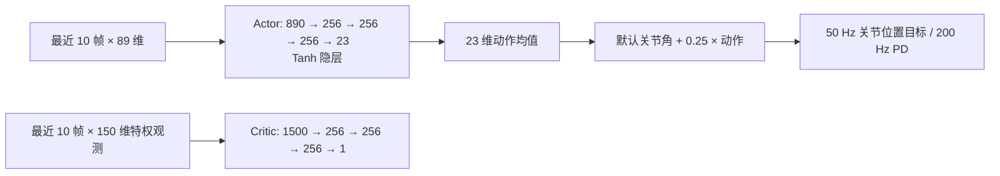

# RPO V2 第一阶段：直立与低速直行

日期：2026-09-23。状态：仿真任务和评估协议已实现，**新策略尚未训练并通过评估**。本阶段是 [RPO WBC 总设计](10-roboparty-rpo-wbc-integration.md) §7.2 的 A 阶段；上肢动态目标属于后续阶段，不能用旧模型的训练曲线宣称本阶段成功。

## 1. 为什么重设阶段目标

旧任务 `RPO-WBC-WalkUpper-v0` 同时要求随机前后/横向速度、随机转向、随机上肢参考。环境平地，但 reset 可带较大速度扰动，每 10–15 秒会推搡。旧模型的 `env/episode_len` 约 800 表示采样 episode 长度，不是走了 800 步，也不证明站立。录像显示机器人趴倒，而评估仍记录 1000 步：原环境只检查部分身体接触，`terminate_base_height` 和 `terminate_base_orientation` 均为空，漏判倒地。此外，平台自定义上肢奖励过去每策略步直接加 `exp(-4 MSE)`，上游 RewardManager 的各项奖励却乘 0.02 秒。前者相对放大约 50 倍。旧模型的训练和已完成评估均不能按修复后的规则重新解释。

## 2. 冻结训练任务 `tsk_rpo_stand_walk`

入口为 `rpo_v2_wbc_stand_walk_ppo` → `RPO-WBC-StandWalk-v1`，使用 RLinf PPO 和 Isaac Lab。平地，无横移/转向命令、外力推搡和启动时质量/摩擦/驱动随机化；关闭观测噪声。每个并行环境在一个 20 秒 episode 内固定为原地站立或沿机体前向以 **0.3 m/s** 直行，各约占 50%。上肢 11 维参考固定为相对默认关节角的零位。初始化关节偏差 ±0.05 rad，机体 x/y/yaw 速度 ±0.05；初始朝向和位置可变化。

控制频率 50 Hz，物理频率 200 Hz，最多 1000 个策略步。机体基座高度低于 **0.50 m**、相对竖直倾角超过 **0.80 rad** 或原有关键躯干接触触发时，立即终止 episode；1000 步到期属于正常截断。阈值以仿真初始基座高度约 0.75 m 为基线，需用视频和仿真状态核对；此阈值尚非真机安全阈值。

### 奖励计算

每步 `r = 0.02 × [Σ(wᵢ fᵢ) + exp(-4 mean((q_upper - q_default)²))]`，其中 `Σ` 使用上游 `RPORewardCfg` 的项。终止惩罚在触发步计算。第一阶段权重如下；未单列改写的函数沿用 RoboLab `rpo_interrupt_env_cfg.py` 与 `base/mdp/rewards.py`，训练镜像中资产源码只读。

| 目标或约束 | 权重 | 作用 |
|---|---:|---|
| 前向/横向速度指数跟踪 | +3.0 | 原地要求零速度，行走要求 0.3 m/s |
| yaw 速度指数跟踪 | +1.0 | 两场景均要求不旋转 |
| 竖直投影 `upward` | +0.5 | 鼓励躯干直立 |
| 平坦朝向误差 | -1.0 | 抑制俯仰、横滚 |
| 倒地终止 | -200.0 | 提前跌倒的代价 |
| 站立时默认关节位/速度偏差 | -0.2 | 原地保持姿态；改用不依赖 interrupt 状态的 `stand_still` 函数 |
| 躯干与肘 yaw 偏差 | -0.3 | 约束上身 |
| 上肢 11 关节中立位跟踪 | +1.0 | 在共同的 `dt` 尺度计算 |
| 竖直/横向角速度、能耗、扭矩、关节速度/加速度、动作变化 | -0.2 / -0.1 / -1e-4 / -1e-5 / -2e-4 / -2.5e-7 / -0.02 / -0.02 | 抑制振荡和过度用力 |
| 非足部接触、足部滑动/过载/绊倒/朝向、关节限位 | -1.0 / -0.3 / -0.003 / -1.0 / -0.1 / -1.0 | 接触和机械约束 |
| 足部腾空/高度/间距、膝间距、站立足接触 | +0.25 / +0.2 / +0.1 / +0.1 / +0.1 | 保留上游步态塑形 |
| 髋/腿默认姿态偏差 | -0.03 / -0.01 | 避免畸形姿态 |

第一阶段关闭 `joint_deviation_interrupt` 和 `action_penalty_interrupt`，因为 interrupt 已关闭且这两个函数依赖相应状态；这些项不能被误称为生效奖励。权重是明确的训练起点，不是已经验证能学会走路的结果。训练时同时记录平均回报、episode 长度、真实倒地率、站立漂移和前向位移；仅看回报或 episode 长度不足以判定动作能力。

## 3. 模型结构与输出

维持既有 RPO 23 关节接口，不为第一阶段换网络，以便后续继续训练同一输入输出合同。

每帧 actor：角速度 3、机体重力投影 3、速度指令 3、关节位置偏差 23、关节速度偏差 23、上一动作 23、上肢参考 11，总计 89。Critic 额外含机体线速度和接触/动力学信息，总计每帧 150；仅训练使用。PPO 训练时 actor 学习 23 维对角高斯方差，评估/ONNX 输出确定性均值。输出是**相对于默认关节角的 23 个关节位置目标**，不是力矩、足端轨迹或步数。前 12 通道双腿，随后 1 腰、10 手臂。`hidden_dim: 256` 与实际硬编码 MLP 的 256 对齐，但当前源码不支持改 YAML 后改变隐层宽度。

## 4. 冻结评估环境、任务与判据

套件 `suite_rpo_v2_wbc_{isaac,mujoco}_stand_walk_v2`：独立加载 checkpoint，导出 890→23 确定性 ONNX，Isaac Lab 同域为主要判断，MuJoCo 为跨域诊断；两者分别报告，不能互相替代。默认 12 个 seed；冒烟模式 3 个。偶数 seed 是站立，奇数 seed 是直行；每个 seed 还决定初始关节（±0.05 rad）、平移/yaw 小速度（±0.05）和初始朝向（±π），避免同类案例重复。直行位移沿初始朝向投影。seed 指定时仅为诊断。上肢中立位、无推搡和随机命令，最多 1000 步，可录制视频。初版 `v1` 仅留下历史诊断记录，不再接受新评估提交。

| 场景 | 成功标准 | 失败时 |
|---|---|---|
| 原地站立 | 存活并保持直立 1000 步；水平漂移 ≤ 0.5 m；速度 RMSE ≤ 0.15 m/s | 记录倒地原因、步数、位移和录像 |
| 直线行走 | 存活并保持直立 1000 步；沿初始朝向前进 ≥ 4.0 m；速度 RMSE ≤ 0.20 m/s | 记录倒地原因、步数、位移和录像 |

仿真和评估均采用高度 0.50 m、倾角 0.80 rad 的跌倒条件；评估器额外从机体状态独立复核条件，触发时当步结束录像。报告保留每个 case 的场景、步数、位移、失败原因及视频；只有标准规模 12 个 case 全部成功，整套件资格才通过。冒烟或单 seed 只提供诊断，不出通过资格。RMSE 为平均速度误差，不将训练回报作为评估门槛。评估至少应观察稳定站立、直行不侧倒以及足部交替运动；后者目前依靠视频人工检查，自动步态判据留待实际轨迹数据校准后增加。

## 5. 本次实现的证据边界

代码、模板、判据和 UI 已可检查与提交新训练任务，但**没有声称新模型已经站稳或学会行走**。旧 `rpo-wbc-model-1` 是旧奖励和旧终止逻辑下训练出的权重；修复评估器只会让旧模型更诚实地失败，不能修复权重。需要重新训练第一阶段模型，再以同域套件和视频检验；若早期持续跌倒，再依据每项奖励和初始状态分布调权重/课程，而不是把 1000 步的旧曲线视为达标。
