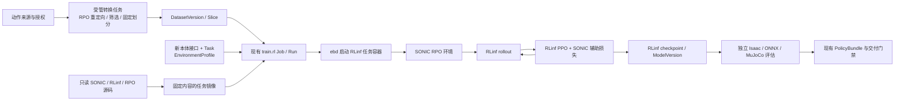

# 13 · SONIC 接入 RPO 与 RLinf 训练适配

日期：2026-09-23。状态：**接入方案，尚未实施或验证 SONIC→RPO 训练**。本次只新增设计文档与目录索引，不修改产品代码、不运行训练、不做 Git 提交。

遵循 [02 · 系统架构](02-system-architecture.md)、[03 · 数据与采集](03-data-collection.md)、[04 · 模型与训练](04-model-training.md)、[05 · 评估与交付](05-evaluation-delivery.md)、[10 · RPO WBC](10-roboparty-rpo-wbc-integration.md)、[11 · 直立直行](11-rpo-stand-walk-phase-a.md)、[12 · 环境目录](12-environment-catalog-and-selection.md)。本文新增训练路线，不覆盖已发布接口、旧任务或其评估结果。

## 1. 结论与范围

**可以引入 SONIC，但应把它作为 RLinf 内的动作跟踪环境和策略组件接入，不能把 SONIC 自带 trainer 套进 RLinf 启动器。** 推荐路径是：

```text
人类动作 / 自有动作
→ RPO 重定向、可行性筛选、冻结 motion DatasetVersion
→ SONIC 的 RPO tracking 环境 + reference encoder / FSQ / RPO decoder
→ RLinf rollout、GAE、PPO＋辅助损失、optimizer、权重同步、checkpoint
→ ModelVersion → 独立 Isaac / ONNX / MuJoCo 评估 → 现有交付门禁
```

用户已确认：SONIC 指 NVIDIA `NVlabs/GR00T-WholeBodyControl` 中的 **GEAR-SONIC**；RPO 指当前环境中的 **RoboParty 机器人**，对应本项目 RPO V2.0、23 DoF。目标是**完整 SONIC 能力迁移到 RPO，训练统一由 RLinf 执行**。单一动作参考只是中间验证阶段，不是最终完成标准。

三条路线的区别：

| 路线 | 得到什么 | 判断 |
|---|---|---|
| SONIC 环境、动作表示与网络移入 RLinf，迁移到 RPO | RPO 上完整的 SONIC 控制能力，训练仍属于 RLinf | **采用路线**；先单参考验证，再完成多模态与控制前端 |
| 只用动作库与 tracking reward，RLinf 训练普通 MLP | 较小的 RPO 动作跟踪策略 | 适合验证环境与数据的对照；不能称为完整 SONIC |
| 直接载入 G1 SONIC 权重，删掉多余关节或调用上游 trainer | 不能证明 RPO 兼容；后者不满足 RLinf 训练要求 | 不采用；部分权重复用另做明确实验 |

SONIC 的价值是让策略通过参考动作学习协调运动、再接受不同形式的运动意图；它不会自动修复 RPO 的资产限位、错误奖励或跌倒漏判。[11](11-rpo-stand-walk-phase-a.md) 的站立/直行基线仍应独立推进，接入研究可以并行开展，不以“先训练完整 SONIC”为站稳的前置条件。

初始课程只覆盖平地、直立、低速行走和温和上肢动作，随后扩展到 RPO 物理可行的完整动作范围。完整功能迁移不等于 RPO 自动获得 G1 的全部动作性能；跳跃、翻滚、接触操作各自需要可行动作和独立验收。VR 设备、输入延迟和 planner 实现仍需具体选择；VLA 联训、灵巧手及同仓 MotionBricks 不因共处一个仓库自动进入本任务。

完整迁移的验收边界：

| 必做能力 | 完成标准 |
|---|---|
| 全身 motion tracking | RPO 参考 encoder、FSQ、23 维 dynamics decoder、kinematic decoder 与独立 critic 全部接入 RLinf |
| 多模态统一控制 | robot-reference、teleop 三点目标、人类运动输入均可驱动同一 RPO 策略；以 release 的 SMPL 路径为基线，SOMA 可作为额外入口 |
| SONIC 训练目标 | PPO、运动重建、跨模态 latent 对齐、重编码一致性及所用课程/采样状态真实参与 RLinf 训练与恢复 |
| 规划/实时参考前端 | 速度/转向/姿态意图能生成 RPO 可行参考；teleop 录制回放、输入切换、延迟和丢帧路径有闭环证据 |
| 平台闭环 | 同一套数据、Job/Run、模型版本、独立评估、导出与交付门禁；每个声明能力都有证据 |

缺少模态数据或某项尚未实现时，该阶段应标记未完成；不得把普通 MLP、单 encoder 或仅 ONNX 推理标为“完整 SONIC 已接入”。真机可部署仍由既有硬件与现场门禁另行判定。

**完整迁移有一项额外不确定性：controller 的训练源码已公开，kinematic planner 的训练源码在所查版本仍标为待发布。** 因此 controller→RLinf 是可设计的源码迁移，planner→RPO 先走冻结推理与重定向可行性验证；未通过该验证前不能承诺完整规划能力，详见 §5.5。

## 2. 证据基线：已经有什么，缺什么

### 2.1 调研版本与可信边界

- SONIC 源码固定到 [`7f151314d4d1606544bf249d2a7a1cb754c64582`](https://github.com/NVlabs/GR00T-WholeBodyControl/tree/7f151314d4d1606544bf249d2a7a1cb754c64582)，本次通过 GitHub API 解析，提交日期 2026-09-15；下文源码链接均指向这个版本。
- 本地 RLinf：`/data/kk/RLinf`，HEAD `018e6a9e0da60f96eeda8b11008543911027d414`，有工作区修改；**HEAD 不能代表实际运行源码**。正式镜像沿用内容快照、补丁 hash、image digest 的三重绑定。
- 平台依据当前工作区静态阅读，不以 Git HEAD 或 AGENTS.md 中较早的骨架说明代替当前代码。既有大量未提交修改保持原样。
- 官方网站与 Hugging Face 是查询日期的在线资料；checkpoint、数据和许可还未下载冻结。本文没有验证权重张量、Isaac 兼容性、显存、收敛或真机性能。

### 2.2 SONIC 上游已经公开的能力

| 能力 | 核实结果 | 接入含义 |
|---|---|---|
| 训练源码 | 已公开；`train_agent_trl.py` 创建 Accelerate / TRL trainer 并调用 `trainer.train()` | 可复用模块，正式任务不能直接执行该训练循环 |
| 策略结构 | reference encoder → FSQ token → 动力学 decoder；另有运动重建 decoder、critic 和辅助损失 | 普通 890→23 MLP 不能通过改模型路径变成 SONIC |
| 已发布模型 | 官方列出原版、低延迟版、v1.1，均为 G1 控制器；包含 PyTorch 与 ONNX 文件 | 选择变体时权重、观测配置必须成套；G1 兼容不等于 RPO 兼容 |
| 新本体适配 | 有新本体指南和 H2 例子 | 证明有扩展入口，不证明已经支持 RPO |
| 动作数据 | BONES-SEED 有人类骨架与 G1 重定向轨迹 | RPO 仍须自己的重定向与验收 |
| Kinematic planner | 有 G1 ONNX 接口与 C++ 推理代码；文档仍标训练源码待发布 | 与 controller 分别判断开放程度；适配方案和风险见 §5.5 |

来源：[训练入口](https://github.com/NVlabs/GR00T-WholeBodyControl/blob/7f151314d4d1606544bf249d2a7a1cb754c64582/gear_sonic/train_agent_trl.py)、[网络配置](https://github.com/NVlabs/GR00T-WholeBodyControl/blob/7f151314d4d1606544bf249d2a7a1cb754c64582/gear_sonic/config/actor_critic/universal_token/all_mlp_v1.yaml)、[模型发布说明](https://huggingface.co/nvidia/GEAR-SONIC)、[新本体指南](https://nvlabs.github.io/GR00T-WholeBodyControl/user_guide/new_embodiments.html)、[数据卡](https://huggingface.co/datasets/bones-studio/seed)。

### 2.3 当前 RPO / RLinf 实际链路

```text
TrainNew.vue
→ routes_train.py：模板、数据/模型、EnvironmentProfile 校验与 JobSpec
→ RlinfAdapter.render：镜像、配置、只读资产与输出挂载
→ scheduler / ebd：租用 GPU、启动任务容器
→ rlinf_entry.py
→ RLinf examples/embodiment/train_embodied_agent.py
→ EnvWorker + MultiStepRolloutWorker + EmbodiedFSDPActor / EmbodiedRunner
→ checkpoint 发布、模型登记、独立评估
```

| 现有文件 / 行为 | 可以复用 | SONIC 接入缺口 |
|---|---|---|
| [rlinf_form.py](../../backend/eb/domain/rlinf_form.py)：`rpo_v2_wbc_{stand_walk_ppo,ppo}` | PPO 模板、保护 override、GPU placement | 两个旧模板不接受动作库/基座；新 recipe 需单独绑定 |
| [rpo_wbc_extension.py](../../backend/eb/runners/rpo_wbc_extension.py) | RPO 资产、关节顺序、非对称 critic、终止状态设计经验 | 当前是速度＋11 维上肢目标的 DirectRLEnv，不是 SONIC ManagerBased tracking 环境 |
| [当前接口](../../contracts/ee_rpo_v2_wbc_23dof_v1.yaml) | 23 关节、电机语义参考 | actor 890、critic 1500；增加 motion/token 输入后必须新建接口 |
| [rlinf.py](../../backend/eb/adapters/rlinf.py) | 固定入口、Job/Run、只读挂载、输出路径 | Job kind、镜像、输入映射、恢复入口多处按模板 ID/前缀分支 |
| [rlinf_entry.py](../../backend/eb/runners/rlinf_entry.py) | resolved config、receipt、发布与恢复协议 | 发布器目前把 MLP 特判为 890 维；其他模型按 VLA 处理并寻找父模型 norm，不能直接支持新 SONIC 类型 |
| [rpo_wbc_artifact.py](../../backend/eb/runners/rpo_wbc_artifact.py) | 评估证据和媒体回流方式 | 导出/观测构造针对既有 MLP，不能复用为 SONIC 导出器 |
| [rlinf-rpo.Dockerfile](../../deploy/images/rlinf-rpo.Dockerfile)、[patch_rpo_wbc.py](../../deploy/patches/rlinf/patch_rpo_wbc.py) | 镜像内补丁与源内容校验模式 | 缺 SONIC、motion loader、网络注册、辅助损失与相应 probe |

既有 [9 月 21 日进度](../progress/2026-09-21-rpo-wbc-p4.md) 只记录当时的实现与检查；[9 月 23 日设计](11-rpo-stand-walk-phase-a.md) 已解释旧策略倒地、终止遗漏和奖励尺度问题。本文不把旧训练曲线、合成权重导出或代码完成当作成功 RPO 基线。

## 3. 职责边界与对象绑定



| 层 | 负责 | 不承担 |
|---|---|---|
| Python 控制面 | 版本绑定、受控配置、预览/提交、准入、血缘、门禁 | 运行 trainer、加载全部动作库、GPU rollout |
| Rust / ebd | 容器、设备、挂载、日志/视频/大文件通道、生命周期 | 新建 SONIC 专属调度系统 |
| SONIC 组件 | 参考轨迹、tracking 观测/奖励、encoder/FSQ/decoder、辅助目标 | 正式 optimizer、训练主循环、独立分布式进程组 |
| RLinf | rollout 传输、GAE/PPO、backward/optimizer、同步与 checkpoint | 调用另一个 trainer 代替训练 |

新增的逻辑绑定建议如下；**名称为拟议 ID，尚未注册**：

| 对象 | 建议 | 版本边界 |
|---|---|---|
| Embodiment / 形态 | 复用 `emb_roboparty_rpo` / RPO V2 23 DoF | 同一机器人物理资产不重复建家族 |
| EmbodimentEnv | `ee_rpo_v2_sonic_23dof_v1` | 新观测分组、reference horizon、动作 codec；发布后不可变 |
| Task | `tsk_rpo_motion_tracking` | 首期平地低速动作跟踪，与速度控制任务分开 |
| Recipe | `rpo_v2_sonic_tracking_ppo` | 数据必填；初始化模式由受控配置选择 |
| Runtime / 镜像 | RPO SONIC 专用 profile，示例 tag `eb/rlinf:rpo-v2-sonic` | 正式以 digest 标识 |
| EnvironmentProfile | 新 recipe 专属训练/评估修订 | 定义 motion sampler、奖励、终止、课程，声明实际生效字段 |
| DataSlice | RPO motion library 训练/validation/acceptance 划分 | motion 数据，不冒充图像动作示教 |
| EvalSuite | RPO tracking 独立冻结套件 | 不继承旧 890→23 套件资格 |

复用 `train.rl`；合法已训练 RPO SONIC 的权重初始化可绑定 `train.rlft`，恢复按原 kind 派生。受控的 G1 部分权重迁移仍是新的 RPO 训练实验，不能记为对同一个策略的无缝恢复。无需新增 JobKind、训练服务或业务数据库；仅按既有模板/recipe 模式增加声明和必要校验，不重构通用领域对象。

## 4. 最先要解决的工程问题：RPO 动作数据

### 4.1 来源与转换

优先选一小批授权明确的直立/行走人类动作，或已有可用的 RPO 参考轨迹。可将 [SOMA Retargeter](https://github.com/NVIDIA/soma-retargeter) 作为候选重定向工具，固定版本、RPO mapping 与求解参数后再接入；本次没有确认其现成 RPO 配置。已有工具若能输出合格 RPO 轨迹，优先复用，不为 SONIC 再造通用重定向框架。

```text
SourceVersion（原始动作、许可、hash）
→ data.retarget Job（受管容器，重定向到批准的 RPO 资产）
→ data.convert Job（发布 SONIC 兼容 motion view）
→ 同步 root / q / dq / FK / 接触标签、重采样、质量报告
→ 按原始动作组划分，再做裁剪/镜像增强
→ DatasetVersion + 固定 Slice + SONIC motion view
→ 目标训练镜像 loader 回读 / input receipt
```

G1 的 29 维 CSV 不能删去 6 列作为 RPO 的 23 维数据：关节轴、腰和腕部自由度、连杆长度、默认角、质量与接触约束均不同。重定向应优化脚接触、根运动和可达身体关键点；不能要求 RPO 在缺少腕部自由度时完整复现 G1 的手腕姿态。

### 4.2 数据契约

| 字段 | 要求 |
|---|---|
| 身份 | source hash、原始 motion/group ID、转换代码与参数 hash、RPO 资产 hash、split |
| 时间 | 原始 FPS、目标采样时间、每条有效时长；重采样后速度按同一时间轴计算 |
| root | 平移单位 m；世界轴、左右手系、heading 与四元数顺序在 manifest 明示 |
| 关节 | `dof[T,23]`，rad，明确 MuJoCo / Isaac / 平台标准顺序的双向映射 |
| 骨架 | `pose_aa[T,B,3]` 与 RPO MJCF 的实际树和固定 link 处理一致；不能假定 B 恒等于 24 |
| 可选模态 | 人类骨架/teleop 目标和 RPO 轨迹必须同 motion、同时间；缺失用 availability mask，不作为有效全零监督 |
| 质量 | 限位、速度、接触滑动、穿地、自碰撞、FK 误差、重定向残差与剔除原因 |
| 发布 | 文件列表、大小/hash、loader 版本、实际训练样本数与可用时长、许可用途 |

上游兼容 view 可以采用其 joblib PKL 结构，但只加载受管转换器输出且 hash 已核验的内容；pickle/joblib 是可执行反序列化，不允许 API 直接加载任意上传 PKL。原始导入、转换、回读均在隔离工具容器内进行。

### 4.3 上游脚本不能原样当作 RPO 适配

1. [`convert_soma_csv_to_motion_lib.py`](https://github.com/NVlabs/GR00T-WholeBodyControl/blob/7f151314d4d1606544bf249d2a7a1cb754c64582/gear_sonic/data_process/convert_soma_csv_to_motion_lib.py) 写死 `NUM_DOF=29`、`NUM_BODIES=30`、G1 轴与重排数组。需增加 RPO 专用配置/转换路径；不能只改数字。
2. 同一转换器的 `root_rot` 输出是 `xyzw`，而新本体指南的示例标为 `wxyz`。平台以显式边界转换和“单位旋转＋绕 z 轴 90°”黄金样本核验；检查 `pose_aa`、loader FK 和仿真姿态的一致性，不凭字段名推断。[源码转换函数](https://github.com/NVlabs/GR00T-WholeBodyControl/blob/7f151314d4d1606544bf249d2a7a1cb754c64582/gear_sonic/data_process/convert_soma_csv_to_motion_lib.py)
3. 该脚本降采样采用整数 stride；例如 120→50 不能截帧后直接标注 50 FPS。非整数比例必须按时间插值，旋转使用正确的球面插值/等价实现，并检查时长与接触事件。
4. [`filter_and_copy_bones_data.py`](https://github.com/NVlabs/GR00T-WholeBodyControl/blob/7f151314d4d1606544bf249d2a7a1cb754c64582/gear_sonic/data_process/filter_and_copy_bones_data.py) 主要按路径关键词筛选与复制。它不是关节限位或动力学可行性检查，也不能替代 RPO 仿真回放。

静态合法仅允许进入训练候选：还需在 RPO 仿真中检查站立高度、足底接触和跟踪难度。难以执行的动作应有明确标记，首期不把它们全部交给策略“自己学”。

### 4.4 划分、许可与存储

同一源动作的镜像、裁剪、变速版本必须在同一 split；按原始动作组、采集 session/表演者去重，避免训练与验收泄漏。validation 用来选模型与调阈值，acceptance 在候选和判据冻结后才运行。

源码 Apache-2.0、模型 NVIDIA Open Model License、动作数据许可是三条独立血缘。BONES-SEED 当前是自定义许可，对使用主体和用途有条件，并非“可下载即无限制使用”。正式下载和发布前确认该主体的授权与用途，许可随数据与模型版本保留；不符合来源要求时采用自有/另行授权数据。这是现有数据发布门禁的应用，不是本次文档工作的阻塞条件。[源码/模型许可说明](https://github.com/NVlabs/GR00T-WholeBodyControl#license)、[BONES-SEED 许可原文](https://huggingface.co/datasets/bones-studio/seed/blob/main/LICENSE.md)

动作库在受管数据根分片存储，训练源只读；运行时按预算加载子集并保留采样统计，不把全部库复制到每个 GPU 进程。临时转换、缓存、视频及 checkpoint 都有字节预算，不改变 ebd 大字节通道。

## 5. RPO tracking 环境与新接口

### 5.1 复用 SONIC 环境组件，复用 RPO 物理事实

使用 SONIC `modular_tracking_env_cfg.py` 的 ManagerBased 环境配置与 mdp 组件，添加受管 RPO robot profile / mapping，接入已有 RPO 资产 manifest。不要把整套 tracking 逻辑复制进旧 `InterruptEnv`。

RPO profile 至少绑定：23 关节名称/顺序、实际 body 和锚点、双脚与手臂末端、default pose、质量/惯量、碰撞、PD/armature、effort/velocity limits、逐关节 action scale。G1 的 wrist/head link 不能作为 RPO 默认值；不存在的观测/奖励 body 在启动 probe 中直接失败。[上游 robot mapping](https://github.com/NVlabs/GR00T-WholeBodyControl/blob/7f151314d4d1606544bf249d2a7a1cb754c64582/gear_sonic/envs/manager_env/modular_tracking_env_cfg.py)

物理参数继续服从 [10](10-roboparty-rpo-wbc-integration.md) 的 V2.0 资产差异核对。首个对照优先保持当前 RPO 50 Hz 策略步、200 Hz 物理步和已声明 actuator 配置；若必须改成 SONIC 的 actuator 模型、仿真频率或逐关节缩放，发布独立运行修订并重新评估，不把 G1 PD 参数直接套到 RPO。实物尚未匹配时保持 `simulation_unverified`。

### 5.2 观测与动作协议

新接口不能把 SONIC 填进旧 890 维向量。建议逻辑分组如下，具体张量布局由配置 probe 生成并在发布时冻结：

| 分组 | 内容 | 使用方 |
|---|---|---|
| `proprio` | gravity、角速度、23 维 q/dq、上次动作及历史 | actor；端侧可获得 |
| `reference` / `tokenizer` | RPO 参考 q/dq、锚点相对朝向、future frames、有效帧及模态 mask | encoder；是已给定目标，不是未来实测状态 |
| `critic_states` | 特权速度、接触、误差等，维度由环境生成 | 仅 critic |
| `action` | 23 维对角高斯样本；评估为均值 | 仿真 PD / 端侧 codec |

若沿用上游五类 proprio、各 10 帧，则理论维度为 `(3+3+23+23+23)×10=750`；这是方案计算，**不是已测得的 SONIC-RPO 输入规格**。Isaac observation manager 可能按 term 展平历史，不能按旧代码的逐帧拼接顺序解释。冻结 term 次序、历史方向、reset 填充、scale/clip、mask 与 shape；critic 同理。[上游 policy 观测配置](https://github.com/NVlabs/GR00T-WholeBodyControl/blob/7f151314d4d1606544bf249d2a7a1cb754c64582/gear_sonic/config/manager_env/observations/policy/local_dir_hist.yaml)

动作保持“默认关节角＋逐关节 scale×归一化输出”，明确限幅是在采样之后还是分布变换中、历史保存的是原始样本还是执行值。PPO 的 log-prob 必须对应采样随机变量；不能用裁剪后的动作重新冒充原样本。若引入 tanh 分布，密度变换必须一并实现并验证。

### 5.3 Reference horizon 与命令语义

首个 robot-reference recipe 可参考 `sonic_release` 的 10 帧、0.1 s 间隔；SMPL 路径的参考间隔是 0.02 s，两者不能统称“200 ms lookahead”。实际首/末索引偏移以 command builder 的回执为准，冻结在新接口里。[release 配置](https://github.com/NVlabs/GR00T-WholeBodyControl/blob/7f151314d4d1606544bf249d2a7a1cb754c64582/gear_sonic/config/exp/manager/universal_token/all_modes/sonic_release.yaml)

离线轨迹允许读取未来**参考**帧；实时遥操无法看到未来实测输入，须另行选择缓冲、预测或短 horizon，并按同一输入机制训练和评估。窗口越界需一致的 valid mask/尾帧策略，不能跨入下一动作。

旧任务接收 `vx/vy/yaw + upper_body_reference`；新任务接收 motion reference。完整接入必须把“速度→RPO 可行参考”的命令生成器作为冻结组件纳入评估。中间验证阶段可用受控动作片段及连续拼接；G1 planner 或 G1 latent 不默认兼容 RPO latent。完整组件尚未通过时，页面应明确只支持已验证的动作参考跟踪能力。

### 5.4 奖励、终止与重置

- 奖励组合包括关节/关键点/锚点跟踪、足接触与滑动、动作变化和动力学约束。每项记录原值、权重及 `dt`；继承现有 RPO 奖励修复经验，防止自定义项相对放大 50 倍。
- 动作完成、时间限制、跟踪失败、跌倒是不同原因。首期直立动作保留 [11](11-rpo-stand-walk-phase-a.md) 的高度/倾角独立检查；将来蹲伏或起身不能直接沿用直立阈值，需新 suite/profile。
- 初期关闭大扰动、混合上肢动作增强及复杂自适应课程；先验证单条参考可跟踪。参考状态初始化可用于训练，但验收还必须含中立站姿启动，避免策略只会从“已经走起来”的状态继续。
- **reset 只能有一个负责人。** SONIC ManagerBased env 的自动 reset 与现有 RLinf wrapper 的 partial reset 不可叠加。新增 bridge 应返回 reset 前的真实 final actor/critic/reference 观测、termination/truncation 与 mask，再执行一次 reset；若受用版本已提供 final-observation hook，优先复用，否则在受管副本增加最小 hook。不能从 reset 后观测重建终止状态。
- 超时 bootstrap 必须用 final critic 观测；跌倒真实终止不 bootstrap；动作自然结束的任务定义单独固定。用短 episode 的手工可计算 GAE 检查，而非只看训练能跑。
- 历史、上次动作、reference cursor、模态 mask 在 episode 边界一起清理。自适应采样按 reset **前**的 motion ID/cursor 归因；上游已有 `capture_adaptive_cursor_snapshot()`，移植时不能遗漏。[wrapper](https://github.com/NVlabs/GR00T-WholeBodyControl/blob/7f151314d4d1606544bf249d2a7a1cb754c64582/gear_sonic/envs/wrapper/manager_env_wrapper.py)、[motion command](https://github.com/NVlabs/GR00T-WholeBodyControl/blob/7f151314d4d1606544bf249d2a7a1cb754c64582/gear_sonic/envs/manager_env/mdp/commands.py)
- 本地 `IsaaclabBaseEnv.step()` 会用新的 metrics 字典替换环境 `infos`，且 `_record_metrics()` 把正 reward 计为 `success_once`。新 bridge 必须保留受控的终止原因、motion ID、采样计数与质量统计，并改用任务定义的成功事件；不能直接继承这两项行为。

### 5.5 完整阶段：多模态输入与 planner

**Teleop / 人类输入。** 从同一人类动作生成 RPO 轨迹、头/双手目标及对应人类骨架，按时间配对。人体身高、手臂长度、世界/人体/机器人 heading、设备到手掌的外参都进入版本化标定。RPO 的手臂缺少 G1 的腕自由度，输入应投影到可达目标并记录残差；无法实现的旋转分量设明确有效性约束，不能向用户报告已完整跟踪。训练加入与目标设备匹配的输入频率、延迟、丢帧和模态切换；验收同时报告原始人体目标误差和投影后的控制误差，避免投影掩盖能力不足。

**Planner 是单独的迁移点。** 固定版本 [planner 接口](https://github.com/NVlabs/GR00T-WholeBodyControl/blob/7f151314d4d1606544bf249d2a7a1cb754c64582/docs/source/references/planner_onnx.md) 的 context 是 `[1,4,36]`，输出为 G1 qpos 轨迹；36 来自 free root 的 7 维与 G1 的 29 关节。RPO 若采用相同 free-root 表示则是 30 维，不能靠 padding/cropping 获得物理等价。该接口的 `target_vel<=0` 使用模式默认速度，停止必须使用正确的 idle/状态机语义，不能简单传零当急停。

建议先验证下列路线，均不启动 SONIC 原生 trainer：

```text
RPO 状态/参考历史 → 带可达约束的 G1 proxy context
速度 / 朝向 / 高度 / 已验证风格 → 冻结的 G1 planner ONNX
→ G1 未来运动 → RPO 重定向 / 接触与连续性检查
→ RPO reference encoder → 已由 RLinf 训练的 RPO controller
```

这是**待验证工程方案，不是上游已提供的 RPO 功能**。需要同时验证状态投影与输出重定向，处理不对称自由度、生成频率、有效输出帧数、根漂移、规划重叠窗口及接触连续性；将该前端实际生成的参考分布加入 RLinf 训练与独立评估，不能只训练离线理想动作。先在少量可行模式上测延迟与稳定性，再扩展到 RPO 可行动作清单。

若双向适配无法达到实时/质量要求，继续采用已验证 RPO 动作片段生成参考作为诊断能力，同时把完整 planner 迁移保持 `blocked/unsupported`；后续需上游可训练模型/源码，或另行批准 RPO 原生 planner 的实现方案，不能把片段播放冒充完整 planner。若新增学习式 planner 的训练，也必须走现有 Job/Run 并落实到 RLinf 支持的训练路径，不另起平台外训练系统。

输入前端、重定向器、controller 和模式范围共同进入 PolicyBundle。所有输入中断/越界/切换行为先在仿真与目标板离线验证；实际端侧控制仍由现场部署栈负责。

## 6. SONIC 模型如何进入 RLinf

### 6.1 新模型 builder，不替换 RLinf trainer

本地 RLinf 已有 `rlinf.models.register_model(model_type, builder)`，并会注册 `SupportedModel`。增加受管 `SonicRpoPolicy`，实现 `BasePolicy.default_forward()` 与 `predict_action_batch()`；不修改已有 MLP 语义，也不把 SONIC 误注册为 GR00T VLA。

策略组件为：

```text
reference ─→ RPO motion encoder ─→ FSQ ─┬→ dynamics decoder + proprio → μ[23], σ[23]
                                      └→ kinematic decoder → reference reconstruction
critic_states ─→ critic → V

完整阶段：teleop / SMPL encoder → 同一 latent，逐模态验收；SOMA 可扩展
```

首个真实 SONIC 结构阶段保留 motion encoder、FSQ、动态/运动学 decoder、critic；只有普通 tracking MLP 的阶段标为诊断基线。可先用比上游发布模型小的网络配置测通路，记录宽度与参数量；最终是否扩大由对照结果决定，不能将小规模结果等同上游基础模型能力。

上游代码内部大量使用 `g1`、`g1_dyn`、`g1_kin` 键，并有默认 `body_action_dim=29`。最小适配可保留这些内部键作为兼容别名，但 robot/body/action 的实际定义全部来自 RPO profile；receipt 和用户界面必须显示 RPO。不能只改网络最后一层，同时遗漏重建维度、模态掩码、body 映射或默认 29 维切片。[UniversalTokenModule](https://github.com/NVlabs/GR00T-WholeBodyControl/blob/7f151314d4d1606544bf249d2a7a1cb754c64582/gear_sonic/trl/modules/universal_token_modules.py)

### 6.2 RLinf 数据接口

| 环节 | 必须传递的内容 | 关键检查 |
|---|---|---|
| env → rollout | proprio、reference/tokenizer、critic_states、有效帧/模态标记 | 新 bridge 不能像旧 `_wrap_obs()` 一样只保留两项 |
| rollout → actor | 原始采样 action、old log-prob、old value、同一份 forward_inputs | 环境数、时间维、chunk、模态和 reset 对齐 |
| actor forward | 新 log-prob、entropy、value、带梯度的 aux loss | 使用同一观测/模态/normalization，重算动作分布 |
| actor → rollout | encoder、FSQ 相关状态、decoder、std、推理 normalization buffers | 各 worker 均加载同一策略版本 |
| checkpoint | 策略、critic、optimizer/scheduler、RNG、step、课程与采样状态 | 可重载且不依赖原生 SONIC trainer |

沿用 `num_action_chunks=1` 和连续动作 PPO。本地 `rlinf/algorithms/utils.py::preprocess_loss_inputs()` 的 `action_level` 在 23 个关节 log-prob 上求和；新 policy 应按其形状合同输出逐维密度，不能先求和后再让 RLinf 求和。固定权重与输入时，检查 rollout 与 actor 的原始输出以及聚合后的 ratio≈1。

训练批必须保存原始 reference 输入，**不能只保存旧 encoder 算好的 latent**；否则 PPO 更新 decoder 时 encoder 无法得到正确梯度。encoder 选择、frame mask、噪声与增强已体现在 rollout 输入中，重算时不得重新抽样。部署观测噪声在环境产生；首次接入禁用未验证的 dropout、compile、CUDA graph 与异步策略滞后。

策略注册需要在主进程、actor、rollout 和 Isaac 子进程各自生效。主进程临时注册不会自动穿过 `spawn`；采用镜像内固定模块导入/注册及受控 config，先 materialize lazy 参数再 FSDP 包装，禁止用户 Hydra `_target_` 任意导入。

### 6.3 辅助损失必须进入 RLinf 的同一次 backward

SONIC 不只是 tracking reward。上游 release 配置包括运动重建、多模态 latent 对齐与重编码一致性；其 TRL trainer 在 PPO loss 上加权求和。[辅助损失配置](https://github.com/NVlabs/GR00T-WholeBodyControl/blob/7f151314d4d1606544bf249d2a7a1cb754c64582/gear_sonic/config/aux_losses/universal_token/g1_recon_and_all_latent.yaml)、[上游求和实现](https://github.com/NVlabs/GR00T-WholeBodyControl/blob/7f151314d4d1606544bf249d2a7a1cb754c64582/gear_sonic/trl/trainer/ppo_trainer_aux_loss.py)

```text
L = L_RLinf_PPO（含 value 与 entropy 项）
    + λ_recon L_RPO_reference_recon
    + Σ λ_pair L_paired_latent
    + λ_cycle L_reencode
```

本地 `rlinf/workers/actor/embodied_fsdp_actor_worker.py::train_micro_batch()` 目前读取 logprobs、values、entropy，没有消费 SONIC 的 `aux_losses`。受管补丁在该路径的 gradient accumulation 除法之前合并受控辅助损失，继续使用 RLinf 的 backward context、AMP、梯度裁剪与 optimizer。不能在策略 forward 内另起 optimizer，也不能把可微重建误差改成环境 reward 就称为等价训练。

实施时逐项验证：

1. 单机器人 encoder 阶段只启用 RPO 重建；没有配对模态时不启用跨模态损失，也不喂零值占位冒充监督。
2. 后续 latent 对齐保留上游 loss 的目标分支 `detach`、样本配对、方向与归一化；不能统一替换成无差别对称 MSE。系数参考上游只是实验起点，不保证尺度适合 RPO。
3. 每项按有效样本数、跨 rank 全局样本数加权；某 rank 无该模态时产生有限的零贡献，并处理未使用参数，防止挂死或 rank 平均造成偏置。
4. 辅助 loss 保持计算图，仅日志值 detach；检查 encoder 和 decoder 梯度、非零参数更新。将系数置零可回到 PPO 对照，并做损失尺度/梯度范数记录。
5. 首期只允许已适配的同步 PPO worker，`runner.use_training_pipeline=false`；其他训练后端/异步路径未适配时直接拒绝，不静默漏掉辅助损失。

### 6.4 自适应采样与课程

第一次桥接使用固定小库、固定概率，让终止和更新可重复。进入大动作库训练时，迁移上游的失败统计、概率更新、重采样时机与 checkpoint state；这些属于 env worker 的受控状态，不能依赖 TRL callback 才运行。

明确各 rank 持有的动作子集、失败计数聚合、概率广播和 RNG；若先采用每 rank 独立统计，要把这个差异写入 recipe 并与统一统计对照。评估使用固定逐 case 列表，禁用训练自适应采样。课程越过阶段或更换 motion view 不得悄悄改变已冻结 Run 的训练语义。

## 7. 已发布 G1 权重怎么用

**完整权重直接用于 RPO 不作为基线。** 发布的 G1 proprio、参考编码、动作输出和运动重建维度都带本体语义；即使两个 tensor 恰好同 shape，也不等于可迁移。

| 方式 | 可采用条件 | 记录方式 |
|---|---|---|
| RPO 网络随机初始化 | 已有小规模合格 RPO motion view | 正式可行性基线，`train.rl` |
| 部分模块 warm-start | PyTorch 权重与配置已冻结；输入表示/shape/语义逐项核验 | 迁移报告列出 loaded / reinitialized / rejected keys、参数占比与理由 |
| RPO SONIC 继续训练 | 同本体/模型/观测；满足 checkpoint 完整性和兼容指纹 | `trainer_state` 恢复，或明确新语义的 warm-start |
| G1 ONNX 作对照 | G1 仿真与输入有独立配置 | 只证明 G1 推理/迁移前对照，不能当 RPO teacher 的正确动作标签 |

人类 encoder 的部分权重可成为候选，但需检查其是否还依赖 G1 wrist/姿态特征；FSQ 本身不能被视为包含全部运控能力的通用知识库。RPO decoder、std、critic 与本体相关层通常需要重新初始化；哪些共享层保留，以实测对照为准，不承诺“只改输出头就能微调”。

所有迁移必须使用显式 allowlist 和 shape 检查，禁止无报告 `strict=False`。缺文件、错版本或配置不一致直接失败，不能偷偷退回随机初始化。上游 `last.pt` 是上游训练状态格式，不是 RLinf resume checkpoint；只读提取批准权重，RLinf 新建 optimizer/scheduler/RNG 状态。

完整多模态路线需要同一动作的 RPO、人类骨架及 teleop 目标配对。SMPL 与 SOMA 不是可以直接互换的 joint layout；模态数据和授权未具备时停留在 robot-reference 能力等级，并将完整迁移标为未完成，不能宣称通用遥操。

## 8. 当前平台需要改哪些位置

以下是实施清单，**本次尚未改动这些代码**。复用现有抽象，只增加 SONIC 确实需要的受控分支；不因本方案另建插件市场或通用训练 SDK。

| 位置 | 最小必要改动 | 验收证据 |
|---|---|---|
| `contracts/`、`bootstrap.py` | 新 interface/task/profile/recipe 绑定；沿用 RPO embodiment 和资产版本 | 旧 active 接口内容不变，新规格由 probe 冻结 |
| `backend/eb/domain/rlinf_form.py` | 新模板、镜像、数值范围和输入要求；新类型明确 `train.rl`/RLFT | 不落入旧 `ppo→TRAIN_RLFT` 默认分支；配置快照一致 |
| `backend/eb/api/routes_train.py`、`adapters/rlinf.py` | motion 版本校验、只读挂载、配置注入、初始化模式、resume 白名单 | preview/submit/renderer 三处得到同一输入；不放宽旧 RPO 禁止数据规则 |
| 数据转换 runner、`data_validation.py` 及接入入口 | SONIC motion view 与真实 loader probe；校验 23 DoF/资产/时间/划分 | motion 数据可验证为训练就绪；不套 LeRobot 图像动作 schema |
| `backend/eb/runners/` | RPO tracking bridge、SonicRpoPolicy、配置与导出能力 | 单 env、批量 forward、PPO 更新、checkpoint 重载 |
| 受管参考前端与端侧适配包 | teleop 三点映射、速度/姿态到 RPO 参考、缓冲与模态切换；仿真测试在任务容器执行 | 全部前端产出同一版本化参考协议；在线端侧不经过平台实时回路 |
| `deploy/patches/rlinf/` | 模型/env 注册，PPO 辅助损失接入和必要 terminal hook | 补丁位置严格匹配；每个 worker 实际生效 |
| `backend/eb/runners/rlinf_entry.py` | 发布 SONIC 自身配置、normalization、接口/参考与模型 manifest | 新模型不按 VLA 复制父目录，也不写死 MLP 890 维 norm |
| `backend/eb/checkpoints.py` 与 RLinf 保存扩展 | 兼容指纹覆盖 motion/encoder/aux/sampler；保存训练附加状态 | 换 motion view 或模态后禁止冒充同一恢复 |
| `environment_catalog.py`、`domain/environment_profile.py` | recipe 对应训练/评估 profile、可编辑字段与执行映射 | 改界面参数确实改变受管 config；未支持参数禁止提交 |
| `frontend/src/views/TrainNew.vue` | 区分旧纯 RL 与新 motion RL，显示动作库、初始化和能力状态 | 新 recipe 能选择兼容 motion；旧表单行为不变 |
| 导出/评估 runner、评估路由与 suite | 识别 SONIC 模型包、构建 reference、跑实际 ONNX | 拒绝 890→23 专用导出器；逐 case 回执带完整 hash |
| `deploy/images/`、`Makefile`、容量估算 | 专用任务镜像及 probe、`make images` 构建入口、实测资源画像 | 仍由 `make up` 部署平台、ebd 动态启动 Job |

特别注意三处容易漏掉的现有行为：

- 当前 PPO 数据挂载存在，但 loader path 注入主要针对 SFT；新 motion Dataset 需要注入环境 motion loader，不能只在 TrainJob 表保存 ID。
- `rlinf_entry.publish_checkpoint()` 对非 MLP 类型要求父模型 norm；无基座 SONIC 的空路径不能被解释为当前目录并遍历。应显式声明发布文件集合，包含自己的模型结构与 normalization。
- 新 recipe 如果使用不同前缀，需要同时接通镜像内源码选择、受控 `rlinf_entry`、PYTHONPATH、源回执与恢复入口；不能为了命中旧分支伪装成旧 WBC 模板。

新 recipe 的保护配置必须覆盖：数据和基座版本、robot/profile、模型 builder、辅助项名单、镜像/源码、输出目录与设备。只给用户已验证的数值调参范围；Hydra 解析后再次校验，禁止任意路径、import target、网络与 mount override。

## 9. 镜像、单机资源与恢复

### 9.1 依赖和容器边界

SONIC 官方训练说明要求 Python 3.11 与 Isaac Lab 2.3+；现有 RPO 镜像依赖本地基础镜像、特定 URDF importer 和 RoboLab 资产，实际 Sim/Lab/CUDA/PyTorch 组合须容器 probe 后锁定。不能从 Dockerfile 名字推断已经兼容。[安装说明](https://nvlabs.github.io/GR00T-WholeBodyControl/getting_started/installation_training.html)

还有实际依赖冲突：本项目 [rlinf.Dockerfile](../../deploy/images/rlinf.Dockerfile) 固定 `transformers==4.53.2`，SONIC [training extra](https://github.com/NVlabs/GR00T-WholeBodyControl/blob/7f151314d4d1606544bf249d2a7a1cb754c64582/gear_sonic/pyproject.toml) 要求 `transformers>=4.56.2` 且引入 TRL。不要直接向共享 VLA 镜像执行不受控的 `pip install gear_sonic[training]`。派生独立 RPO SONIC 镜像，只装实际导入的环境/网络依赖；确有耦合时隔离/调整受管模块导入，并固定兼容包锁，TRL trainer 不进入正式执行链路。

代码、配置、motion/asset/model 内容快照均只读；缓存、生成 USD、日志、视频和输出进入受管可写目录。不得在只读 URDF/源码旁生成缓存。任务不挂 docker.sock，不要求 privileged/真机网络或现场驱动；平台 Redis 保持 6380，RLinf/Ray 使用既有隔离端口规划。

### 9.2 从 1 卡 probe 扩展到 4 卡

4×4090 是每卡 24GB，不是单块 96GB；上游大规模训练配置不能原样视为本机可行。正式选择环境数前测量 env、actor、rollout 副本、optimizer、activation、motion cache、shm 与主机 RAM，记录加载峰值和每秒样本数。

建议初始 probe 为 1 卡、16–64 env、24 步 rollout、小型网络与少量动作；这些是起测值，不是承诺能装下或收敛。先完成至少两次 PPO 更新和一次保存/重载，再探测 128/256/512 env 与 2/4 卡 placement。各规模固定可整除的 micro/global batch、采样总量和 seed；改变规模产生新 spec，不在 OOM 后静默降配。

原生 SONIC trainer 不得另建 Accelerate/NCCL world。跨卡训练与 env 统计同步由 RLinf 已分配的进程/通信路径处理，避免在 Isaac 子进程等待 actor 进程组导致死锁。先使用同步、可观测的 placement，再测分离 actor/env 是否有收益。

### 9.3 保存、恢复与血缘

保存 RLinf 模型/optimizer/scheduler/RNG/step 的同时，保存 SONIC schema、encoder 顺序、FSQ 配置、normalization、std、motion 划分/hash、采样概率/计数、课程阶段和各 rank sampler RNG。配置本身也是模型包的一部分，不能只留 `full_weights.pt`。

没有持久化物理状态、完整 env 历史和未消费 rollout 时，仅标为 `trainer_state`，从新 episode 边界恢复；不得声明 `exact`。若尚未实现 sampler/curriculum 的恢复，则拒绝该模式或明确只允许 warm-start，不能显示状态已恢复。

继续复用完整 manifest、原子发布、源 checkpoint 租约和最新完整版本保留规则；checkpoint 不完整不替换最后可用版本。最佳 validation 候选及最终验收权重必须先冻结/持有，避免在后续保存时被 GC。所有分片与 SONIC 附加状态在同一 step 完成后才标 complete。

## 10. 评估和交付：要证明什么

### 10.1 分开判断三个结果

1. **接入正确**：输入真实、关节/FK/时间一致、RLinf 有梯度更新、checkpoint 可重载。
2. **RPO 会跟踪**：在未参与训练的冻结动作、起始状态和 seed 上完成动作，并满足跟踪/接触/动力学指标。
3. **改善现有任务**：在中立站立、0.3 m/s 直行、上半身控制目标上比既有基线有收益；复杂 motion 成功不自动等于速度命令接口可用。

训练 reward、episode 长度、零退出码和 ONNX 文件存在都不能单独证明上述能力。

### 10.2 冻结 suite

| 套件 | 必需 case / 指标 | 判定原则 |
|---|---|---|
| bridge/codec 诊断 | 黄金姿态、关节往返排列、root 90°旋转、短/空/损坏 motion、partial reset | 合同错误直接失败，先于长训 |
| motion tracking | 未见源动作；中立启动与参考状态初始化分别报告；root/关键点误差、关节 RMSE、跌倒、足滑、限位/扭矩饱和 | 每 case 保留完成率、有效时长与失败原因；不只对幸存片段算均值 |
| stand/walk 回归 | [11](11-rpo-stand-walk-phase-a.md) 同一批场景条件、seed、20 s 时长和成功函数 | 使用新策略对应的 reference 前端；报告为显式可比较变体，不冒用旧 interface 的 suite ID |
| 模态一致性 | 同一动作从 robot / teleop / 人类输入驱动；模态切换、缺帧、输入中断 | 只有已实现的模态参与；不能以 robot 模式成绩替代全部模态 |
| 跨域与导出 | 同一策略包的 PyTorch→ONNX 数值一致性、Isaac ONNX 闭环、MuJoCo ONNX 闭环 | 三项独立状态；MuJoCo 与 Isaac 都核对相同 PD/codec |

tracking 阈值不能把 G1 论文数值直接抄为 RPO 门槛。实施阶段先用 validation 测得参考可行性与误差分布，确定并冻结任务相关阈值、case 列表和汇总规则，再首次运行 acceptance。阈值未冻结只能出诊断，不允许 `validated`。与旧 stand/walk 比较时保留其既有 12-case 标准规模与全部成功资格要求；小样本 smoke 没有通过资格。

必要对照采用相同数据划分与预算：现有速度控制 MLP、相同 tracking 环境的普通 MLP、SONIC 结构随机初始化、可选部分预训练迁移；后两项分别做 aux-off/aux-on 检查。统一比较 wall time、env steps、失败率和误差，而非只比各自 reward。研究初期小样本用于排错；正式声称提升时至少多 seed 重复并报告不确定性。

### 10.3 导出和现场边界

首期可导出组合 actor（proprio＋reference→23 维均值），以减少两个 ONNX 间的接口错误；完整阶段导出所有已验收输入模态的 encoder 与共享 decoder，或提供功能等价的组合图。分拆时将两者、normalization、obs layout、FSQ 设置、reference horizon、joint map、default pose、PD/action scale 作为同一个不可拆配的模型包，禁止跨版本混搭。

导出包含实际使用的 FSQ 舍入等算子，不用跳过量化的近似图冒充同一策略。对典型/边界/随机输入检查数值误差，再跑准备交付的实际 ONNX；逐 case 绑定模型、数据、profile、镜像、代码与 suite hash，并由 ebd 收集视频及回执。训练用 kinematic decoder/critic 可不进推理包，但恢复训练 checkpoint 仍须保留。

端侧需重新实现/核验历史、输入帧组装、坐标、reference 超时/丢包/结束处理和 RPO 电机 codec。G1 的 C++ 部署栈、设备协议和动作流不能直接替代 `roboparty_deploy`。测量编码＋解码＋预处理＋控制周期内的端到端时延；当前接口的 8 ms 预算与新模型是否兼容需实机离线 benchmark，不承诺本次能达到。

PolicyBundle、目标板无电机测试、现场人员确认与 Gate 4/5 沿用现有设计。平台不进入机器人实时环路，Agent 不具备真机放行、门禁豁免或远程关节控制能力。

## 11. 实施顺序与停止条件

| 阶段 | 工作与输出 | 进入下一阶段前的必要证据 |
|---|---|---|
| P0 范围与版本 | 确认目标模态、动作来源；冻结 SONIC/RLinf/RPO 内容及依赖；新 interface 草稿 | 许可/版本可定位；镜像依赖 probe；不动旧接口 |
| P1 数据与环境 | 少量 RPO motion 重定向、motion view、单 env replay/step、FK/codec/终止检查 | 同一黄金动作在 loader/Isaac/MuJoCo 姿态一致；partial reset 和 timeout 语义通过 |
| P2 RLinf tracking 闭环 | 先普通 MLP 诊断，同一环境接 SONIC 单 encoder/FSQ/重建；短 RLinf 训练 | 至少两次真实 PPO 更新；encoder/decoder 梯度与同步证据；保存/重载一致 |
| P3 平台完整接入 | 预览/提交、数据/模型/环境选择、取消、日志、模型登记与恢复 | UI 提交得到冻结 JobSpec；失败不中断旧任务；恢复和资产版本校验通过 |
| P4 能力训练与评估 | 小库课程到未见动作；stand/walk 回归、ONNX 和 sim2sim | 冻结 acceptance 满足标准；对照结果可复核，不能仅凭训练回报通过 |
| P5 完整多模态（必做） | 准备配对数据，接入 teleop/人类 encoder、latent/cycle loss；部分预训练是可选对照 | 各模态和切换逐项通过；不能以 P4 代替本阶段 |
| P6 控制前端与完整仿真验收（必做） | RPO 参考 planner/命令生成、teleop 输入、全部模态导出与回放、输入异常处理 | §1 完整能力逐项有证据；速度/姿态前端与实时输入条件一起评估 |
| P7 目标设备与交付 | 新 actor 包、目标板时延、端侧 reference/codec、现场验证 | 现有 Gate 4/5 所需证据完整，人工现场放行 |

P0–P4 是首个单参考闭环，**P0–P6 才构成完整 SONIC 的平台仿真接入**；P7 决定真机交付状态。每阶段先做最小有效检查，失败先定位数据/坐标/终止/梯度，不能靠扩大网络和长训掩盖错误。长训另设 GPU 小时、最大更新数、动作库大小与输出字节预算；本次静态调研不足以给出可信收敛时间。

如果 P1 的参考在 RPO 上不可行，停止扩训练并修正重定向/任务；如果 P2 loss 不进入 encoder 或 rollout/actor log-prob 不一致，停止 long run；如果 P4 无收益，保留普通 tracking MLP 作为实测对照，定位差距后再扩大 SONIC。不得未经用户确认将完整迁移目标缩减为 MLP 交付；这些停止条件限制无效长训，不改变最终范围与 RLinf 约束。

## 12. 多轮反思与已修订内容

本节记录实际不同角度的检查结论，不把“已反思”当作运行证据。

| 轮次 | 反查问题 | 发现的遗漏 / 容易误判点 | 本文处理 |
|---|---|---|---|
| 第一轮：需求与现状 | RPO 是算法还是机器人？当前链路是否仍是占位？ | 本地已有 23 DoF WBC、修复后的 stand/walk 与模板；仅看旧手册会误判 | §1–3 以当前文件和最新设计为基线，保留旧任务 |
| 第二轮：官方文档对源码 | “支持新本体”是否等于换 URDF 即可？ | 转换器写死 G1、root 四元数说明冲突、整数降采样、关键词筛选不等于可行性 | §4 增加 RPO 转换、黄金样本、真实筛选与 loader 回读 |
| 第三轮：训练归属与数学语义 | RLinf 是否真的在训练 SONIC？ | 上游 TRL 独立 trainer；RLinf 没消费 aux；只保存 latent 会切断 encoder 学习 | §6 明确 policy 接口、同一次 backward、原始输入与联合 log-prob |
| 第四轮：状态与分布式 | 短训能跑是否代表训练正确？ | ManagerBased 自动 reset 与 RLinf 双 reset；终止后 critic、历史、采样归因；spawn 注册遗漏 | §5–6、§9 指定唯一 reset、final obs、跨 rank 状态和恢复等级 |
| 第五轮：产品与交付 | 新 recipe 能提交、恢复、评估和部署吗？ | 现有发布器只区分 MLP/VLA；motion 数据与 LeRobot 格式不同；速度命令不等于参考动作；wrapper 丢弃 info 且用正 reward 标成功 | §5、§8–10 补齐真实事件、平台入口、模型包、输入前端和独立 suite |
| 第六轮：成本与证据 | 是否用阶段性最小方案替代完整目标，或把研究设想写成已完成？ | 全库/大模型会掩盖早期问题；G1 权重不能直接继承能力；用户明确要求完整迁移；planner 源码开放程度不同 | §1、§5.5、§7、§11 固定完整边界，明确 planner 实验和外部依赖，不削减多模态和控制前端 |

交叉检查后的四个关键结论：**新接口必须版本化；RPO 动作库必须真实可用；SONIC 辅助损失必须由 RLinf 优化；完整推理前端必须一起评估。** 少掉任一项，都会出现“任务显示训练完成，但不是目标 RPO SONIC 能力”的结果。

## 13. 尚需确认的选择

SONIC 项目、当前 RoboParty RPO 机器人、完整能力迁移和 RLinf 统一训练已经由用户确认。以下剩余选择不阻塞本设计交付，但应在相应实施阶段前明确：

| 选择 | 本文默认建议 | 影响 |
|---|---|---|
| 预训练权重策略 | 从 RPO 随机初始化建立对照，部分权重迁移作为实验 | 不承诺 G1 权重可显著缩短训练；不影响完整功能目标 |
| 首批动作来源与使用许可 | 小批自有/授权人类动作，重定向到 RPO | P1 数据准备；不能自动下载全部 BONES-SEED |
| 实时输入设备和表示 | 完整包含 motion、teleop、人类输入与参考规划；具体 VR 设备、SMPL 数据来源、是否增加 SOMA 另定 | lookahead、标定、配对数据及端侧输入延迟 |
| 可投入算力与训练预算 | 沿项目单机 4×4090 边界，先单卡测量 | 网络规模、env 数、大库采样策略 |
| 硬件标定与目标板 | 沿现有未完成硬件确认项，先仿真 | 不阻塞仿真研究；阻止宣称真机匹配或现场可部署 |
