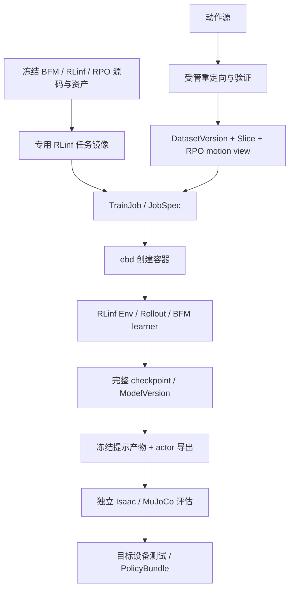

# 14 · BFM-Zero / RoboParty RPO / RLinf 接入设计

日期：2026-09-24。性质：可行性分析与接入方案。**结论是有条件可行；本次没有运行 BFM 训练、测量资源或验证 RPO 行为效果。**

遵循 [01](01-product-domain.md)、[02](02-system-architecture.md)、[03](03-data-collection.md)、[04](04-model-training.md)、[05](05-evaluation-delivery.md)、[06](06-agent-security.md) 的平台不变量，以及 [10 · RPO 接入](10-roboparty-rpo-wbc-integration.md)、[11 · 直立直行](11-rpo-stand-walk-phase-a.md)、[12 · 环境目录](12-environment-catalog-and-selection.md)。本文新增 BFM 路线，不原地修改这些文档的已冻结接口/任务，也不把 [13 · SONIC](13-sonic-rpo-rlinf-integration.md) 自动串成 BFM 的前置步骤。

## 1. 决策摘要

**可以将 BFM-Zero 的训练方法迁移到 RPO，并保持最终由 RLinf 训练；不能直接把当前 MLP 权重换成官方 G1 checkpoint。** 保持的是平台的资产、Job/Run、容器、模型登记、独立评估与交付管线，训练算法需要从 PPO 扩展到 BFM 的离策略学习。

用户明确要求：替换当前 roboparty 直立行走模型；整体管线一致；最终使用 RLinf；多轮反思；只输出方案，不做 Git 提交。本文依据现有项目将机器人解释为 **RPO V2.0、23 个受控关节**。

**用户已确认：完整接入 BFM-Zero，允许扩展 RLinf。** 正式目标包括完整预训练方法、goal/motion/reward 提示、行为切换和少样本 latent 适应；不以扩大 PPO 网络或仅完成站立直行代替完整接入。RLinf 修改仍只作用于受管镜像副本。

| 判断 | 结论及条件 |
|---|---|
| 能否维持 RLinf 训练？ | 能。RLinf 已有离策略 worker、replay、target network、权重同步和 checkpoint 基础；需新增 BFM worker/模型/数据协议。 |
| 能否只改模型名或网络宽度？ | 不能。BFM 同时训练策略、Forward/Backward 表征、判别器和两个奖励 critic。 |
| 能否直接用 G1 权重控制 RPO？ | 不能作为正式路线。关节、几何、动力学、输入和动作语义都不同；删掉 6 个输出不解决迁移。 |
| 是否一定更容易站稳、走直？ | 无此证据。现有失败曾涉及奖励尺度和倒地漏判，不能归因于网络小。BFM 的主要价值是统一运动、目标和奖励条件，而非保证单任务优于 PPO。 |
| 4×4090 是否足够？ | 有研究实施路径，尚无本项目实测。先测完整算法的小容量配置；大模型、replay RAM、更新吞吐分别准入。 |
| 现在能否开始长训？ | 不能据本文直接放行。先完成 RPO 动作数据、数值对齐、容器依赖和资源 probe。 |

### 1.1 三条路线

| 路线 | 获得什么 | 取舍 |
|---|---|---|
| **完整 BFM 算法 → RPO 环境 → RLinf 离策略训练** | 具备学习可提示运动表征的正确结构；可渐进扩展数据和规模 | **推荐**，满足替换目标；主要工作在算法和数据接入。 |
| 借鉴 residual actor，继续 RLinf PPO | 强一些的任务专用网络，复用多数现有训练逻辑 | 可作对照，不具有 BFM 的 FB 表征和零样本任务推断能力。 |
| 在平台容器内直接启动 BFM 原生 trainer | 较快验证上游 G1 工程 | 不满足正式训练由 RLinf 完成的要求，不作为接入方案。 |

采用推荐路线也保留原 PPO recipe 作对照。只有新模型通过独立验收后，才将对应任务的默认模型切到新版本；历史 Job、模型和报告不被覆盖。首个站立/直行里程碑与最终通用行为能力分别验收。

## 2. 调研依据与可信边界

### 2.1 上游版本

本次通过官方 GitHub API 解析 `LeCAR-Lab/BFM-Zero/main`，固定为提交 **`318cf44a3262e5bdec5944f82f1a5f509b95d09b`**，提交日期 2026-07-15。以下源码链接均指向该版本。

| 已核对材料 | 对接入的直接影响 |
|---|---|
| [官方仓库与发布说明](https://github.com/LeCAR-Lab/BFM-Zero/tree/318cf44a3262e5bdec5944f82f1a5f509b95d09b) | 训练源码已公开，另有 deploy/minimal_inference 分支；不能沿用“仅有推理、训练未公开”的旧判断。 |
| [训练配置与循环](https://github.com/LeCAR-Lab/BFM-Zero/blob/318cf44a3262e5bdec5944f82f1a5f509b95d09b/humanoidverse/train.py) | 实际调用 `FBcprAuxAgent`；配置包含专家数据、在线 replay、混合 latent、连续片段和辅助奖励。读取执行配置，不能只看 dataclass 默认值。 |
| [FB](https://github.com/LeCAR-Lab/BFM-Zero/blob/318cf44a3262e5bdec5944f82f1a5f509b95d09b/humanoidverse/agents/fb/agent.py)、[FB-CPR](https://github.com/LeCAR-Lab/BFM-Zero/blob/318cf44a3262e5bdec5944f82f1a5f509b95d09b/humanoidverse/agents/fb_cpr/agent.py)、[辅助奖励 agent](https://github.com/LeCAR-Lab/BFM-Zero/blob/318cf44a3262e5bdec5944f82f1a5f509b95d09b/humanoidverse/agents/fb_cpr_aux/agent.py) | 必须迁移完整更新顺序，不能把目标换成 SAC loss 或 PPO loss。 |
| [模型与提示推断](https://github.com/LeCAR-Lab/BFM-Zero/blob/318cf44a3262e5bdec5944f82f1a5f509b95d09b/humanoidverse/agents/fb/model.py) | 提示向量由 Backward 表征生成，支持 goal、tracking、reward inference；latent 不是语言 token。 |
| [环境 bridge 与专家 loader](https://github.com/LeCAR-Lab/BFM-Zero/blob/318cf44a3262e5bdec5944f82f1a5f509b95d09b/humanoidverse/agents/envs/humanoidverse_isaac.py) | 含 G1 29 DoF 和 36 维 qpos 的渲染假设；构造器断言多种终止关闭；不能直接复用为 RPO 环境。 |
| [依赖声明](https://github.com/LeCAR-Lab/BFM-Zero/blob/318cf44a3262e5bdec5944f82f1a5f509b95d09b/pyproject.toml) | Python 3.10、Isaac Lab 2.0.2、Isaac Sim 4.5.0，与当前 RPO 镜像的 Python 3.11 环境不一致，不能直接 `uv sync` 合并。 |
| [官方论文](https://arxiv.org/html/2511.04131v1) §B.2、§D.1 | 论文主配置约 440.5M 参数，不含 target；actor 约 31.9M。还有更小容量消融，不能把训练全套大小等同于部署 actor 大小。 |
| [源码许可证](https://github.com/LeCAR-Lab/BFM-Zero/blob/318cf44a3262e5bdec5944f82f1a5f509b95d09b/LICENSE)、[官方权重卡](https://huggingface.co/LeCAR-Lab/BFM-Zero) | 标注 CC BY-NC 4.0。模型/代码复用必须记录许可；涉及商业用途时先解决授权，不能用 RLinf 的 Apache 许可替代。动作数据另查来源许可。 |

公开仓库包含训练实现，不代表已经证明本机依赖兼容或 RPO 可收敛。本次只读取源码和资料，没有下载完整权重/动作库、安装依赖或执行 GPU 实验。权重卡的 BibTeX 存在另一个 arXiv 编号，本方案以论文 **2511.04131** 为准。

### 2.2 本地真实链路

本地 RLinf HEAD 为 `018e6a9e0da60f96eeda8b11008543911027d414`；检查时 `.gitignore` 有修改。平台工作区也已有大量未提交内容，因此正式构建必须绑定实际内容快照、补丁 hash 和 image digest，不能仅记录 HEAD。

```text
TrainJob / rpo_v2_wbc_stand_walk_ppo
→ JobSpec → 现有 RLinf adapter → ebd 动态任务容器
→ rlinf_entry.py → RLinf train_embodied_agent.py
→ EnvWorker + MultiStepRolloutWorker + EmbodiedFSDPActor
→ RPO-WBC-StandWalk-v1 / PPO
→ checkpoint → ModelVersion → 独立 Isaac / MuJoCo 评估
```

| 本地位置 | 已有能力 | BFM 缺口 |
|---|---|---|
| [现有配置](../../backend/eb/runners/config/rpo_wbc_stand_walk_ppo.yaml)、[本体接口](../../contracts/ee_rpo_v2_wbc_23dof_v1.yaml) | actor 890、critic 1500、动作 23；50 Hz 策略、200 Hz 物理；actor 为三层 256 MLP | 新的状态组、latent、网络和算法；旧 checkpoint 不是新网络的 resume 输入。 |
| [RPO bridge](../../backend/eb/runners/rpo_wbc_extension.py) | 关节映射、RPO 资产、跌倒终止、RLinf 唯一 reset 责任 | 新增 BFM 环境与 privileged motion 特征；不能把 1500 维旧 critic 当成 BFM 动作表征。 |
| RLinf `workers/actor/fsdp_sac_policy_worker.py`、`data/storage/replay/` | 已有离策略采样、target、保存/加载模式；SAC 的 advantage 方法为空操作 | BFM 独立 worker、六组 optimizer、专家片段采样和 latent 重标记。 |
| RLinf `data/schema/embodied_types.py::prepare_observations` | 目前只输出固定的图像、`states`、任务描述等字段 | 自定义 history/privileged/latent 会被过滤；需要受控字段透传和端到端验证。 |
| [模板](../../backend/eb/domain/rlinf_form.py)、[提交](../../backend/eb/api/routes_train.py)、[adapter](../../backend/eb/adapters/rlinf.py) | 现有 RPO PPO 特判、镜像和挂载；旧训练不接受数据/基座 | 新模板应要求动作 DatasetVersion；放行新算法入口，不能假扮旧 PPO。 |
| [入口与发布](../../backend/eb/runners/rlinf_entry.py)、[收集](../../backend/eb/orchestrator/collect.py) | checkpoint/回执/模型登记 | MLP 固定 normalization、其他类型走 VLA 父模型资产分支；需显式 BFM 发布与恢复支持。 |
| [现有导出评估器](../../backend/eb/runners/rpo_wbc_artifact.py) | MLP 890→23 ONNX、物理失败判据、视频与结果回流 | 新 BFM exporter 和完整 prompt+actor 评估；旧导出器不能强行读新权重。 |

## 3. 保持管线一致的边界



- 控制面仍为 Python；容器、日志、视频和大文件仍由 Rust/ebd 管理；只有 ebd 持有 Docker socket。任务不加入 Compose，平台仍 `make up`，大镜像仍由 `make images` 单独构建。
- `/data/kk/RLinf`、BHL、原始数据和其他外部源保持只读。修改放受管补丁/扩展，构建时作用到镜像中的源码副本；USD、缓存、replay、checkpoint 全部写受管路径。
- RLinf 必须拥有采样调度、backward/optimizer、target 更新、权重同步和保存/恢复。可移植上游网络与 loss 计算，不调用 `Workspace.train()`、上游训练主循环或其独立分布式 launcher。
- 沿用 `train.rl`、`train.rlft`、`data.retarget`、`data.convert`、`export.policy`、`eval.sim`、`eval.sim2sim`、`bundle.build`；不新增训练服务、通用 workflow 引擎或 JobKind。
- Agent 操作仍走 ToolBus；新 recipe 不带 shell/任意 Python/出网能力。真实机器人放行与门禁不变。

建议新增下列绑定；**这些是设计标识，不是已注册能力**：

| 对象 | 标识/约束 |
|---|---|
| 机器人 | 继续 `emb_roboparty_rpo` |
| 本体接口 | `ee_rpo_v2_bfm_23dof_v1`，独立于旧 890 维接口 |
| 模型/算法 | `bfm_zero_policy` / `bfm_zero` |
| 训练模板 | `rpo_v2_bfm_zero_pretrain`，`train.rl`，动作数据必需，默认从头训练 |
| 适应模板 | `rpo_v2_bfm_zero_adapt`，`train.rlft`，绑定已发布 RPO BFM；RLinf 管理 latent 候选优化，网络权重冻结 |
| 训练任务/环境 | `tsk_rpo_bfm_pretrain` / `RPO-BFM-Pretrain-v1` |
| 站立直行验证 | `tsk_rpo_bfm_stand_walk` / `RPO-BFM-StandWalkEval-v1`，继承 [11](11-rpo-stand-walk-phase-a.md) 的物理场景与成功标准 |
| 镜像 | 单独 profile，例如 `eb/rlinf:rpo-v2-bfm-zero`，执行绑定 digest |
| 数据视图 | `rpo_bfm_motion_v1`，observation-only 轨迹，不伪装 LeRobot action 数据 |

环境目录按 [12](12-environment-catalog-and-selection.md) 绑定 training/evaluation revision；发布后的旧环境不可修改。SONIC 与 BFM 可共享同一合格 RPO 动作资产的派生视图，但训练器、latent 和模型接口分别冻结。

## 4. 数据：第一项实际前置条件

BFM 不是“没有 reward 就不需要数据”。完整方法使用 **在线交互 + 离线 observation-only 动作轨迹**；专家不需要电机 action 标签，但需要与 RPO 一致的运动状态。官方 G1 重定向 PKL 不能删列后当作 RPO 数据。

### 4.1 数据路径与最小内容

```text
授权明确的原始人体动作 / 合格 RPO 轨迹
→ data.retarget：RPO 23 DoF、限位、足接触和身体比例约束
→ data.convert：统一坐标、时间基准、RPO FK 与特征编码
→ 质量检查 → DatasetVersion → train / validation / test Slice
→ BFM motion view 与内容 hash
```

首批覆盖原地站立、自然步行、启停和少量转向，先完成站立直行里程碑；仅有两种姿态不能宣称通用行为基础模型已复现。后续按能力扩展动作覆盖，避免把无关大数据下载列为首期依赖。重定向工具优先复用已有可用路径，[13](13-sonic-rpo-rlinf-integration.md) 的候选工具不等于已确认支持 RPO。

每个 clip 至少冻结：来源/许可/原始 clip ID、FPS 与时间戳、root position/quaternion、23 维关节位置与速度、root 线/角速度、按 body-name 排列的刚体位置/旋转/线角速度、接触标签（若使用）、有效帧 mask、坐标和单位、RPO 资产/mapping/转换器 hash。根位姿、关节和 FK 特征必须来自同一版本。训练和专家数据共用特征编码函数，并以同一姿态的数值对照验证。

质量检查至少包含 NaN、关节硬限位、瞬时速度/加速度、穿地、自碰撞、足滑、根高度与左右映射；在 Isaac/MuJoCo 回放抽样检查。`kinematically_valid` 与动态可跟踪分开记录。重定向失败的片段剔除并记原因，不能靠悄悄截断关节角伪造合格率。

### 4.2 专家采样与隔离

- 按原始 clip/采集来源切分，然后切窗；相邻帧或同一动作的重定向版本不能落入不同 split。
- 专家编码使用连续 8 帧作为初始配置，跨 clip、padding 和片尾有明确 mask；不能随机取 8 帧再 reshape 冒充连续运动。
- 专家只向 B 和 D 提供可由运动学计算的状态；不提供伪造的 PD 动作、上一执行动作、力矩或碰撞力。上游 loader 中的占位 action 不能成为 BC/SAC 监督。
- 训练优先级更新若沿用上游 tracking 误差，只能使用训练专用校准轨迹。官方独立验收集不反馈 sampler、奖励、latent 或模型选择；validation 负责选择，test 只负责最终报告。
- 任意外部 PKL 不能由 API 直接反序列化；转换任务在隔离容器读取可信、hash 固定的来源，发布受控数组及 manifest。

## 5. RPO 环境、观测、动作与提示协议

### 5.1 环境选择

首期复用当前 RPO 的资产、Isaac 物理场景、关节 codec 和终止处理模式，在受管扩展新增 BFM 环境。移植上游算法和状态特征定义，不整体替换为 G1 `HumanoidVerseVectorEnv`。后者含 G1 专用渲染、动作缩放和关闭跌倒终止的假设，移植成本并不只是改 URDF。

物理起点保留 50 Hz 策略、200 Hz 物理、RPO PD/资产 manifest。训练 A 阶段采用平地、站立重置和保守探索；高度 <0.50 m、倾角 >0.80 rad 及既有关键接触触发倒地终止，20 秒截断。**这是 RPO 站立直行课程，区别于官方含倒地初始化的广行为训练分布。** 后续地面动作/恢复能力必须使用新的任务和训练/评估 revision，不能为了模仿官方配置关闭旧任务的跌倒判据。

领域随机化按阶段加入质量、摩擦、PD、延迟、噪声和推搡，各参数保持可标定。RPO V2.0 资产与实物的 effort/velocity 等差异继续按 [10](10-roboparty-rpo-wbc-integration.md) 核对；未匹配时不得提升为真机可用。

### 5.2 新模型接口

初始 RPO 观测规格如下，是**设计维数**，需要 loader/环境 probe 确认后才发布合同：

| 输入组 | 内容/候选维数 | 消费者 |
|---|---|---|
| `state` | 关节位置偏差 23、关节速度 23、重力投影 3、机体角速度 3，合计 52 | actor、F、B、D、两个 Q |
| `last_action` | 上一执行动作的规范化表示，23 | actor、F、两个 Q |
| `history_actor` | 上述 75 维的前 4 帧，合计 300 | actor、F、两个 Q |
| `privileged_state` | root 高度及 heading-local 刚体位姿、线角速度；维数由冻结的 body 集合和编码确定 | F、B、D、两个 Q；禁止进入部署 actor |
| `z` | 256 维任务向量，按上游投影到范数约 `sqrt(256)=16` 的球面 | actor、F、D、两个 Q |

候选 actor 输入为 `375 维 proprio/history + 256 维 z`，输出 23 维。不是 890→23，也不是把 G1 输入补零。这里的 residual actor 仍是数值状态网络，不需要图像、语言模型或 tokenizer。

冻结 codec 时明确：state 项次序；关节/body 顺序；四元数 wxyz/xyzw；米/弧度/秒；世界、机体、heading-local 坐标；scale/clip；history 的项优先/帧优先排列、时间方向与重置填充。上游 history 按字段名排序拼接，不能与当前逐帧展平历史混用。RPO 选择的布局可以不同，但训练、专家、导出、两种评估器和端侧必须共用同一版本。

初始实现使用已展平的历史快照存 replay，减少随机采样重建历史的错误；同一环境 reset 后仅清其历史、上一动作、latent 游标，不能影响其他环境或跨 episode 借帧。若以后因内存压力改为按 episode 重建历史，属于新的存储实现，必须验证逐样本等价。

### 5.3 动作缩放不能漏乘或重复乘

上游 residual actor 使用有界均值和截断噪声；G1 配置还把策略动作乘 5，再乘 `action_scale=0.25`。所以不能仅因两边都有 `0.25` 就认定相同。[网络实现](https://github.com/LeCAR-Lab/BFM-Zero/blob/318cf44a3262e5bdec5944f82f1a5f509b95d09b/humanoidverse/agents/nn_models.py)、[G1 控制配置](https://github.com/LeCAR-Lab/BFM-Zero/blob/318cf44a3262e5bdec5944f82f1a5f509b95d09b/humanoidverse/config/robot/g1/g1_29dof_hard_waist.yaml)、[动作预处理](https://github.com/LeCAR-Lab/BFM-Zero/blob/318cf44a3262e5bdec5944f82f1a5f509b95d09b/humanoidverse/envs/legged_base_task/legged_robot_base.py)

RPO 明确分为 `policy_action u`、执行裁剪/延迟后的 `executed_action`、物理 `q_target`：`q_target = q_default + scale × clip(gain × u)`，再服从 RPO 关节/驱动约束。`scale/gain/clip/default_pose/PD/delay` 必须是新接口和环境修订的显式字段。0.25 可作为既有 scale 起点；gain 通过动作范围与参考轨迹覆盖 probe 冻结，不能默认继承 G1 的 5，也不能默默漏掉该倍数。

replay 的 action 保留策略送给环境的规范化动作，目标 Q 与 actor 输出使用同一变量；历史使用冻结定义的执行动作，不能将裁剪前输出标成执行值。启用延迟随机化时同时区分“已命令”和“已施加”，必要历史和特权延迟信息一并冻结。动作饱和率、关节越界和 target 范围需单独记录。

### 5.4 站立、行走和其他任务怎样驱动同一策略

首期使用 reward prompt，将“站立”和“0.3 m/s 直行”分别物化成 `z_stand`、`z_walk_0p3`。输入的是结构化目标和固定向量，不是让平台 Agent 实时生成关节动作。

- Goal：用 RPO 的目标状态经 B 编码并投影。
- Motion tracking：参考轨迹经 B 编码，按固定前瞻窗口平均并投影。
- Reward：冻结参考状态样本及奖励定义，按上游 `reward_inference` 对 `B(s')` 做奖励加权，再投影；定义清楚奖励究竟属于 `s'` 还是 transition，不能错一帧。

站立/行走奖励推断使用可由参考状态计算的直立、速度、yaw 和上身姿态项。原 PPO 的动作变化、力矩等惩罚不能假装从单个 mocap 状态取得，应进入辅助奖励 Q；“20 秒走到 4 m”仍是独立轨迹验收，不伪装成单状态 reward。

提示生成在受控 `export.policy` 任务的前处理阶段运行，输入模型、校准 Slice、reward/goal 定义和随机种子，输出带 hash 的 `prompt-manifest`；评估只消费已冻结结果。拒绝非有限或范数退化的编码，记录参考分布与有效样本数，不能用归一化把空/无效提示掩盖成成功。不能用测试 seed 的 rollout 优化 z 后再报零样本成绩。权重/B/normalization 更新后必须重新生成 prompt，旧 z 不能与新 actor 混搭。

先固定每个 episode 的提示；增加交互切换时，定义过渡时长、球面插值/归一化和退化范数处理，单独测试切换稳定性。任意速度范围、语言控制和技能组合能力都需独立数据和证据，不从两个 prompt 外推。

## 6. RLinf 里的完整训练实现

### 6.1 必须保留的学习组件

| 组件 | 输入/职责 | 更新要求 |
|---|---|---|
| Actor `π(o_history,z)` | 只看可部署观测，输出 23 DoF 动作 | 最大化 FB 价值，同时受行为和辅助奖励价值约束 |
| Forward `F(x,a,z)` | privileged+history、动作、z；双网络 | FB Bellman 目标及 ensemble/pessimism |
| Backward `B(s)` | 可与专家对齐的 state/privileged 特征 | 与 F 联合训练及正交约束，构造任务向量 |
| Discriminator `D(s,z)` | 区分专家与在线状态 | 判别损失、gradient penalty |
| `Q_D(x,a,z)` | 行为正则的价值，双网络 | 使用 D 给出的奖励与自己的 target |
| `Q_aux(x,a,z)` | 机械/运动约束的价值，双网络 | 使用辅助奖励与自己的 target |

推荐新增 `BFMZeroPolicy` 与 `EmbodiedBFMPolicyWorker`，复用 RLinf worker 生命周期、设备 placement、通信与 checkpoint strategy。SAC 是基础设施参考，不继承其 entropy temperature、SAC loss 或两组 optimizer 假设。上游 `FBcprAuxAgent.update()` 内部直接 backward/step，不能把它当作无副作用 loss 函数套进 RLinf/FSDP。

每个更新批次按冻结上游语义执行：在线/专家采样 → 归一化 → 专家连续序列编码 → D 更新 → mixed-z 和 relabel → F/B 联合更新 → Q_D 更新 → Q_aux 更新 → actor 更新 → F/B/Q_D/Q_aux 的 target soft update。六组 optimizer 分别负责 F、B、D、Q_D、Q_aux、actor。更新次序、detach 边界和 target 初始化都写入数值对照，不压成一个任意总 loss。

训练 forward 使用可求导模块，不能误调用上游带 `no_grad` 的推理包装。计数器分别记录全局环境 transition、learner update 和采样样本量；更新/采样比明确为 `updates × batch_size / new_transitions`，不将 PPO 的 epoch 计数直接当作 BFM 更新预算。专家 batch 必须满足序列长度整除及有效帧要求。

RPO 辅助奖励只从已实现且量纲明确的项组成；逐项记录原始量、权重、是否乘 dt、normalizer 及最终贡献，禁止沿用曾经的 50 倍尺度错误。权重为零的项应显示禁用，不能因配置存在就声称生效。修改身体/奖励属于 RPO recipe 适配，不是宣称复现原 G1 数值。

### 6.2 Rollout 与 replay 协议

在线 transition 至少保存：

```text
episode_id, env_id, step_id, policy_version, normalizer_version
obs_t = {state, last_action, history_actor, privileged_state}
policy_action_t, executed_action_t, behavior_z_t, latent_source
next_obs_before_reset, terminated, truncated, aux_reward_components
```

`rollout.collect_transitions=true`，初期 `num_action_chunks=1`。在现有 `curr_obs/next_obs/forward_inputs` 能表达的地方复用；确需扩展的辅助奖励/元数据使用明确 schema，不依赖未保存的 `env_infos`。补丁需覆盖 EnvOutput 白名单、merge/split、trajectory builder、replay flatten/collate 和 policy 输入，不能只在 env 中加字段。

RLinf 传输层继续使用 `states` 作为主状态张量，BFM policy 显式将其映射为内部 `state`；其他组使用顶层 tensor 字段，避免现有 batch 推断依赖 `states` 而失败，以及嵌套字典在 flatten 中丢失。`predict_action_batch` 返回动作与实际 forward inputs；rollout 的版本张量不能继续强依赖 PPO `prev_logprobs`，也不伪造可用于训练的 value/log-prob。BFM 的 bootstrap 在 learner 内计算，额外 bootstrap/评估调用不得推进 rollout latent 或历史游标。

- transition 的 `next_obs` 为 **reset 前**真实末状态，终止/截断逐环境处理；reset 只有一个负责人，沿用 RLinf bridge 控制方式。
- Bellman discount 使用 `gamma × (1-terminated)`；时间截断仍从真实末状态 bootstrap，NaN/越界等失败不能当作普通截断。行为 z 切换和 done 分开记录。
- 更新时的 relabel-z 与行为 z 分离；当前/next actor 和 Q 目标按同一 relabel 任务计算，不混用下一次行为调度的 z。
- 在线 transition 可随机采样，专家则需连续 8 帧。RLinf replay 的 `sample_window_size` 是轨迹缓存窗口，**不是**这 8 帧的时间窗口；添加专用 expert slicer，不把 SAC 的在线/示教 50:50 合批规则照搬。
- replay 明确按 transition 数限定容量与淘汰顺序，并限制落盘占用；RLinf 的轨迹缓存条数不能充当这个上限。窗口淘汰不可破坏仍被 checkpoint/恢复租约引用的数据。
- 混合 latent 包含随机、在线 goal、专家序列编码；每环境维护刷新步数、专家 clip/游标、z-buffer 及采样 RNG。训练过程中 B 变化，已编码 z 必须带版本并按固定刷新规则更新。
- rollout 每次权重同步同步 actor、必需的 B/提示编码资产和 observation-normalization buffers，作为一个版本生效；不能只同步 `requires_grad` 参数。

`EmbodiedRunner` 已通过 worker 的方法组织训练；BFM 的 `compute_advantages_and_returns` 与 SAC 一样返回空指标，更新在 BFM worker 中执行。入口增加 `loss_type=bfm_zero` 的显式分派，禁止落入默认 PPO worker。

### 6.3 单 learner 优先，多卡不改算法语义

第一版采用 **一个 learner + RLinf 环境/rollout worker**，先关闭 compile/CUDA graph，使用 FP32 验证 loss 和梯度。各进程通过 RLinf 管理；单 learner 不等于原生 trainer。

FB loss 和正交项使用 batch 内两两关系；把一个 batch 随意分成 microbatch 再累积梯度会丢掉跨块配对。多 learner 时局部负样本、all-gather 是否带梯度、归一化统计和优化步数也会改变算法。首期不承诺 FSDP 能自动解决这些问题；需要扩展时先定义全局/局部 batch 语义，再做单卡与多卡的数值对照。

上游默认中部分字段并非独立生效，例如辅助 critic 构造当前读取 `archi.critic`。移植时先对所用配置做等价性检查；若暴露独立 `aux_critic` 配置，必须证明实际网络随之变化，不能形成无效配置旋钮。

## 7. 容器与算力准入

推荐把 BFM 需要的网络、loss、normalizer、专家采样模块作为固定源码依赖移入现有 RPO/RLinf 兼容环境；不把上游整个 Python 3.10 锁环境覆盖当前任务镜像。迁移后以受管补丁记录 Python/PyTorch API 差异。只有在模块最小 import/forward/backward 仍无法兼容时，才评估独立依赖镜像，并要求 RLinf 入口与 RPO 资产桥同样通过 probe。

专用镜像固定 Python、PyTorch/CUDA、Isaac Lab/Sim、BFM、RLinf、RoboLab、URDF/mesh 内容。运行时离线加载；训练容器不得临时下载权重、安装包或访问外部写目录。能力探测包括 `spawn` 子进程中的注册、GPU、无头仿真、小步更新、导出和原子发布。

### 7.1 两档容量，不删算法

| 配置 | 用途 | 建议起点，均待实测 |
|---|---|---|
| `bringup` | 验证完整算法、接口、恢复和行为趋势 | residual hidden 1024、3 blocks、z=256、专家序列 8、batch 256、32–128 env、CPU replay 10 万 transition；六组件与 target 全保留 |
| `research` | 更大数据上的正式候选训练 | 依据 probe 向 2048/6 blocks、batch 1024 扩展；不是自动把官方所有默认参数搬过来 |

`bringup` 仍是 BFM 算法，但规模和任务分布不同，不能标成论文主模型复现；进入下一档创建新配置和兼容性指纹。上游实际 `train_bfm_zero()` 使用 1024 env、512 万 replay、3.84 亿环境 transition、每 1024 transition 做 16 次更新，replay 放 CUDA；dataclass 的 CPU 默认值不能证明实际训练能放入 4090。

资源起点建议 2 卡：GPU0 learner，GPU1 仿真+rollout；一张卡的配置仅在完整 probe 通过后用于小规模验证。4 卡首先用于环境吞吐/独立实验，不默认拆成 4 learner，也不把显存相加。资源不足时明确降低实验规模、换配置再提交，不静默改变算法或反复 OOM 重试。

**粗略下界，不是容量承诺：** 440.5M FP32 参数的权重+梯度+Adam 两矩约 7.05 GB（十进制），另有 target、激活、两两矩阵、临时量和仿真。若 RPO 每条观测共 `D=375+P` 个 float，显式保存当前/下一观测的 replay 仅 float 数据就约为 `N×4×[2D+23+256+K]` 字节，P 为 privileged 维数，K 为奖励等字段。示例 `P=360,K=8` 时，512 万条约 **36.0 GB**；这还没算额外 action、索引、容器/框架开销和专家库。减少到 10 万条约 0.70 GB 同类数据，不表示学习充分。

probe 必须报告每卡加载/更新峰值、主机 RAM、共享内存、CPU replay 采样/H2D 吞吐、环境 steps/s、更新次数/s、实际 UTD、checkpoint 大小和保存时间。总训练预算在短训后用 `环境 transition / 实测吞吐` 加更新与 I/O 成本估算；本文不承诺几小时训练成功。

## 8. Checkpoint、发布、导出与交付

### 8.1 恢复所需的完整状态

保存 actor/F/B/D/Q_D/Q_aux、四类 target、六组 optimizer 及所用 scheduler/scaler、观测和辅助奖励 normalization、环境步/更新步、在线 replay 与索引、专家 Slice/hash/采样优先级、z-buffer、各 worker RNG、latent/clip 游标和 policy version。清单写完并验证后原子发布，再清理旧 checkpoint；平台默认保留最新完整版本的规则不变。

首期恢复标记 `trainer_state`：学习器、replay 和采样状态恢复，仿真在新 episode 边界重建；不得宣称逐步 exact。缺 replay 或 target 时不能冒充完整恢复；允许时显式派生 `warm_start`，否则失败。G1→RPO、PPO→BFM、改变接口/数据或网络规模都是新实验，不是 resume。

恢复测试要比较下一批 sample IDs、加载后的 target/optimizer/normalizer 和下一次更新结果；只看“没有异常”不足以通过。CPU replay 的持久化文件必须与保存 step 对齐，避免一个 checkpoint 引用继续被覆盖的活跃 buffer。

### 8.2 模型资产和推理包分开

- `ModelVersion` 保留完整 BFM 可训练模型、config、normalization、接口和训练输入血缘；使用 BFM 专用发布分支，不走当前 VLA 父模型复制逻辑，也不写假的 890 维 normalization。
- `export.policy` 读取只读模型和冻结校准数据，输出 actor、prompt、codec、导出回执。推理无需加载 F、D、Q_D、Q_aux；goal/tracking 在线编码场景才需要 B，其特权输入来自参考资产，不来自实际机器人隐藏状态。
- actor ONNX 明确接受 proprio/history 和 z 两组输入；normalization 可嵌入图，history 由同一 codec 构造。对随机状态、边界动作、零/重置历史、不同 z 比较 PyTorch/ONNX 输出，并验证批次=1 的推理模式不会更新 BatchNorm。
- 真机端已有程序不能继续按 890→23 加载新包。新接口需端侧 codec/历史/prompt 支持，并测完整周期的 p50/p95/p99 延迟、超时和异常输出。RPO 既有 8 ms 策略预算是目标约束，不是 BFM 已达到的结果。
- 若 actor 超预算，再提出蒸馏/压缩子任务；学生策略需重新评估，不能把它与原 BFM 模型的能力、权重或零样本结论混为一谈。

模型/提示/normalization/interface/导出 artifact 使用 hash 绑定，prompt 重建不能原地覆盖已发布包。平台不进入实时控制回路；Orin 或 RPO 实际主控未验证时保持 `target_infer=blocked` 并附未验证原因，不伪造可部署能力。

## 9. 独立评估与“替换成功”的含义

### 9.1 首个站立直行验收

新建 BFM 套件版本，复用 [11](11-rpo-stand-walk-phase-a.md) 的场景、12 个 seed、20 秒/1000 步、固定中立上身目标及无推搡条件。由于接口不同，不能直接篡改旧 suite 绑定。

| 场景 | 通过条件 |
|---|---|
| 原地站立 | 全程直立；漂移 ≤0.5 m；平面速度 RMSE ≤0.15 m/s |
| 0.3 m/s 直行 | 全程直立；沿初始朝向位移 ≥4.0 m；平面速度 RMSE ≤0.20 m/s |
| 全套资格 | 标准 12 case 全通过；3 seed smoke 或单 seed 只作诊断 |

跌倒、NaN、硬限位、异常裁剪、录像终止与独立物理状态检查都要保留。Isaac 同域和 MuJoCo 跨域结果分别报告，MuJoCo 必须执行自己的物理 rollout，不能使用上游“把 Isaac 状态画进 MuJoCo”的渲染器冒充 sim2sim。

候选选择使用 validation；最终 test 的 case、prompt 和 hash 预先冻结。与重新验证过的 PPO 基线比较成功率、跌倒率、漂移/位移、速度误差、动作平滑性、能耗代理、训练 GPU 小时和推理延迟。记录动作范围/normalization/随机化差异，不能把所有提升归因于网络结构。旧趴倒模型的高回报不作为已通过基线。

上身中立既是任务意图，也应单独报告 11 关节偏差；旧套件没有独立的上身通过阈值，因此若将其提升为新硬门槛，应给 BFM/PPO 建同一对照套件新版本，而非单方面改变旧标准。

### 9.2 通用行为能力分阶段提升

站立直行通过只允许宣称该能力。完整 BFM 路线还要分别验证：held-out goal reaching、held-out motion tracking、不同奖励 prompt、提示切换，以及 few-shot latent adaptation。记录目标误差、跟踪误差/足滑、任务奖励、失败原因和接触/约束指标；未设定冻结阈值的能力停留在诊断状态，不能显示 validated。上述能力均纳入最终范围，分阶段验收不意味着删去后续部分。

### 9.3 少样本适应也纳入 RLinf

按[论文 §2.2/§3.3](https://arxiv.org/html/2511.04131v1)，单姿态从 goal latent 出发采用 CEM；轨迹从已编码的 latent 序列出发采用采样式双层退火优化。两者都冻结网络，只优化提示。本次所查固定主分支目录中定位到了三类 inference 入口，**未定位到这两类适应的独立完整入口**；不能把预训练代码已公开推断成所有适应组件均可直接复用。实施时需进一步定位上游实现或按论文补齐，并记录与论文的差异。

`rpo_v2_bfm_zero_adapt` 仍在 RLinf 内管理候选生成、并行环境评估、精英选择/分布或轨迹更新、预算和保存，不启动外部 trainer。冻结 candidate 数、迭代数、horizon、温度/方差 schedule、初始状态分布与 seed；每个候选从同一组可重建初态评估，不能让后评估的候选继承前一个候选的机器人状态。目标包含任务奖励与机械约束，越界/非有限候选按失败计入预算。

保存候选分布/轨迹、最优提示、迭代计数、RNG、使用的环境交互量和父模型 hash。平台登记派生版本，复用父网络权重并发布新提示及适应回执；明确标记权重未更新，禁止伪造训练参数变化。发布器需支持这种显式父版本依赖及其 GC 租约。

适应集、模型选择集和最终测试集隔离；同一冻结预算比较优化前后任务误差、失败率和约束违反，适应后成绩与 zero-shot 分列。若以后用 PPO 微调 actor，应另发任务专用派生 recipe，不能默认保留原 BFM 的全域提示一致性。

## 10. 实施顺序与退出条件

以下是实施分解，不是本次已完成的代码工作。先满足前一阶段的证据再进入下一阶段，失败保留原始记录。

| 阶段 | 最小交付 | 可进入下一阶段的条件 |
|---|---|---|
| P0 版本/依赖/数据摸底 | 固定源码和许可；镜像最小模块 probe；RPO 资产检查；动作来源清单 | 依赖可加载、RPO 数据来源可用；必要商业授权问题有处理结果 |
| P1 motion view 与新接口 | 少量合格 RPO clip；body/joint codec；新 BFM 环境；终止和 reset 协议 | FK/观测双路径对齐；无跨 episode 历史；动作缩放与范围 probe 通过 |
| P2 RLinf 算法数值接入 | BFM policy/worker、传输/replay、六 optimizer、target、专家 slicer | 同一冻结小 batch 上，对照上游组件逐项比较 loss、梯度、一步参数变化；坏 shape/缺字段明确失败 |
| P3 短训与恢复 | RLinf 容器真实采样/更新/保存/恢复；CPU replay 资源报告 | 所有模块有正确梯度；B/z 无塌缩迹象；采样与 UTD 合理；完整恢复测试通过 |
| P4 站立直行候选 | 固定 prompt、actor 导出、独立 Isaac/MuJoCo 报告与视频 | 标准套件资格通过；性能/成本对照可解释；才可切默认模型 |
| P5 完整能力与交付 | 扩大数据/规模；goal/tracking/reward/切换、姿态与轨迹少样本适应；目标板测试 | 完整能力逐项验收，不以 P4 代替；真机交付另经既有门禁和现场验证 |

### 10.1 预计改动位置

| 位置 | 必要改动 |
|---|---|
| `contracts/`、`backend/eb/domain/rlinf_form.py`、bootstrap/环境目录 | 新接口、任务、模板和能力状态；增加 BFM 模板算法类别及到既有 `train.rl` 的映射 |
| `backend/eb/api/routes_train.py`、`backend/eb/adapters/rlinf.py` | 数据/基座/恢复校验、镜像选择、motion/asset 只读挂载、保护 override、准确的入口与资源 placement |
| `backend/eb/runners/` | BFM RPO 环境/codec、loader、配置、发布/导出/评估；共享现有物理判据，不复制整个平台 |
| `deploy/images/`、`deploy/patches/rlinf/` | 专用镜像、内容 hash、BFM 模块依赖、受管 RLinf 补丁及构建 probe |
| 镜像内 RLinf `config.py`、`models/embodiment/`、`examples/embodiment/train_embodied_agent.py` | 模型/算法注册，BFM policy，worker 分派；入口仍属于 RLinf |
| 镜像内 RLinf `workers/actor/`、`workers/rollout/hf/`、`workers/env/` | BFM 更新、latent 生命周期、normalization 同步、辅助奖励与真实终态采集 |
| 镜像内 RLinf 适应 runner/worker 及对应 recipe | 单姿态 CEM、轨迹采样优化、可比初态重置、预算/恢复；不更新父网络 |
| 镜像内 RLinf `data/schema/`、`data/storage/replay/` | 新字段贯穿传输和存储；在线与专家的不同采样语义 |
| `backend/eb/orchestrator/collect.py` 及模型/评估登记路径 | BFM manifest 完整性、模型和提示血缘、独立能力状态，不套旧 MLP 特判 |

新代码放最少的明确组件，不建设通用算法插件框架。Rust 执行和存储通道优先原样复用，只有具体大文件/原子发布能力不足且有证据时才补齐。此改动不是“新增一份 adapter 配置”规模，主要成本在 P1–P3。

## 11. 多轮反思与修正记录

本次按以下顺序进行多轮静态检查；这些记录是设计复核，不是训练结果。

| 轮次 | 反问 | 发现的遗漏/风险 | 已纳入的决策 |
|---|---|---|---|
| 1 · 问题与算法 | 小 MLP 真是瓶颈吗？RLinf 是否必须 PPO？ | 原基线存在环境/奖励问题；BFM 是完整离策略算法，不是大 actor | §1 区分效果未知、直接换权重不可行与算法迁移；保留 PPO 对照 |
| 2 · 本体与数据 | G1→RPO 只改输出维数是否够？ | 29/23 关节之外还有 FK、坐标、身体特征、动作乘 5、G1 渲染假设 | §4–5 新 motion view/合同；动作 range probe；禁止删列迁移 |
| 3 · 学习闭环 | RLinf 现成 SAC 能否直接装 BFM？ | 观测白名单丢字段；版本张量依赖 log-prob；专家需连续片段；多组件更新与 SAC 不同 | §6 独立 worker、字段贯通、rollout 输出协议、expert slicer、六 optimizer 数值对照 |
| 4 · 时间与资源 | 能跑一步是否等于正确、可恢复？ | autoreset 丢终态、latent/normalizer 不同步、replay 太大、FB batch 两两项不能普通梯度累积 | §6–8 单 learner、CPU replay、末状态/版本协议和恢复等级 |
| 5 · 发布与验收 | 有 checkpoint/视频能否算替换成功？ | MLP/VLA 发布特判不兼容；MuJoCo 渲染不等于仿真；prompt 可能使用测试反馈 | §8–9 新发布器、prompt 冻结、独立物理 rollout 与能力分别验收 |
| 6 · 范围与可交付性 | “完整版”和第一阶段会不会互相矛盾？ | 站立课程限制通用地面动作；小容量不是论文模型；适应入口未定位；源码/数据许可与版本仍需固定 | 按用户确认保留完整能力；§9.3 补齐姿态/轨迹适应路径；明确阶段、规模、许可与独立修订 |

## 12. 实施前仍需确定的选择

完整 BFM→RLinf 的范围已经确认。剩余选择不阻塞本文交付，但需在对应实施阶段完成：

1. **动作来源与使用范围**：优先提供已有 RPO 轨迹或确定可用的人体动作来源；涉及商业使用时需要明确 BFM 与数据授权。缺合格数据时停在 P0/P1，不启动伪 BFM 训练。
2. **资源预算**：依据实际可用 GPU、RAM、磁盘与短训吞吐确定规模/时长；现有设计的 4×4090 是规划边界，本文未探测当前空闲资源。
3. **真机目标**：继续使用 [10](10-roboparty-rpo-wbc-integration.md) 的硬件批次/主控/限位核对结果；不阻塞仿真研究，但会阻塞端侧能力与交付。

建议实施的第一步是 **P0–P2：证明 RPO 数据和接口正确，且 BFM 更新确实由 RLinf 完成**，再投入长训。本文已经给出按用户确认范围的完整接入路径；具体实施与训练启动属于后续任务。
