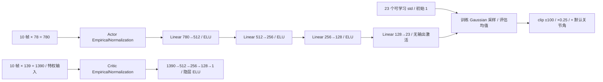
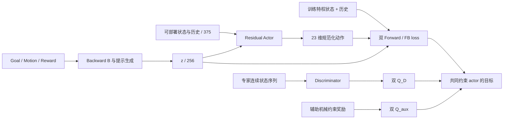
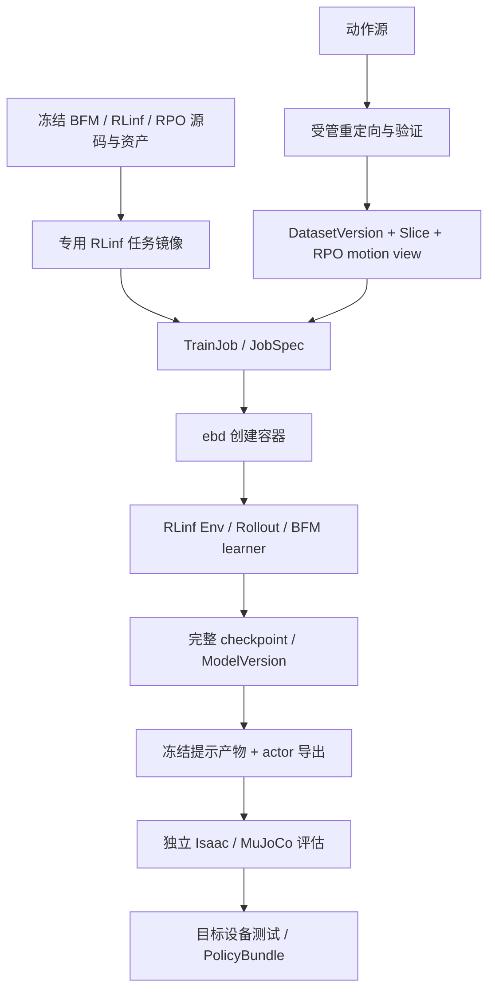

# 14 · BFM-Zero / RoboParty RPO / RLinf 接入设计

初稿：2026-09-24；本次修订：2026-10-08（Asia/Shanghai）。性质：基于当前官方 `RPO-Flat` / RLinf 实现的可行性分析、网络结构、接入方案和 smoke 实施状态。**结论是有条件可行；一 GPU bringup 已经通过 RLinf 采样、更新、恢复、模型登记和双 ONNX 导出 smoke。它不证明动作数据具备正式训练资格、策略学会行走或模型可真机部署。**执行证据见[进度台账](../progress/2026-10-08-bfm-zero-rpo-rlinf.md)。

遵循 [01](01-product-domain.md)、[02](02-system-architecture.md)、[03](03-data-collection.md)、[04](04-model-training.md)、[05](05-evaluation-delivery.md)、[06](06-agent-security.md) 的平台不变量，以及 [10 · RPO 接入](10-roboparty-rpo-wbc-integration.md)、[11 · 直立直行](11-rpo-stand-walk-phase-a.md)、[12 · 环境目录](12-environment-catalog-and-selection.md)。本文新增 BFM 路线，不原地修改这些文档的已冻结接口/任务，也不把 [13 · SONIC](13-sonic-rpo-rlinf-integration.md) 自动串成 BFM 的前置步骤。

## 1. 决策摘要

**可以从现有官方 RPO-Flat 接入迁移到 BFM-Zero，并保持最终由 RLinf 训练；这是策略、状态表征和算法的迁移。** 保持平台的资产、Job/Run、容器、模型登记、独立评估与交付管线；训练算法从 PPO 扩展到 BFM 的离策略学习，现有 Flat 和官方 G1 权重均不能直接作为 RPO BFM checkpoint。

用户要求：基于已接入的官方基础模型分析并接入 BFM-Zero，补齐网络结构和分析；整体管线一致；最终使用 RLinf；多轮反思；执行冒烟计划且不做 Git 提交。机器人为 **RPO V2.0、23 个受控关节**。

本次基线是 `rpo_v2_flat_ppo → RPO-Flat-RLinf-v1`，不是初稿中的 `rpo_v2_wbc_stand_walk_ppo`。正式 locomotion 替换保留当前完整前进/后退/侧移/heading/转向指令范围及地形/随机化对照；原地站立和 0.3 m/s 直行只作为早期诊断。

**用户已确认：完整接入 BFM-Zero，允许扩展 RLinf。** 正式目标包括完整预训练方法、goal/motion/reward 提示、行为切换和少样本 latent 适应；不以扩大 PPO 网络或仅完成站立直行代替完整接入。RLinf 修改仍只作用于受管镜像副本。

| 判断 | 结论及条件 |
|---|---|
| 能否维持 RLinf 训练？ | 能。RLinf 已有离策略 worker、replay、target network、权重同步和 checkpoint 基础；需新增 BFM worker/模型/数据协议。 |
| 能否只改模型名或网络宽度？ | 不能。BFM 同时训练策略、Forward/Backward 表征、判别器和两个奖励 critic。 |
| 能否直接用 G1 权重控制 RPO？ | 不能作为正式路线。关节、几何、动力学、输入和动作语义都不同；删掉 6 个输出不解决迁移。 |
| 是否一定比当前 Flat 更好？ | 无此证据。已有 Flat 5000 轮记录为 43/100，主要失败是硬越限和速度/转向误差，不能把初稿所述旧 WBC 趴倒问题当成当前根因。BFM 的价值是统一行为表征，须与这个实际基线对照。 |
| 4×4090 是否足够？ | 尚无研究规模资源实测。本轮一 GPU、小环境 bringup 通过；大模型、replay RAM、更新吞吐仍需分别准入。 |
| 现在能否开始长训？ | 不能。当前 motion DatasetVersion 标记 `training_ready=false`；还需合格授权与动态质量数据、数值对照和资源 probe。 |

### 本轮实现状态（仅 smoke）

RLinf 平台训练、从完整 trainer state 续训、checkpoint→ModelVersion 发布和 `export.policy` 均已跑通。最新续训 Run `run_405eeaf7cdf64c11a5f9` 到 step 4；导出 Job `job_4056f902e2fe42899d38` / Run `run_c235a1d8aedf48ffbc8e` 登记了 actor 模型 `mv_289c26f293424413a467` 及独立 command-to-latent Artifact。actor ONNX 为 `375 observation + 256 z → 23 action`；命令前端为 `3 command → 256 z`，二者分别完成 batch=1/批量的 Torch 对照。训练数据仍是 2 个 clip、691 帧的诊断视图；模型 readiness 为 `diagnostic_smoke`。P4 正式 Flat 和 P5 全能力/少样本适应、真机交付均未完成。

### 1.1 三条路线

| 路线 | 获得什么 | 取舍 |
|---|---|---|
| **完整 BFM 算法 → RPO 环境 → RLinf 离策略训练** | 具备学习可提示运动表征的正确结构；可渐进扩展数据和规模 | **推荐**，满足替换目标；主要工作在算法和数据接入。 |
| 借鉴 residual actor，继续 RLinf PPO | 强一些的任务专用网络，复用多数现有训练逻辑 | 可作对照，不具有 BFM 的 FB 表征和零样本任务推断能力。 |
| 在平台容器内直接启动 BFM 原生 trainer | 较快验证上游 G1 工程 | 不满足正式训练由 RLinf 完成的要求，不作为接入方案。 |

采用推荐路线也保留原 PPO recipe 作对照。只有新模型通过独立验收后，才将对应任务的默认模型切到新版本；历史 Job、模型和报告不被覆盖。首个站立/直行里程碑与最终通用行为能力分别验收。

## 2. 调研依据与可信边界

### 2.1 上游版本

2026-10-08 再次通过官方 GitHub API 解析 `LeCAR-Lab/BFM-Zero/main`，仍为提交 **`318cf44a3262e5bdec5944f82f1a5f509b95d09b`**，提交日期 2026-07-15。以下源码链接均指向该版本。

| 已核对材料 | 对接入的直接影响 |
|---|---|
| [官方仓库与发布说明](https://github.com/LeCAR-Lab/BFM-Zero/tree/318cf44a3262e5bdec5944f82f1a5f509b95d09b) | 训练源码已公开，另有 deploy/minimal_inference 分支；不能沿用“仅有推理、训练未公开”的旧判断。 |
| [训练配置与循环](https://github.com/LeCAR-Lab/BFM-Zero/blob/318cf44a3262e5bdec5944f82f1a5f509b95d09b/humanoidverse/train.py) | 实际调用 `FBcprAuxAgent`；配置包含专家数据、在线 replay、混合 latent、连续片段和辅助奖励。读取执行配置，不能只看 dataclass 默认值。 |
| [FB](https://github.com/LeCAR-Lab/BFM-Zero/blob/318cf44a3262e5bdec5944f82f1a5f509b95d09b/humanoidverse/agents/fb/agent.py)、[FB-CPR](https://github.com/LeCAR-Lab/BFM-Zero/blob/318cf44a3262e5bdec5944f82f1a5f509b95d09b/humanoidverse/agents/fb_cpr/agent.py)、[辅助奖励 agent](https://github.com/LeCAR-Lab/BFM-Zero/blob/318cf44a3262e5bdec5944f82f1a5f509b95d09b/humanoidverse/agents/fb_cpr_aux/agent.py) | 必须迁移完整更新顺序，不能把目标换成 SAC loss 或 PPO loss。 |
| [模型与提示推断](https://github.com/LeCAR-Lab/BFM-Zero/blob/318cf44a3262e5bdec5944f82f1a5f509b95d09b/humanoidverse/agents/fb/model.py) | 提示向量由 Backward 表征生成，支持 goal、tracking、reward inference；latent 不是语言 token。 |
| [环境 bridge 与专家 loader](https://github.com/LeCAR-Lab/BFM-Zero/blob/318cf44a3262e5bdec5944f82f1a5f509b95d09b/humanoidverse/agents/envs/humanoidverse_isaac.py) | 含 G1 29 DoF 和 36 维 qpos 的渲染假设；构造器断言多种终止关闭；不能直接复用为 RPO 环境。 |
| [依赖声明](https://github.com/LeCAR-Lab/BFM-Zero/blob/318cf44a3262e5bdec5944f82f1a5f509b95d09b/pyproject.toml) | Python 3.10、Isaac Lab 2.0.2、Isaac Sim 4.5.0，与当前 RPO 镜像的 Python 3.11 环境不一致，不能直接 `uv sync` 合并。 |
| [官方论文](https://arxiv.org/html/2511.04131v1) §B.2、§D.1 | 论文主配置约 440.5M 参数，不含 target；actor 约 31.9M。还有更小容量消融，不能把训练全套大小等同于部署 actor 大小。 |
| [源码许可证](https://github.com/LeCAR-Lab/BFM-Zero/blob/318cf44a3262e5bdec5944f82f1a5f509b95d09b/LICENSE)、[官方权重卡](https://huggingface.co/LeCAR-Lab/BFM-Zero) | 标注 CC BY-NC 4.0。模型/代码复用必须记录许可；涉及商业用途时先解决授权，不能用 RLinf 的 Apache 许可替代。动作数据另查来源许可。 |

公开仓库包含训练实现，不代表已经证明本机依赖兼容或 RPO 可收敛。本轮没有复用/下载 G1 训练权重；用受管镜像内固定的网络源码在 RPO 诊断 motion view 上完成了短训 smoke，不涉及正式来源授权或收敛验证。权重卡的 BibTeX 存在另一个 arXiv 编号，本方案以论文 **2511.04131** 为准。

### 2.2 本地真实链路

本地 RLinf HEAD 为 `018e6a9e0da60f96eeda8b11008543911027d414`；检查时 `.gitignore` 有修改。本次平台工作区已有未跟踪的 `scripts/`，不属于本次修改。实际运行镜像还包含受管 WBC/AMP/Flat 补丁，因此正式构建必须绑定内容快照、补丁 hash 和 image digest，不能仅记录 HEAD。

```text
TrainJob / rpo_v2_flat_ppo / ee_rpo_v2_flat_23dof_v1 / tsk_rpo_flat
→ JobSpec → 现有 RLinf adapter → ebd 动态任务容器
→ rlinf_entry.py → RLinf train_embodied_agent.py
→ EnvWorker + MultiStepRolloutWorker + RPOFlatActor
→ RPO-Flat-RLinf-v1 + RPOFlatPolicy / PPO
→ 完整 checkpoint → mf_rpo_v2_flat / ModelVersion
→ rpo_v2_flat_eval → 独立 Isaac 100 case / ONNX / 轨迹 / 视频
```

| 本地位置 | 已有能力 | BFM 缺口 |
|---|---|---|
| [Flat 配置](../../backend/eb/runners/config/rpo_flat_ppo.yaml)、[Flat 本体接口](../../contracts/ee_rpo_v2_flat_23dof_v1.yaml)、[policy](../../backend/eb/runners/rpo_flat_policy.py) | actor 780、critic 1390、动作 23；512/256/128 ELU；经验归一化；50/200 Hz | 新 BFM 状态组、latent、六组件及算法；旧权重不能 resume。 |
| [Flat bridge](../../backend/eb/runners/rpo_flat_extension.py)、[PPO worker](../../backend/eb/runners/rpo_flat_worker.py) | 官方环境与原生关节顺序；延后 autoreset、保持其他 env 的历史；KL/归一化/多 rank RNG | 复用资产、reset 原则和生命周期，新增 BFM body 特征与 worker；1390 维 critic 不能作为动作库特征。 |
| RLinf `workers/actor/fsdp_sac_policy_worker.py`、`data/storage/replay/` | 已有离策略采样、target、保存/加载模式；SAC 的 advantage 方法为空操作 | BFM 独立 worker、六组 optimizer、专家片段采样和 latent 重标记。 |
| RLinf `data/schema/embodied_types.py` 与受管 [WBC 补丁](../../deploy/patches/rlinf/patch_rpo_wbc.py)、[AMP 补丁](../../deploy/patches/rlinf/patch_rpo_amp.py) | WBC 增加 critic_states 透传，AMP 从 env_infos 保存 motion window；原始 upstream 与运行镜像不同 | 沿用明确模式加入 BFM history/privileged/latent/aux，不认为全部字段天然支持。 |
| [模板](../../backend/eb/domain/rlinf_form.py)、[提交](../../backend/eb/api/routes_train.py)、[adapter](../../backend/eb/adapters/rlinf.py) | Flat 模板、官方来源冻结、纯 RL 和同 Flat 模型 warm start | BFM 模板要求动作 DatasetVersion、独立模型/算法入口，不套旧纯 RL 校验。 |
| [入口与发布](../../backend/eb/runners/rlinf_entry.py)、[收集](../../backend/eb/orchestrator/collect.py) | Flat 专用 empirical normalization 验证、模型卡、血缘和 checkpoint 发布 | 补 BFM 发布/恢复；不能套 Flat shape 或 VLA 父模型分支。 |
| [Flat 导出评估器](../../backend/eb/runners/rpo_flat_artifact.py)、[冻结验收](../../backend/eb/rpo_flat.py) | 780→23 ONNX、完整速度/heading、100 case、物理限位、golden/轨迹/视频证据 | 复用场景和判据，增加 BFM prompt+actor 推理前端及独立套件绑定。 |
| [AMP motion loader](../../backend/eb/runners/rpo_amp_motion.py) | 已有受控数组、资产/hash 校验、clip 隔离和运动学数据路径 | 复用有效基础数据；74 维 AMP 特征和三帧窗口不能直接代替 BFM 的全 body 特征和八帧专家编码。 |

已有[四卡 Flat 进度记录](../progress/2026-10-01-rpo-flat-four-gpu.md)写明：累计 5000 轮模型 `mv_784eb4ce52d240719aba`、报告 `ev_86e1aa59a8e943059896`，100 case 完整执行，43 通过、32 硬越限、25 速度/转向跟踪失败，跌倒/NaN 均为 0。它说明当前基础模型已学会一定运动能力，但未达到 ≥80/100；**它没有证明网络容量是主要瓶颈**。本次引用已有记录，未重新运行或在线复核该报告。

### 2.3 当前官方基础模型的网络结构与含义

“最简单”指普通 Actor–Critic MLP，不是初稿的三层 256 Tanh 网络。当前 [RPOFlatPolicy](../../backend/eb/runners/rpo_flat_policy.py) 与固定 RoboLab 的 `BaseAgentCfg`/`RPOFlatEnvCfg` 对齐，实际结构为：



每帧 actor 的 78 维为：角速度 3、重力投影 3、实际速度指令 3、关节位置偏差 23、关节速度偏差 23、上一采样动作 23。Critic 的 139 维在无噪 actor 帧上增加线速度、足接触/接触力/腾空时间/高度、关节加速度和力矩，仅训练使用。历史输入仍是 MLP：**它没有 RNN、注意力或 Transformer**，只通过展平的十帧提取时间关系。

按实际 Linear 的 `in×out+out` 计算，actor 均值网络 **567,063** 参数，std **23** 参数，critic **876,545** 参数；总训练参数 **1,443,631**，normalizer 的统计是 buffer。纯 actor 权重约 2.27 MB FP32，不含统计和格式开销。动作输出是默认姿态的关节位置偏移，经 PD 控制，不是力矩或步态轨迹。

优势是计算轻、PPO 链路成熟、部署与恢复已接通；局限是它学习一个“观测+速度命令→动作”的任务策略，没有可用于新动作/目标/奖励推断的共享行为表征。十帧展平也不自动获得长序列记忆。当前 Flat 用 24 步 rollout、GAE/PPO、clipped MSE value loss、可学习 Gaussian std 和 KL 自适应学习率；BFM 不能沿用这套 loss。

当前 RLinf 归一化按轮更新并跨 rank 合并统计，rollout/SGD 使用缓存的归一化输入；官方 RSL 是每步更新。该差异已在[Flat 接入记录](../progress/2026-09-30-rpo-flat-rlinf.md)说明，不能将官方环境/网络对齐说成整条训练轨迹逐位复现。

### 2.4 BFM-Zero 网络：六组件、条件策略和训练专用表征

以下以固定版本[网络源码](https://github.com/LeCAR-Lab/BFM-Zero/blob/318cf44a3262e5bdec5944f82f1a5f509b95d09b/humanoidverse/agents/nn_models.py)和[实际训练配置](https://github.com/LeCAR-Lab/BFM-Zero/blob/318cf44a3262e5bdec5944f82f1a5f509b95d09b/humanoidverse/train.py)为准。BFM 不是视觉/语言基础模型，也不是把 23 个关节各放一个独立网络；actor/F/Q 的主干为带 LayerNorm、Mish 的 residual MLP。

记 `n` 为 batch，`d=256` 为 latent 维数，`P` 为 RPO privileged 维数，`H` 为网络宽度。按 §5 候选 codec，`o=[state,last_action,history_actor]` 是 375 维，`b=[state,privileged_state]` 是 `52+P` 维，F/Q 的实际字段次序 `x=[state,privileged_state,last_action,history_actor]` 合计 `375+P` 维；动作 23 维。下文 body 数使用 `N_body`，与 Backward 网络 B 区分。

| 网络 | 实际输入 | 输出张量 | 数量/用途 |
|---|---|---|---|
| Actor `π` | `o`、`z` | `[n,23]` | 1；部署的动作策略 |
| Forward `F` | `x`、动作、`z` | `[2,n,256]` | 2 个独立 ensemble 成员；学习任务条件下的后继状态分布 |
| Backward `B` | `b` | `[n,256]` | 1；将状态/目标/参考动作映射到共享 latent |
| Discriminator `D` | `b`、`z` | logits/probability `[n,1]` | 1；专家行为正则 |
| `Q_D` | `x`、动作、`z` | `[2,n,1]` | 2；判别奖励的长期价值 |
| `Q_aux` | `x`、动作、`z` | `[2,n,1]` | 2；机械/运动约束的长期价值 |

另有 target F、B、Q_D、Q_aux，做 soft update，不做 optimizer 更新；没有必要复制 target actor/D 或 SAC temperature。所谓六组件实际包含 **九个 online 网络成员**，训练状态又包含对应 target。



#### 2.4.1 Actor 的两条 embedding 分支

实际主配置 `H=2048`、`hidden_layers=6`、`embedding_layers=2`：

```text
normalized o: [n,375] ── Block(375→2048) ── Block(2048→1024) ──┐
[normalized o,z]: [n,631] ─ Block(631→2048) ─ Block(2048→1024) ─┤
                                                             concat [n,2048]
                                                             ↓ 6 × ResidualBlock(2048)
                                                             ↓ LayerNorm → Linear(2048→23)
                                                             ↓ tanh → 均值 [-1,1]
```

`Block(i→j)` 为 **LayerNorm(i) → Linear(i,j) → Mish**，输出 Block 不含 Mish。`ResidualBlock(H)` 为 `h + Mish(Linear(LayerNorm(h)))`，不是卷积 ResNet，也没有 attention。两个 embedding 均以 H/2 输出再拼接，避免把输入简单画成一个 `631→2048` 主干。

实际 `actor_std=0.05` 是配置值，不是 Flat 的 23 个可学习 std。训练更新路径限制噪声，样本再裁剪到动作区间，并以 straight-through 方式保留动作对均值的梯度；评估使用确定性均值。源码名为 `TruncatedNormal`，实际实现是 **Gaussian 噪声加边界裁剪**，不能当作数学截断正态的正确 log-prob 接入 PPO。

#### 2.4.2 Forward 和两个 Q 的双分支、双网络

每个 ensemble 成员的结构为：

```text
[x,z]  → embedding_z → H/2 ─┐
[x,a]  → embedding_sa → H/2 ─┤ concat H → 6 × ResidualBlock(H) → 输出
```

F 的输出为 256，Q_D/Q_aux 的输出为 1；ensemble 维数 2 对应独立参数，不是同一网络重复计算。两个 Q 使用相同结构但不同参数、奖励、optimizer 和 target。

**源码有一个必须保留的结构细节：** `ResidualForwardMap` 的两条 embedding 读取 `cfg.hidden_layers`，主配置下每条为 `Block(input→2048) + 4×ResidualBlock(2048) + Block(2048→1024)`；actor embedding 才读取 `embedding_layers=2`。若统一把二者改成两层 embedding，会大幅减少 F/Q 参数并改变实现，不能声称按固定源码迁移。小容量配置也应遵循此实际 builder，另标规模。

#### 2.4.3 B 和 D 的具体结构

```text
B: [state,privileged] (52+P)
   → Linear(52+P,256) → LayerNorm(256) → Tanh
   → Linear(256,256) → 球面投影（范数 16）

D: [z,state,privileged_state] (308+P，按源码 z 在前)
   → Linear(308+P,1024) → LayerNorm(1024) → Tanh
   → Linear(1024,1024) → ReLU
   → Linear(1024,1024) → ReLU
   → Linear(1024,1) → Sigmoid
```

B 的实际 `hidden_layers=1`；D 的实际 `hidden_layers=3`。不能只读类默认值或概述成“全 ReLU”。D 的奖励是稳定计算的 `log(D)-log(1-D)`；专家/在线状态分别训练它，并带 gradient penalty。B/D 不消费 action/history，正是 observation-only 动作库可用于它们的原因。

各观测组先经过训练配置中的无 affine BatchNorm normalizer，网络内又有上述 LayerNorm；二者作用不同。Flat 的经验均值/方差既不能删列直接复用，也不能当作 BFM 的 BatchNorm 状态加载。

#### 2.4.4 参数规模：actor 与整套训练模型分开计算

下表按固定源码 Linear bias 和 affine LayerNorm 求和，**不含 target 和统计 buffer**。P 暂按 24 个 body 的示例编码 `P=15×24−2=358`；这只是算例，不是已经测得的 RPO articulation body 数。Actor 参数不依赖 P，其余参数在 body 集合冻结后重新生成。

| 组件 | Bringup：H=1024、3 blocks | 主容量：H=2048、6 blocks |
|---|---:|---:|
| Actor，双 embedding 后单主干 | 5,268,467 | 31,524,851 |
| F，包含两个成员 | 16,737,604 | 134,241,604 |
| B | 171,520 | 171,520 |
| D | 2,785,281 | 2,785,281 |
| Q_D，包含两个成员 | 16,214,854 | 133,196,614 |
| Q_aux，包含两个成员 | 16,214,854 | 133,196,614 |
| online 合计 | **57,392,580** | **435,116,484** |

当前 Flat actor 约 0.567M；RPO BFM actor 两档约 **9.3 倍 / 55.6 倍**。主容量 actor 权重约 126 MB FP32；这是参数/内存算式，不是推理时延实测。固定源码按 G1 actor 输入 465 维算得 31,893,851 参数，与论文的约 31.9M 相符；论文全套约 440.5M 是 G1 口径，不能原样作为 RPO 模型登记结果。

首期保留全部六组件，先做小容量数值与短训接入，再扩到主容量。单独放大 Flat 的 MLP 与上述完整训练结构的成本和能力不同。BFM actor 还可能比 Flat 少历史帧，本方案候选为前 4 帧加当前帧，不能仅凭参数更多就断言部分可观测系统里的稳定性更好。

### 2.5 为什么这些网络需要新的训练目标

Flat PPO 的 actor 最大化手工任务回报，value head 预测标量回报；BFM 的 F/B 则拟合任务条件下的长期后继状态分布，随后通过 `F(x,a,z)·z` 为不同任务提供价值。它不是用 F 预测下一帧，也不是单纯动作 BC。

令 `M_ij=F(x_i,a_i,z_i)·B(s'_j)`，FB 更新用 target F/B 构造 batch 内的后继目标，结合对角项、非对角项与 B 的正交约束；中间矩阵为 `[2,n,n]`。D 学习专家状态先验，Q_D/Q_aux 分别估计行为正则和机械约束的长期贡献。源码 actor 目标可概括为：

`L_actor = −mean(Q_FB) − 0.05×w×mean(Q_D) − 0.02×w×mean(Q_aux)`，其中 `w=detach(mean(abs(Q_FB)))`，各 Q 按配置做 ensemble pessimism 聚合。

这解释了六组件缺一不可、target/replay 的必要性，以及不能按 PPO minibatch 习惯随意梯度累积。BFM 更大、数据更多，却仍须正确终止、动作约束和奖励尺度；Q_aux 是学习的约束偏好，**不是硬限位保护的数学保证**。

### 2.6 从 Flat 权重迁移的取舍

正式路线从头训练 RPO BFM：Flat 的首层 780、critic 1390、隐藏 512/256/128、激活 ELU、输出分布及 normalization 都与 BFM 不同。直接 state_dict、填零/删列、把 Flat value head 当 F/Q，以及加载 G1 后删掉六个动作，都不成立。资产、物理环境和运行协议可复用，学习参数不是兼容恢复。

Flat 可作为性能对照，或在新的训练 seed 上采集质量合格的 observation-only 轨迹作为一个数据来源；后者必须另行发布 DatasetVersion 并补全 FK/刚体速度。**现有标准评估 100 case 的轨迹不能回流成训练专家或 prompt 校准数据。** 不以未合格 Flat 教师蒸馏替代完整 BFM 预训练。

## 3. 保持管线一致的边界



- 控制面仍为 Python；容器、日志、视频和大文件仍由 Rust/ebd 管理；只有 ebd 持有 Docker socket。任务不加入 Compose，平台仍 `make up`，大镜像仍由 `make images` 单独构建。
- `/data/kk/RLinf`、BHL、原始数据和其他外部源保持只读。修改放受管补丁/扩展，构建时作用到镜像中的源码副本；USD、缓存、replay、checkpoint 全部写受管路径。
- RLinf 必须拥有采样调度、backward/optimizer、target 更新、权重同步和保存/恢复。可移植上游网络与 loss 计算，不调用 `Workspace.train()`、上游训练主循环或其独立分布式 launcher。
- 沿用 `train.rl`、`train.rlft`、`data.retarget`、`data.convert`、`export.policy`、`eval.sim`、`eval.sim2sim`、`bundle.build`；不新增训练服务、通用 workflow 引擎或 JobKind。
- Agent 操作仍走 ToolBus；新 recipe 不带 shell/任意 Python/出网能力。真实机器人放行与门禁不变。

建议新增下列绑定；**这些是设计标识，不是已注册能力**：

| 对象 | 标识/约束 |
|---|---|
| 机器人 | 继续 `emb_roboparty_rpo` |
| 本体接口 | `ee_rpo_v2_bfm_23dof_v1`，独立于 Flat 780/1390 和 WBC 890/1500 接口；动作采用 Flat 原生关节顺序 |
| 模型/算法 | `bfm_zero_policy` / `bfm_zero` |
| 训练模板 | `rpo_v2_bfm_zero_pretrain`，`train.rl`，动作数据必需，默认从头训练 |
| 适应模板 | `rpo_v2_bfm_zero_adapt`，`train.rlft`，绑定已发布 RPO BFM；RLinf 管理 latent 候选优化，网络权重冻结 |
| 训练任务/环境 | `tsk_rpo_bfm_pretrain` / `RPO-BFM-Pretrain-v1` |
| 正式 locomotion 验证 | `tsk_rpo_bfm_flat` / `RPO-BFM-FlatEval-v1`，以 `flat_suite_spec()` 的完整物理场景/指令/判据派生 BFM 套件 |
| 早期站立直行诊断 | `tsk_rpo_bfm_stand_walk` / `RPO-BFM-StandWalkEval-v1`，采用 [11](11-rpo-stand-walk-phase-a.md) 的简单场景，不作为正式 Flat 替换验收 |
| 镜像 | 单独 profile，例如 `eb/rlinf:rpo-v2-bfm-zero`，执行绑定 digest |
| 数据视图 | `rpo_bfm_motion_v1`，observation-only 轨迹，不伪装 LeRobot action 数据 |

环境目录按 [12](12-environment-catalog-and-selection.md) 绑定 training/evaluation revision；发布后的旧环境不可修改。SONIC 与 BFM 可共享同一合格 RPO 动作资产的派生视图，但训练器、latent 和模型接口分别冻结。

## 4. 数据：第一项实际前置条件

BFM 不是“没有 reward 就不需要数据”。完整方法使用 **在线交互 + 离线 observation-only 动作轨迹**；专家不需要电机 action 标签，但需要与 RPO 一致的运动状态。官方 G1 重定向 PKL 不能删列后当作 RPO 数据。

### 4.1 数据路径与最小内容

```text
授权明确的原始人体动作 / 合格 RPO 轨迹
→ data.retarget：RPO 23 DoF、限位、足接触和身体比例约束
→ data.convert：统一坐标、时间基准、RPO FK 与特征编码
→ 质量检查 → DatasetVersion → train / validation / test Slice
→ BFM motion view 与内容 hash
```

最小 bringup 数据先覆盖站立与步行，用于验证结构与链路。正式 Flat 候选还需覆盖前进、后退、侧移、转向、启停及组合运动；只有前向直行数据时不能预期 reward prompt 能合成可靠后退/横移。完整行为能力再扩大姿态/全身动作覆盖。已有 AMP 路径优先复用原始关节、root、FK 与质量处理，重新生成 BFM 视图；74 维 AMP 特征不足以恢复完整 body 旋转与速度。重定向工具优先复用已有可用路径，不重新建设通用转换框架。

每个 clip 至少冻结：来源/许可/原始 clip ID、FPS 与时间戳、root position/quaternion、23 维关节位置与速度、root 线/角速度、按 body-name 排列的刚体位置/旋转/线角速度、接触标签（若使用）、有效帧 mask、坐标和单位、RPO 资产/mapping/转换器 hash。根位姿、关节和 FK 特征必须来自同一版本。训练和专家数据共用特征编码函数，并以同一姿态的数值对照验证。

质量检查至少包含 NaN、关节硬限位、瞬时速度/加速度、穿地、自碰撞、足滑、根高度与左右映射；在 Isaac/MuJoCo 回放抽样检查。`kinematically_valid` 与动态可跟踪分开记录。重定向失败的片段剔除并记原因，不能靠悄悄截断关节角伪造合格率。

2026-10-09修订：按[18 · 原始参考先验与G1→RPO](18-bfm-reference-prior-and-g1-rpo-retarget.md)区分参考数据资格、BFM训练消费和控制器能力。参考动画/FK可以用于几何检查；只有实际策略物理rollout可以证明控制器能力。固定PD开环通过不是BFM行为先验的必需条件。本阶段禁止教师训练和教师生成参考，保持原论文的动捕/重映射状态先验路线。

### 4.2 专家采样与隔离

- 按原始 clip/采集来源切分，然后切窗；相邻帧或同一动作的重定向版本不能落入不同 split。
- 专家编码使用连续 8 帧作为初始配置，跨 clip、padding 和片尾有明确 mask；不能随机取 8 帧再 reshape 冒充连续运动。
- 专家只向 B 和 D 提供可由运动学计算的状态；不提供伪造的 PD 动作、上一执行动作、力矩或碰撞力。上游 loader 中的占位 action 不能成为 BC/SAC 监督。
- 训练优先级更新若沿用上游 tracking 误差，只能使用训练专用校准轨迹。官方独立验收集不反馈 sampler、奖励、latent 或模型选择；validation 负责选择，test 只负责最终报告。
- 任意外部 PKL 不能由 API 直接反序列化；转换任务在隔离容器读取可信、hash 固定的来源，发布受控数组及 manifest。

## 5. RPO 环境、观测、动作与提示协议

### 5.1 环境选择

首期复用当前 RPO 的资产、Isaac 物理场景、关节 codec 和终止处理模式，在受管扩展新增 BFM 环境。移植上游算法和状态特征定义，不整体替换为 G1 `HumanoidVerseVectorEnv`。后者含 G1 专用渲染、动作缩放和关闭跌倒终止的假设，移植成本并不只是改 URDF。

具体以 `RPOFlatEnvCfg`、`RPOFlatEnv` 和 `FlatResetCompat` 为基础，复用 70% 平地/30% gravel、RPO 资产/PD、场景和随机化定义。算法 bringup 可选简单平地修订，进入正式 Flat 比较时必须使用冻结的官方分布；不能把名字含 Flat 当成纯平面。当前官方训练主要按接触终止，而独立验收额外检查高度/倾角/硬限值；BFM 训练若加物理提前终止，明确列为新 recipe 差异，不能称为只换网络的实验。

物理起点保留 50 Hz 策略、200 Hz 物理、RPO PD/资产 manifest。训练 A 阶段采用平地、站立重置和保守探索；高度 <0.50 m、倾角 >0.80 rad 及既有关键接触触发倒地终止，20 秒截断。**这是 RPO 站立直行课程，区别于官方含倒地初始化的广行为训练分布。** 后续地面动作/恢复能力必须使用新的任务和训练/评估 revision，不能为了模仿官方配置关闭旧任务的跌倒判据。

领域随机化按阶段加入质量、摩擦、PD、延迟、噪声和推搡，各参数保持可标定；正式 Flat 对照恢复其官方随机化，新增项另列修订。RPO V2.0 资产与实物的 effort/velocity 等差异继续按 [10](10-roboparty-rpo-wbc-integration.md) 核对；未匹配时不得提升为真机可用。

### 5.2 新模型接口

初始 RPO 观测规格如下；本轮已由目标资产/Isaac probe 冻结到 BFM 合同：

| 输入组 | 内容/候选维数 | 消费者 |
|---|---|---|
| `state` | 关节位置偏差 23、关节速度 23、重力投影 3、机体角速度 3，合计 52 | actor、F、B、D、两个 Q |
| `last_action` | 上一执行动作的规范化表示，23 | actor、F、两个 Q |
| `history_actor` | 上述 75 维的前 4 帧，合计 300 | actor、F、两个 Q |
| `privileged_state` | root 高度 1、去掉 root 的相对位置 `3(N_body−1)`、6D 旋转 `6N_body`、线/角速度 `3N_body+3N_body`，合计 `P=15N_body−2` | F、B、D、两个 Q；禁止进入部署 actor |
| `z` | 256 维任务向量，按上游投影到范数约 `sqrt(256)=16` 的球面 | actor、F、D、两个 Q |

候选 actor 输入为 `375 维 proprio/history + 256 维 z`，输出 23 维。当前 Flat 输入 780 的三维速度命令不直接进入这个 actor，而由 §5.5 转为 z；不把输入画成 780→大 MLP。375 来自 `52+23+4×75`，迁移时直接使用规范化状态和自己维护的历史，不能在带 Flat 经验归一化的 780 向量上删列。P 的算式按上游 max-local body 特征定义，body/扩展点集合及 root 高度地形基准需要 probe 冻结。

合同保留 `history_length=4` 描述策略使用的帧数，并以 `history_preflattened=true` 标记 300 维历史已经包含在 375 维 actor layout 中，避免通用布局校验再次乘四；critic layout 显式列出 375 维 actor 输入与 358 维特权状态，合计 733 维。该标记只改变合同维度校验，不改变模型实际输入或 RLinf 的帧历史实现。

新 BFM 动作顺序沿用 `RPO_LAB_JOINT_ORDER`：腿索引为 `[0,1,3,4,7,8,11,12,15,16,19,20]`，腰为 `[2]`，手臂为 `[5,6,9,10,13,14,17,18,21,22]`。旧 WBC/AMP 的“前 12 个腿、随后腰和手臂”布局不能复用；来自旧布局的 motion 数组必须按关节名转换并双向核对。关节数同为 23 不等于通道兼容。

冻结 codec 时明确：state 项次序；关节/body 顺序；四元数 wxyz/xyzw；米/弧度/秒；世界、机体、heading-local 坐标；scale/clip；history 的项优先/帧优先排列、时间方向与重置填充。上游 history 按字段名排序拼接，不能与当前逐帧展平历史混用。RPO 选择的布局可以不同，但训练、专家、导出、两种评估器和端侧必须共用同一版本。

初始实现使用已展平的历史快照存 replay，减少随机采样重建历史的错误；同一环境 reset 后仅清其历史、上一动作、latent 游标，不能影响其他环境或跨 episode 借帧。若以后因内存压力改为按 episode 重建历史，属于新的存储实现，必须验证逐样本等价。

### 5.3 动作缩放不能漏乘或重复乘

上游 residual actor 使用有界均值和截断噪声；G1 配置还把策略动作乘 5，再乘 `action_scale=0.25`。所以不能仅因两边都有 `0.25` 就认定相同。[网络实现](https://github.com/LeCAR-Lab/BFM-Zero/blob/318cf44a3262e5bdec5944f82f1a5f509b95d09b/humanoidverse/agents/nn_models.py)、[G1 控制配置](https://github.com/LeCAR-Lab/BFM-Zero/blob/318cf44a3262e5bdec5944f82f1a5f509b95d09b/humanoidverse/config/robot/g1/g1_29dof_hard_waist.yaml)、[动作预处理](https://github.com/LeCAR-Lab/BFM-Zero/blob/318cf44a3262e5bdec5944f82f1a5f509b95d09b/humanoidverse/envs/legged_base_task/legged_robot_base.py)

RPO 明确分为 `policy_action u`、Flat 单位下的 `a_flat=gain×u`、执行裁剪/延迟后的 `executed_action`、物理 `q_target`。对照路线通过现有 Flat 动作入口执行 `q_target=q_default+0.25×clip(a_flat,−100,100)`，保留官方 PD/资产和动作单位。`gain/default_pose/PD/delay` 固定在新合同及环境修订；gain 可以逐关节标定，不能默认继承 G1 的 5，也不能漏掉该倍数。

直接 `0.25×u` 会把 BFM 可达偏移限制到 ±0.25 rad，而当前 Flat 记录中原始动作已超过 4，二者并非相同动作覆盖。先按合格 motion 的关节偏移、Flat 非测试轨迹和物理限位核对 gain，再做单关节输入→23 通道 q_target 的 golden 检查。额外的硬裁剪/限幅若改变物理行为，要派生环境修订并对两种策略重新比较，不能只改 BFM 的执行器后声称网络提升。

replay 的 action 保留 u，目标 F/Q 和 actor 输出使用同一变量；同时保存 a_flat 和 executed_action 作物理对账。新历史使用合同定义的归一化执行动作，不能直接用 Flat 原始采样动作历史冒充该字段。启用延迟随机化时同时区分“已命令”和“已施加”，必要历史和特权延迟信息一并冻结。动作饱和率、关节越界和 target 范围需单独记录。

### 5.4 站立、行走和其他任务怎样驱动同一策略

最小诊断使用 reward prompt，将“站立”和“0.3 m/s 直行”分别物化成 `z_stand`、`z_walk_0p3`。正式 Flat 控制需要 §5.5 的连续命令前端；这两个向量不能覆盖完整速度和 heading 命令。输入仍是结构化目标和 latent，不由平台 Agent 实时生成关节动作。

- Goal：用 RPO 的目标姿态状态经 B 编码并投影；max-local 编码去掉世界 XY/root heading，不把它称为世界坐标导航目标。
- Motion tracking：参考轨迹经 B 编码，按固定前瞻窗口平均并投影。
- Reward：冻结参考状态样本及奖励定义，按上游 `reward_inference` 对 `B(s')` 做奖励加权，再投影；定义清楚奖励究竟属于 `s'` 还是 transition，不能错一帧。

站立/行走奖励推断使用可由参考状态计算的直立、速度、yaw 和上身姿态项。原 PPO 的动作变化、力矩等惩罚不能假装从单个 mocap 状态取得，应进入辅助奖励 Q；“20 秒走到 4 m”仍是独立轨迹验收，不伪装成单状态 reward。

提示生成在受控 `export.policy` 任务的前处理阶段运行，输入模型、校准 Slice、reward/goal 定义和随机种子，输出带 hash 的 `prompt-manifest`；评估只消费已冻结结果。拒绝非有限或范数退化的编码，记录参考分布与有效样本数，不能用归一化把空/无效提示掩盖成成功。不能用测试 seed 的 rollout 优化 z 后再报零样本成绩。权重/B/normalization 更新后必须重新生成 prompt，旧 z 不能与新 actor 混搭。

先固定每个 episode 的提示；增加交互切换时，定义过渡时长、球面插值/归一化和退化范数处理，单独测试切换稳定性。任意速度范围、语言控制和技能组合能力都需独立数据和证据，不从两个 prompt 外推。

### 5.5 正式 Flat：连续 command → reward latent → actor

这是当前基线带来的额外接入工作。保持官方命令生成器：vx `[-0.6,1.0]` m/s、vy `[-0.5,0.5]` m/s、yaw `[-1.57,1.57]` rad/s，heading `[-π,π]`、heading 比例 1.0、20% 站立、每 10 秒重采样。heading 误差产生的实际 yaw-rate 指令可能每策略步变化，不能只在每 10 秒刷新 z。

推荐使用 BFM 原生 reward inference，不新增命令 encoder 的监督学习任务。离线冻结校准参考状态 `s_i`、对应 `β_i=B(s_i)` 与其中可计算的速度/姿态特征；运行时从当前三维命令 c 构造 `r_c(s_i)`，计算：

`z(c)=16×normalize(sum_i r_c(s_i)×β_i)`。

例如速度部分沿用官方 yaw-aligned XY/world-Z yaw 语义：`exp(−||v_xy,i−c_xy||²/0.5²)` 和 `exp(−(ω_z,i−c_yaw)²/0.5²)`，再加冻结的直立/姿态状态项。奖励属于参考状态，不读取真实机器人特权线速度来喂 actor；动作/力矩/接触约束仍由 Q_aux 及物理验收处理。任务定义与 reward 推断中不可计算的项必须列明，不能声称完整 PPO 奖励被一个状态向量无损代替。

runtime 不反复加载整个动作库/运行 B，而是消费固定 `β[N_ref,256]` 和 reward 特征数组。先以 `N_ref=4096` 作前端吞吐与覆盖 probe 的候选，β 约 4.19 MB FP32；N_ref 不够时增大并重新冻结。此过程是对已固定有限参考分布的直接加权计算；不是“连续命令取最近的两个提示”，也不承诺小参考集已达到质量要求。主模型更新后整个前端重新生成。

在执行动作前使用同一时刻 c 生成 z，并记录 c/z/prompt_version；reset 和命令变化不能错一帧。正式比较默认按当前 c 直接计算并投影，不暗加插值平滑；若需平滑，过渡函数、滞后和参数成为新前端 revision，评估目标仍使用原始官方 c。稀疏参考、范数退化、命令超范围或前端超时明确失败，不能悄悄换成旧 z。

前端验收包括 command 范围的边界/零/随机样本、heading 跨 ±π、10 秒重采样、侧向/后退、混合转向，以及模型/B/normalizer/参考 hash 的一致性；端侧预算覆盖 **命令转换 + latent + actor + codec**。如果只导出 actor 而忽略这个前端，不能算 Flat 可替换，也不能据 actor 时延宣称实时性能。

## 6. RLinf 里的完整训练实现

### 6.1 必须保留的学习组件

| 组件 | 输入/职责 | 更新要求 |
|---|---|---|
| Actor `π(o_history,z)` | 只看可部署观测，输出 23 DoF 动作 | 最大化 FB 价值，同时受行为和辅助奖励价值约束 |
| Forward `F(x,a,z)` | privileged+history、动作、z；双网络 | FB Bellman 目标及 ensemble/pessimism |
| Backward `B(s)` | 可与专家对齐的 state/privileged 特征 | 与 F 联合训练及正交约束，构造任务向量 |
| Discriminator `D(s,z)` | 区分专家与在线状态 | 判别损失、gradient penalty |
| `Q_D(x,a,z)` | 行为正则的价值，双网络 | 使用 D 给出的奖励与自己的 target |
| `Q_aux(x,a,z)` | 机械/运动约束的价值，双网络 | 使用辅助奖励与自己的 target |

推荐新增 `BFMZeroPolicy` 与 `EmbodiedBFMPolicyWorker`，复用 RLinf worker 生命周期、设备 placement、通信与 checkpoint strategy。SAC 是基础设施参考，不继承其 entropy temperature、SAC loss 或两组 optimizer 假设。上游 `FBcprAuxAgent.update()` 内部直接 backward/step，不能把它当作无副作用 loss 函数套进 RLinf/FSDP。

每个更新批次按冻结上游语义执行：在线/专家采样 → 归一化 → 专家连续序列编码 → D 更新 → mixed-z 和 relabel → F/B 联合更新 → Q_D 更新 → Q_aux 更新 → actor 更新 → F/B/Q_D/Q_aux 的 target soft update。六组 optimizer 分别负责 F、B、D、Q_D、Q_aux、actor。更新次序、detach 边界和 target 初始化都写入数值对照，不压成一个任意总 loss。

训练 forward 使用可求导模块，不能误调用上游带 `no_grad` 的推理包装。计数器分别记录全局环境 transition、learner update 和采样样本量；更新/采样比明确为 `updates × batch_size / new_transitions`，不将 PPO 的 epoch 计数直接当作 BFM 更新预算。专家 batch 必须满足序列长度整除及有效帧要求。

RPO 辅助奖励只从已实现且量纲明确的项组成；逐项记录原始量、权重、是否乘 dt、normalizer 及最终贡献，禁止沿用曾经的 50 倍尺度错误。权重为零的项应显示禁用，不能因配置存在就声称生效。修改身体/奖励属于 RPO recipe 适配，不是宣称复现原 G1 数值。

具体不能把当前 Flat `reward_buf` 总和当作 BFM 的 task-free reward：在线预训练使用 mixed-z，原 Flat 命令与 z 未必对应，直接加速度跟踪和指令相关站立奖励会污染目标。Q_aux 首期只选关节/扭矩限位、动作平滑、非足接触、足滑等与外部 c 无关的项，保留有符号项和 dt 语义，不从已经总和/裁剪的 reward 反推。指令相关项如需进入学习，必须定义其与当前 z 的一致关系并单独验证。

### 6.2 Rollout 与 replay 协议

在线 transition 至少保存：

```text
episode_id, env_id, step_id, policy_version, normalizer_version
obs_t = {state, last_action, history_actor, privileged_state}
policy_action_t, executed_action_t, behavior_z_t, latent_source
next_obs_before_reset, terminated, truncated, aux_reward_components
```

`rollout.collect_transitions=true`，初期 `num_action_chunks=1`。在现有 `curr_obs/next_obs/forward_inputs` 能表达的地方复用；确需扩展的辅助奖励/元数据使用明确 schema，不依赖未保存的 `env_infos`。补丁需覆盖 EnvOutput 白名单、merge/split、trajectory builder、replay flatten/collate 和 policy 输入，不能只在 env 中加字段。

RLinf 传输层继续使用 `states` 作为主状态张量，BFM policy 显式将其映射为内部 `state`；其他组使用顶层 tensor 字段，避免现有 batch 推断依赖 `states` 而失败，以及嵌套字典在 flatten 中丢失。`predict_action_batch` 返回动作与实际 forward inputs；rollout 的版本张量不能继续强依赖 PPO `prev_logprobs`，也不伪造可用于训练的 value/log-prob。BFM 的 bootstrap 在 learner 内计算，额外 bootstrap/评估调用不得推进 rollout latent 或历史游标。

- transition 的 `next_obs` 为 **reset 前**真实末状态，终止/截断逐环境处理；reset 只有一个负责人，沿用 RLinf bridge 控制方式。
- Bellman discount 使用 `gamma × (1-terminated)`；时间截断仍从真实末状态 bootstrap，NaN/越界等失败不能当作普通截断。行为 z 切换和 done 分开记录。
- 更新时的 relabel-z 与行为 z 分离；当前/next actor 和 Q 目标按同一 relabel 任务计算，不混用下一次行为调度的 z。
- 在线 transition 可随机采样，专家则需连续 8 帧。RLinf replay 的 `sample_window_size` 是轨迹缓存窗口，**不是**这 8 帧的时间窗口；添加专用 expert slicer，不把 SAC 的在线/示教 50:50 合批规则照搬。
- replay 明确按 transition 数限定容量与淘汰顺序，并限制落盘占用；RLinf 的轨迹缓存条数不能充当这个上限。窗口淘汰不可破坏仍被 checkpoint/恢复租约引用的数据。
- 混合 latent 包含随机、在线 goal、专家序列编码；每环境维护刷新步数、专家 clip/游标、z-buffer 及采样 RNG。训练过程中 B 变化，已编码 z 必须带版本并按固定刷新规则更新。
- rollout 每次权重同步同步 actor、必需的 B/提示编码资产和 observation-normalization buffers，作为一个版本生效；不能只同步 `requires_grad` 参数。

`EmbodiedRunner` 已通过 worker 的方法组织训练；BFM 的 `compute_advantages_and_returns` 与 SAC 一样返回空指标，更新在 BFM worker 中执行。入口增加 `loss_type=bfm_zero` 的显式分派，禁止落入默认 PPO worker。

BFM 将冻结 target 与可训练 online 网络注册在同一 policy module 中，因此 RLinf FSDP 配置必须启用 `use_orig_params=true`；不能为了兼容默认 flatten 而让 target 进入 optimizer 或重新开启梯度。

### 6.3 单 learner 优先，多卡不改算法语义

第一版采用 **一个 learner + RLinf 环境/rollout worker**，先关闭 compile/CUDA graph，使用 FP32 验证 loss 和梯度。各进程通过 RLinf 管理；单 learner 不等于原生 trainer。

FB loss 和正交项使用 batch 内两两关系；把一个 batch 随意分成 microbatch 再累积梯度会丢掉跨块配对。多 learner 时局部负样本、all-gather 是否带梯度、归一化统计和优化步数也会改变算法。首期不承诺 FSDP 能自动解决这些问题；需要扩展时先定义全局/局部 batch 语义，再做单卡与多卡的数值对照。

上游默认中部分字段并非独立生效，例如辅助 critic 构造当前读取 `archi.critic`。移植时先对所用配置做等价性检查；若暴露独立 `aux_critic` 配置，必须证明实际网络随之变化，不能形成无效配置旋钮。

## 7. 容器与算力准入

推荐把 BFM 需要的网络、loss、normalizer、专家采样模块作为固定源码依赖移入现有 RPO/RLinf 兼容环境；不把上游整个 Python 3.10 锁环境覆盖当前任务镜像。迁移后以受管补丁记录 Python/PyTorch API 差异。只有在模块最小 import/forward/backward 仍无法兼容时，才评估独立依赖镜像，并要求 RLinf 入口与 RPO 资产桥同样通过 probe。

专用镜像固定 Python、PyTorch/CUDA、Isaac Lab/Sim、BFM、RLinf、RoboLab、URDF/mesh 内容。运行时离线加载；训练容器不得临时下载权重、安装包或访问外部写目录。能力探测包括 `spawn` 子进程中的注册、GPU、无头仿真、小步更新、导出和原子发布。

### 7.1 两档容量，不删算法

| 配置 | 用途 | 建议起点，均待实测 |
|---|---|---|
| `bringup` | 验证完整算法、接口、恢复和行为趋势 | residual hidden 1024、3 blocks、z=256、专家序列 8、batch 256、32–128 env、CPU replay 10 万 transition；六组件与 target 全保留 |
| `research` | 更大数据上的正式候选训练 | 依据 probe 向 2048/6 blocks、batch 1024 扩展；不是自动把官方所有默认参数搬过来 |

`bringup` 仍是 BFM 算法，但规模和任务分布不同，不能标成论文主模型复现；进入下一档创建新配置和兼容性指纹。上游实际 `train_bfm_zero()` 使用 1024 env、512 万 replay、3.84 亿环境 transition、每 1024 transition 做 16 次更新，replay 放 CUDA；dataclass 的 CPU 默认值不能证明实际训练能放入 4090。

资源起点建议 2 卡：GPU0 learner，GPU1 仿真+rollout；一张卡的配置仅在完整 probe 通过后用于小规模验证。4 卡首先用于环境吞吐/独立实验，不默认拆成 4 learner，也不把显存相加。资源不足时明确降低实验规模、换配置再提交，不静默改变算法或反复 OOM 重试。

离线专家运动 FK 转换使用 32 个 Isaac 环境，不加载 learner 或 optimizer；平台容量估算需按这类仿真任务独立预算，不能落入大模型训练的默认参数估算。

`bringup` 训练容量估算采用 online optimizer 与 target 权重约 1.12 GiB、learner 3 GiB 保留量及实际环境数，再加 Isaac 基线与安全余量；这是准入估算，不替代目标 GPU 的实测峰值。

**粗略下界，不是容量承诺：** 按 §2.4 的 RPO 示例，主容量 online 435,116,484 参数加 target 400,806,352 参数；FP32 的 online 权重+梯度+Adam 两矩和 target 权重约 **8.57 GB**，bringup 同口径约 **1.12 GB**，均不含激活、两两矩阵、临时量、rollout/normalizer 与仿真。若每条观测共 `D=375+P` 个 float，显式保存当前/下一观测的 replay 仅 float 数据就约为 `N×4×[2D+23+256+K]` 字节，K 为奖励等字段。示例 `P=358,K=8` 时，512 万条约 **35.9 GB**；这还没算额外 action、索引、容器/框架开销和专家库。10 万条约 0.70 GB 同类数据，不表示学习充分。

probe 必须报告每卡加载/更新峰值、主机 RAM、共享内存、CPU replay 采样/H2D 吞吐、环境 steps/s、更新次数/s、实际 UTD、checkpoint 大小和保存时间。总训练预算在短训后用 `环境 transition / 实测吞吐` 加更新与 I/O 成本估算；本文不承诺几小时训练成功。

## 8. Checkpoint、发布、导出与交付

### 8.1 恢复所需的完整状态

保存 actor/F/B/D/Q_D/Q_aux、四类 target、六组 optimizer 及所用 scheduler/scaler、观测和辅助奖励 normalization、环境步/更新步、在线 replay 与索引、专家 Slice/hash/采样优先级、z-buffer、各 worker RNG、latent/clip 游标和 policy version。清单写完并验证后原子发布，再清理旧 checkpoint；平台默认保留最新完整版本的规则不变。

首期恢复标记 `trainer_state`：学习器、replay 和采样状态恢复，仿真在新 episode 边界重建；不得宣称逐步 exact。缺 replay 或 target 时不能冒充完整恢复；允许时显式派生 `warm_start`，否则失败。G1→RPO、PPO→BFM、改变接口/数据或网络规模都是新实验，不是 resume。

恢复测试要比较下一批 sample IDs、加载后的 target/optimizer/normalizer 和下一次更新结果；只看“没有异常”不足以通过。CPU replay 的持久化文件必须与保存 step 对齐，避免一个 checkpoint 引用继续被覆盖的活跃 buffer。

### 8.2 模型资产和推理包分开

- `ModelVersion` 保留完整 BFM 可训练模型、config、normalization、接口和训练输入血缘；使用 BFM 专用发布分支，不套 Flat 的 780/1390 empirical normalization 或 VLA 父模型复制逻辑。
- `export.policy` 读取只读模型和冻结校准数据，输出 actor、prompt、codec、导出回执。推理无需加载 F、D、Q_D、Q_aux；goal/tracking 在线编码场景才需要 B，其特权输入来自参考资产，不来自实际机器人隐藏状态。
- actor ONNX 明确接受 proprio/history 和 z 两组输入，Flat 场景还导出/绑定 §5.5 的 command-to-latent 前端；normalization 可嵌入图，history 由同一 codec 构造。对随机状态、边界动作、零/重置历史、不同 z 比较 PyTorch/ONNX 输出，并沿用 Flat 的 golden 设计检查 batch=1/批量与物理关节目标误差，而非只查 raw action。
- 现有 Flat 的 780→23 导出包、旧 WBC 的 890→23 包和 BFM 包明确区分，端侧按版本验证 codec/历史/prompt。测完整周期 p50/p95/p99 延迟、超时和异常输出，并验证推理不会更新 BatchNorm。8 ms 沿用先前 WBC 设计作候选目标预算，当前 Flat 合同未声明此数字；不得写成 Flat 已有实测上限或 BFM 已达到的结果。
- 若 actor 超预算，再提出蒸馏/压缩子任务；学生策略需重新评估，不能把它与原 BFM 模型的能力、权重或零样本结论混为一谈。

模型/提示/normalization/interface/导出 artifact 使用 hash 绑定，prompt 重建不能原地覆盖已发布包。平台不进入实时控制回路；Orin 或 RPO 实际主控未验证时保持 `target_infer=blocked` 并附未验证原因，不伪造可部署能力。

## 9. 独立评估与“替换成功”的含义

### 9.1 正式 Flat 替换验收与早期诊断

派生 `suite_rpo_v2_bfm_isaac_velocity_commands_v1`，绑定新 BFM 接口与 prompt 前端，复用 [flat_suite_spec()](../../backend/eb/rpo_flat.py) 的物理条件/命令生成/成功标准和标准 seed 50000–50099。旧 Flat suite、模型与 43/100 报告不可改写；BFM 能力验收不能照搬“至少 500 轮 PPO”检查，应核验真实 BFM 训练及冻结预算回执。

| 正式比较项 | 要求 |
|---|---|
| 指令/环境 | §5.5 完整指令、70% 平地/30% gravel、官方启动/运行随机化与噪声；每 case 20 秒/1000 步 |
| 单例 pass | 完整 1000 步，无跌倒/非有限状态/物理硬越限；平移向量 RMSE ≤0.20 m/s，yaw RMSE ≤0.30 rad/s |
| 套件资格 | 100 case 完整执行，至少 80 pass；基础设施失败保留在计划分母且不能产生完整资格 |
| 误差时序/坐标 | 对比物理推进前 c 与推进后状态；XY 为 yaw-aligned，yaw 为 world Z，沿用 Flat 既定边界规则 |
| 推理被测对象 | 冻结参考/normalizer/command-to-latent/actor/codec 全链路；不能直接注入事后选出的最佳 z |

与记录中的 Flat 5000 轮模型比较每类指令、踝 pitch/roll 的位置/速度/力矩越限、动作饱和与平滑性、速度/yaw 误差、训练 GPU 小时及完整前端延迟。例如假设 BFM 达到 60/100，相对 43/100 有改善但仍未达到资格；Q_aux 回报高不能覆盖硬越限失败。

标准旧 seed 是固定回归对照，已被之前实验反复观察；再冻结一组未用于训练、prompt 校准或调参的新 seed 作泛化验收，并对 PPO/BFM 都运行。validation 做选择，test 只报告；不得用最终 case 的真实轨迹或反馈优化 z。

原地站立/0.3 m/s 直行采用 [11](11-rpo-stand-walk-phase-a.md) 的 12 seed 场景可用于早期诊断，不能代替上述 100 case 正式 Flat 比较。Isaac 和 MuJoCo 分别报告；当前已记录的 Flat 资格路径是 Isaac，不能把 MuJoCo 声称为现有已验收基线。BFM sim2sim 必须真实 MuJoCo 物理 rollout，复用 RPO MJCF，不能把 Isaac 状态渲染到 MuJoCo 当作跨域评估。

### 9.2 通用行为能力分阶段提升

Flat locomotion 通过只允许宣称该能力。完整 BFM 路线还要分别验证：held-out 姿态目标、held-out motion tracking、不同奖励 prompt、提示切换，以及 few-shot latent adaptation。记录目标误差、跟踪误差/足滑、任务奖励、失败原因和接触/约束指标；未设定冻结阈值的能力停留在诊断状态，不能显示 validated。上述能力均纳入最终范围，分阶段验收不意味着删去后续部分。

### 9.3 少样本适应也纳入 RLinf

按[论文 §2.2/§3.3](https://arxiv.org/html/2511.04131v1)，单姿态从 goal latent 出发采用 CEM；轨迹从已编码的 latent 序列出发采用采样式双层退火优化。两者都冻结网络，只优化提示。本次所查固定主分支目录中定位到了三类 inference 入口，**未定位到这两类适应的独立完整入口**；不能把预训练代码已公开推断成所有适应组件均可直接复用。实施时需进一步定位上游实现或按论文补齐，并记录与论文的差异。

`rpo_v2_bfm_zero_adapt` 仍在 RLinf 内管理候选生成、并行环境评估、精英选择/分布或轨迹更新、预算和保存，不启动外部 trainer。冻结 candidate 数、迭代数、horizon、温度/方差 schedule、初始状态分布与 seed；每个候选从同一组可重建初态评估，不能让后评估的候选继承前一个候选的机器人状态。目标包含任务奖励与机械约束，越界/非有限候选按失败计入预算。

保存候选分布/轨迹、最优提示、迭代计数、RNG、使用的环境交互量和父模型 hash。平台登记派生版本，复用父网络权重并发布新提示及适应回执；明确标记权重未更新，禁止伪造训练参数变化。发布器需支持这种显式父版本依赖及其 GC 租约。

适应集、模型选择集和最终测试集隔离；同一冻结预算比较优化前后任务误差、失败率和约束违反，适应后成绩与 zero-shot 分列。若以后用 PPO 微调 actor，应另发任务专用派生 recipe，不能默认保留原 BFM 的全域提示一致性。

## 10. 实施顺序与退出条件

以下阶段状态按“实现/smoke”与“正式资格”区分；先满足前一阶段的正式条件再扩大训练，失败保留原始记录。

| 阶段 | 最小交付 | 可进入下一阶段的条件 | 当前状态 |
|---|---|---|
| P0 版本/依赖/数据摸底 | 固定源码和许可；镜像最小模块 probe；RPO 资产检查；动作来源清单 | 依赖可加载、RPO 数据来源可用；必要商业授权问题有处理结果 | 镜像/资产 smoke 完成；数据权利与动态质量未完成 |
| P1 motion view 与新接口 | 合格 RPO clip；Flat 原生关节序、body/FK codec、新 BFM 环境与 reset；前端参考集 | 专家/在线特征对齐；无跨 episode 历史；动作范围 probe 与 c→z 边界/时序检查通过 | smoke codec、motion loader 与 command 前端完成；DatasetVersion 仍为诊断 |
| P2 RLinf 算法数值接入 | BFM policy/worker、传输/replay、六 optimizer、target、专家 slicer | 核对 §2.4 的真实双分支/层数/参数量；同一冻结小 batch 比较 loss、梯度、一步参数变化；坏 shape/缺字段失败 | 参数/shape、手算 FB loss、组件梯度和实际更新通过；尚无与上游整步参数变化逐位对照 |
| P3 短训与恢复 | RLinf 容器真实采样/更新/保存/恢复；CPU replay 资源报告 | 所有模块有正确梯度；B/z 无塌缩迹象；采样与 UTD 合理；完整恢复测试通过 | RLinf 训练/续训 smoke 通过；未测显存/主机峰值，未对恢复后更新做逐位确定性比较 |
| P4 正式 Flat 候选 | 完整指令 motion 覆盖；冻结 c→z 前端与 actor 导出；独立 100 case/新 seed 报告、轨迹与视频；sim2sim 诊断 | 100 case ≥80 pass，泛化证据完整；成本/物理约束对照可解释；才可切 Flat 默认模型 | 未开始 |
| P5 完整能力与交付 | 扩大数据/规模；goal/tracking/reward/切换、姿态与轨迹少样本适应；目标板测试 | 完整能力逐项验收，不以 P4 代替；真机交付另经既有门禁和现场验证 | 未开始；少样本 latent adaptation 未接入 |

### 10.1 预计改动位置

| 位置 | 必要改动 |
|---|---|
| `contracts/`、`backend/eb/domain/rlinf_form.py`、bootstrap/环境目录 | 新接口、任务、模板和能力状态；增加 BFM 模板算法类别及到既有 `train.rl` 的映射 |
| `backend/eb/api/routes_train.py`、`backend/eb/adapters/rlinf.py` | 数据/基座/恢复校验、镜像选择、motion/asset 只读挂载、保护 override、准确的入口与资源 placement |
| `backend/eb/runners/` | BFM RPO 环境/codec、loader、配置、发布/导出/评估；共享现有物理判据，不复制整个平台 |
| BFM command-to-latent 前端与其 artifact | 冻结 β/参考特征、连续 c 的奖励计算与投影、heading/重采样时序、异常/延迟处理；训练、导出和评估共用同一版本 |
| `deploy/images/`、`deploy/patches/rlinf/` | 专用镜像、内容 hash、BFM 模块依赖、受管 RLinf 补丁及构建 probe |
| 镜像内 RLinf `config.py`、`models/embodiment/`、`examples/embodiment/train_embodied_agent.py` | 模型/算法注册，BFM policy，worker 分派；入口仍属于 RLinf |
| 镜像内 RLinf `workers/actor/`、`workers/rollout/hf/`、`workers/env/` | BFM 更新、latent 生命周期、normalization 同步、辅助奖励与真实终态采集 |
| 镜像内 RLinf 适应 runner/worker 及对应 recipe | 单姿态 CEM、轨迹采样优化、可比初态重置、预算/恢复；不更新父网络 |
| 镜像内 RLinf `data/schema/`、`data/storage/replay/` | 新字段贯穿传输和存储；在线与专家的不同采样语义 |
| `backend/eb/orchestrator/collect.py` 及模型/评估登记路径 | BFM manifest 完整性、模型和提示血缘、独立能力状态，不套旧 MLP 特判 |

新代码放最少的明确组件，不建设通用算法插件框架。Rust 执行和存储通道优先原样复用，只有具体大文件/原子发布能力不足且有证据时才补齐。此改动不是“新增一份 adapter 配置”规模，主要成本在 P1–P3。

## 11. 多轮反思与修正记录

2026-10-08 基于新 Flat 基线重新做了以下六轮静态检查，替换初稿的旧基线推论；这些记录是设计复核，不是新的训练结果。

| 轮次 | 反问 | 发现的遗漏/风险 | 已纳入的决策 |
|---|---|---|---|
| 1 · 当前基线 | 是否仍用旧 WBC 890/1500 与趴倒结论？ | 当前已是 Flat 780/1390、ELU 512/256/128；43/100 主要硬越限/跟踪失败 | §2.2–2.3 改为实际链路、原生顺序、已有证据；不归因于网络小 |
| 2 · 网络实现 | “2048×6 residual”是否已足以实现？ | Actor 双 embedding、F/Q embedding 层数读取不同字段；B/D 首层 Tanh；方差与 PPO 不同 | §2.4 逐层/shape/ensemble/target 展开，复核精确参数算式 |
| 3 · 命令与动作 | 两个提示是否能替换完整 Flat？ | 连续侧移/后退/转向和每步 heading；bounded u 与 Flat 高斯动作范围不同；关节序不同 | §5 原生 joint codec、动作 gain probe、完整连续 c→z 前端与时序验收 |
| 4 · 学习与资源 | 现有四卡 PPO、AMP 和 SAC 是否等同于 BFM 基础设施？ | PPO reward/归一化不能套用；74 维 AMP 不足；FB pairwise batch、target/replay 和多 rank 状态不同 | §4、§6–8 复用明确组件；独立 loss/六 optimizer、单 learner/CPU replay、全状态恢复 |
| 5 · 发布与公平验收 | 站立直行或高 Q_aux 是否就算替换成功？ | 12 case 不能覆盖 100 case Flat；硬限位不能放宽；测试轨迹不能成专家；前端延迟被漏掉 | §8–9 全前端导出、100 case ≥80、同分布/新 seed 对照、case 证据和约束指标 |
| 6 · 完整范围 | 更大 actor、Flat 通过是否等于完整 BFM？ | 参数增加不保证质量；姿态/跟踪/适应另验收；适应入口未定位；世界坐标被编码移除 | 保留全部六组件和 §9.2–9.3 能力；不承诺导航、G1 权重复用或论文规模已复现 |

## 12. 后续实施前仍需确定的选择

完整 BFM→RLinf 的目标范围已确认；本轮 smoke 不能替代以下后续条件：

1. **动作来源与使用范围**：本轮派生的 DatasetVersion `ds_e263952190bd4b068a99` 只有 2 个诊断 clip，`training_ready=false`；正式训练前需解决 BFM 与动作数据授权，并提交动态可跟踪质量合格的多方向/多技能运动。
2. **资源预算**：依据目标配置实测 GPU/RAM/磁盘峰值、CPU replay 与 H2D 吞吐、采样和更新速度确定规模/时长；本轮只完成一 GPU 小规模 smoke，没有峰值内存报告。
3. **真机目标**：继续使用 [10](10-roboparty-rpo-wbc-integration.md) 的硬件批次/主控/限位核对结果；不阻塞仿真研究，但会阻塞端侧能力与交付。

4. **完整能力**：当前已导出 goal/tracking/reward/command smoke 产物，但未做提示切换稳定性、独立 100 case Flat、sim2sim、few-shot latent adaptation 或目标板时延验收；这些保持 P4/P5。
