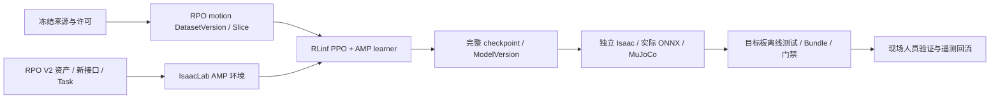

# 15 · AMP 接入 RPO：可行性、RLinf 训练与独立评估

日期：2026-09-24。状态：**设计真源；代码接入与真实训练、双仿真诊断见[实施记录](../progress/2026-09-24-rpo-amp-rlinf.md)，基础站立/行走验收尚未通过**。本文汇总 [Gemini 建议](../gemini_wbc_suggest.md)的可行性核验，以及真实网络结构、环境数、step 和 rollout 预算。执行顺序见[执行计划](../superpowers/plans/2026-09-24-rpo-amp-rlinf.md)。不执行 Git 提交。

遵循 [01 · 领域](01-product-domain.md)、[02 · 架构](02-system-architecture.md)、[03 · 数据](03-data-collection.md)、[04 · 训练](04-model-training.md)、[05 · 评估交付](05-evaluation-delivery.md)、[10 · RPO WBC](10-roboparty-rpo-wbc-integration.md)、[11 · 直立直行](11-rpo-stand-walk-phase-a.md)、[12 · 环境目录](12-environment-catalog-and-selection.md)。与 [13 · SONIC](13-sonic-rpo-rlinf-integration.md)、[14 · BFM-Zero](14-bfm-zero-rpo-rlinf-integration.md) 是并列路线，不能把这些方案的存在当作组件已经实现。

## 1. 可行性结论与范围

**有条件可行，推荐把 RPO 动作先验、判别器和风格奖励迁入 RLinf PPO，继续使用现有平台管线。** AMP 是一种训练方法，不是可直接替换当前 ONNX 的通用预训练模型。它用机器人运动片段训练判别器，再把风格奖励交给策略优化；部署时可以只运行 actor，不需要在线加载动作库或判别器。[AMP 原论文与项目](https://xbpeng.github.io/projects/AMP/)

可行性有三层，不能合并成“支持 AMP”：

| 层次 | 判断与依据 | 尚需证据 |
|---|---|---|
| 算法与本体 | 成立；本地 RoboLab 已有 RPO 23 DoF AMP 配置、动作库、转换和 MuJoCo 脚本 | 这些组件是否匹配批准的 V2.0 资产、动作质量是否满足目标 |
| 平台与 RLinf | 可扩展；现有 RPO 环境桥、PPO worker、Job/Run 和模型发布可复用 | 专用 AMP 数据传输、GAE 前奖励合成、第二 optimizer、恢复和导出检查 |
| 学会自然直立行走及真机运行 | 尚未证明 | 多 seed 独立仿真结果、目标板性能、实物标定及现场验证 |

沿用已确认的 **RoboParty RPO V2.0、23 自由度**，不是 RP1/G1。用户要求完整接入、训练、评估方案，且最终训练由 RLinf 执行；用户已允许优先核验 RoboParty 官方动作数据（包括本机已有副本）。第一阶段范围为：

- 第一验收阶段为平地、无负载、站立及 0.3 m/s 自然直立直行，允许自然摆臂；先解决第 11 章的基础运动目标。
- 随后扩展速度/转向、域随机化及第 10 章的行走中上半身目标控制；各阶段分别出能力证据，不用基础行走冒充完整 WBC。
- 优先核验本机与官方固定 revision 一致的 RPO 动作库，合格且用途允许才纳入训练；不假设已另获上游原始动作权利或新的动捕数据。
- 跳跃、跑步、翻滚、负载接触操作、灵巧手不在本次必需验收范围。数据中存在这些片段不代表要训练这些能力。

### 1.1 三条路线的取舍

| 路线 | 优点 | 代价与结论 |
|---|---|---|
| **现有 RPO 物理环境＋运动特征＋RLinf PPO/AMP** | 最大程度复用平台、现有终态修复和 50 Hz 执行路径；判别器只在训练端 | **采用**；新增必要的 motion loader、AMP learner 和证据协议 |
| 直接移植 RoboLab ManagerBased AMP 全环境到 RLinf | 更接近上游观测和奖励配置 | 要额外解决历史排列、自动 reset 和新 critic；适合作为来源对账，不作为首期最短实现 |
| Phase/clock＋姿态奖励，仍由 RLinf PPO 训练 | 无动作数据和判别器依赖，可作低成本对照 | 不等于 AMP；若数据不合格可继续基础 RL，但不能把替代路线标为 AMP 完成 |

不启动 `AMPRunner.learn()`、`PPOAMP.update()` 或 RSL-RL `OnPolicyRunner` 来冒充 RLinf 训练。不新增常驻服务或通用算法框架；迁移上游的数学定义和必要模块，训练生命周期归 RLinf。

### 1.2 讨论结论速查

| 问题 | 当前结论 | 详细定义 |
|---|---|---|
| AMP 能否接入 | 有条件可行；平台接入仍须运行时联调与收敛验证 | §3–5、§7 |
| 真正训练什么网络 | 带历史输入的非对称 MLP Actor–Critic，训练端附加 AMP 判别器 | §6.4 |
| 机器人运行什么 | Actor 均值推理＋观测/动作 codec＋PD；不运行 critic 或 D | §6、§11 |
| 第一阶段学什么 | 默认姿态起步，平地 20 s 直立站立及 0.3 m/s 直行 | §8.1、§10 |
| 用多少环境/step/rollout | 256 环境资源探测；通过后候选 512 环境×24 策略步×每轮 1 次采集 | §8.3–8.4 |
| 训练多久 | 先检查 1000 轮，有改善再扩至总计 3000–5000 轮；不是收敛保证 | §8.5 |
| 如何证明学会 | 独立站/走验证、自然度指标、实际 ONNX 闭环及 sim2sim；不只看训练 reward | §10 |
| 如何落地 | 按[执行计划](../superpowers/plans/2026-09-24-rpo-amp-rlinf.md)先闭合数据/时序/梯度，再短训、对照长训与验收 | §12 |

## 2. Gemini 建议逐项核验

| 建议/判断 | 评估与修正 |
|---|---|
| AMP 适合自然步态 | 方向合理。学习的是**筛选并重定向后的 RPO 动作分布**，不是直接判别人类关节角；数据含深蹲/跑步、重定向失真或奖励失衡时仍可能产生坏步态。 |
| 普通 RL 必然深蹲，AMP 必然直立 | 两个“必然”均不成立；不能从方法名推导效果。第 11 章还明确记录过奖励尺度和跌倒漏判问题，先修语义，再比较算法。 |
| QP-WBC 不适合此机器人 | 现有材料不足以排除所有 QP/混合控制方案。本次沿用学习式 WBC，是任务与平台选型，不是对硬件力控能力的实测结论。 |
| Dex-Retargeting/Poser 可直接映射整机 | Dex-Retargeting 主要面向手部；“Poser”没有明确仓库/版本，不能作为已验证依赖。优先已有 RoboParty GMR/转换链；BVH 骨架仍需专门映射。[Dex-Retargeting](https://github.com/dexsuite/dex-retargeting) |
| 一份 BVH 就够 | 可用于很小的原理检查，不能证明覆盖站立、低速、启停、转向和独立泛化；也不自动带来 V2.0 动力学可行性或数据授权。 |
| IsaacLab＋RSL-RL 是主训练路径 | 与用户要求不符；改为 IsaacLab 环境＋**RLinf PPO/AMP**，RSL-RL 仅是参考实现。 |
| 高度锁定、膝盖固定 5–15° | 不能把基座高度叫作质心高度，二者不同。高度允许合理波动；膝屈曲应按左右关节方向和支撑/摆动相定义，不能全过程锁死。原文“过屈 <20°”还存在定义/不等号歧义。 |
| 固定 20 ms 延迟、摩擦 0.4–1.1、三天上机 | 仅能作为待校准的仿真假设；延迟包含采样、推理、通信、驱动等部分，需实测分布和尾延迟。无收敛或上机时间承诺。 |

AMP 可降低手工设计风格奖励的负担，但不能替代速度目标、真实跌倒终止、关节/执行器限制和独立步态指标。

## 3. 调研基线与真实缺口

### 3.1 固定来源

本次读取下列本地版本，并核查官方项目页面。版本号是来源线索，正式构建仍必须记录实际内容快照、补丁 hash 与镜像 digest。

| 来源 | 本次 revision / 路径 | 作用 |
|---|---|---|
| RoboLab | `6b1c3d9988497c8961dcba77892de32edc1770e1`；`/data/kk/roboparty/roboparty_train/robolab` | RPO AMP 配置、特征、motion loader、重定向转换、MuJoCo 参照 |
| RoboParty RSL-RL | `6986d4d1b9fbab96fb61d51f07de419bc95432f1`；同级 `rsl_rl` | LSGAN 判别器、风格奖励、优化与保存定义 |
| RLinf | `018e6a9e0da60f96eeda8b11008543911027d414`；`/data/kk/RLinf` | 当前正式训练框架；工作区 `.gitignore` 有修改，不能只记 HEAD |
| 受管 RPO 资产 | `/data/kk/assets/roboparty/rpo-v2/asset-manifest.json` | robolab 如上；description `aa332a3c0a3c8a9d77e6df73c4c9698af0678b32`；hardware `4272767a0ab06e238f61f4c50d5ab1d25825d585` |

设计最初只静态阅读源码和动作文件目录；后续已通过受管容器完成官方 PKL 转换、运动学与 PD 回放、真实 RLinf 训练及独立评估，证据见 `docs/progress/`。**动态回放显示当前低速步行片段均提前跌倒；训练收敛和硬件能力尚未证明**。资产 manifest 的 `verified` 仅代表其资产检查，`hardware_verified=false` 仍成立，且原文件清单未覆盖 AMP 的全部源码/数据依赖。AMP 必须发布扩大覆盖范围的新快照，不能继承旧 manifest 的验证范围。

### 3.2 上游提供了什么

- [`rpo_amp_env_cfg.py`](https://github.com/Roboparty/robolab/blob/6b1c3d9988497c8961dcba77892de32edc1770e1/robolab/tasks/manager_based/amp/rpo_amp_env_cfg.py) 已定义 RPO、六个 key body、3 帧判别器窗口和 `rpo_lab` 数据权重；其命令范围含最高 2.5 m/s 前进及横移、转向，不能照搬为低速第一阶段。
- `amp_env_cfg.py` 的上游 actor 是 `(3+3+3+23+23+23)×3=234`，critic 为 `81×3=243`；观测管理器按 term 管理历史。当前平台 WBC 则是逐帧历史 `89×10=890`、critic `150×10=1500`，形状和语义都不同。
- 上游判别器每帧为角速度 3、绝对关节位置 23、关节速度 23、六个 key body 的 root-body 相对位置 18，共 **67** 维，3 帧共 **201**。其 root 线速度及朝向项在所读配置中被注释，不能宣称已有完整直立特征。
- `scripts/tools/retarget/config/rpo.yaml` 已区分 GMR 关节序和 Isaac 关节序；`gmr_to_lab.py` 处理 `xyzw→wxyz`，并主动把两个肘 yaw 置零。这个简化必须记录，不能据此宣称支持所有上肢动作。
- 本地 `data/motions/rpo_lab/` 有站立、行走、跑步、转向等候选 PKL。文件名不证明动作质量、来源权利或 split 独立性。
- [RoboParty GMR 文档](https://github.com/Roboparty/GMR) 列有 23 DoF `Origin`，但不同输入格式支持不等价；所查表格将其 BVH 路径列为未完成。需要 BVH 时应先 probe，不能从 G1 示例推断 RPO 已适配。

### 3.3 必须处理的现有问题

| 位置 | 静态发现 | 本方案处理 |
|---|---|---|
| 上游 `amp/amp_env.py::step` | 注释说保留终态，但相关 capture 代码被注释，实际先 `_reset_idx` 再计算观测 | 不直接复用该 step；沿用平台唯一 reset 责任并增加 AMP 末态窗口 |
| 上游 `amp_env_cfg.py` | 高度终止为 0.2 m，弱于第 11 章 0.50 m | 新任务沿用更明确的 0.50 m / 0.80 rad 跌倒定义 |
| [RPO 环境桥](../../backend/eb/runners/rpo_wbc_extension.py) | 只传 `states/critic_states`；现有上肢中立位奖励会阻碍自由摆臂 | 新 locomotion 接口/recipe 和训练专用 AMP 字段；旧任务不改语义 |
| 同桥 `_pre_physics_step` | 当前先把原始 action 入历史，再裁剪；与契约 `last_executed_action` 不一致 | 按契约修正执行历史，保留原样本供 log-prob；旧模型不得自动继承修正后 codec 的验证状态 |
| RLinf `isaaclab_env.py` | 以正 reward 记录 `success_once`；通用 info 路径不足以自动保留新字段 | 对运控显式传输任务事件和 AMP 窗口，成功由独立评估判断 |
| RLinf `EnvWorker.compute_bootstrap_rewards` | 在环境端已经给 timeout reward 加 `γV(final)` | learner 合成风格奖励不能重乘/覆盖该项，更不能二次 bootstrap |
| [RLinf adapter](../../backend/eb/adapters/rlinf.py) | 现有两个 RPO PPO 模板拒绝 dataset；多处依赖 `rpo_v2_wbc_` 前缀 | AMP 单独模板显式要求 motion Slice；补齐镜像、挂载、恢复等分支 |
| [模型发布](../../backend/eb/runners/rlinf_entry.py)、[导出评估](../../backend/eb/runners/rpo_wbc_artifact.py) | MLP 元数据/导出仍写死 890 和现有 codec | 显式按 recipe/接口构建，禁止新权重套旧 normalization 或填零骗 shape |
| [模型收集](../../backend/eb/orchestrator/collect.py) | RPO 分支、模型 family/接口/IO 仍绑定旧 WBC 身份 | AMP 新身份和 motion 血缘贯穿 collect，不能只修改训练入口 |
| [MuJoCo adapter](../../backend/eb/adapters/mujoco.py) 与 `case_success` | 旧 checkpoint 评估限制最多 12 seeds；stand_walk 判定未使用传入的 hard_limit | 新套件按冻结 case 清单做有界校验；补齐硬越限失败，不能沿用旧结果证明新资格 |

## 4. 保持平台管线一致



数据转换、训练、导出、评估继续走 `JobSpec → Job/Run → ebd → 动态任务容器 → Artifact/Lineage`。API 只管理元数据与编排；Rust 负责快照、执行、大文件和媒体。任务容器无 `docker.sock`，平台 Compose 仍是唯一部署入口，大镜像仍通过 `make images` 构建。

外部 `/data/kk/RLinf`、RoboParty 源码、BHL 和原始数据全部只读；修改落在仓库内受管扩展/补丁，构建时作用于镜像副本。缓存、USD、动作转换、日志、replay、checkpoint、视频只写独占 Run/受管目录。数据重定向不在 FastAPI 执行，不从用户参数拼任意 shell 或导入路径。

拟新增身份，**以下是设计名，不代表已注册**：

| 对象 | 第一阶段 |
|---|---|
| 本体 | 复用 `emb_roboparty_rpo` |
| 本体接口 | `ee_rpo_v2_amp_locomotion_23dof_v1`，新建并发布，不修改旧 WBC |
| Task / Isaac task | `tsk_rpo_amp_stand_walk` / `RPO-AMP-StandWalk-v1` |
| 训练模板 | `rpo_v2_amp_stand_walk_ppo`；仍为 `train.rl`，必须有 motion Slice |
| 训练/评估环境 | 分别注册 `EnvironmentProfile`，绑定对应模板/Suite、修订和 hash |
| 模型 | 复用 MLP builder，增加 AMP recipe 身份；不能只靠 `model_type=mlp_policy` 推断 codec |
| 评估套件 | `suite_rpo_v2_amp_{isaac,mujoco}_stand_walk_v1`，独立于旧套件 |

AMP 的 motion 是**专家状态序列**，不是机器人 action 标签或 LeRobot SFT episode；数据用途需允许 `motion_prior`，不能伪造电机 action 满足旧校验。复用 DatasetVersion/DataSlice 与 JSON manifest，不引入新的数据服务。

落到现有字段时保留 `usage=train|eval` 的训练/评估隔离，另在 manifest/meta 中声明 `purpose=motion_prior` 及具体 split。`motion_prior` 表达消费语义，不替换 train/eval；验证器按 purpose 检查 motion 特征，不能套用 SFT 的 action/state 维度相等要求。

## 5. 动作数据与重定向

### 5.1 处理顺序和输入来源

1. 冻结原始文件、source/group ID、版本、每文件 hash 和用途授权；先对本机候选库做清点。
2. 对已有 RPO 数据核对资产、关节序、单位、坐标和时间；若资产不兼容则重新重定向或拒绝，不能仅重新命名。
3. 缺合格低速片段时，在隔离工具容器中使用固定版本 GMR＋RPO mapping；优先已验证输入格式。BVH/SMPL-X 各自做 import→IK→RPO 回放检查，不把人体形态缩放等同于关节删列。
4. 重采样、重算速度和 FK、接触与质量报告；按原始动作/表演者/session/近重复关系分组，再划分 train/validation/held-out reference。
5. 仅 train 内做裁剪、左右镜像或有限时间缩放；所有派生片段继承原 group 和 split。
6. 发布 DatasetVersion、固定成员/采样权重的 Slice、AMP feature view；目标训练镜像 loader 回读并生成 input receipt。

不先大批量重定向。首个可行性 probe 使用少量站立、0.3 m/s 附近行走、启动/停止片段；全部可回放后再扩量。站立和行走都必须有有效样本，按行为类别平衡采样，再在 clip 内均匀采有效时间窗；禁止长跑步片段因帧数多支配低速训练。

RoboParty 官方 [`robolab`](https://github.com/Roboparty/robolab/tree/6b1c3d9988497c8961dcba77892de32edc1770e1/data/motions/rpo_lab) 仓在固定 revision 收录候选 PKL，仓库附有 [BSD-3-Clause LICENSE](https://github.com/Roboparty/robolab/blob/6b1c3d9988497c8961dcba77892de32edc1770e1/LICENSE)。**仓库许可证不能单独证明每个上游动作源的再授权，也不能证明精确速度覆盖或重定向质量。**受管审计发现原速库缺足量的 0.3 m/s 连续接地直行，原先只按水平速度筛出的 `114_08` 主要腾空，不能作为步行先验。诊断版可将官方左右转步行动作同步延长时间，再按接地、速度、横移、偏航速率和片段累计转角筛选；root、q、关键点与导数必须同一时间轴重算，记录原 FPS、缩放比例与源 SHA。片段之间不能拼接成一个判别器窗口。**时间缩放并不证明动力学可执行，也不等同于已有合格直行数据**；须在批准资产中回放并通过接触/足滑/执行器检查，再进入正式训练 Slice。转换结果只可作训练诊断输入；真实容器转换与回放通过前不得标正式 `training_ready`。代码许可证、人体模型许可证、原始动作许可证和衍生数据用途分别保留；来源不明确的片段不得进入正式发布 Slice，换用自有/另行授权数据。外部 pickle/joblib 的导入仅在无凭据、无出网、最小挂载容器执行，发布训练视图使用普通数组文件及 manifest，不在 API 或宿主直接反序列化。

### 5.2 最小数据契约

| 内容 | 要求 |
|---|---|
| 身份 | 原始 clip/group/split、来源许可引用、转换代码/参数/资产/mapping hash |
| 时间 | 原 FPS、真实时间戳、50 Hz 目标时间轴、有效段及边界；不只改 `fps` 标签 |
| root | `root_pos[T,3]`，m；`root_quat[T,4]`，明确 body→world、`wxyz`；线/角速度及其 frame |
| joints | 23 维绝对 q（rad）和 dq（rad/s），按平台 canonical joint order；保留与 Isaac/GMR/MuJoCo 的命名映射 |
| FK | 六个 key body 的位置，按左/右踝 roll、左/右膝、左/右肘 yaw 顺序；由同一 root/q/资产计算 |
| 标签 | stand/walk/start/stop、实际速度、接触推导方法、无效帧、重定向残差、剔除原因 |
| 发布 | 文件/字节/hash、有效秒数、独立 source group 数、窗口数和 loader 回读证据 |

统一世界 z 向上，机体前向/左向及 IMU 外参由资产 profile 明确。50 Hz 非整数重采样采用时间插值；四元数先归一化、处理符号连续性，再 SLERP/等价处理。速度从同一目标时间轴生成，降采样前做适当抗混叠；不把跨片段的差分当速度。

普通连续运动窗口不能跨 clip、reset、无效段或不连续循环接缝；首尾不足窗口直接排除。`loop_mode=wrap` 只有 root 位移/heading、q/dq 及接触在周期边界经检查后才可使用。root 高度必须相对于地面，不能混入并行环境 origin；身体局部 keypoint 与世界位置不能混用。离线差分可使用相邻参考帧，在线 actor 只能使用当前已获得的传感器历史。

### 5.3 质量闸门

- 结构：关节/关键体名称唯一且齐全，shape、有限值、时间单调、有效时长、文件 hash 正确。
- 几何：姿态与 FK 一致，无显著穿地/自碰撞，脚底接触与 root 运动相容；转换前后左右不颠倒。
- 运动：关节软/硬限位、速度/加速度、支撑脚滑动、躯干倾角、支撑期膝屈曲及步频分布符合 RPO 目标。
- 动力学：在批准资产中检查执行器力矩/速度包络、PD 跟踪和接触；运动学回放可看不等于动态可执行。跟踪失败既可能是数据问题也可能是控制器问题，保留两类诊断，不用单次失败武断剔除全部动作。
- 反作弊：低速轨迹不能仅把跑步 root 位移缩短而保留原关节速度；时间缩放必须同步 q/dq、root/FK/接触并重新验证。

质量门限、标定样本与判定代码在正式发布前冻结。每个淘汰项有原因及原片段引用；训练 normalizer、sampler 和 reward 调参不得读取 held-out reference 或最终 acceptance。

## 6. 环境、网络与接口

### 6.1 首期选用现有物理桥

在受管 `rpo_wbc_extension.py` 同一边界增加独立 AMP locomotion 任务，复用 RPO 资产、canonical joint mapping、PD 和 RLinf 驱动的唯一 reset。只复用 RoboLab 的 motion 处理和特征定义，不为 AMP 重新复制一套物理 stepping。共享 step 的必要修正必须对旧 WBC 做回归检查。

保持策略 50 Hz、物理 200 Hz、decimation=4、20 s 上限。基础初始化与第 11 章相同：关节偏差 ±0.05 rad、小 x/y/yaw 速度 ±0.05，站立/0.3 m/s 各约 50%，episode 内固定命令，无横移/转向、推搡和域随机化。高度 <0.50 m、倾角 >0.80 rad、规定躯干接触为真终止；20 s 为截断。倾角使用 root 相对竖直，数值非法单独归因。

### 6.2 为什么自然行走需要新接口

旧 890 维接口含 11 维上半身目标；“目标全零但要求自由摆臂”会产生语义或奖励冲突。首期自然行走移除该输入，发布新接口，而非更改旧接口中零值的含义：

| 分组 | 新 locomotion 设计 |
|---|---|
| Actor 单帧 | 角速度 3、重力投影 3、速度指令 3、q 相对默认值 23、dq 相对默认值 23、上一执行动作 23，共 **78** |
| Actor 历史 | 10 帧，逐帧、从旧到新展平，**780**；reset 复制初始测量帧，上一执行动作置零 |
| Critic 单帧 | actor 78＋线速度 3＋足接触 2＋足力 6＋air time 2＋足高 2＋ddq 23＋力矩 23，共 **139** |
| Critic 历史 | 10 帧，共 **1390**；特权量只进训练 critic |
| Action | 23 维对角高斯样本，评估/导出取均值；既有 canonical 顺序 |
| 网络 | 复用三层 256/Tanh MLP 与独立 value head；不因上游配置为 512/256/128 就同时更换网络 |

这些是**设计维度**，发布前须由实际环境 probe 核验。旧 890→23、上游 234→23 和新 780→23 checkpoint 不兼容，不通过裁剪输入或补零直接转换。第一轮随机初始化，避免把来源不明旧权重混入结果。

固定 actor 的既有物理 scale/clip 并写入新 manifest，首期不增加在线 actor normalization。critic 同样记录各 term 的尺度。历史 reset 仅影响指定 env；查询终态或录像不能额外推进历史。端侧、ONNX 和两仿真器共用冻结 codec，并用黄金轨迹验证，不能按维度猜排列。

动作协议明确区分：`u_sampled`、经过裁剪/限位/延迟后的 `u_executed`、物理 `q_target`。`q_target=q_default+0.25×u_executed`，具体 action clip、逐关节软限位、PD/armature 来自新接口批准参数；不得暗中继承不匹配 G1 增益。上一动作写实际执行的等效归一化值；PPO old/new log-prob 始终针对原始采样随机变量，不能用裁剪值重算密度。启用动作延迟后还需明确策略周期内执行历史的采样时刻。

RLinf 的 MLP 返回逐关节 log-prob，PPO 必须按一个 23 维联合动作求和构造 likelihood ratio；不能把 23 个关节算成 23 次环境 transition，也不能因动作维度变化改成未声明的平均。以已知对角高斯和同一 rollout batch 检查采样端、learner 端的 ratio=1 初始一致性。

### 6.3 AMP 特征是训练侧独立协议

首期采用 `rpo_amp_features_v1`：在上游 67 维基础上增加 root 重力投影 3、地面相对高度 1、body 线速度 3，共 **74 维/帧，3 帧/222 维窗口**。这有意增强直立和速度分布信息，属于平台 recipe 适配，不称为逐数值复现上游。

顺序固定为 `root_ang_vel_b[3], q_abs[23], dq[23], key_body_pos_b[18], projected_gravity_b[3], root_height[1], root_lin_vel_b[3]`。q/dq/keypoint 均按命名映射，不沿用 Isaac 内部排列。数据和仿真使用同一编码函数/参数；相同姿态、旋转和速度输入应得到相同特征。

窗口为 `[s_(t-1), s_t, s_(t+1)]`，以动作执行后的 `s_(t+1)` 结尾，用于给 transition `(s_t,u_t,s_(t+1))` 打分；三帧跨度 40 ms，不是 60 ms。训练回合开始不足三真实帧时 `amp_valid=false`，不填零/复制当专家样本，风格奖励为零；PPO 的任务奖励与损失仍有效。跌倒末态只要窗口完整即保留为策略负样本，不能筛掉失败让判别器只看成功。

AMP 特征及专家窗口不进入 actor，不要求端侧获得 root 真值或未来信息。禁止把特权 AMP 张量经 `states` 偷送进 actor。3 帧先验只约束局部运动分布，不能单独证明长期步态周期，故评估必须包含完整步态和启停轨迹。

### 6.4 真正训练和部署的模型

首期选用**带观测历史的非对称 MLP Actor–Critic＋AMP 判别器**。非对称指 actor 只用可在部署端获得的观测，critic 额外使用仿真特权量；三者参数独立，D 的梯度不直接更新 actor。

| 网络 | 明确结构 | 输出与用途 |
|---|---|---|
| Actor | `780 → 256 → 256 → 256 → 23`；三个隐藏层 Tanh，末层线性 | 23 维动作均值；训练另有 23 个可学习、与状态无关的 log-std，组成对角高斯；评估/部署取均值 |
| Critic | `1390 → 256 → 256 → 256 → 1`；三个隐藏层 Tanh，末层线性 | PPO 状态价值估计，只用于训练 |
| AMP 判别器 D | `222 → 1024 → 512 → 1`；两个隐藏层 ELU，末层线性、无 sigmoid | 判别专家与策略局部运动，生成风格奖励，只用于训练 |

Actor 输出归一化关节位置偏移，执行端按 §6.2 裁剪、缩放、映射成 23 个 `q_target` 并由 PD 执行；不是直接输出力矩，也不是预测一整段步态。部署包保留 actor、固定物理 scale/clip、历史构造、关节序、默认位和执行参数；不需要动作库、critic、D 或探索噪声。

选择三层 256 是复用当前 RLinf `MLPPolicy` 与受管非对称 critic 补丁的工程起点，**没有证据证明它最优**。上游使用 `[512,256,128]`/ELU，可在基础闭环达标后作为单独控制变量比较，不能一边更换网络一边把差异归因于 AMP。[上游网络与训练配置](https://github.com/Roboparty/robolab/blob/6b1c3d9988497c8961dcba77892de32edc1770e1/robolab/tasks/manager_based/amp/agents/rpo_amp_agent_cfg.py)

行走中独立控制上身属于 C5：actor/critic 输入变为 890/1500，动作仍 23，D 改为 138 输入，见 §11；这不是首期 780 输入模型已经具备的功能。

## 7. RLinf 中的训练闭环

### 7.1 最小组件及职责

保留 `examples/embodiment/train_embodied_agent.py → EmbodiedRunner → EnvWorker / MultiStepRolloutWorker / actor worker`。新增专用 AMP actor-worker 路径，复用 PPO loss、GAE、FSDP 生命周期、通信和 checkpoint；普通 PPO 分支保持原行为。

| 组件 | 新增职责 |
|---|---|
| RPO env/Isaac wrapper | 返回 reset 前 AMP 窗口、有效 mask、终止原因；保留真实 critic final observation |
| `EnvWorker` | 将本 transition 的 AMP 字段与 policy 输出对齐；不训练判别器、不反序列化原动作库 |
| trajectory builder / serialization | 保留 AMP tensor、mask、版本与 reward 分量，经过 CPU/通信、拆分、合并后不丢字段 |
| AMP actor worker | 所有 batch 收齐后，在 GAE 前计算冻结 D 的 style reward；随后 RLinf PPO 与 D 两组优化 |
| motion loader | 只读已发布 train Slice，采合法连续专家窗口；不执行上游 trainer |
| rollout worker | 仅 actor/value 推理和权重版本同步；不持有在线可变 D，避免每个 rollout 副本奖励不一致 |

首期固定同步 PPO、`runner.use_training_pipeline=false`、`runner.overlap_env_bootstrap=false`、一个 learner、`num_action_chunks=1`、`rollout_epoch=1`、每轮同步策略；关闭异步/流水线 GAE 和 reward filtering。若高级参数试图启用尚未实现的组合，提交时拒绝，而非静默改变算法。AMP 不是 mixed precision 的同名开关，配置使用明确 `motion_prior`/`amp_discriminator` 命名。

### 7.2 传输协议与终态

复用 `ChunkStepResult → EmbodiedTrajectoryBuilder → Trajectory → convert_trajectories_to_batch`。优先用现有 tensor sidecar 字典传输 AMP 字段；若存于 `forward_inputs`，须由 **EnvWorker 在 step 返回后**合入当前 transition，而不是从动作前的 `PolicyOutput` 猜下一帧。worker 取出训练 sidecar 后才将纯策略字段送模型，校验所有轨迹 key/shape 一致。

每条 transition 最少保留：`env_id, episode_id, step_id, policy_version, task_reward, bootstrap_reward, amp_window[3,74], amp_valid, terminated, truncated`，以及现有 obs、action、old log-prob、value、final critic obs。固定 feature/schema hash 写 Run manifest，不必逐样本重复字符串。

reset 只有一个负责人：底层 step 先生成末态和 AMP 窗口，RLinf wrapper 保存 `final_observation/final_info` 后执行 partial reset；reset 后 obs 用于下一动作。不能用 reset obs 代替末态，也不能让 wrapper 丢掉非 terminal env 的 AMP info。初始/最终 bootstrap 记录没有实际动作，不能混进 D 样本或重复记 reward。

GAE 的目标语义：

```text
δ_t = r_total_t + γ × (1 - terminated_t) × V(final_next_t) - V(s_t)
A_t = δ_t + γλ × (1 - terminated_t) × (1 - truncated_t) × A_(t+1)
```

正常 rollout 边界用最后状态 bootstrap；真正跌倒不 bootstrap；timeout 用 reset 前 final value，但 advantage 不跨 reset 传播。若 `terminated` 与 `truncated` 同时为真，以真终止为准。

现有 RLinf 的实现把 timeout bootstrap 预先加到 reward，再使用 done mask。首期保留这一路径：环境分别记录 `task_reward` 和 `bootstrap_reward`，learner 只合成 `task_reward + style_reward + bootstrap_reward`，不再次添加 final value。以手算两 env 样例验证它与上述目标语义等价；不能把已加 bootstrap 的 reward 整体做 task/style lerp。

### 7.3 判别器、奖励和更新顺序

采用上游已有 **LSGAN** 定义。D 为 `222→1024→512→1`、ELU、无输出 sigmoid；专家目标 +1、策略目标 −1。初始超参参考上游而非效果承诺：[判别器实现](https://github.com/Roboparty/rsl_rl/blob/6986d4d1b9fbab96fb61d51f07de419bc95432f1/rsl_rl/modules/amp.py)、[PPOAMP](https://github.com/Roboparty/rsl_rl/blob/6986d4d1b9fbab96fb61d51f07de419bc95432f1/rsl_rl/algorithms/ppo_amp.py)。

```text
x = flatten(N_amp(window))
L_D = 0.5 E_expert[(D(x)-1)^2] + 0.5 E_policy[(D(x)+1)^2]
      + 10 E_expert[||∇_x D(x)||²]
r_style = 0.02 × w_style × max(0, 1 - 0.25 × (D(x)-1)²) × amp_valid
r_total = r_task + r_style
```

D 使用独立 Adam，初始 lr=1e-4，trunk/末层 weight decay 分别 1e-3/1e-1，梯度范数裁剪 1.0；gradient penalty 在 FP32 中计算，参考的是归一化后专家输入的梯度。PPO 仍使用既有 clip=0.2、γ=0.99、λ=0.95、5 epochs 等受管配置。D loss 不反传进 actor；actor 通过 PPO 优势学习风格奖励。

首期 `N_amp` 用训练 Slice 的每特征 mean/std，设置按物理单位冻结的最小 std，并在发布前检查饱和/常数特征；两类样本使用完全相同变换，训练中固定，不分别拟合专家和策略。不为方便给新 normalizer 使用旧 actor 的 890 维统计。在线更新 normalization 属于后续受控实验，需要固定轮内快照、全 rank 合并统计及完整恢复，不能悄悄启用。

每轮顺序固定：

1. 同步 `π_k/V_k`，采集 on-policy rollout；actor/D 更新期间不生成下一轮训练样本。
2. 所有轨迹到齐，用冻结 `D_k/N_amp` 批量计算一次奖励，写 `reward_version=k`；据此计算一次 GAE/returns。
3. RLinf 完成 PPO 更新，整个多 epoch 优化过程不重算 D 奖励，不更换旧 log-prob。
4. D 用当前有效窗口与有界历史策略窗口作为负样本、train 专家窗口作为正样本更新；初始 5 epochs×4 minibatches，每 minibatch 正负数相同，负样本当前/历史各半，历史为空时全用当前。
5. 发布 `π_(k+1)/V_(k+1)/D_(k+1)` 和 optimizer 状态，在轮边界保存。D 下一轮才参与 reward。

历史 buffer 只用于 D，不把旧动作交给 on-policy PPO。初始容量 **100,000 个有效窗口**，按环形 FIFO 淘汰，保存原始特征和来源版本；约 `100000×3×74×4≈88.8 MB` 纯 FP32 payload，索引/副本另算。D 更新完成后再把本轮新窗口加入历史，避免“历史半批”重复算作当前半批。每轮新增窗口统计一次，不能因 PPO 多 epoch 重复计入。专家从固定数组/Slice 采样，不复制完整动作库到所有环境 worker。

每轮 D 的负样本批量以当前有效窗口数为基准分四批，尾批用真实 count 归约，正样本匹配相同 count；从相应池随机有放回采样并记录 sampler 状态。没有有效策略窗口时跳过该轮 D 更新并明确计数；连续两轮仍为空则停止算法 smoke/长训，检查过早终止和窗口协议，不伪造全零样本。§7.2 的 `amp_valid` 不能变成 PPO loss mask。

上游 `task_style_lerp=0.6` 会混合缩放整个 task reward。本方案明确不照搬该混合：保留任务/物理惩罚尺度，另加 `w_style`（候选上限 1.5，初期逐步升至此值）。所有 reward 记录原始量、权重、是否乘 dt、最终贡献；已乘 dt 的任务奖励不得再乘一次。终止惩罚不能因 AMP 权重变化被削弱。该差异写入 recipe hash 和对照实验。

候选 warm-up 固定为前 10 轮 `w_style=0`（D 仍学习），随后在第 10–200 轮线性升至 1.5，之后保持；对应 transition 数随冻结的环境数/horizon 写入 resolved config。这个起点须经 validation 检查，改课程产生新实验修订，不能靠人工临时调权重重解释同一 Run。

### 7.4 平台训练接通不能漏的地方

- 模板/预览/提交明确接受一个已发布 motion Slice；校验用途、feature hash、资产 hash、split 和非空有效窗口，不能走当前“RPO 无 dataset”分支。
- `input_receipt` 记录实际 loader、源/转换/normalizer hash、各类可用时长、实际采样计数和挂载映射；界面保存了 dataset ID 不等于训练读取了它。
- 模型类型仍可用 MLP，但训练算法、接口、D 和 motion 身份要进 recipe；AMP worker 选择、受管配置和 Hydra 保护字段必须实际生效。
- 预览/提交/恢复共用配置解析。环境页只展示/编辑白名单参数；改权重生成新 Profile，不能在现有 active 版本直接改值。
- checkpoint/collect/lineage 纳入 D 和数据，不让“找到 full_weights.pt”替代完整恢复验证。训练 UI 展示 task/style/total reward、D loss/分数/梯度、有效窗口数和倒地/速度/姿态指标。

## 8. 训练课程、对照与资源

### 8.1 顺序与退出条件

| 阶段 | 工作 | 达标后才进入下一阶段 |
|---|---|---|
| C0 数据和接口 | 小动作库、同姿态 feature parity、末态/历史/动作 codec 检查 | loader 真正消费 train Slice，关键检查全部通过 |
| C1 算法 smoke | 2–16 env，至少两轮真实 RLinf PPO＋D 更新和一次保存重载 | actor、critic、D 参数和各自 optimizer 有变化；奖励进入 GAE；结果可定位 |
| C2 站立/低速 | 无随机化，站/走约 50:50；从默认姿态 reset；style 从零逐步增加 | 独立 validation 先通过基础存活/速度，再观察自然度，无靠静止骗分 |
| C3 启停/速度包络 | 默认从 0–0.5 m/s、平缓启停开始；再按数据覆盖引入横移/转向 | 每新增命令段有合格数据、任务/suite 修订和分层结果 |
| C4 鲁棒性 | 按实测逐项加入质量/惯量、PD、摩擦、噪声、时延/抖动、扰动 | 名义与扰动套件分别达标，保留每 case 随机化实值 |
| C5 上半身 WBC | 按 §11 独立 recipe 接入目标跟踪 | 下身稳定、速度和上身误差同时合格，不能用单项平均替代 |

C2 不继承旧任务的 11 关节中立位强跟踪奖励；保留速度/直立/跌倒、接触、关节/力矩/能耗/动作变化约束。原有足高/腾空/关节锚定等步态塑形项逐项记录与动作库是否冲突，首个对照两组使用完全相同设置；需要改变就形成新的实验修订，不边看 acceptance 边调。

初始不使用 reference-state initialization（RSI），确保策略能从部署默认姿态起步。若长训诊断确需 RSI，只采训练片段合法状态，记录概率并保留默认 reset；不能用专家历史伪造 actor 的真实过去动作。最终验收从默认站姿及冻结小扰动起步，RSI 成绩单列。

**2026-09-24 诊断修订：**实际 Isaac 探针发现，默认关节姿态的零动作 PD 在约 59 步跌倒；直接施加官方 A1 站姿目标约 52–58 步跌倒；若从 A1 站姿的关节角与约 0.711 m 基座高度起步，同一恒定 PD 目标可存活 1000 步。因此增加单独的 `official_a1_stand_v1` 初态诊断环境 Profile：源为冻结 v4 动作数据 `A1-_Stand_stageii` 第 95 帧，初始 actor 均值对应同一目标关节角，命令仍为站立/0.3 m/s 各半。训练、模型卡和独立评估计划均记录 Profile 身份与设置；原默认初态 Profile 和既有评估记录不变。这个实验只回答“稳定起点能否学会行走”，**不能替代默认初态或扰动条件下的最终验收**；训练成效若只在源姿态成立，须另做默认起步过渡和新冻结套件。

该 Profile 可另行冻结训练专用的 `initial_logstd`（范围 -4～0），仅改变高斯 actor 的初始探索标准差，不进入部署 ONNX。默认仍使用 RLinf 的 `-0.5`；若从稳定 A1 起点训练仍因采样噪声约 70 步跌倒，以新 Profile 单独测试 `-2.0`，不得把两轮结果混作同一配置或精确续训。

**速度奖励反作弊修订：**100 轮诊断模型在独立 Isaac 步行 case 完成 1000 步却只前进约 0.012 m。原 `track_lin_vel_xy_exp` 的 `std=0.5 m/s` 对 0.3 m/s 指令下的零速度仍给 `exp(-0.3²/0.5²)≈0.70`，容易把“站住不走”当成高收益。AMP 训练 Profile 增加独立的 `velocity_tracking_std`（0.05–0.5 m/s，默认 0.5）；候选 0.2 m/s 时该比例约 0.105。改变该值必须发布新 Profile、新 Run 与模型卡，不能作为已有 checkpoint 的精确 resume；独立评估继续以真实速度、位移和跌倒判定，不读取训练奖励。

**奖励权重有界诊断：**收紧容差后，关闭风格奖励的 PPO 候选在独立步行 case 仍存活 1000 步但只前进约 0.027 m，说明仅靠 `std=0.2` 未让移动收益压过稳定站立。AMP 训练 Profile 可另设 `velocity_reward_weight`（0–10，旧默认 3）；较高权重如 8 仅用于新版本有界诊断，并同时报告倒地、速度误差、位移和关节约束，防止用猛冲或摔倒换取速度奖励。改权重必须新建 Profile/Run/模型卡，不能冒充已有训练的 exact resume，也不能调整独立评估门槛。

**执行器延迟诊断修订：**官方 RPO 资产的 `DelayedPDActuatorCfg` 在每次 reset 为腿、踝、肩、臂分别抽取 0–2 个物理步延迟，单靠关闭事件随机化不能实现 C2 的无随机化要求。100 轮模型在独立 Isaac 站立种子 0 的腿/踝延迟为 1/1 且存活 1000 步，种子 2 为 2/2 且跌倒；仅相关，不据此宣称因果。AMP 训练及 Isaac 诊断评估 Profile 可显式冻结 `actuator_delay_steps` 为 0、1 或 2，缺省保持官方随机延迟；新设置须进入 Profile hash、Run、模型卡和评估计划。先在独立评估固定 0 复测同一权重，只有改善且数据/命令仍可信时才新建训练修订。MuJoCo 不消费此 Isaac 专用设置。

同一诊断还确认受管 RPO MJCF 的关节排列已与 canonical 23 维顺序一致；旧 MuJoCo 评估路径的额外非恒等重排必须修正，并以资产关节名回归检查。修正后跨仿真分数作为新评估版本记录，不能与旧映射下的数值混合比较。

stage/权重课程按全局 transition 数和已冻结规则推进，状态进 checkpoint；不存在“loss 好看就自动放大速度”。数据变了、奖励/任务/随机化变了需要新的训练修订与 warm start 语义，不冒充相同配置的 resume。

### 8.2 必需对照

| 对照 | 控制变量与目的 |
|---|---|
| 同接口 PPO、`w_style=0` | 与 AMP 使用相同 780/1390 网络、任务奖励、初始化、资产、环境数和 transition 预算，隔离 AMP 效果 |
| 同接口 PPO＋AMP | 唯一关键增量为专家先验与 D 更新；报告额外 GPU 时间及数据准备成本 |
| 第 11 章旧 WBC 基线 | 保留其原有任务/接口/12-case 判据；只比较共同速度/稳定指标，不能把接口和上肢语义差异归因于 AMP |

至少 3 个独立训练 seed；报告每 seed 和跨 seed 分布，不只展示最佳录像。主要比较等 transition 预算，再报告等 wall-time 成本；共用验证/验收 case 和选模规则。可选 phase baseline 是额外实验，不能拖延基础 AMP 闭环。

`best` 按 validation 的顺序规则选择：先满足基础稳定/速度，再满足自然度，最后比较风格误差/能耗；不按训练 D 分数选最好，也不用最终验收集选 step。

### 8.3 容器与资源画像

先扩展现有 RPO/RLinf 镜像，固定 Python/PyTorch/IsaacLab/IsaacSim、上游依赖、补丁和资产缓存。GMR 若需不同 Python 环境，作为单独转换任务镜像，不覆盖训练依赖。无需为 AMP 增加 ASE/CALM/SONIC/BFM 依赖。

资源探测从单张 24 GB 4090、256 env、horizon=24 开始；通过显存、吞吐和时序检查后，第一阶段正式候选采用 **512 env、horizon=24、rollout_epoch=1**。两种配置都不保证可容纳。测量载入与更新峰值、RAM/shm、环境 steps/s、D 采样/更新时间、checkpoint 大小及 I/O 后冻结资源。256/512 env 每轮分别采集 6144/12288 transitions；batch/microbatch 要整除真实布局，不因 PPO epoch 数把环境样本量乘五。

2/4 卡先用于独立 seed 作业；单 Run 多卡是后续优化，必须单独验证 D 梯度同步、全局样本分母、专家采样 RNG、normalizer、buffer 分片与 checkpoint。不能只同步 actor 而让各 rank 的 D 自行漂移。4×24 GB 不视作一张 96 GB；按 UUID 租卡，防止不同 Run 争用设备与 Ray 端口。

每次实验冻结最大 transitions/updates、GPU 小时、磁盘/视频预算和早停规则。持续 NaN、数据不合法、D 与 reset/归一化伪特征有关、所有 rollout 跌倒且无改善时停止扩长训，先诊断。D 正负分数轻易饱和先查 feature parity、padding 和数据范围，不能直接用更大网络或更久训练掩盖问题。

### 8.4 环境数、step、rollout 和 batch 的统一口径

这里的**一轮训练**是同步策略→采集一次 rollout→计算奖励/GAE→PPO 更新→D 更新；不是一次梯度下降，也不是一个完整 episode。环境数取决于采样与硬件预算，不能由 actor 的层数直接计算。

| 概念 | 512 环境候选配置的含义 |
|---|---|
| 物理 step | 200 Hz，5 ms；四个物理步对应一个策略步 |
| 策略 step / transition | 50 Hz，20 ms；一个环境执行一次 23 维动作得到一条 transition |
| Actor 历史 | 10 帧观测；与 rollout 长度无关 |
| AMP 历史 | 3 帧，窗口首尾相隔 40 ms；与 actor 历史分别维护 |
| `max_steps_per_rollout_epoch=24` | 每环境采 24 个策略步，单环境模拟时长 0.48 s |
| `rollout_epoch=1` | 每轮一次采集，含 512 段、每段 24 步的环境轨迹；共 12288 条 transition |
| `max_episode_steps=1000` | 单回合最长 20 s；跌倒提前结束；24 步采样结束不重置仍在运行的回合 |
| `algorithm.update_epoch=5` | 同一批新样本重复做五遍 PPO 优化，新增交互仍为 12288 条 |
| `global_batch_size=4096` | 单 learner 下，每个 PPO epoch 分成三个优化 batch |
| `micro_batch_size=1024` | 每个优化 batch 分四次前后向累积梯度，再更新一次参数 |
| 每轮 PPO 优化次数 | `12288 / 4096 × 5 = 15`；D 的更新次数单独统计 |
| `runner.max_epochs=1000` | 当前 RLinf embodied runner 的 1000 次采集/更新轮；`max_steps=-1` 不额外截短 |

需要 `auto_reset=true` 使未结束 episode 跨 rollout 继续；当前 RLinf 在 `auto_reset=false` 时会在每次采集入口 reset，不能误用。rollout 边界使用 value bootstrap，真实终止/timeout 按 §7.2 处理。AMP 无效窗口只减少 D 样本数，不删除 PPO 的 transition。

以下是**新 AMP recipe 的候选参数摘录，不是已可执行的完整 YAML**；完整 recipe 还必须包含 §7 的 D、motion Slice、时序保护及镜像绑定：

```yaml
runner:
  max_epochs: 1000
  max_steps: -1
  use_training_pipeline: false
  overlap_env_bootstrap: false
  val_check_interval: 25
  save_interval: 50
algorithm:
  update_epoch: 5
  gamma: 0.99
  gae_lambda: 0.95
env:
  train:
    total_num_envs: 512
    max_steps_per_rollout_epoch: 24
    rollout_epoch: 1
    max_episode_steps: 1000
    auto_reset: true
    ignore_terminations: false
actor:
  global_batch_size: 4096
  micro_batch_size: 1024
  optim:
    lr: 3.0e-4
    value_lr: 3.0e-4
```

当前旧 WBC YAML 的 global/micro batch 是 4096/4096，但 `domain/rlinf_form.py` 模板默认覆盖为 1024/128。因此不能根据某一份 YAML 宣称真实 batch；新模板、预览和启动后的 **resolved config 必须一致**，以实际值重算优化次数。表中 4096/1024 是新 AMP 候选值，不是现有模板已经执行的值。

| 用途 | env 数 | horizon | 每轮 transition | global / micro batch | 每 epoch batch 数 |
|---|---:|---:|---:|---:|---:|
| 真算法 smoke | 8 | 24 | 192 | 64 / 32 | 3 |
| 单卡资源探测 | 256 | 24 | 6144 | 2048 / 512 | 3 |
| 首期正式候选 | 512 | 24 | 12288 | 4096 / 1024 | 3 |
| 有实测余量后的可选对照 | 1024 | 24 | 24576 | 8192 / 1024 | 3 |

以上均为单 learner、单动作 chunk、`rollout_epoch=1`。改变环境数会改变每轮数据量、梯度统计和以轮计的课程跨度，必须新建实验修订，并按 transition 对齐课程/评估频率；不能把增大 env 数视为等价的无损加速。

### 8.5 学会基本站走的实验预算与诊断节点

**先跑 1000 轮检查趋势，有改善再扩至总计 3000–5000 轮。无法承诺其中某一轮必然学会。** 此预算用于决定是否值得继续，不是上游已证实的最低样本量。

```text
每轮新 transition = env 数 × horizon × rollout_epoch
累计新 transition = 每轮新 transition × 已完成训练轮数
```

| 累计轮数 | 512×24 的新 transition 数 | 决策 |
|---|---:|---|
| 10–50 | 122880–614400 | 检查关节方向、真跌倒/timeout、reward 各项尺度、actor/critic/D 的真实更新 |
| 200–500 | 2457600–6144000 | 站立与行走分开查看存活、速度误差、倾角/高度、着地交替、D 有效窗口和探索方差 |
| 1000 | 12288000（约 1229 万） | 独立 validation；若仍立即跌倒且无改善，不直接追加到 5000 |
| 3000 | 36864000（约 3686 万） | 仅在趋势支持时扩展；按 validation 选候选，而非最后一步必然最好 |
| 5000 | 61440000（约 6144 万） | 本实验预算上限；未达标就发布失败/诊断结论，修改方案另开实验 |

从 1000 恢复到 5000 是**累计总轮数 5000**，不是再加 5000；新增交互 49152000。恢复必须满足 §9，保留 D/buffer/RNG/课程和原学习率调度语义。当前 `resume_fingerprint` 已排除轮数上限 override，可复用此预算扩展能力，但仍须检查新上限不会重置/改写 scheduler；更换数据、环境数、batch 或奖励不是单纯追加预算。

至少三个训练 seed 的 AMP-on/off 对照若每组各跑 5000 轮，共 `6×61440000=368640000` 条新 transition；验证/验收、资源 probe 和失败重跑另外记账。探索期先用一个 seed 定位问题，冻结 recipe 后再做三 seed 正式对照，不能把试过多组参数的最优 run 当作无偏对照。

上游配置为 8192 env、24 步、5000 iterations、PPO 5 epochs，交互预算是 `8192×24×5000=983040000`，是本候选 512 env 同轮数的 16 倍。配置存在不证明全部预算都必要，也不证明 512 env 跑 5000 轮效果等价。[上游环境配置](https://github.com/Roboparty/robolab/blob/6b1c3d9988497c8961dcba77892de32edc1770e1/robolab/tasks/manager_based/amp/amp_env_cfg.py)、[上游训练配置](https://github.com/Roboparty/robolab/blob/6b1c3d9988497c8961dcba77892de32edc1770e1/robolab/tasks/manager_based/amp/agents/rpo_amp_agent_cfg.py)

耗时只能在 probe 后估计：测量含采样、GAE、PPO、D 和同步的完整轮耗时，预估 `剩余轮数×实测每轮耗时＋验证/保存耗时`；报告波动和冷启动，不能用纯仿真 FPS 代替端到端吞吐。多卡并行独立 seed 的收益也须实测。

“学会”至少需要独立站立 20 s 低漂移、0.3 m/s 指令下直行 20 s 前进 ≥4 m、相应速度误差和姿态/机械限制同时通过；完整判据见 §10。`episode_length=1000`、总 reward 上升或一段视频好看均不能单独证明学会。

## 9. Checkpoint、恢复与发布

完整 checkpoint 必须含：actor/critic（含高斯 log-std）、D、两组 optimizer、所用 scheduler/scaler、AMP normalizer、step/transition/课程及 style 权重、policy/reward version、各 worker RNG、专家 sampler 状态、D buffer 内容/游标/容量，以及数据/Slice/接口/特征/资产/代码/镜像 hash。

首期只在完整轮边界保存，遵循临时目录→全部分片/manifest→barrier→原子发布；新版本完整后才清旧版本。latest 与被选作 best/ModelVersion 的引用分别保留租约，不能清理仍被评估/恢复引用的产物。

诊断训练先保留最近 **4 个完整 AMP checkpoint**（25 轮保存一次时覆盖最近约 100 轮），并允许恢复请求显式指定已保留的 step。这样内部评估非单调时，可把候选 step 受管地恢复至下一轮、登记独立模型并运行相同冻结套件；选择、源 Run、step 与镜像 digest 均进入新 Run 血缘。4 个不是长期 best 租约：正式长训须在清理前为已选候选建立独立发布/租约，不能等清理后引用已删除的权重。

- `trainer_state`：恢复全部训练端状态，环境从新 episode 重建；清理未提交 rollout 和不完整 AMP 历史。PhysX 状态未持久化，不能宣称 exact。
- `warm_start`：更换数据、接口、资产、课程语义或拓扑时新建 Run，明确哪些权重载入、哪些 D/buffer/optimizer 重建；不得把不兼容加载失败退回随机初始化继续报 resume 成功。
- `exact`：只有环境/接触/历史、所有 RNG、通信边界等也可恢复并有等价性证据时才开放，首期不承诺。

恢复检查分两部分：固定保存样本上比较加载前后的 π/V/D 输出、reward 和下一次更新；固定 sampler/buffer 状态上比较下一批 sample IDs。随后做环境重置后的继续训练检查，允许新 rollout 不与中断前逐 bit 相同，但必须说明这是 trainer_state。

模型登记区分可推理 actor artifact 和完整训练 checkpoint。推理包可以不含 D/buffer；训练可恢复状态不能因此丢弃。发布 manifest 不再写死 `observation_dim=890`，实际网络/codec/normalization 内容须与新接口一致；未知字段或缺关键状态阻止相应能力提升。

## 10. 独立评估：能走、自然、稳健分别证明

### 10.1 四类评估与冻结规则

1. **协议 smoke**：少数 case，检查模型/动作/末态/视频/报告，不出资格。
2. **基础行为**：保留第 11 章共同任务定义，20 s/1000 步；站立漂移 ≤0.5 m、速度 RMSE ≤0.15 m/s；直行初始朝向投影位移 ≥4.0 m、RMSE ≤0.20 m/s；零倒地/NaN/硬越限。新套件包含对应 12 个冻结 case，全成功才过基础门槛。
3. **自然度和泛化 acceptance**：至少 100 个站立、100 个直行的预先固定 case，分层报告；自然度指标见下表，使用不参与训练/调参的 case。每个关键层候选门槛为成功率 Wilson 95% 下界 ≥0.95，必需 case 全部完成。100/100 成功时双侧 Wilson 下界约 0.963，可支持该门槛；不能拿 12/12 声称可靠性已充分证明。
4. **鲁棒/扩展**：启停、速度插值、转向/横移、C4 扰动、C5 上肢控制分别冻结 Suite 和包络；每关键层按相同置信要求确定样本量。超出声明包络仅做压力诊断，不混入范围内成功率。

相同初始 seed 在各算法/检查点共用以便配对比较；同一初始轨迹的重复窗口不是独立 case。多训练 seed 的报告分别给出，相关性用分层/cluster bootstrap 处理，不能简单扩大分母。只有 validation 可指导选模和候选阈值校准；正式 acceptance 在模型与 Suite 冻结后运行，不反向调整门限或从失败 case 中挑选通过者。

一个自然度 case 成功要求基础行为及适用的自动姿态/接触/步态门限同时满足；指标逐项计分，不以综合平均补偿某项失败。总体通过还要求冻结的视频 rubric 完成。声明“AMP 优于同条件 PPO”须报告配对差值及不确定性；两者都通过或差异不明确时只能声称达标，不能声称 AMP 必然更好。

### 10.2 把“不深蹲、不弓腰、不内八”变成指标

以下是**待运动标定集验证的仿真候选门限**，不是硬件安全限值或已达成结果。在第一次候选模型验收前，由独立的训练/标定片段确认可行并发布 Suite revision；若需调整，保留理由和新 revision。门限未冻结时结果只能标 diagnostic。

| 目标 | 定义与候选门限 |
|---|---|
| 不弓腰/侧倾 | root 与 torso 各自相对重力的倾角；稳态 p95 ≤0.20 rad、p99 ≤0.35 rad；root/torso 分别报告，不能只看 IMU 安装处 |
| 不长期深蹲 | root 高度相对同资产批准直立参考 `h_ref`：稳态 p5 ≥0.90 h_ref；同时报告膝屈曲，不能靠踮脚提高 root |
| 支撑期膝屈曲 | 按关节轴/零位转为物理屈曲角，左右分开；支撑稳态至少 80% 时间落在候选 5–30°，摆动相另报，不强迫摆动膝伸直 |
| 不内八 | 支撑脚纵轴相对期望行进 heading 的有符号 yaw，左右镜像一致；绝对值 p95 ≤15°，同时报告 toe-in 尾部与足间距；站立按固定身体 heading |
| 不滑行 | 支撑期间足底代表接触点的水平速度，p95 ≤0.05 m/s；报告滑动位移及接触切换，避免只看 link 中心误判旋转 |
| 确实迈步 | 20 s 直行内稳态至少 10 次左右交替的着地事件、每脚至少 5 次；报告步频、步长、占空比、净位移；站立不要求踏步 |
| 自然摆臂 | 左右肩 pitch 振幅、与对侧腿的相位/相关性、上身角动量；先以 held-out RPO 合格步行区间作诊断，并保留固定视角人工 rubric，不用一个任意相关系数代替全部自然度 |
| 物理代价 | 峰值/p95 力矩、限幅占比、功率、能耗/米、动作变化及足部冲击；零硬越限，不能只靠更大力矩改善外观 |

稳态统计区间为启动后第 2–20 s；基础跌倒/越限和任务成功仍覆盖全程，不得删掉启动失败。接触检测先用法向力占机器人重量比例的迟滞阈值（候选进入 5%、退出 2.5%，连续两个物理步），固定滤波/着地计数规则并做录像对照；阈值、接触点及 knee/foot frame 都进入 Suite hash。

没有有效支撑样本、走路没有接触切换，或自然度窗口因提前失败不足时，不能把空统计当零误差：任务失败，相关指标记为缺失并说明原因。自然摆臂的人工 rubric 首期固定三项：有连续交替摆动、与步态协调、无明显高频抖动或碰撞；Suite 预选至少 10 个直行 case 的正/侧面全程视频，两名评阅者隐藏算法标签独立判断，全部项目通过且分歧有记录的复核结论才完成此项。全部自动失败 case 另留录像供诊断，不替换预选成功/失败样本。

风格距离只用冻结特征和独立参考集，按 stand/walk/速度段分别计算分布距离或统计误差，不要求 AMP 策略逐帧追踪某一专家 clip。训练中的 D 分数是诊断，**不是跨模型可比的自然度主指标**；各模型有自己的 D，不能据其高低排名。

### 10.3 导出、sim2sim 与回执

先做 PyTorch actor→ONNX golden trace，包含实际 scale/clip/history、初始/终态/边界输入，检验均值输出及物理 q_target 误差；复用现有数值检查，但阈值按实际 FP32/目标精度冻结。FP32 可先用最大动作绝对误差 1e-4 作为候选。只测一个线性向量不足以证明整条 codec。

在独立进程/容器中加载所选模型，使用**准备交付的实际 ONNX**运行 Isaac 同域闭环；再以冻结 RPO MJCF、同样命令/case 运行 MuJoCo。逐个核对 asset、关节序、默认位、PD、力矩/速度限值、积分步长、接触和延迟。两仿真器单独报告，不把 MuJoCo 失败隐藏成“视频可播”。基础研发可保留 MuJoCo 诊断状态，交付候选必须通过其声明的 sim2sim 套件。

每 case 输出 `case_id, seed, model/codec/suite/asset/runtime hash, planned_duration, actual_steps, termination_reason, metrics, randomization_values, media_refs`；必需窗口数据与接触轨迹进入受管 Artifact，PG 只保摘要。duplicate/missing/unknown case、非法 schema 或 JSON 数值为 NaN 的损坏报告拒绝完整性验证。策略输出 NaN、倒地或硬越限则应生成**完整的 task_failure 记录**，包含原因、最后有效状态，未定义指标用 null/availability 标记，不能把策略失败抹成基础设施故障。基础设施失败计为 incomplete，不记作策略自然度低分。视频缺失如实标注；要求人工自然度检查的必需视频缺失则该项 incomplete。

Job `succeeded` 只代表完整报告发布；模型 `qualification=pass/fail/incomplete` 独立。新版套件不得重解释旧 WBC 评估，也不能绕过旧导出器的 890 输入检查复用不兼容模型。

## 11. 上半身控制与真机交付

### 11.1 扩展到行走中控制上半身

自然 locomotion actor 没有 11 维上身输入，不能直接宣传为可遥操 WBC。C5 使用独立 `rpo_v2_amp_walk_upper_ppo` recipe，复用旧 WBC 的明确命令语义：速度 3＋腰/双臂目标 11，actor 890、critic 1500、动作 23；前提是其实际 codec 与已发布接口完全一致，否则派生新接口。

推荐用**下身 AMP 先验＋显式上身跟踪任务奖励**：D 仅看 root 角速度/重力/高度/线速度、12 个腿关节 q/dq、双脚/双膝的局部位置，共 `3+3+1+3+24+12=46` 维/帧、3 帧 138 维。移除手臂/腰关节及其关键点，避免“专家自然摆臂”与“用户要求抬臂/转腰”相互惩罚。新 feature hash、D 和独立 normalizer 必须重新训练；不能直接载入 222 维 D。

上身目标仍进 actor，奖励按现有 dt 尺度计算；单个策略输出全部 23 关节，部署端不得事后覆盖手臂动作。腰、肘 yaw 按第 10 章课程渐进加入；上游转换器肘 yaw 置零不是这些自由度已验证的证据。所声明的 11 个通道最终全部需要独立目标跟踪验证。

C5 默认作为新训练，必要时显式 warm-start 共享 actor 层并验证新增输入列映射；维度变化不属于 resume。评估覆盖站立/行走＋单臂/双臂/腰/组合参考、目标变化率、接近限位和转向叠加；在速度/稳定和机械约束通过的同时，上身逐关节 RMSE 候选 ≤0.1 rad，峰值误差和响应延迟另冻结。不因下身 D 不看手臂就取消手臂限位、碰撞和力矩约束。

此 recipe 的上身是显式目标控制，不要求同时保留自由摆臂。若以后要求同一策略自由摆臂与部分关节遥操动态切换，必须再设计有明确 mode/mask 的新接口和过渡测试，不能把全零目标偷偷解释成“放开”。自然 locomotion 与 WBC 两包不能在运动中热切换。

### 11.2 硬件与现场

复用第 10 章已有硬件差异闸门：训练与硬件 URDF 的 effort/velocity/部分角度不同，踝部闭链映射、电机零位、符号、IMU 外参、固件及主控板均须按实物核验。批准的力矩/速度曲线和热限制高于算法选择优先级；源 URDF 数字不是实测额定值。

先做目标板无电机权限的离线容器 benchmark，测完整 sensor-to-command-ready 链路的 p50/p95/p99、deadline miss、温度/内存/功耗。50 Hz 的 20 ms 周期不意味着推理可耗尽 20 ms；沿用当前接口 8 ms 策略时延预算时必须说明其测量范围并留出传感器/驱动余量，最终数值随批准 TargetProfile 冻结。

Bundle 只含部署必需 actor/normalization/codec/default pose/PD/限制/目标 runtime/签名和证据引用；D/训练 buffer 留训练产物。端侧校验错接口、错资产、坏签名、过期传感器、NaN、推理超时、总线失联和 watchdog。急停、支撑、停机动作、默认/previous 回滚由现场人员及本地 runtime 验证；不假定“全零力矩”在任何姿态都是安全停车。

平台仅交付包与接收异步报告，Agent 仍经 ToolBus，不新增远程关节控制、真机放行或 Gate override。未取得目标/现场证据时维持 `awaiting_target_evidence` / `hardware_unverified`，仿真通过不能自动升级。

## 12. 实施落点与验收清单

| 顺序 | 最小改动落点 | 必需交付/停止条件 |
|---|---|---|
| P0 资产/数据 | 受管数据转换 runner、motion manifest、`contracts/` 草稿 | 许可/资产/关节/时间检查；缺合格站走片段则停止正式 AMP 长训 |
| P1 环境 | `backend/eb/runners/rpo_wbc_extension.py` 共享 step 与独立 AMP 扩展 | 780/1390/23、74×3 probe；partial reset、真实终态与正确步态特征 |
| P2 RLinf | `deploy/patches/rlinf/`；受管模型/AMP worker；入口、env worker、trajectory 传输 | 两轮真实 PPO＋D 更新；风格奖励在 GAE 前；禁止上游 trainer |
| P3 平台 | `domain/rlinf_form.py` 配置注册、`adapters/rlinf.py`、环境目录、输入校验/receipt、现有收集器 | 预览/提交/实际加载同一 Slice，训练/恢复/模型血缘完整；不重构通用 domain |
| P4 恢复和短训 | runner 发布、checkpoint manifest、现有模型/训练页面 | D/buffer/RNG 完整重载，失败恢复不回退，资源 probe 后才长训 |
| P5 对照训练 | 受管 recipes/固定实验矩阵 | 至少 3 seed、同条件 AMP-off/on 和独立 validation；没有收益就保留失败并定位 |
| P6 评估/导出 | `rpo_wbc_artifact.py` 的显式 recipe codec、eval planner、独立 Suite/Profile、Gate | 实际 ONNX、case 完整性、基础/自然度/鲁棒分项及 MuJoCo 结果 |
| P7 WBC/交付 | C5 recipe、端侧独立 profile、Bundle 与外部 evidence | 上身/下身联合验收；目标板及现场另过门禁 |

P0–P6 构成第一阶段完整仿真接入，C5/P7 才能增加 WBC/目标/真机能力声明；每一项分别有状态和证据，不把“文档已写”算作阶段完成。

逐任务落点、检查命令和依赖见[执行计划](../superpowers/plans/2026-09-24-rpo-amp-rlinf.md)。执行时 P6 的最小独立 validation/导出检查必须前置到 P5 长训之前；P6 完整 acceptance 则在模型和 Suite 冻结之后，避免训练完才发现无法正确评估。

实现时保留以下最小有意义的可运行检查，全部在任务/测试容器执行：

1. **黄金特征**：单位姿态、yaw 90°、单关节运动经数据/Isaac/MuJoCo codec 得到同一 q/dq/keypoint，时间反转/错序样本必须失败。
2. **两 env 异步 reset＋GAE**：一 env 跌倒、一 env timeout/继续；校验末态、唯一 reset、窗口 mask、bootstrap 恰好一次、advantage 不跨回合。
3. **奖励及梯度**：固定 D 输出对照公式/dt；actor/critic/D 都有预期梯度与参数变化，D 更新不改已生成 reward，原始 action log-prob 与 rollout 一致。
4. **数据隔离**：跨 clip/padding/亲缘 split 泄漏拒绝；实际样本 ID 全来自 train Slice，坏 hash/错误资产不能启动。
5. **恢复**：缺 D/optimizer/buffer/shard 时拒绝，完整状态加载后固定 batch 更新一致，下一批专家/历史 IDs 可复核。
6. **导出和报告**：完整 golden trace、实际 ONNX 闭环；漏 case、错误 codec、NaN、缺必需视频不能通过；旧 WBC、SONIC/BFM 未实施入口不被误标 AMP 能力。

这些检查验证链路和语义，不能替代真实多 seed 训练或硬件测量。已执行的代码检查及尚缺的目标容器证据见[实施记录](../progress/2026-09-24-rpo-amp-rlinf.md)。

## 13. 多轮反思与修正记录

| 轮次 | 追问 | 实际发现及本文修正 |
|---|---|---|
| 第一轮：建议是否可信 | AMP 是直接换模型、是否必须新造重定向？ | 已有 RPO AMP/动作/转换组件；Gemini 的必然性和 Dex 全身适配说法不足。§1–3 改为有条件迁移，优先复用。 |
| 第二轮：接口和目标 | 23 维相同就兼容？自由摆臂与中立目标是否矛盾？ | 上游 234、当前 890；历史与关节序不同。§6 新建 780 接口；§11 将独立上身控制作为不同 recipe。 |
| 第三轮：时间和数据 | 动作片段存在就能当专家？3 帧是哪三帧？ | 包含跑步、来源待核验、肘 yaw 置零和不同 quaternion/order；§5–6 明确转换、连续窗口、reset mask、40 ms 跨度与 split。 |
| 第四轮：RLinf 是否真的在学 | D 奖励何时参与 GAE？timeout 会不会重复计值？ | RLinf 已环境侧 bootstrap、存在另一套流水线 GAE 路径；§7 固定同步入口、GAE 前合成且保留 bootstrap 独立项。 |
| 第五轮：上游是否能照抄 | AMP 环境注释是否等于真实末态保留？reward/归一化是否一致？ | capture 被注释且先 reset；§6–7 复用唯一 reset，补真实终态；任务奖励不被 lerp 降权，统一 dt 和固定 D normalizer。 |
| 第六轮：恢复和多卡 | 保存 actor 就够？4 张卡是否自动加速？ | D/optimizer/buffer/sampler 缺一会改变训练；§8–9 完整保存，首期单 learner，多卡先跑独立 seed。 |
| 第七轮：评估是否自证 | D 高分、视频自然或 12/12 就算通过？ | D 不可跨模型比较，小样本不能证明泛化；§10 使用基础＋物理自然度＋独立参考/置信区间，实际 ONNX 两仿真器分报。 |
| 第八轮：平台与交付 | 新模板是否真读数据、能导出并上机？ | 现有 RPO 禁 dataset，发布/评估硬编码 890，资产仍 hardware_unverified；§7/9/12 列全链落点，§11 保留目标/现场门禁。 |
| 第九轮：成稿一致性 | 执行动作历史、空窗口和人工验收是否还有歧义？ | 发现原样本入历史、D 当前/历史重复计数风险，且空统计和策略 NaN 容易误归类；§6–7 补联合 log-prob、入 buffer 时机和显式课程，§10 补缺失样本、人工 rubric 和完整 task_failure。 |
| 第十轮：讨论与计划汇总 | 256/512 env 是否矛盾，24 步是否太短，旧 YAML 是否就是实际 batch？ | §6.4 固定网络；§8.3–8.5 区分资源 probe/正式候选、episode/rollout/优化次数，指出模板覆盖及预算非收敛保证。 |
| 第十一轮：可执行性 | motion 用途会破坏 train/eval 隔离？长训之前有验证器吗？只追加轮数能恢复吗？ | §4 明确 purpose 与 usage 分离；§12 前置最小评估；§8.5/§9 约束累计预算和 scheduler 恢复，执行计划覆盖完整收集链。 |

这些是设计复核，实际修复和运行测试以 `docs/progress/` 的证据为准。后续任何新失败应记录在进度文档，不能反向降低已发布设计和验收条件。

## 14. 尚需确认与阻断边界

| 未确定项 | 当前采用的方案 | 必须解决的时间 |
|---|---|---|
| 首期目标是否包含独立上身控制 | 先自然站立/直行，再 C5 完整上身目标跟踪 | 当前计划按此顺序；C5 启动前明确通道/任务范围，不阻断基础仿真接入 |
| 指定动作来源及用途 | 优先本机 RPO 候选库；不假设其已授权/质量合格 | P0 数据发布前；失败则补充自有/明确授权来源 |
| V2.0 实物配置、主控板和标定 | 沿用现有资产差异清单，仿真先行 | 真机匹配资产、目标镜像和现场试验前 |
| 自然度/驱动/延迟数值 | §10 提供候选仿真阈值，驱动与时延由实测 profile 冻结 | 正式 Suite、C4 和目标交付前；不阻断文档和 C0/C1 |
| 收敛预算及计算吞吐 | 先单卡 probe、短训，再固定 transition/GPU 小时预算 | 长训准入前；不承诺固定天数或必然优于普通 PPO |

最终决策：**可以开展 AMP→RPO→RLinf 接入；最先关闭的是动作数据可信性、统一特征/终态、GAE 前奖励接入三个阻断点。** 只有数据、真实训练更新、恢复、独立自然度/稳定评估及对应交付证据齐全，才提升相应能力状态。
