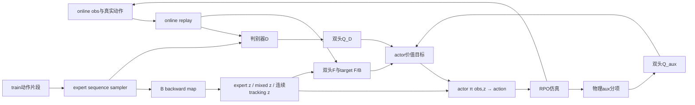
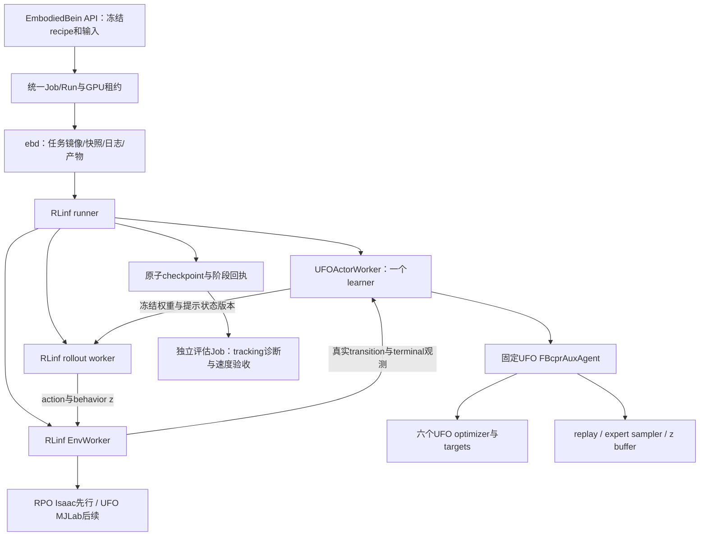

# 20 · UFO / BFM-Zero / RPO / RLinf 接入设计

日期：2026-10-10（Asia/Shanghai）。这是源码分析与目标设计，**不是 UFO 已接入或模型已学会行走的声明**。延续设计14/16/18/19；平台执行仍为 API → Job/Run → ebd → 受管任务容器。用户偏好 RLinf 承载训练；禁止教师、禁止 Git 提交，现有数据仍限本地非商业研究，不分发派生动作。

## 1. 结论与路线选择

**UFO 可以作为 RLinf 中 BFM 算法的来源接入，值得优先采用；当前还不能直接把 UFO 启动脚本嵌进 RLinf 就视为完成。** 推荐用 RLinf 管理 worker、采样通信、权重同步和阶段生命周期，用 UFO 的 `FBcprAuxAgent` 管理真实 BFM 更新及六个优化器。先接算法核心与已验证的 RPO/Isaac 环境，再接完整 UFO/MJLab 环境。UFO 原生执行作为可选对照后端，不取代本项目的 RLinf 首选路线。

集成不要求把所有框架变成相同的 Python API，更不要求把离策略算法变成 PPO/FSDP。平台统一资产、运行意图、资源、产物和证据；框架内部保留自己的学习语义。平台层的扩展见[设计21](21-training-runtime-contracts.md)。

| 问题 | 判断 | 尚需证明 |
|---|---|---|
| UFO 是否包含 BFM 相关训练实现 | 是，`fb` preset 构建 `FBcprAuxAgent`；不是仅 FB 表征网络 | 与本地改写版的逐更新差分 |
| 可否复用其模型、loss、六优化器和提示机制 | 源码结构支持这种拆分 | 目标镜像依赖、worker API、状态同步 |
| 可否由 RLinf 管理 UFO 算法训练 | 可行的工程设计，当前未实现 | 真正由 RLinf runner 调用 UFO update 的短训与恢复 |
| 可否复用 UFO/MJLab 环境 | 可以设计环境桥，不能直接替换 Isaac env_type | RPO XML/actuator/RobotState、reset/terminal、资源与评估 |
| UFO 能否直接把 G1 数据变成 RPO 数据 | 不能；导入器要求输入已匹配目标机器人 | 已有 G1→RPO 标定链继续承担映射 |
| 直接运行 UFO 是否保证 RPO 行走 | 没有此证据；新机器人路径仍实验性 | RPO 独立闭环验收 |

三种方案：

| 方案 | 内容 | 优点 | 代价与定位 |
|---|---|---|---|
| A · 平台直接运行 UFO native | 固定 CLI/镜像 → UFO Workspace/NCCL → 平台收集 | 最大限度保留原生循环，可作参考后端 | 不是 RLinf 训练；还需原子产物/完整恢复包装。不是本任务主线 |
| **B · RLinf + UFO agent + RPO Isaac** | RLinf worker 调用原生 agent；复用 RPO 物理与冻结数据 | 最快定位手写算法漂移，保留当前管线 | 仍是 RPO 定制环境，不能称完整 UFO recipe 复现。首选第一阶段 |
| C · RLinf + UFO agent + UFO MJLab | 再迁入 UFO 的环境、motion library、初态/aux/推理 | 最大限度保留 UFO 的机器人训练语义，后续机器人可复用 | 新模拟器、RPO资产和数据转换成本高；须分阶段验证。目标第二阶段 |

三种方案可共用 Job/Run 生命周期；不能把方案A改名为方案C。若C遇到依赖或物理问题，保留B作为有明示差异的 RLinf 路径，无需重写整个平台。

## 2. 调查身份与官方能力边界

本次通过官方 GitHub API 解析 `main`，固定 UFO revision：

`0b89378de02f77712072d983bc43ec2a46455dc0`

它恰与此前 G1 资产来源 revision 一致；那次只使用数据/资产，不代表已集成 UFO 的训练代码。当前本地网络来源仍为 LeCAR-Lab/BFM-Zero `318cf44a3262e5bdec5944f82f1a5f509b95d09b`。两个来源分别记录，不用“官方 BFM”掩盖版本差异。

官方 [README](https://github.com/Roboparty/UFO/blob/0b89378de02f77712072d983bc43ec2a46455dc0/README.md)表明：主分支面向训练、数据导入、推理和 ONNX；部署/遥操作在另一个分支。G1 最成熟，新机器人需自己的 XML、审查过的配置和已映射 RobotState；没有自动 retarget，也没有跨形态权重直接复用的承诺。UFO 为 CC BY-NC 4.0；原始 LAFAN 和机器人资产的来源条件分别保留。

实际源码路径：

```text
humanoidverse/train.py
  → agents/presets/fb.py
  → FBcprAuxAgentConfig / FBcprAuxAgent
  → training/workspace.py
      → HumanoidVerseMjlabConfig / Env
      → expert_motion_loader / motion library
      → replay、agent.update、tracking evaluation / prioritization
      → checkpoint / train_status
```

`--agent tech` 是另一种算法 preset，`tldr` 是兼容别名；本次不把 TeCH 纳入 BFM 接入，避免将“换框架”和“换算法”混成一次实验。[入口源码](https://github.com/Roboparty/UFO/blob/0b89378de02f77712072d983bc43ec2a46455dc0/humanoidverse/train.py)

“无监督”指不依赖每个动作的教师控制输出、手工标注的行为标签或每种行为的任务奖励；这里仍使用参考动作先验、机器人状态、判别器以及物理辅助约束。它不是没有数据、没有约束，也不保证少量更新就能零样本执行速度指令。

## 3. 当前失败证据，以及不能推出的结论

已执行证据见[设计19对应进度](../progress/2026-10-10-bfm-staged-walking-training.md)及[历史1000更新评估](../progress/2026-10-09-bfm-four-gpu-1000-evaluation.md)。

| 模型阶段 | 独立评估 | 结果 |
|---|---|---|
| 原四卡1000更新 | 100 seed旧标准组 | 0/100，66次fall、36次硬限位；两种标志可重叠，动作约97.2%饱和 |
| 修复后单卡16→24更新 | 16 seed validation_v2 | 0/16，1 fall、15硬限位，动作69.63%饱和 |
| 修复后四卡16更新 | 相同16 seed validation_v2 | 0/16，13 fall、3速度硬限位，动作78.78%饱和，median存活0.19秒 |

事实：修复前1000更新 checkpoint 的 mixed-z 池全0；目前遗漏已修复，实际完整恢复及三采样rank同步已有证据。因此不能继续把“当前池仍为空”列为当前根因。

当前是**手工迁移的 BFM 算法 + RPO-Flat 派生环境**，不是完整 UFO 训练配方。两个短训模型在线数据、更新数和拓扑不同，不能据表宣称修复已提升行走质量。全部零成功证明当前交付的速度提示策略失败；它也没有证明所有 latent 的所有行为都失败。仍要分离“模型学到了什么”“提示前端能否选出该行为”“在目标物理/指令分布下能否稳定执行”。

### 3.1 已查实的算法和训练配方差异

下表来自固定 [UFO FB preset](https://github.com/Roboparty/UFO/blob/0b89378de02f77712072d983bc43ec2a46455dc0/humanoidverse/agents/presets/fb.py)、[agent.update](https://github.com/Roboparty/UFO/blob/0b89378de02f77712072d983bc43ec2a46455dc0/humanoidverse/agents/fb_cpr_aux/agent.py)，以及本仓库 `bfm_zero_worker.py / policy.py / learning.py / config/rpo_bfm_zero_pretrain.yaml`。

| 语义 | UFO 默认 FB | 当前 RPO bringup | 影响与处理 |
|---|---|---|---|
| 显式初始化 | `weight_init`后准备targets | 构造器默认初始化后copy | 初始尺度不同；直接复用agent初始化，禁止恢复后重新init |
| F/B/D/actor/Q_D/Q_aux LR | 3e-4 / 1e-5 / 1e-5 / 3e-4 / 3e-4 / 3e-4 | F/B/D/Q均1e-4，actor3e-4 | 表征、判别器、策略更新速度不同 |
| FB pessimism | 0；actor/Q分别0.5 | 共用0.5 | 不是同一FB目标；分开保留原生配置 |
| replay latent重标记 | 概率0.8，剩余保留behavior z | 全部重标记 | 改变训练分布；复用原update |
| norm更新 | 每次update的replay obs/next | 每轮fresh rollout | 新样本暴增时统计响应不同 |
| grad clipping | 默认禁用；可选F/B与actor分别裁剪 | 所有更新阈值10，F/B联合norm | 不是等价安全开关；先复现，再派生有证据调整 |
| online warmup | 10,240本rank样本，随机动作，之后开始学习 | 第一轮凑满batch即学习 | 早期replay与normalizer不同 |
| online replay | 每rank 5,120,000容量，trajectory组织 | 100,000 CPU transition池 | 留存/采样分布与显存/RAM画像不同 |
| 源内/源间采样 | 可固定source比例，源内prioritization | train有效窗口统一抽样 | 不能凭30+40个片段推断两来源实际权重 |
| 连续专家提示 | 250步轨迹的逐步B编码提示 | 随机/混合z，每100步换一次 | 仅写mixed-z池不能替代连续专家rollout |
| D reward | sigmoid夹紧后的log-odds | 直接logit | 常规区间近似等价，极端logit有界性不同；不得称逐值完全一致 |
| target采样 | 各objective按原生实现采next action | FB与两个Q共用next action | 均值可能相近，随机过程不同；差分时须固定随机输入 |
| full网络 | residual宽2048、6块 | 宽1024、3块bringup | 小模型可以研究，但不是原生规模；不能先假定4×24GB可装原生配置 |

复用UFO agent的目的，是减少持续手写六个objective、六个optimizer与采样规则造成的漂移；不是因为改成UFO名字就会收敛。

### 3.2 采样量与实际更新量

定义 `N`=总online env，`L`=每次同步采样控制步，`U`=该轮联合更新数，`B`=每次联合更新抽样数：

`draw/new = U × B / (N × L)`。

| 方案 | N/L/U/B | draw/new |
|---|---|---:|
| 原1000更新实验 | 24576 / 4 / 1 / 128 | 0.001302 |
| 当前四卡probe | 3072 / 4 / 8 / 128 | 0.083333 |
| UFO默认单rank稳定阶段 | 1024 / 1 / 16 / 1024 | 约16 |

它是抽样次数/新增样本数，**不是唯一样本覆盖率**；UFO实际触发还受warmup和计数边界影响。增加env而不增加有效优化，会让同样1000更新遇到完全不同的数据重用。下一阶段按学习进展、updates/s与留存选择env，不能沿用“尽量多env”作为首要目标。

UFO默认总预算192,000,000是global环境样本数。单rank1024env、每次触发16更新的量级约300万联合更新；4同步learner情况下global样本同预算，触发次数约再除4。不要与设计19讨论的LeCAR原文384,000,000样本预算混为一谈。1000更新仍是很早的区间，但不能用此事实给失败模型无限追加预算。

### 3.3 环境与接口差异比网络名字更重要

源码 [MJLab env](https://github.com/Roboparty/UFO/blob/0b89378de02f77712072d983bc43ec2a46455dc0/humanoidverse/agents/envs/humanoidverse_mjlab.py)的 `reset_idx` 会抽参考motion/time，将root位置/姿态/线角速度、q/dq写入仿真，再加初态扰动；G1配置还启用概率0.3的lie-down初态。当前RPO继承Flat reset，从默认站姿起步，训练关掉观测噪声，并按高度0.50m/倾角0.80rad终止。这是不同探索MDP。

参考状态初始化是直接使用动作库中的状态，**不是训练教师**。新RPO训练可加入该机制，但必须派生新的训练EnvironmentProfile及状态数据版本。G1 lie-down和终止配置不能照搬：可能与RPO早期跌倒终止冲突，也不是本次“正常行走”目标的首期要求。评估的fall/硬限位门槛保持原标准，不因为训练环境调整而放宽。

其他需要分离验证的差异：

- RPO aux目前为位置限位、非零力矩惩罚和动作平滑三项，并乘policy dt；UFO常规FB还使用足部方向、踝roll、接触和滑移，torque默认系数为0。EMA可能消去一部分共同尺度，不能把dt差异单独判为失败原因；要对账原始分项、加权值、归一化值。
- RPO训练平地、无噪声与延迟；当前独立评估有官方指令、噪声/随机化及平地/粗糙地形混合。此差异需要课程/泛化实验，不更改验收。
- 当前指令→z前端从训练参考视图计算reward inference；尚未证明所有速度/yaw区域均有有效覆盖。先分别测固定专家tracking z、固定目标z和当前command z，不能把prompt问题混进所有策略能力。

### 3.4 不能用shape相同判定兼容

当前RPO actor输入为 `state52 + last_action23 + history300 = 375`，特权358，总critic观测733，z256，action23。

```text
当前history300（4 × 75）：
  [最旧帧: q,dq,g,ω,a] ... [最新帧: q,dq,g,ω,a]

UFO native history（同为RPO23关节时也可能是300）：
  [actions四帧] [base_ang_vel四帧] [dof_pos四帧]
  [dof_vel四帧] [projected_gravity四帧]
  每组最新帧在前；按特征名排序拼接
```

证据为UFO `_raw_actor_obs`、`envs/env_utils/history_handler.py`及本地 `rpo_bfm_codec.History`。重复调用UFO get_observation会推进history；RLinf bootstrap/重复读必须返回缓存，只有真正物理控制步推进一次。

此外UFO数据/内部姿态常用xyzw，MuJoCo qpos和Isaac状态边界另用wxyz；native last_action会记录解码/归一化后的动作，当前RPO记录[-1,1]策略动作。关节、body、6D rotation轴、root高度基准、速度frame、动作增益都要逐段核对。新native codec必须派生新接口/数据/归一化/导出metadata，不能原地改v1。

方案B可以保留当前375/733与history v1，构造符合该schema的UFO obs_space重新训练；这叫RPO定制recipe。不能直接加载UFO G1权重，也不声称native history语义一致。

## 4. UFO BFM核心结构，以及应复用的范围



| 模块 | 主要输入/输出 | UFO默认结构 |
|---|---|---|
| actor | actor obs、z → bounded action分布 | 两条embedding分支，宽2048、6 residual块，std0.05 |
| F | critic obs、z、action → 两组256维向量 | 宽2048、6 residual块，ensemble2 |
| B | state、privileged → 256维表示 | hidden256、1隐层，latent投影范数16 |
| D | state、privileged、z → logit | hidden1024、3隐层 |
| Q_D / Q_aux | critic obs、z、action → 双头标量 | 与F同类网络，输出维度1 |
| targets / norm | 四个target网络、观测BN与aux EMA | 原生target tau和统计状态必须保留 |

结构来源 [nn_models](https://github.com/Roboparty/UFO/blob/0b89378de02f77712072d983bc43ec2a46455dc0/humanoidverse/agents/nn_models.py)。这些width不是GPU资源承诺。

应直接调用：agent构建/初始化、`update`、`act`、`maybe_update_rollout_context`及goal/tracking/reward inference。通过适配batch和平台生命周期复用它们，而非再写一套FB/D/Q/actor loss。保留可定位的极小补丁，只解决分布式所有权、终态观测、完整状态保存、路径/只读边界与诊断。

## 5. RLinf承载UFO：组件边界



### 5.1 唯一学习与分布式所有者

`UFOActorWorker`是待实现的RLinf worker，满足当前EmbodiedRunner实际调用：`init_worker / set_global_step / recv_rollout_trajectories / compute_advantages_and_returns / run_training / sync_model_to_rollout / save_checkpoint / load_checkpoint`，并继承/适配现有profiling与通信能力。BFM不计算GAE；相应hook只校验transition和计数。

首期**一个learner**：UFO agent独占模型、六个optimizer和target更新；RLinf管理worker/Channel和阶段调度。复用RPC、参数同步工具，不为适配现有 `EmbodiedFSDPActor` 而给UFO套第二个Adam或虚假scheduler。若继承路径强制FSDP optimizer，则使用RLinf原生Worker实现这组方法，避免双重训练器所有权。

禁止在worker里运行 `run_train.sh`、UFO Workspace无限循环或另起torchrun。那会绕过RLinf的采样/更新/保存边界；“由RLinf启动子进程”不算本设计集成。

UFO的distributed helper依赖默认torch process group。首期必须核实该group只有learner，native `average_gradients`不向env/rollout rank发collective。以后多learner时，只选RLinf或UFO一套梯度同步，不同时FSDP/DDP同步和UFO all_reduce。FB的每rank batch×batch负样本目标没有自动跨rank合并：4×batch1024的局部loss梯度平均不等于一个global batch4096的全pairwise loss。多learner是新recipe，不继承单learner质量或恢复能力。

### 5.2 replay/expert桥

给原生agent提供其实际消费的两个接口：

```python
replay_buffer["train"].sample(batch_size)
# observation/action/z/aux_rewards；next.observation/next.terminated

replay_buffer["expert_slicer"].sample(batch_size, seq_length=...)
# 连续observation与next.observation，支持8帧和250帧
```

这里只是设计示意，不是新增平台公共API。桥必须保存真实behavior动作与z，不使用下一轮策略重算；保留terminated/truncated、case/episode/cursor和策略版本。若采用原生trajectory buffer，按其时间×env布局写入；初始RPO bridge若继续transition池，则明确与native存储/抽样差异，不谎称trajectory语义一致。

方案B只在桥边界将本地`states`映射到UFO`state`，保持同一state52编码；online的last_action/history来自真实环境。`aux_rewards`转为原生具名分项，由agent按一次冻结系数加权；不把已经加权并乘dt的三维向量当八个原始奖励。discriminator/expert只提供原native filter所需字段；不能用expert全零history替代online历史。terminated为bool且与transition对齐，episode结束后的首观测不覆盖前一transition。

方案B的expert可直接使用冻结52+358视图，B/D只消费它们，不需要教师动作或伪造expert action。方案C要给motion library和reference reset提供**原始RobotState**；现有视图去掉世界平移/yaw，不能唯一逆推出root全姿态。必须回到冻结官方RPO源及G1→RPO数值输出，转换出新的状态数据版本，而不是把观测NPZ换后缀当RobotState。

对train有效区间做连续切段，不跨invalid帧，不把不同动作拼成250步。现有train组250步窗口实测2,210，来自15片段（9 G1、6官方RPO）；8步11,922窗口。短片段可以训练expert mini-batch，不能称都支持长提示。采样时分别记录source、祖先group、motion/窗口、真实抽样比例和权重；prioritization只能用train tracking反馈，validation/acceptance不得用于改训练采样权重。

### 5.3 rollout与状态同步

普通rollout同步actor、其norm、B及需要的提示统计；连续专家提示需要同步B/norm版本，并冻结该片段的编码和cursor。mixed-z池属于UFO agent的普通Python对象，不会因同步`_model.state_dict()`自动带走；必须显式打包storage、count/full、cursor、版本和抽样状态。

每个episode和真实control step最多推进一次提示/历史；重复bootstrap读不能重采样。对native“有任一env在250步边界就重新选整批环境/轨迹”的行为先复现并记录；在异步reset的RLinf批次中改为按env独立cursor时，需要单独recipe revision与差分结果。配置0.5的有放回索引抽样不代表恰好50%独立env。

### 5.4 环境桥与终态观测

方案B复用Isaac物理；新增reference-state初始化、明确命名的aux分项和训练Profile。若schema维持v1则新模型/recipe即可；若history/动作记录含义变更，则新接口+新codec视图一起发布。

方案C注册新RLinf env_type/工厂，实例化UFO MJLab batch env；仿真器由该EnvWorker拥有，不能一个环境既归UFO Workspace又归RLinf EnvWorker。原生wrapper存在内部reset和get_observation推进history路径；`auto_reset=False`配置并不证明所有上层重置已关闭。必须探测并规范：

1. `step`后的terminal状态与reset后首状态分别保存；timeout的bootstrap不能读到下一episode。
2. terminated和truncated严格区分；discount对真正终止为0，对time limit使用冻结算法规则。
3. 单次物理步只reset一次、history只append一次；partial reset不改其他env。
4. reset RNG、参考motion/time、噪声、动作/PD解码来自冻结RPO Profile。

若native接口取不到terminal观测，用镜像内小补丁在reset前捕获，不忽略timeout或把它改成terminated来绕过问题。

## 6. 依赖、RPO配置与动作数据

[UFO pyproject](https://github.com/Roboparty/UFO/blob/0b89378de02f77712072d983bc43ec2a46455dc0/pyproject.toml)声明Python3.10、Torch2.7系列、MJLab1.4.0、MuJoCo3.8系列。实际读取现有v10镜像：Python3.11.16、Torch2.7.0+cu128、Pydantic2.11.5、Gymnasium1.2.0。Python版本存在声明冲突；不能直接`pip install UFO`进现有Isaac镜像，也不能说Torch主版本已经冲突。

首期agent-only镜像仅装/纳入agent的传递依赖，不导入MJLab Workspace。UFO包meta声明与Python3.11兼容性必须通过实际import/构建/更新验证；若不可用，派生兼容的RLinf任务镜像，控制面Python3.11不受任务解释器限制。完整MJLab路径独立镜像验证，禁止一次把Isaac、MJLab及不同环境库无条件混装；只读安装源码、生成cache写Run目录。

replay不能照抄容量后再等OOM：以RPO完整online观测733维、action23、z256、aux8计，native trajectory只存一次每时刻观测的float32下界约`(733+23+256+8)×4×5,120,000 = 20.89 GB`，尚未算flags/索引、专家数据、模型/targets/Adam、activation、缓存和分配器余量。若桥将obs与next_obs各存一份，下界约35.90GB。两者都不是实测峰值；24GB卡需先减少replay、选择受测CPU存储或调整容量recipe，不把4卡显存视为统一池。

RPO native配置审查范围：[Robot Config规范](https://github.com/Roboparty/UFO/blob/0b89378de02f77712072d983bc43ec2a46455dc0/docs/robot_config_training.md)。

| 范围 | 必需检查 |
|---|---|
| 模型与语义 | XML/URDF hash、base/body顺序、23控制关节、feet/hands/key bodies、contact与torso |
| 动力学 | 质量/惯量、碰撞、自碰撞、armature、friction、effort/velocity、PD、控制频率 |
| 动作 | XML actuator顺序、策略[-1,1]到目标q的全链；UFO action_rescale使用effort/Kp，不能直接照搬RPO ACTION_GAIN |
| 数据 | root frame/quaternion、q/dq/root速度、FK和body速度、fps、valid/祖先split、source许可 |
| 训练 | reference-state reset、noise/DR、aux原始单位、终止/超时、curriculum |
| 推理 | history/norm hash、z映射、prompt引用库和校准来源、action decoder metadata |

必须使用RPO逐关节`training.actuator.source=yaml`参数，不能误走G1 mode15 motor默认。`robot_inspect`产物是draft，不是物理正确的证明。UFO import工具可能重采样/切窗/写cache；先按祖先冻结split，分别构建train与诊断输入。不会因为导入器接受数据，就晋升控制器质量。

## 7. checkpoint、计数和评估出口

原生 [agent.save/load](https://github.com/Roboparty/UFO/blob/0b89378de02f77712072d983bc43ec2a46455dc0/humanoidverse/agents/fb/agent.py)保存model、optimizers和config；Workspace另存replay与train_status。native路径并没有因此提供本平台所需的完整RNG/z-pool/expert优先级/cursor及原子发布保证。UFO Agent.load及BaseModel.load还有宽松key加载路径，平台必须核验缺失/多余keys，只容许已冻结、可解释的target差异。

新checkpoint清单包含：六online网络、四targets、norm/EMA、六Adam所有真实step、可适用scheduler/scaler、CPU/CUDA/Python/NumPy各rank RNG、replay数据/cursor/RNG、expert sampler与权重/RNG、z-buffer、rollout提示/历史状态及计数。目标文件格式可保留native safetensors/PT；外层通过平台manifest、hash、完成标记与原子rename发布，不强迫改成DCP。环境未持久化则标`trainer_state`；只权重跨旧bringup→UFO recipe最多`warm_start`，正式语义对照优先新初始化。

完整清单中的rollout状态是可恢复状态范围，并不自动使旧环境episode可恢复。trainer_state模式在已记录的重建episode边界重置history/context，保留采样RNG、pool及相应计数，不用旧episode cursor去控制新环境。先构建/加载model与optimizer，再最后恢复RNG，避免构造函数消耗随机数改变恢复后首个batch。目标结构或codec不匹配时失败，禁止用native宽松加载吞掉缺失权重。

至少独立记录 `sampling_round / learner_joint_updates / online_transitions / env_control_steps`。一个joint update包括六优化器的相应更新，不能把六组step求和当六倍训练量。warmup轮允许learner计数0，禁止“轮数×固定倍数”无条件报数；保存前回读六优化器step。1000边界按实际joint updates停住；最后不足区间照常快评。

独立评估分为：

- **tracking诊断**：用冻结held-out参考片段检查B提示、初始化、动作和物理；自带train tracking/prioritization不是泛化评估。
- **command行走验证**：保持validation61000–61015和最终acceptance62000–62099隔离，采用设计19原物理判据；latent前端和norm也纳入模型身份。
- **native MJLab → Isaac sim2sim**：作为新增Suite，不能把两个不同物理后端的seed结果直接平均，也不能只在更容易的后端验收。

ONNX需实际执行actor+prompt前端并比对Torch golden traces；UFO tracking导出存在不代表当前速度前端已导出。每次快评图表、全部case、真实成功/失败录像、hash与实际解码齐全；没有成功样例如实标注。数据参考回放不作为策略成功录像。

## 8. 实施次序与放行条件

本次只交付设计，不运行新训练、不再次索要与设计无关的长训预算。以下是后续实施阶段；有界训练预算沿设计19的问题另行确定。

| 阶段 | 修改范围 | 进入下一阶段的证据 |
|---|---|---|
| P0 · 固定依赖/语义 | UFO与RLinf sources receipt、agent-only镜像、RPO schema；从冻结源派生带root/q/dq/速度的train状态版本 | 目标镜像真实import、构建及固定batch一次update；状态版本与expert视图祖先/valid区间同源 |
| P1 · 原生算法差分 | agent↔replay桥、RLinf actor/rollout注册 | 同weights/data/RNG的loss、gradient、参数delta、targets/norm/六optimizer及z池差分；compile先关闭 |
| P2 · RPO短训闭环 | 方案B，原生agent+Isaac、消费P0状态版本的新reference reset Profile/aux | 实际联合更新、完整checkpoint、恢复后首更新、源hash不变、独立快评/录像、失败/取消/资源释放 |
| P3 · MJLab环境 | 新环境桥、RPO robot config、原始RobotState派生视图 | 单env impulse/PD/FK、terminal与history幂等、少量env短训及sim2sim桥；未通过保留B |
| P4 · 实测四卡 | 一个learner+三sampler先行 | 组合峰值、源采样比例、draw/new、权重+z版本、完整恢复与四卡case隔离，不借旧v10证据放行 |
| P5 · 有界训练 | 每1000真实更新保存/释放/快评/决策 | warmup/耐心窗口/预算冻结，逐段continue/stop/wait；不能预提交无条件长训 |
| P6 · 最终验收 | validation选best、acceptance独立一次 | 原门槛通过、推理包一致、录像与报告完整；未通过如实失败 |

原生配置逐层引入：先在可测网络容量/有限replay下验证数值语义，资源不足派生缩小容量recipe；不冒称原生2048×6/5.12M配置已复现。RPO初态、aux和新模型与旧模型对比使用相同validation条件，但变recipe不能拼接为旧训练的连续曲线。

## 9. 最小落点与三轮复核

后续必须触达的现有入口：

- `domain/rlinf_form.py / api/routes_train.py / adapters/rlinf.py`：新recipe、保护参数、实际计数预算、冻结输入及预览一致。
- `runners/`：新增UFO agent/replay/rollout/env桥，复用现有codec与评估，逐步停用该新recipe中的手写learning核心；旧recipe保留可回放。
- `deploy/patches/rlinf/`与新任务Dockerfile：受管、明确版本的注册改动，不写外部RLinf/UFO源目录。
- `checkpoints.py / orchestrator/collect.py / model/export/eval桥`：native文件清单、完整恢复及推理包；沿设计21消除模板名推断格式。
- environment catalog与前端：新recipe/Profile的实际可用状态、learner单位、API支持的评估入口；不能只添加选择项却不连validator。
- focused tests：真实agent差分、边界字段、短片段拒绝、mixed-z同步、重复读/partial reset、错误恢复、半写产物、源码版本/许可及图表媒体。

三轮复核记录：

1. **算法/本体/数据**：发现并明确初始化、LR/重标记、RSI、history排列、动作记录单位、RobotState不可逆与非G1 actuator边界；没有教师、无跨split采样。
2. **运行/资源/恢复**：区分native NCCL与RLinf采样拓扑；防双optimizer/双collective；native save缺口须补；5.12M replay和research网络尚未准入，不用4卡总显存相加。
3. **任务质量/证据**：区分tracking、reward prompt和速度验收；两次短训0成功不包装为质量进步；所有拟议能力都保留“待实现/待实测”身份。

这些复核完成的是设计审查。UFO+RLinf尚未运行；正常行走、native MJLab RPO、跨后端泛化与真机均未验证。
