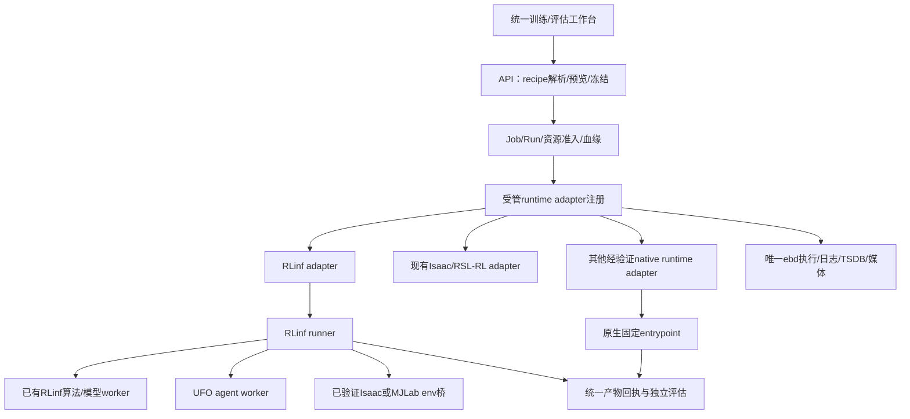

# 21 · 与训练框架解耦的运行与产物契约

日期：2026-10-10（Asia/Shanghai）。配套[UFO/RLinf设计20](20-ufo-bfm-rlinf-integration.md)，约束平台如何接入多个训练框架。本文是目标设计，不宣称通用协议已实现。延续设计01/02/04/05/07/12；不新增调度服务、工作流引擎或任意脚本插件市场。

## 1. 平台统一什么，框架保留什么

EmbodiedBein管理的是**机器人学习实验的资产与证据**。它统一本体接口、数据版本、recipe身份、Job/Run、资源租约、checkpoint、ModelVersion、独立评估及交付；网络结构、更新规则、replay、并行梯度和native存储格式由经审查的训练实现负责。

因此“支持多个训练框架”不等于所有模型使用同一个optimizer，不等于所有checkpoint变成DCP，不等于所有仿真器使用Isaac，更不等于前端暴露任意启动脚本。

必须分开的四个身份：

| 身份 | 含义 | BFM例子 |
|---|---|---|
| algorithm | 训练数学方法和冻结超参数语义 | BFM FB-CPR-aux；不能从`ppo`入口名推断 |
| algorithm provider | 算法实现的代码来源 | UFO固定revision / 本地legacy实现 |
| training runtime | 管理训练worker和进程的运行框架 | RLinf；可选其他已接入native runtime |
| simulator / environment | 真实产生transition的物理与任务 | RPO Isaac / RPO UFO-MJLab，分别验证 |

另外保留model serialization/backend身份，例如PyTorch/safetensors/ONNX；数据库 `ModelVersion.framework`不能承载上述四个维度。一个模型由RLinf训练，不代表其文件格式叫RLinf。

## 2. 现有系统已经解耦的部分与具体耦合点

设计02/04已要求统一Job/Run与adapter；`JobSpec.kind`表达`train.rl / train.sft / eval.sim`等意图，`RenderedJob`表达image/argv/env/mounts/devices/outputs。资源准入、容器启动、日志采集和产物登记可以复用。无须推倒平台。

源码审查发现需要逐步修正的边界：

| 当前位置 | 实际耦合 | 必要改动 |
|---|---|---|
| `adapters/__init__.py:get_adapter` | `params.stack=rlinf`特判；其他训练按JobKind落到默认Isaac | 新recipe按批准的runtime_id分发；未知runtime直接拒绝，不能静默fallback |
| `api/routes_train.py:_build_spec` | 默认冻结stack=rlinf、RLinf config/override | 先解析recipe，再由该runtime validator/renderer转换；RLinf旧入口仍保留 |
| `domain/rlinf_form.py:RlinfTemplate` | 算法BFM也使用kind=ppo入口、步数/额外旋钮带RLinf语义 | 新recipe显式algorithm与budget单位；旧字段是历史兼容，不改旧Run |
| `store.models.TrainJob` | `ray_port / hydra_overrides`是框架专有列 | 新运行公共展示来自冻结execution；非Ray不分配端口，旧列保留，新增非空值不伪造 |
| `checkpoints.py` | DCP shard与RLinf模板格式检查 | 按checkpoint_format及recipe validator检查；DCP只适用对应runtime/保存器 |
| `orchestrator/collect.py:promote_rpo_model` | 按template_id推断BFM/PPO/AMP及固定shape、卡片 | 从冻结recipe和产物manifest取身份，recipe validator检查真实shape；未知格式失败 |
| `environment_catalog.py`与前端 | 多处机器人/模板/stack分支枚举 | 展示已验证的能力绑定元组，不能只改筛选项而缺实际renderer/evaluator |
| pipeline与恢复 | 当前sequence按Job succeeded无条件推进，部分binding只有base_model | 周期训练不能把Job成功当continue；决策点必须先有独立评估和预算结论 |

其中最后一点不能只靠新增一个`stack=ufo`解决。原生框架的最小完整接入包括参数冻结、镜像、算法状态、产物、恢复、独立评估、UI和失败路径。

## 3. 复用ModelRecipe，增加明确执行绑定

使用设计04的ModelRecipe概念，不创建平行的“UFO模型目录”。首期以受版本控制的静态recipe注册实现，复用现有模板注册器；不为一条UFO能力建设数据库插件市场。

每条recipe必须绑定一个经过验证的组合：

```text
(recipe revision,
 algorithm + provider revision,
 runtime revision,
 simulator + environment revision,
 embodiment interface + codec,
 image digest + source receipt,
 topology + device profile,
 checkpoint/export/evaluation protocols)
```

不是将所有runtime、算法和机器人列表做任意笛卡尔组合。`rlinf + ufo.fb + RPO.Isaac`通过不意味着`ufo.tech + RPO.MJLab`通过，更不能推广至G1权重加载RPO。

下面是**拟议冻结metadata结构**，不是当前可以直接提交的API字段/可运行配置：

```yaml
params:
  execution:
    schema_version: eb/training-binding/v1
    recipe_id: rpo_bfm_ufo_agent_rlinf_isaac_v1
    algorithm_id: bfm_fb_cpr_aux
    provider_id: ufo
    runtime_id: rlinf
    simulator_id: isaaclab
    progress_unit: learner_joint_update
    checkpoint_format: ufo_agent_state_v1
    topology_id: one_learner_three_samplers
```

这些值由recipe解析并冻结，用户不能任意覆盖provider导入路径、镜像、CLI、mount、network或设备。真实provider/runtime revision、所有source hash、接口/数据/norm/prompt版本放在冻结recipe snapshot及input receipt中，与已有JobSpec输入、code_ref和image身份一起校验。

现有`CodeRefs.stack`只能表示一个栈；复合镜像同时含RLinf与UFO时，镜像source receipt必须列两者commit/content hash及受管patch hash、实际安装依赖。源commit用于定位，正式身份仍使用实际内容快照和image digest，不能只保存两个GitHub链接。首期可将该清单放在已有冻结JSON metadata中并强类型验证；需要查询索引时再派生schema/迁移，避免先加一组空数据库表。

对旧Job：根据已知template/stack及原image冻结一次兼容身份，只用于解释历史记录；不能重渲染成当前新recipe、补造未验证source或修改历史对象。新Job同时存在legacy stack和execution时必须一致，不一致拒绝。

## 4. 两层适配，而非两套平台



**平台runtime adapter**把JobSpec变成现有RenderedJob；**runtime内部算法桥**把该runtime的batch/worker调用转成算法provider接口。前者是框架解耦，后者实现“RLinf上接UFO”。两者互补，不要求先完成所有native adapter才接UFO agent。

首期算法桥只实现BFM所需最小方法，不设计全算法通用training loop。相同provider可以用于native runtime和RLinf worker，但同一Job只有一个训练循环、一个optimizer所有者、一套资源租约。

## 5. 必需协议：输入、进度、checkpoint、模型与评估

### 5.1 输入协议

固定input receipt至少包含recipe/runtime/provider/simulator身份、实际解释器与包版本、本体/环境/asset/codec、原始数据及派生视图hash、祖先split、有效窗口、初态/PD/频率、norm与prompt校准来源、sampler权重、资源拓扑。native config与resolved config同时保存。

recipe保护参数经对应validator解析后交给固定argv；不把同一个Hydra override白名单用于所有框架。原生argparse和Hydra分别有保护规则，不能让用户传任意脚本、Python import路径或shell片段。CPU/RAM从JobSpec.resources沿原编排器传到ebd，不往RenderedJob臆造新资源字段。

### 5.2 进度协议

至少分别表达实际`learner_joint_updates`、各optimizer的step核验、`online_transitions`、runner采样轮/epoch、环境控制步及wall time。primary单位来自recipe；epoch、environment sample与gradient update互不冒充。

每条指标携带名称、单位、scope和真实计数横轴；规范核心progress字段，保留算法自有loss命名，不强行给BFM添加PPO KL等无关指标。raw时序可在既有TSDB/Chart查看，阶段图说明平滑窗口和缺失点；不能跨不同recipe或warm-start拼连续恢复曲线。

来源特定日志转tfevents/受支持指标流在任务容器或ebd内进行，FastAPI只编排元数据。原生CSV的存在不代表当前ebd已能自动读取该CSV。

### 5.3 checkpoint协议

统一的是外层manifest，而不是内部文件格式：

```text
checkpoint identity:
  source Run、recipe/hash、真实primary count + native counters
  format、state coverage、compatibility fingerprint
  model/norm/optimizer/algorithm/RNG/sampler各项coverage
  全部文件的相对路径、bytes/hash、原子complete标记
```

路径不可越界/符号链接，半写或缺分片不进入恢复候选。FSDP使用DCP validator，UFO native使用native文件+算法状态validator。新增格式必须提供验收和错误恢复测试，不能只绕开旧DCP检查。

恢复模式沿用设计04：完整可恢复的训练状态但环境重建为`trainer_state`；只有适用的所有rank/环境/sampler状态都经未中断对照证明才`exact`；仅权重/norm为`warm_start`。源只读、恢复新Job/Run、错误不得退回新初始化。runtime/provider版本、数据、codec、topology或采样/优化语义变化默认拒绝完整恢复；用户明确采用warm-start时也要有真实模型兼容证据。

原生框架内置`agent.save()`可以保留；受管wrapper补缺状态、staging/flush/manifest/rename和完整性检查。每段成功正常结束才清理旧checkpoint；保护被评/best模型及报告媒体的既有Artifact引用和GC租约。

### 5.4 模型/导出协议

模型卡分别记录runtime、algorithm/provider、simulation/domain profile、checkpoint format；模型IO signature必须描述字段名、顺序、单位、history、norm、latent/prompt和动作解码，不能只写obs=375/act=23。导出manifest绑定实际Torch与ONNX包/版本/golden traces及processor/norm。

训练runtime与推理runtime不必相同。UFO训练权重可以通过明确导出桥进入ONNX评估；旧RLinf权重可以通过原有桥评估。不存在“所有PyTorch权重通用加载”的能力：碰到未知model format/decoder直接拒绝，不默认套RPO-Flat或G1 actor。

### 5.5 独立评估协议

统一EvalSuite、完整planned/completed/valid分母、逐case指标、成功/失败、模型hash、Plan hash和媒体证据；native内置eval只能辅助诊断。evaluator需绑定兼容的推理包和环境，换模拟器派生新Suite。

tracking、command locomotion、sim2sim是不同能力标签和门槛。G1成功不推出RPO成功，数据FK通过不推出控制器成功，Job succeeded不推出qualification pass。validation用于选择候选；acceptance与train反馈隔离，不能将接受案例用于训练prioritization。

## 6. 固定step训练闭环继续使用现有Job/Run

```text
完整输入/资源probe
→ 有界训练段至实际joint-update目标
→ complete checkpoint / ModelVersion / 释放GPU
→ 独立validation Job
→ raw曲线 + 逐case + 录像/资源分析
→ continue / stop_adjust / wait_evidence / budget_end
→ 同配方trainer_state恢复，或派生新recipe
```

当前pipeline的`pipeline_next`只检查Job终态，不能直接串联一个无限的“训练→评估→训练”。首期执行人工/开发Agent在决策点审查的有限分段，台账可复查；以后若新增自动continue，须用有限预算和typed决策记录扩展原编排器，不新增常驻UFO/RLinf控制服务。

取消仍走平台API→ebd，验证容器退出和租约释放；不能以杀宿主进程当作暂停恢复。native框架没有最后checkpoint保证时如实标记，不能把不完整产物发布为成功。基础设施重试和模型任务失败分别处理，OOM改容量为新spec。

## 7. 兼容性、能力发现与用户入口

recipe按设计04状态独立提升：`discovered / adapter_ready / dependency_ready / smoke_passed / validated / unsupported / blocked`。状态绑定完整组合与证据，不因官方README或安装成功自动提升。

训练页首先选择本体、任务/目标和数据，列出兼容recipe；高级详情展示算法实现来源、运行框架、仿真器、单位与已验证topology。保护字段由服务端选择，客户端选项过滤不能替代校验。对于本项目，默认候选为RLinf+UFO agent，native UFO只在证据和用途允许时出现；未实现能力显式不可提交。

新增框架适配涉及所有调用者：

1. recipe/catalog与能力binding；预览、提交和保护参数。
2. adapter/镜像/source receipt；资源准入与device/profile、cache/outbound边界。
3. runner入口、指标、原子checkpoint和恢复；半写/失败/取消/重试。
4. collector、模型血缘、导出与独立evaluator。
5. environment catalog、前端选项/状态/真实单位、旧Job详情兼容。

没有把这些路径接齐时，不能将“新增adapter”标为框架接入完成。旧的RLinf、Isaac/RSL-RL、MuJoCo评估和SFT模板均保留；逐条迁移，测试旧snapshot，不批量重写历史数据。

## 8. 实施边界、顺序与验收

| 步骤 | 最小实现范围 | 验收 |
|---|---|---|
| 1 · 定义binding | 复用recipe，typed解析现有JSON metadata，旧Job兼容 | 预览/提交一致；冲突/未知runtime拒绝；旧模板快照不变 |
| 2 · 接UFO agent到RLinf | 设计20方案B，专用worker与native checkpoint桥 | 实际更新/完整恢复/独立快评/图表录像；不是仅子进程启动 |
| 3 · 输出协议统一 | collector/checkpoint按recipe validator分发 | DCP与native两种正常/半写/错误输入均测；不能通用宽松加载 |
| 4 · 接MJLab和新RPO数据 | environment bridge+新Profile/接口+RobotState版本 | 动作/历史/terminal/RSI/partial reset、资源及独立sim2sim证据 |
| 5 · 验证第二runtime | 可选UFO native的固定容器entrypoint | 同平台Job/Run可取消/收集/恢复；不称RLinf训练或跨runtime完整恢复 |

第二runtime不是步骤2的前置条件；可在明确需求时再实施。只定义本次要消费的binding与回执，不扩展任意插件API、可视化workflow编辑器、多机训练或部署放行。

三轮设计复核：

- **身份与边界**：框架、算法来源、模拟器、序列化格式分开，兼容按元组，保留设计02/04的共同生命周期。
- **状态与故障**：native和DCP各自validator；未知runtime不fallback，warmup/恢复计数真实，取消不伪造checkpoint，source/lease/原子发布不省略。
- **质量与出口**：UI能力来源可追溯，TSDB/图表/媒体由既有通道服务，周期决策与qualification分开，未运行能力不升级。

本次不改产品代码、不部署、不运行新训练。具体依赖可兼容性、native RPO质量和多learner语义仍由设计20的递进实测确定。
