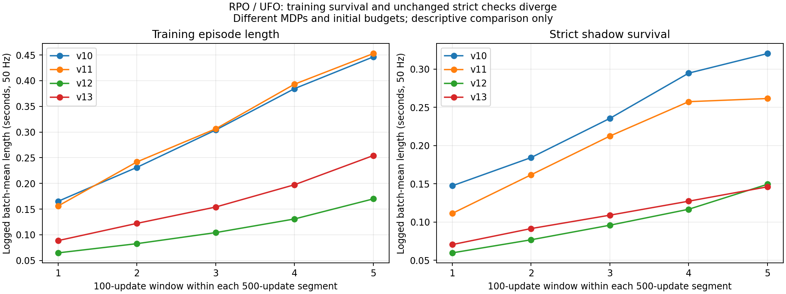

# 22 · UFO / RPO BFM 的 500 次更新失效分析与优化设计

日期：2026-10-13，Asia/Shanghai。本文针对“500 steps 后仍不能稳定站立、行走或跟踪”的模型效果问题。依据设计14、16、18–21以及2026-10-08至2026-10-13的训练记录；不重写历史实验结论，不降低行走验收标准。

**状态：分析和后续优化设计，尚未实施。** 本轮只读分析历史数据、工作区和冻结镜像，生成复算证据与图表；没有启动训练、物理仿真、策略评估或教师，没有修改产品代码，没有暂存或提交Git。后续实验配置、资源与预算均是提案，不构成训练授权，也不是当前API可提交的参数。

## 1. 结论与优先级

当前失败由多个环节叠加，不能归结为“PhysX不行”“MJLab不行”或“只差再训几千步”。最直接的事实是：**策略很快进入位置/速度不合格状态，得到的在线经验主要是很短的失败回合；500次联合更新没有证明它能形成持续、严格合格的控制。**

优先级如下：

1. **先解决严格边界附近的控制与动力学问题。** v13正式段99,547个完成episode中，86,364个终止转移包含训练位置违规；严格位置标志覆盖243,700/786,432条转移。踝关节仍出现42.58rad/s，而同帧驱动已经反向制动饱和。继续调大环境数、网络或软惩罚不能消除这种物理事件。
2. **500 updates不是充分训练量的承诺。** 当前500新增更新只推进每个环境128个控制步，即2.56秒；训练episode只有约0.25秒，严格影子约0.15秒。6144环境增加并行样本，不能把短失败轨迹变成完整步态。
3. **扩容改变了学习机会。** 当前稳态每新增转移的replay抽样次数约1.33，固定UFO默认1024-env/rank配方约16。当前不是原生配方的简单加速版；但这个差异仍需对照实验，不能单独宣布为唯一根因。
4. **训练指标的改善有混杂。** v13训练末窗口相对v12提高49.65%，严格末窗口却下降2.23%；前者包含位置终止容差从1mrad扩大到20mrad的影响。v11也出现训练存活上升、严格存活下降。现在没有证据证明更容易的训练曲线代表更好的步态。
5. **动作接口、专家参考、latent和价值优化仍有待证伪的问题。** 全范围绝对目标加slew可能造成动作等效区间与critic外推；几何合法参考不保证动力学可执行；正常行走目标也不自动来自BFM损失下降。它们是需要分离诊断的假设，不能替代已经确认的位置违规事实。

推荐顺序：**冻结v12/v13 → 事故状态配对诊断 → 控制/初态的最小单因素改动 → 重新配置采样与更新 → 100→500/1000趋势观察 → 有证据才进入5000–10000正式训练 → 独立验收。** 不再将反复从头的500更新版本累计成“一个模型已经充分训练”。

## 2. 证据来源与本次核验

| 编号 | 来源 | 本文用途 |
|---|---|---|
| E1 | [早期四卡1000更新](../progress/2026-10-09-bfm-four-gpu-1000-evaluation.md)、[指标分析](../progress/2026-10-10-bfm-training-metric-analysis.md)、[分段闭环](../progress/2026-10-10-bfm-staged-walking-training.md) | 旧手写算法、z池遗漏、严重采样失衡与0/100历史 |
| E2 | [UFO四卡接入](../progress/2026-10-10-ufo-four-gpu-training.md)、[优化摘要](../progress/2026-10-11-ufo-optimization-summary.md) | 原生agent/完整网络对齐、D1024独立验证与已修复问题 |
| E3 | [6144环境5000更新](../progress/2026-10-11-ufo-6144-env-5000-experiment.md) | 单纯放量之后的后程退化 |
| E4 | [v7可达控制](../progress/2026-10-12-ufo-reachable-v7-500-observation.md)、[v8接触修复](../progress/2026-10-12-ufo-contact-v8-500-observation.md) | 旧动作盒、68.68rad/s事件、有限地面缺陷 |
| E5 | [v9地面修复](../progress/2026-10-12-ufo-ground-v9-500-observation.md) | 完整地面覆盖后的剩余冲击与短回合 |
| E6 | [v10 tracking/contact](../progress/2026-10-12-ufo-tracking-contact-500-observation.md)、[v11顺应接触](../progress/2026-10-12-ufo-contact-compliance-500-observation.md) | 提示恢复、子步奖励、接触峰值与严格存活的分离 |
| E7 | [v12原生MJCF/MJLab](../progress/2026-10-12-ufo-mjcf-pretraining.md) | 后端迁移、物理差异、首步位置违规 |
| E8 | [v13动态RSI](../progress/2026-10-13-ufo-mjlab-rsi-viability.md) | 最新100→600实验、事故、参考核验和最终停止决策 |
| E9 | [本轮指标复算](artifacts/2026-10-13-ufo-rpo-learning-diagnosis/record-audit.json) | 七版500更新序列、685个窗口均值、来源文件SHA256与推导 |
| E10 | [本轮源码核验](artifacts/2026-10-13-ufo-rpo-learning-diagnosis/source-audit.json) | 八个工作区runner与v13镜像逐文件一致；冻结UFO/MJLab源码hash |

本次在**无网络、无GPU的只读容器**内读取历史JSON并复算，七个区间均恰好500个真实联合更新；685个选定窗口均值与原统计匹配。数值检查针对选定指标，不等同于重跑历史物理、核验全部模型大文件或重新观看所有录像。

运行源码来自v13镜像`eb/rlinf:rpo-bfm-ufo-mjlab-viability-v13`，本轮只读image inspect确认实际digest与历史一致：`sha256:e23281518d388565f4b1162dc9d2f21947543b2fd0a014b0288365be2788cee2`。E10核对了`bfm_ufo_agent/worker/replay/rollout_context`以及`rpo_ufo_mjlab/isaac/contact`、`rpo_bfm_codec`八个文件。UFO固定revision为`0b89378de02f77712072d983bc43ec2a46455dc0`；本机只读RLinf HEAD与镜像receipt均为`018e6a9e0da60f96eeda8b11008543911027d414`。八文件一致不代表整个工作区或整个外部仓逐字节一致。

统计口径：下表和图采用**100联合更新窗口内实际日志批次均值的等权平均**，每窗口只有6–7个环境点；不是每更新一次环境测量，不插值，也不是按episode数量加权。v11原门禁采用episode加权及跨窗口批次分摊，因此其13.08348等门禁值与下表13.07494不能互相替代。不同版本MDP、累计初始化预算及有效初态池不同，表格用于描述现象，不是随机配对因果比较。

## 3. 历代结果：修复了什么，什么仍然失败

| 版本/阶段 | 关键变化 | 本段结果 | 可以得到的结论 |
|---|---|---|---|
| 早期手写BFM，1000更新 | 24576总env、batch128、replay100K、每轮1更新 | 98.304M transition；独立验收0/100；评估动作约97.2%饱和 | 采得多而学得少；真实z池为空。不能将这些旧缺陷直接安到v13 |
| UFO原生agent/bringup，1024 | 单learner+3×64 sampler；batch128、较小网络 | latest validation 0/16；冻结best24验收0/100 | 原生agent接上仍不会走；100例成绩属于best24，不属于latest1024 |
| 原生完整网络D1024 | 435.1M参数、batch1024、target slew | validation 0/16，中位35步；held-out walk87步终止 | 短期控制有所提高，未达到20秒正常行走 |
| F，6144环境/5000新增更新 | batch2048、速度aux、sample_interval24576 | episode中段18.16步后回落，末窗15.44步；未独评 | 更多更新确实执行，但不能无条件延长同配方 |
| v7可达控制 | v2目标盒覆盖有限关节范围、梯度保护 | 末窗14.15步 | 修复旧动作不可达；地面覆盖仍不成立 |
| v8接触/PD | RSI接触池、400Hz子步 | 末窗11.86步 | 初态几何更明确；仍受约20%网格中心落在旧地面外影响 |
| v9地面修复 | 512m平面与实际包络核验 | 末窗13.27步；子步峰67.52rad/s | 地面越界0，但接触超速没有消失 |
| v10 tracking/contact/Kd | 50%环境连续tracking、4M replay、子步速度aux | 训练末窗22.31步；严格16.01步；峰55.76rad/s | 首步终止已低于0.1%，持续控制仍失败 |
| v11接触顺应 | 接触与速度惩罚变体 | 训练22.64步；严格13.07步；峰50.31rad/s | 力峰下降并未带来严格质量改善 |
| v12 MJLab | 原生MJCF、MuJoCo-Warp、无限平面 | 训练8.49步；严格7.47步；峰35.78rad/s | 后端已切换，问题转向位置边界与剩余足踝动力学 |
| v13 MJLab viability | 20ms动态RSI筛选、训练位置容差20mrad | 训练12.71步；严格7.30步；峰42.58rad/s | 首步训练终止改善；严格行走仍没有实质改善证据 |



图的纵轴为秒，四版均50Hz。v13严格末窗7.30步仅0.146秒；独立正常行走要求20秒。这个差距说明尚未具备持续控制，但不能把窗口均值直接除以20秒当成“成功率”。

### 3.1 已修复的历史问题不再作为当前根因

- 2026-10-08诊断转换器的wxyz/xyzw误读、早期未写mixed-z池，已有后续修正证据。
- v1动作盒无法覆盖大量G1→RPO参考，v7已派生v2接口和新数据身份；v13 reset投影盒外率为0。
- v7/v8的100m地面不覆盖2048网格，v9已修复，MJLab使用无限平面。
- v10已补全子步速度奖励、限位锁存、环境独立tracking上下文与运输字段；v13覆盖漏记和上下文错误为0。
- v13已有静态q/dq、接触几何和动态外冲筛选；不能再写成“RSI完全没有速度或位置校验”。

仍须做回归，但“过去出现过bug”不等于“这个bug现在仍造成失败”。

## 4. 把500 steps换算成真实学习机会

当前`BFM`的step是**learner_joint_update**。一次更新包含六个Adam各更新一次；v13从100恢复到600，所以新增500，不能按六优化器算成3000，也不是500个物理控制步或PPO epoch。

令总环境数为`E`，每采样轮控制步数为`L`，每触发更新数为`U`，batch为`B`，每触发新增样本为`C`：

```text
当前：E=3×2048=6144，L=4，C=24576，U=16，B=2048。
稳态每新增transition的训练抽样量 ρ=U×B/C=4/3。
新增500更新：32轮×4×6144=786432 transitions。
每个环境名义推进：32×4=128 control steps=2.56秒。
500次online replay抽样：500×2048=1024000，区间draw/new≈1.3021。
```

触发有warmup10240和最后不足16的更新块，因此正式区间比值与稳态4/3略有差别。源码实际以`replay.received`和`next_trigger`判断，六Adam回读决定步数，不用“轮数×16”替代真实计数。

固定UFO源码`agents/presets/fb.py`默认`update_agent_every=1024`、`num_agent_updates=16`、`batch=1024`，在默认每rank1024环境下，稳态ρ约16。当前约为该默认的1/12。**ρ是抽样重用次数，不是optimizer更新数与新样本数之比，也不是唯一最优值。** 更高ρ可能过拟合和增加策略滞后，不能机械照抄16。

固定UFO `train.py`默认预算为**192M全局环境转移**；本段786,432约为其0.410%。多learner时全局样本、每rank batch和梯度同步必须分别计算，不能将192M直接除以1024推导当前单learner必须更新多少次。设计19引用的更早BFM上游预算也不能当成当前UFO固定版本的训练终点。

### 4.1 “尚未完成250步tracking”有两个原因

250个控制步需要5秒。即使策略完全不终止，每次恢复之后只推进128步的500-update段也不够完成一次250步窗口。按当前采样设置至少63轮、252步、1,548,288个转移，才覆盖5秒；稳态对应约1008更新，精确值仍取决于warmup和末块。

因此`tracking_windows_completed=0`不能单独证明tracking代码坏了。另一方面，实际严格回合通常只有4–16步，说明确实存在控制失败。**时间预算不足和实际早终止必须分别报告。**

100→600是trainer_state恢复，仿真环境重新RSI；不能把100阶段32步与正式阶段128步拼成同一episode的160步。多个从头初始化的500-update版本也不能相加当成一个累计训练模型。

### 4.2 不要用4M容量解释当前改善

v13最终replay为983,040/4,000,000，无FIFO淘汰，ρ累计为1.25。扩大容量当前只是存储余量，尚未改变“满池之后”的淘汰行为。现阶段的主要样本问题是质量、时序长度、覆盖和使用次数，不是“4M还不够大”。策略年龄最大600更新也是事实，但是否造成坏目标需要按年龄桶测TD误差与行为差异，不能只看最大值。

## 5. 当前原因：证据强度与可证伪解释

### 5.1 高置信度：位置/速度违规把经验截成短失败回合

v13正式段的严格位置标志为243,700/786,432=**30.988%转移**，严格速度标志47,980/786,432=**6.101%转移**。99,547个完成episode中86,364个终止转移包含训练位置违规，约86.76%。原因可能重叠；不能相加当独立episode数。严格标志在训练放宽后可能连续出现，也不能将243,700当作独立终止次数。

首步训练终止只有10/105,291=0.00950%，首步严格违规仍有1566/105,291=1.4873%；全部episode严格中位4步、严格最长33步。**现在应从“初始第一步”转向“之后数步何时、哪个关节、由什么力越界”。**

终止令FB/Q的discount为0，这是正确的边界，已经有学习信号。但大量极短转移意味着模型学到的状态占据与后继关系主要围绕失败附近，而不是持续支撑、落足和下一步恢复。删除terminated或偷偷放宽验收只会失真。

### 5.2 高置信度：target slew不是实际速度约束

`limit_action_slew`限制目标变化为`0.5×Vmax×0.02`。踝关节是每控制步最多0.08rad；这约束的是PD目标，实际q/dq还受重力、浮动基座、全身耦合和接触约束影响。

v13极值在右踝pitch，第17个控制步、子步6：`dq=-42.578rad/s`、`q=-0.30856rad`、`target=+0.25530rad`，实际电机`+27Nm`反向制动饱和；同帧右足垂直净力1219.91N。v7旧极值也不是简单满目标：右踝roll起步误差只有约0.0092rad，末力矩约+0.2515Nm，却出现-68.68rad/s。

这些支持“局部驱动已经制动仍不能限制耦合瞬态”。现有记录缺少完整接触雅可比、广义约束力与完整惯量矩阵，**还不能唯一分离接触、惯量、软限位和控制器的贡献**。足部垂直净力不是关节碰撞力矩，末态`tau×dq`也不是控制区间积分机械功。

### 5.3 高置信度：容差改善不能替代严格控制改善

v13同时筛选动态RSI并将训练位置终止容差由±0.001改为±0.02rad；物理joint range没有改。训练末窗8.4938→12.7107，严格7.4692→7.3027。该-2.23%来自单seed、不同初态池和不同MDP，不能据此证明统计显著退化；但足以说明**训练指标的+49.65%不能证明严格质量提高**。

v11的末窗训练22.31→22.64，严格16.01→13.07；速度超标转移26,588→41,825。力峰下降与更好步态之间没有必然关系。调参目标必须包含严格长度、实际速度、位置余量和任务动作质量，而不是只提高episode_len。

### 5.4 已确认配置差异、因果待验证：采样重用与探索深度失衡

现有6144环境只有一个learner。扩容时batch变成2048，采样间隔变成24576，却仍只做16更新；不是DDP，也没有三张sampler共同训练网络。较低ρ、短时间推进、大量重复RSI与435.1M参数共同提高“500更新还没学会”的可能性。

早期24576环境/128batch的失衡非常严重；当前已经改善，不能引用旧0.001302比例形容v13。当前1.33仍与原默认差很多，但需要匹配实际采样量和相同冻结状态的实验才能决定最合适的值。网络参数多本身也不是“500必然失败”的证明。

### 5.5 强假设：全范围绝对动作和slew可能妨碍Actor/Critic学习

v2将`[-1,1]`映射到有限物理范围的中点/半宽，修复可达性；可达不等于适合早期控制。原始参考重置后目标anchor跟随当前q，而策略输出可能在很宽的绝对目标范围内跳动，控制器再截成小增量。

v13请求/执行饱和比例分别37.73%/11.31%，请求与执行最大归一化差约1.95。多个不同请求可能被slew映射为同一个实际目标，critic却需学习这些请求的等效性；Actor在critic上的梯度可能指向实际不再改变控制的方向。

**这不是已证实的replay错位。** 当前replay存requested，last_action存applied，观测含控制器上一动作，符合以requested为MDP动作的定义。直接把replay换成applied而保留原Actor/target critic接口反而可能造成不一致。首先记录slew触发比例、等效动作比例、q_target−q与分项Actor梯度，再决定是否派生局部增量动作接口。

### 5.6 尚未证明：合法参考是否动态可执行，专家是否与在线可达分布匹配

v13允许的557个tracking起点，其全部251帧均满足冻结位置范围±1mrad；完整train原始帧中官方RPO149/9431位置违规帧不在这些允许窗口内。不能将“未来参考必然越界”写成本轮死亡原因。

但是合法q/dq和FK精度不证明接触支持、根部速度、惯性力矩、步频、全身质心轨迹与目标机器人电机相容。3043个RSI候选、557个tracking起点也不等于3043/557个独立动作；重叠窗口和同take切片高度相关。官方来源祖先未知，官方0.5/G1 0.5是来源比例，不是站立/正常走路的语义比例。

应检查PD跟随、逆动力学和源/在线观测差分来定位问题。依照设计18，**固定PD跟踪失败不能直接撤销observation-only参考的数据资格，更不能重新引入教师训练作为必经阶段。** 新课程只是在既有train数据上派生采样规则；需要修改轨迹时派生新数据版本。

### 5.7 尚未证明：价值目标、负惩罚与短视目标是否阻碍持续控制

Actor优化原生三项价值：`Q_FB + 0.05×w×Q_D + 0.02×w×Q_aux`，`w=min(mean(abs(Q_FB)),50)`。速度aux权重-25后还进入scale=True的RewardNormalizer，因此把-25再增大不保证Actor有效约束同比增强。

v13 Critic五窗0.475→0.369→0.342→0.392→0.504，Q_FB末点63.62，判别奖励末点-0.893。有限标量和梯度裁剪只能证明没有记录到数值发散，不能证明价值估计正确或策略像专家。判别器loss下降也可能是专家/在线更容易区分。

discount=0.98在50Hz下的`1/(1-gamma)`约50步/1秒；250步后的权重约0.0064。它与UFO默认一致，**不是已证实的算法错误**，但在短失败回合和持续行走目标下需要测短视影响。负aux与零终止bootstrap还可能形成提早结束减少成本的倾向；同时存在FB和D项，不能仅凭负奖励就认定“策略主动自杀”或reward hacking。

v13 tracking q RMSE窗口0.104→0.260rad，同时存活更长，存在相位分布改变和短回合选择偏差。RMSE增大不能直接判退化，也不能被存活上升掩盖；需要固定相位和相同时长的误差比较。

## 6. 为什么MJLab没有解决问题

后端改变主要影响接触求解、动力学和运行成本；它不会自动解决动作参数化、训练比例、数据动态相容性和BFM目标。v11→v12不仅换solver，还换原生MJCF惯性/碰撞、self-collision、无限平面、有效初态池与DC驱动，不能将结果差异唯一归因于求解器。

当前MJLab运行dt=0.0025、8子步、Newton100 iterations、implicitfast；已经不是低分辨率默认仿真。但：

- MuJoCo关节范围是软约束，训练终止容差也是另一机制，不能将XML range视为数学硬截断。[MuJoCo建模说明](https://mujoco.readthedocs.io/en/3.8.0/modeling.html#solver-parameters)解释软约束机制。
- 原始MJCF的`solref=(0.001,2)`在400Hz下需核对运行时refsafe。官方机制在启用时使用`max(solref[0],2×dt)`，此处是至少0.005秒；必须检查MuJoCo-Warp实际实现、接触混合和disableflags，不能从XML字面推断实际接触刚度。[XML refsafe](https://mujoco.readthedocs.io/en/3.8.0/XMLreference.html#option-flag-refsafe)。
- MJLab1.4.0 `DcMotorActuatorCfg.velocity_limit`表示**电机空载速度**，不是qvel硬裁剪。当前将接口额定8/25rad/s同时用作电机曲线参数；`effort_limit`和`saturation_effort`也都用27/120Nm。是否对应真实连续/堵转能力尚未校准，不能据此宣称模型一定错误，也不能默认二者物理含义相同。实现hash见E10。
- armature=0.01是原MJCF/配置已有值，未查到转子惯量与减速比。反射惯量为`N²×I_rotor`；关节有效惯量还含浮动基座与耦合。保持原值，先测完整矩阵和事故。[MuJoCo armature定义](https://mujoco.readthedocs.io/en/3.8.0/XMLreference.html#body-joint-armature)。

没有证据表明“再换一个仿真器”优先级高于解决剩余控制问题。MJLab v12/v13也没有新的独立validation或acceptance成绩；旧Isaac 0/100不能替代当前模型评估。

### 6.1 补充复核：UFO原生G1配方怎样处理控制与动力学

本节核对同一固定revision的官方源码、G1 Robot YAML与Hydra配置，并与v13镜像内实现交叉检查。**UFO提供的是机器人专属动力学、动作映射、动作先验和持续交互的组合，没有承诺新机器人仅替换MJCF后即可稳定控制。** [官方新机器人接入说明](https://github.com/Roboparty/UFO/blob/0b89378de02f77712072d983bc43ec2a46455dc0/docs/robot_config_training.md)明确要求人工复核PD、执行器、初态与接触语义，并要求已适配本体的动作数据。

**第一，电机模型按本体配置。** 原生MJLab桥按G1电机类型提供力矩、空载速度、反射惯量和摩擦；反射惯量由转子惯量与两级减速比计算，PD仍读取UFO配置。G1踝的模型参数为50Nm、37rad/s、Kp=28.50125、Kd=1.81445；RPO v13为27Nm、8rad/s、Kp=40、Kd=2.5，armature统一0.01。前者不是RPO应复制的硬件能力，数值差异本身也不能证明RPO配置错误。两边的DC驱动均不能将实际关节速度硬截在velocity_limit内。[原生环境桥](https://github.com/Roboparty/UFO/blob/0b89378de02f77712072d983bc43ec2a46455dc0/humanoidverse/agents/envs/humanoidverse_mjlab.py)、[G1机器人配置](https://github.com/Roboparty/UFO/blob/0b89378de02f77712072d983bc43ec2a46455dc0/configs/robots/g1_29dof.yaml)。

**第二，动作以默认姿态为中心，尺度与力矩/Kp关联。** 忽略可配置默认姿态偏移，G1默认映射为：

```text
u = clip(5 × actor_action, -5, 5)
q_target = q_default + 0.25 × (effort_limit / Kp) × u
tau_PD = Kp × (q_target - q) - Kd × dq
实际tau再受DC电机的力矩—速度边界限制。
```

这使动作的静态力矩尺度与各关节电机对应；但不是安全投影，也不是围绕当前q的增量控制。不能遗漏5倍归一化后声称原生动作必然更小：G1踝单位actor动作对应约2.193rad目标偏移，目标本身甚至可在物理关节范围之外。当前RPO是物理范围中点/半宽映射加target slew；二者改变了Actor动作语义，应测等效动作区与实际力矩，不能直接断言原生更优。[动作配置](https://github.com/Roboparty/UFO/blob/0b89378de02f77712072d983bc43ec2a46455dc0/humanoidverse/config/robot/g1/g1_29dof_hard_waist.yaml)。

**第三，原生训练保留跌倒后的恢复轨迹。** `legged_motions`关闭接触、倾倒、低高度、接近位置/速度/力矩限位等提前终止；MJLab桥显式断言这些开关为False，termination manager只注册time_out。基础episode为10秒；G1 Robot YAML又将lie_down_init设为True、概率0.3。因此“跌倒/限位后继续交互”是训练定义的一部分，并不代表这些状态在验收中合格。当前RPO在子步越限、保护部位接触或高度/倾角失败后终止并RSI，既改变训练分布，也切断该终止转移的价值bootstrap。[终止配置](https://github.com/Roboparty/UFO/blob/0b89378de02f77712072d983bc43ec2a46455dc0/humanoidverse/config/env/legged_motions.yaml)。

这是此前分析应更突出的一项**已确认配方差异**：原生策略有机会观察偏离—恢复的后继状态，当前RPO大量回合只保留偏离前段。它对现有失败的因果贡献仍待单因素实验；不能从“不早停”直接推导“已经学会恢复”。若研究该机制，应派生显式的训练MDP对照，冻结参考、动作、电机、采样预算和原严格影子指标，分别报告首次违规前时长、违规后恢复率及总交互时长。实际严重失稳/数值异常的停止条件仍需定义。不得在v13内偷偷把terminated改为False，也不得把继续躺着的episode算作站立成功；此对照不自动成为本方案已授权实验。

**第四，用先验与辅助价值学习接触行为。** 原生reset写入动作参考的完整root/q/dq状态；FB预设还配置250步专家trajectory rollout、0.5采样比例，以及动作变化、软位置边界、非期望接触、足底姿态、踝roll和滑动惩罚。Actor联合优化FB、判别器与辅助critic价值。默认FB辅助列表并没有选入limits_dof_vel，torques与limits_torque权重为0；环境能计算某个奖励，不代表Actor实际使用了它。因此不能说UFO通过强速度惩罚或一个隐藏的安全控制器解决了RPO超速。[FB预设](https://github.com/Roboparty/UFO/blob/0b89378de02f77712072d983bc43ec2a46455dc0/humanoidverse/agents/presets/fb.py)。RPO现已接入RSI、tracking及主要辅助项，还增加了速度惩罚；缺少的不是再复制一次奖励名称，而是验证本体动力学、训练轨迹与学习机会是否相容。

原生默认物理200Hz、控制50Hz；RPO当前物理400Hz、控制50Hz。更高子步频率本身没有解决现有问题。结合第4节的训练量与采样重用差异，应将“本体专属控制、电机模型、终止语义和学习预算”共同列为配方对账项，而不是仅对齐MJLab后端名称。[原生仿真配置](https://github.com/Roboparty/UFO/blob/0b89378de02f77712072d983bc43ec2a46455dc0/humanoidverse/config/simulator/mujoco.yaml)。

## 7. 路线选择

| 路线 | 改动与收益 | 代价/问题 | 选择 |
|---|---|---|---|
| A：当前v13直接继续几千步 | 最少实现工作 | 位置违规占主要终止、极值5.32×、原门禁失败；可能只拟合更多失败 | 不推荐，不绕过v13当前100→600预算门禁 |
| B：先诊断物理/控制，再调整学习机会 | 保持UFO/RLinf主体，建立可归因的实验 | 需要事件状态、诊断桥和新recipe；不能保证500步学会 | **推荐** |
| C：教师/PPO、换算法或再次换后端 | 可能另走专用行走路线 | 改变任务范围；教师不符合既有设计18；无法解释当前失败 | 本文不实施，也不作为默认优化 |

路线B只复用现有recipe、runner、checkpoint和Job生命周期；不建设通用实验框架、控制器插件市场或新的调度服务。

## 8. P0：先做能区分原因的事故与控制诊断

### 8.1 冻结可回放输入

保留v12 step524和v13 step600模型、镜像、数据、原始指标和门禁结论。事故样本至少覆盖：首步位置外冲、非首步位置越界、踝速度峰、正常落足对照；按source、tracking/mixed、关节和首次原因分层，避免只挑一个最大值。

现有223列interval trace保存极值和若干状态，**不足以直接精确重放完整MuJoCo事件**。后续诊断先保存事件前：root qpos/qvel、23关节q/dq、上一target/requested/applied、Actor/B/norm与z版本、历史、接触配置、完整质量矩阵及雅可比、必要solver warmstart/执行器状态、之后若干控制步的真实requested序列。不能保存全部仿真内部状态时标为“同可观测初态的配对诊断”，不能声称exact replay。

每个事故记录全部8子步：位置余量、q/dq、实际/请求力矩、电机饱和方向、qfrc_bias/constraint/passive、接触点/方向/穿透、接触冲量和足部力矩；按同一时间点对账力与状态。力矩-速度曲线、惯量和接触模型来自冻结运行对象，不能填假硬件参数。

### 8.2 诊断矩阵与决策

| 配对诊断 | 只改变什么 | 支持什么解释 | 不足以证明什么 |
|---|---|---|---|
| 固定q_target锚点 vs 原策略requested序列 | 输入动作序列 | 策略是否比同状态基础保持控制更早越界 | 固定锚点能走路或参考数据必然不可用 |
| 同q/dq无接触受控关节试验 vs 有接触 | 接触边界；属于诊断环境 | 自由驱动或接触耦合对峰值的贡献 | 移除地面是可训练环境 |
| 2.5ms vs 1.25ms，保持50Hz | 子步16、其余物理参数与有效接触参数对账 | 离散化敏感性 | 更细步长一定更真实；refsafe改变会引入额外混杂 |
| 显式DC PD vs 经核验的替代控制实现 | 驱动执行机制 | 显式控制稳定性和曲线作用 | 可任意增大力矩、硬裁dq来让图好看 |
| 单环境 vs 生产批次中的固定样本 | 批次规模 | 求解/设备/缓存是否影响可重现性 | 单env通过即可放行2048-env生产拓扑 |

优先复用v13已有32控制步锚点probe：4547/6144个初始episode活到32步，首步strict违规0，但全程峰2.819×，仍超过原扩训门槛。它表明初态首步已改善、后续仍有动态问题；不是稳定站立证明。

**诊断出口：** 输出最主要首次违规关节/相位，区分驱动饱和、接触广义力、软限位响应与积分敏感性，选定一个首要改动。如果仍不能区分，决策是等待必要证据，不再新建“综合调参v14”来碰运气。

## 9. P1：针对证据做最小控制与初态改动

### 9.1 初态课程：从可保持支撑到正常落足

保留train-only、原始q/dq、祖先split与root lift边界。先从已经存在的合法候选中按稳定支撑/低法向速度、缓慢行走、正常行走分层；“站立/走路”必须来自人工核实或可靠运动标签，不从文件名猜。冻结各层数量、独立clip/take、来源比例和拒绝原因。

课程只改变新recipe的采样分布，保留旧数据有效标志。固定PD/逆动力学诊断用于选择容易的起点和定位瓶颈，不能成为所有observation-only专家数据的新强制准入门槛。reference合法但支撑轨迹不适合当前电机时，派生有明确标签的数据/采样版本，不能逐帧裁角、裁速度或零掉root速度伪造可执行性。

RSI筛选需从`q+dq×dt`扩展到被验证的控制协议下的短时动态相容性。若采用制动余量，先估计`d_stop≈dq²/(2×a_brake)`，其中`a_brake`来自完整耦合动力学或实测保守界，不能用armature0.01冒充总有效惯量。接触外力存在时该公式不提供安全保证，始终保留子步原限位诊断。

### 9.2 动作接口：先测等效区，再决定是否派生增量控制

首先保持v2动作，新增最少诊断：逐关节slew触发率、requested→applied压缩程度、等效请求比例、目标距物理边界、q_target−q、电机饱和、Actor三项梯度方向。如果固定锚点稳定而策略大量请求在slew等效区外，才进入局部动作参数化对照。

候选设计为**围绕上一PD目标的有界增量**：

```text
q_target_next = project(q_target_previous + action × delta_q_max,
                        当前冻结的关节范围与经诊断验证的位置余量)
delta_q_max 首次保持现有0.5×Vmax×control_dt，不同时调大。
```

零动作保持上一目标，减少对整个关节跨度的探索；这仍不保证实际dq受限。若投影区间为空必须保留明确错误/停止，不能瞬间重置q或藏掉违规。

这个候选改变了MDP动作语义，必须派生新接口/codec、模型/recipe、数据视图身份和导出metadata。replay保存新定义的behavior动作，last_action/history中的控制状态由新合同明确；当前v2 requested/applied规则不原地改写。训练Actor、target-action、critic、Torch/ONNX、评估和端侧解码必须一起对齐，不只改环境的一处。

物理诊断若证明固定锚点也普遍失控，应先修物理/执行器，不能靠此动作改动掩盖。没有硬件数据前不增加armature、不提高effort、不降低验收速度边界，也不以硬裁qvel伪装真实控制。

## 10. P2：让固定更新预算兼顾样本使用与时序覆盖

先保持单learner、batch2048、现有网络和LR，比较有限的采样配比；扩容不线性提高LR。候选如下，**尚未准入，当前validator只允许1024/24576采样间隔，不能直接提交这些新值**。

| 候选 | 每sampler env / 总env | L | U / C | 稳态ρ | 500更新名义物理跨度 | 用途 |
|---|---:|---:|---|---:|---:|---|
| 对照S0 | 2048 / 6144 | 4 | 16 / 24576 | 1.333 | 约2.56s | 重现已知学习机会，保留生产规模 |
| S1 | 128 / 384 | 4 | 16 / 1536 | 21.333 | 约2.56s | 只缩小采样规模及其派生间隔，检测重用增加的收益/过拟合 |
| S2 | 128 / 384 | 4 | 8 / 1536 | 10.667 | 约5.12s | 在S1基础上只改更新块，获得更长每env物理跨度 |

表格按**新增500更新**估算；它与后文“累计100→500只增加400更新”是两个预算口径。跨度是正式段的稳态近似，最后块、warmup、reset和触发舍入必须用实际checkpoint回读。即使名义5.12秒，频繁终止仍不会形成5秒连续episode。128/env是工程候选而非已测最优值；通过组合峰值、数据多样性和质量对照后，才在128/256/更大环境数中选合适规模。

这一表同时暴露一个约束：固定500更新、6144env、batch2048时，无法既要求完整250步覆盖，又要求ρ=16。若要6144env至少252步，需要≥1,548,288新transition；500更新抽样只有1,024,000，ρ≤0.6614。要达到ρ16约需12,096更新。**不能同时承诺“500步快速学会”“维持6144环境”“高重用”“每env完整5秒探索”，这些预算不相容。**

如果后续仍要求每卡2048环境，保留S0，不暗中缩环境；把趋势目标扩展到1000只是获得约5秒名义跨度，仍需质量改善和采样重用实验才能进入正式训练。增加每轮更新会提高ρ，但固定500更新下反而减少物理推进，必须明确报告这一代价。

比较既报告500更新时的控制能力，也在**相同online transition量、相同验证状态和相同墙钟预算**下报告质量，避免只挑一个对候选有利的横轴。至少记录：真实updates、transition、每env控制步、最长连续严格episode、phase覆盖、实际draw/new、replay年龄/重复率、每source实际抽样和每次同步版本。

当前batch2048相对1024还使FB batch×batch配对数约为4倍。缩batch属于下一次独立实验，不能一边改env、一边改batch/LR/网络，然后把收益归给某一个因素。DDP涉及局部FB负样本与全局目标差异，不是本轮优先优化。

## 11. P3：物理/采样改善后，再排查目标与数据分布

保持原生UFO六优化器和FB/CPR主体，按以下顺序诊断，不先加站立奖励或改成PPO：

1. **专家/在线观测差分。** 同一原始RobotState分别经expert codec和MJLab reset读取，比较52维state、358维privileged、root/body frame、q/dq、root lift、碰撞支持；合法高度修正造成的差异如实记录。B/D不消费expert history，不能再用“expert history为零”解释其损失。
2. **提示分离。** 相同冻结状态分别测试固定专家tracking z、固定目标z、mixed z和command-to-latent。确认历史只推进一次、同episode/phase编码版本、同步不重编码活动片段。tracking优于mixed只是迹象，不等于command行走可用。
3. **价值与梯度拆分。** 分别记录三项Actor目标贡献、对Actor的梯度范数/夹角、TD残差、Q预测与实际多步回报、D的专家/在线logits和裁剪比例；按终止原因、source、episode相位和replay年龄分桶。z norm16不能代替有效秩、方向相似度和语义可辨性。
4. **识别负成本偏好。** 在相同初态/提示比较安全继续与快速违规的冻结回报/价值，核对RewardNormalizer与终止目标。只有确认后才设计通用物理aux或权重变体；不移除terminated、不把失败当成功、不追求env/reward占位零值变正。
5. **独立调整discount或约束配比。** 仅当短视或梯度冲突得到证据，才各自做新recipe单因素对照；提高gamma可能增大Q尺度和不稳定，不能直接从0.98改成0.995并宣布解决。D lr、grad clip、velocity penalty、scale_reg不可一次全部修改。

首期课程应以有实际语义标签的站立/正常行走train参考为主，再逐步加入动态动作；保留官方/G1两来源统计及holdout隔离。250窗口、8-frame expert和RSI池的资格分别报告，不能用总帧数推导全部片段具备长时序。

## 12. 实验阶梯、停止条件与验收

### 12.1 有界执行顺序

| 阶段 | 目标 | 可继续条件 | 应停止的情况 |
|---|---|---|---|
| P0工程诊断 | 冻结事故/锚点/自由驱动/接触配对 | 根因可分离；输入、时间与物理量对账；生产规模覆盖通过 | 证据仍缺、数值非有限、源身份不一致 |
| 新recipe流程100更新 | 参数确实更新；六Adam/完整checkpoint/恢复/诊断媒体链路 | 工程链路完整，同配置已通过则复用 | 输出损坏、计数错误、NaN/OOM、必须证据缺失 |
| 趋势到累计500或1000 | 固定K=100更新检查，基线/100模型对照 | 严格长度与控制质量持续改善，无硬停止 | 改善仅来自容差、违规恶化、无改善耐心耗尽 |
| 正式累计5000–10000 | 趋势阶段已证明改善，周期评估与恢复已验证 | 逐区间continue决定、资源和剩余预算允许 | 无改善/退化、物理风险门槛失败、预算耗尽 |
| 最终验收 | 冻结候选、独立未见Suite | 原行走与完整证据标准达到 | 不通过则报告失败，不复用已调参的acceptance |

建议后续首轮只选**一个已诊断的控制/物理变量和一组采样配比**；先完成100→500，若严格质量有趋势而时序仍不足，再有界观察到1000。阶段目标和K分开，100→500是再加400，不是一律每阶段重新初始化。跨MDP改变不能完整恢复旧优化器/replay冒充连续训练；只权重继承必须标warm_start并单独报告。

本轮不设虚假的“保证500步学会”目标。500/1000用于判断学习趋势；20秒任务成功来自独立质量评估。

### 12.2 质量决策口径

- 原v11/v13扩训门禁和v13累计600上限保持；新方案不能直接取消旧门禁。后续新recipe必须冻结自己的预算、恢复指纹和决策规则。
- 存活同时报告训练、严格影子、tracking/mixed、完成episode数及未完成episode的右删失。使用按episode加权的分层存活统计与固定相位误差；严格影子是在放宽训练轨迹上的首次违规诊断，不等于真正严格终止环境的独立策略结果。
- 改善以严格控制和相同条件的诊断结果为准；建议连续两个不重叠100更新窗口，严格存活相对100模型提高≥20%，同时位置/速度违规率不增加、固定相位tracking误差不恶化。20%是待冻结的研究决策值，不是已经通过的标准；要用独立seed/episode簇的不确定性校验，不能把6–7个批次点当成独立大样本。
- 峰值必须保留，另报告逐关节p95/p99、严格违规转移率、子步曝光和事故计数。样本数不同会改变全局max，匹配样本量后才能比较；不能降低原峰值门禁。
- 后续独立质量评估仍按冻结训练触发条件运行；不足时继续诊断或停止，不用历史0/100代填新模型结果。MJLab独立评估桥与视频链路应先补工程能力，不在提交长训后承诺补证据。
- 一旦达到正常行走独评触发条件，分别验证静态保持、held-out tracking、command平地，再做设计19/20规定的噪声、粗糙地形与sim2sim；最终保留20秒/1000控制步、速度RMSE≤0.20m/s、yaw≤0.30rad/s、无fall/NaN/硬越限、至少80/100及完整证据。分任务诊断不能代替完整验收。

### 12.3 时间、资源与失败路径

v13正式段上海时间2026-10-13 00:50:40至01:13:29，容器约1369.15秒；native末点1065.73秒约0.469 updates/s。两者包含项不同，不能混用。它提示有界实验的成本，不证明后续候选相同速度。

后续建议预算需分别限定诊断Job数、配置数、累计联合更新、online转移、墙钟、录像和磁盘；首轮最多两个趋势候选，每个100→500/1000，不默认启动正式训练。四张4090仍按GPU0 learner、GPU1–3 sampler；实测整卡/主存/shm/保存和录像组合峰值，不相加显存、不抢其他作业。缩env后采样卡利用率变低可以接受，选择依据是每墙钟的严格控制改善。

checkpoint保存/分段恢复可能重建episode，不能人为每100更新结束容器截断所有长轨迹。K=100可在训练中记录区间决策；需要独立评估时采用已验证的正常结束/保存/释放/评估/恢复流程，报告重置边界。没有经过验证的在线暂停能力，不用杀容器模拟暂停。

失败/取消不保证产生最新checkpoint；保留最后完整版本和原失败Run，损坏输出不能晋升模型。CPU replay流式保存、模型大文件、输出和停止容器可写层都纳入磁盘预算，避免重现旧80GiB计量遗漏；不删除pinned模型换取试验空间。

## 13. 后续实现最小落点

下面是后续触达范围，本轮没有改动这些代码。只实现诊断证据决定需要的分支，不为全部候选预建代码。

| 需求 | 现有落点 | 必须连带验证 |
|---|---|---|
| 事件/子步物理诊断 | `runners/rpo_ufo_mjlab.py`、`rpo_ufo_isaac.PhysicsInterval`、`rpo_ufo_mjlab_probe.py` | 时间对齐、接触/力矩frame、partial reset、terminal-before-reset、8/16子步布局与证据容量 |
| RSI课程/动态筛选 | `runners/rpo_ufo_contact.py`、`rpo_ufo_motion.py` | train-only、源权重、q/dq不改写、空候选拒绝、窗口资格/拒绝原因 |
| 动作候选确需实施时 | `rpo_bfm.py`、`runners/rpo_bfm_codec.py`、`bfm_ufo_policy.py`、训练/导出/评估桥、`contracts/` | 新合同与codec、replay/last_action/history、目标与Actor/critic单位、Torch/ONNX同值、禁止跨接口完整恢复 |
| 有限采样配比 | `runners/bfm_ufo_worker.py:UFOLearner`、config、`domain/rlinf_form.py`、`domain/training_recipe.py`、`environment_catalog.py`、capacity与adapter | 新允许值、真实触发/尾块、preview=submit、资源估算、单learner不误标DDP、六Adam计数与恢复指纹 |
| 价值诊断确需实施时 | `runners/bfm_ufo_agent.py`与受管UFO patch | 三项贡献/梯度、RewardNormalizer、target与真实terminated，不再写一套loss |
| checkpoint/准入 | `checkpoints.py`、`runners/bfm_ufo_checkpoint.py`、`api/routes_train.py`、collector | 边界状态、全部hash、半写拒绝、来源绑定、新门禁原始记录回算 |
| MJLab评估证据 | `runners/rpo_bfm_eval.py`、`bfm_ufo_tracking.py`、`api/routes_eval.py`、collector | 后端显式绑定、无Isaac静默fallback、case隔离、规范与原限位、图/逐case/真实成功失败媒体 |
| 部署/显示 | 新任务Dockerfile、`deploy/patches/rlinf/`、需要时训练/评估详情页 | 冻结image/source receipt；显示updates/采样量/严格质量；无API含义之外的新旋钮 |

外部UFO/RLinf/资产源仍只读，补丁只作用于owned镜像。所有真实训练/评估/物理诊断依旧经过Job→Run→ebd，不复制shell equivalent-command绕过准入。平台内Agent的ToolBus禁令不变。

## 14. 多轮反思与仍不确定的问题

### 第一轮：历史与版本归因

最容易遗漏的是把旧四元数、z池、动作盒和地面缺陷重复认作最新根因。本轮按时间链核对，明确这些已有修复。也区分best24的历史0/100、latest1024的0/16和v12/v13未独评；多次工程成功不能累加成模型质量证据。

### 第二轮：真实训练量与时序

最容易遗漏的是6144并行环境下每env只推进2.56秒，以及恢复重建episode。复算500联合更新、786432转移、32采样轮、1.30区间draw/new，修正“0个完整tracking窗口一定是代码bug”的判断。也发现提高U虽然增加重用，却缩短固定500预算下的物理推进，不能单向优化ρ。

### 第三轮：物理与指标混杂

最容易遗漏的是首步训练终止下降不等于严格违规下降，训练容差不等于物理joint range，target slew不等于qvel硬限制。本轮补充DC空载速度语义、refsafe有效参数和完整惯量/接触力矩缺口；保留armature原值，未把接触力峰下降解释成唯一因果。

### 第四轮：学习目标、评估与方案可执行性

最容易遗漏的是requested/applied差异可以是正确MDP定义、PD失败不能否决observation-only参考、RMSE受短回合选择偏差影响。方案因此先测动作等效区与固定相位，再决定新接口；不直接改replay、不训练教师、不复制PPO奖励。候选采样参数现在不可提交，必须补validator、计数、容量与完整恢复；不会只写一个YAML就称优化完成。

### 第五轮：原生配方与本地约束是否相同

用户追问UFO如何处理控制问题后，继续核对原生MJLab桥、G1 Robot YAML、Hydra终止配置及FB预设。补充第6.1节：原生不因跌倒/限位提前终止且包含30%躺倒初态，当前RPO并非同一训练MDP；同时计入动作5倍归一化，避免将effort/Kp缩放误称为天然小动作。原生默认辅助项也未启用速度限位惩罚。上述源码差异确定，但恢复训练、动作映射或硬件配置哪个主导当前失败，仍不能跳过配对验证。

### 尚需证据

1. 电机转子惯量、减速比、连续/峰值/空载曲线和真实关节阻尼尚缺；硬件校准应优先补，仿真改善不能推导真机安全。
2. 事故前完整物理状态、广义接触力与耦合惯量尚未回放，无法指定唯一物理参数修复。
3. 三项Actor梯度与critic在动作等效区的误差尚未测，动作参数化仍是候选。
4. 参考的动态支持与来源/语义覆盖尚未分层，不能将全部557窗口称为独立可执行步态。
5. 历代多数实验只有一个learner seed，版本比较没有独立随机配对；小幅差异缺乏显著性证据。
6. MJLab独立策略评估、sim2sim与真实正常行走均未验证，不能承诺任一候选在500更新内达标。

本次实际核验完成的是历史证据与源码分析、七版500更新/685窗口重算及图表检查。后续应先取得能选择修复的物理证据，再用严格质量趋势决定继续；**记录多、采样多、loss下降、Job成功，都不能替代持续控制和独立验收。**

## 执行阶段新增证据：采样动作模式失配

后续按计划执行时，通过冻结镜像源码及真实策略行为测试，确认`bfm_ufo_policy.py::predict_action_batch`在`environment_tracking_v10`且`ankle_control_profile=kd25`时，用tracking分区bool张量覆盖字符串`mode`。因此`mode == "train"`不成立、`mean=mode != "train"`成立：既绕过首10240转移随机热身，也将其后的训练行为动作改为Actor均值。learner更新Actor时仍从动作分布采样，行为策略与更新目标因此存在非预期差异。该问题可解释探索不足的一部分，但不能单独证明所有短回合由它造成。

最小修复保持`mode`，使用独立`tracking_mode`检查分区，并将mode纳入动作缓存身份。行为测试在热身前后分别证实原train/eval相同，修复后不同。旧v13镜像、模型、recipe及累计600更新终点保持冻结。

实验顺序据此调整：先将该实现修复作为单独因素绑定新recipe/镜像/恢复指纹；不与奖励、RSI课程、动作映射或终止同时变化。不将历史600更新状态跨行为语义完整恢复到新对照。奖励候选仍由配对物理、成本时序与梯度证据选择，实际结果见[执行记录](../progress/2026-10-13-rpo-bfm-learning-optimization.md)。

## 首轮受管诊断的证据约束

后续v4诊断Job `job_cc05573774c4419bac64` / Run `run_1a86aa399ea64ca79387`成功，零训练更新。相同6144个动态RSI初态，固定目标48步后3254个原始episode未终止、峰值速度比2.819233；step600权重及保存z池的原行为策略则0个持续到48步、峰值比3.927786。首次episode配对成立，reset后两分支抽样次序不同；48步仅0.96秒，不是独立策略验收。

实际事件中右踝pitch达到31.4223rad/s时，积分力矩已为−27Nm制动，右足垂直力798.7N；位置仍距物理边界0.2976rad。速度在控制步末帧已回到训练容差内，但子步终止锁存仍截断episode。该例支持继续核对接触耦合与恢复MDP，不能据此提高接口额定值或直接取消严格验收。固定目标也失败且保留了参考的非零dq/root动量，因此还需区分初态动量、姿态支撑和执行器/求解器问题，不能认定某个PD参数是唯一原因。

64条冻结replay、stored-z批次的Actor梯度范数为FB40.6709、D5.38182、aux1.38149，FB/aux余弦−0.15835，w达到50上限。全replay位置加权成本占约48%，并不意味着它拥有48%的Actor梯度。该诊断不覆盖0.8 relabel及多批次分布；EMA用保存统计计算，未调用即使eval仍更新的EMA.forward，实际网络/buffer哈希前后一致。

当前决定仍是先补动力学与同状态privileged一致性证据，暂停奖励候选训练；训练mode实现修复已做，但未经过新配方训练质量验证。首轮4个诊断Job预算已用满，三个入口失败与最终成功分别保留。新课程、奖励、终止MDP、动作接口、采样比例及独评仍各自按原条件出口推进，不把这次诊断Job成功视为模型验收通过。
