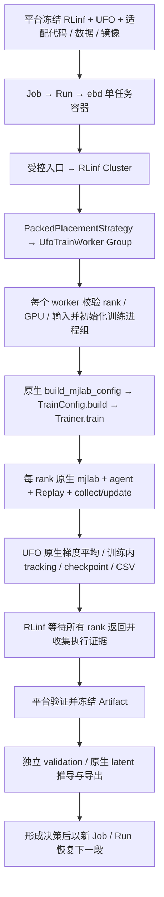

# 25 · RLinf 承载的 UFO 原生 RPO 训练接入方案

日期：2026-10-18。状态：**源码分析与接入设计；尚未实现或运行本方案**。

本次只更新设计文档，不修改平台实现、`/data/kk/RLinf` 或 `/data/kk/UFO`，不启动任务、不提交 Git、不使用 superpowers。架构目标按用户确认更新为：**由 RLinf 承载训练，同时尽量直接复用 UFO 原生网络、loss、Replay 和更新逻辑**。不恢复旧 BFM-Zero/humanoidverse 算法桥接；新增的 worker 仅承担 RLinf 与原生训练器之间的进程适配。

遵循 [02 · 系统架构](02-system-architecture.md)、[04 · 模型与训练](04-model-training.md)、[05 · 评估与交付](05-evaluation-delivery.md)、[12 · 环境目录](12-environment-catalog-and-selection.md)，衔接 [23 · 原生 UFO/RPO 部署](23-ufo-native-rpo-deployment.md) 与 [24 · 实时仿真验证](24-ufo-live-simulation-validation.md)。本文定义新的原生训练接入，不改变其他训练栈的算法或已有部署接口的语义。

## 1. 方案结论

**源码层面可行，推荐“RLinf 每 GPU 一个基础 Worker，Worker 内直接持有 UFO 原生 Trainer”的同步共置方案。** RLinf 负责 Cluster、WorkerGroup、GPU 放置、rank/rendezvous、远程调用、进程日志和失败传播；UFO 负责环境采样、网络、Replay、loss、更新和训练状态保存；EmbodiedBein 负责整个 Job 的准入、容器、不可变资产、指标与独立评估。

“可行”是对接口与调用关系的静态判断，**不等于两个仓库原封不动安装后即可运行**。已发现明确的依赖声明冲突、启动器/设备映射冲突，以及平台模板和产物协议缺口，详见第 4、6、7 节。必须新增薄适配，当前不存在现成的 UFO RLinf worker。

首期按已有上下文选择 **RPO 23DOF + UFO 原生 FB-CPR-Aux + mjlab**。训练目标是学习可由任务 latent `z` 条件化的控制能力，再用原生 tracking/goal/reward inference 使用模型。站立和前行是首期评估任务，不能把这条链路重新解释成平台自写的站走 PPO。

关键决定：

1. 网络、loss、优化器、target network、Replay、专家采样、环境 reset/step、多卡梯度平均全部直接使用 UFO 实现；不继承 RLinf 的 PPO/SAC/FSDP 算法 worker。
2. 平台使用 `stack=rlinf`、专属 recipe `rpo_ufo_fb_native`（拟定名称），复用 `train.rl`、TrainJob/Job/Run/Artifact/ModelVersion；RLinf 创建实际承载训练的 Ray workers，每个 rank 在自己的进程内执行原生 Trainer。
3. 首期采用**分段训练结束 → 全 rank Replay 保存 → 冻结 checkpoint → 独立快评 → 作出继续/停止决定 → 新 Run 恢复**。先验证这条流程，再讨论边训练边快评。
4. 原生环境步、agent 更新次数、控制时间分别展示；绝不把 `num_env_steps=100` 宣称为“完成 100 次训练更新”。
5. 完整 Replay 恢复仍不等于逐位无损恢复。原生没有保存全部环境/RNG/运行时状态，不能使用平台既有 `exact` 或暗示完整状态的恢复标签。
6. 现有原生导入/导出/仿真可以复用，但其来源限制、模型 provenance、prompt 绑定和输入大小限制必须适配新的受管训练产物，不能直接假定已经兼容。
7. 首期每个 worker 内共置环境、agent、Replay，不经过 RLinf EnvWorker/RolloutWorker 的张量 Channel，不做 FSDP 分片、异步采样、动态增减 rank。后续若需要这些能力，必须重新评估其对 UFO 训练语义的影响。

RLinf 承载在这里有可检查的证据：训练 rank 必须是 RLinf WorkerGroup 的成员，其 PID/rank/GPU/源码身份和退出结果可追踪；不能只让一个 RLinf worker 用 shell 启动另一个不受其 rank 管理的 UFO 多卡作业。**可以避免重写算法 worker 的内部逻辑，但不能承诺“一个适配 worker 都不新增”。**

原生 TeCH 也存在，但首期不开放：当前 RPO 部署校验要求 `FBcprAuxModel`，原生 reward inference 也只支持 FB。开放 TeCH 必须单独验证其训练、checkpoint、推理和评估，不做仅切换菜单名称的接入。

## 2. 分析基线与证据边界

本次依据当前本地源码进行静态追踪，没有读取线上训练结果来推导模型质量，没有执行 GPU/容器测试。

| 对象 | 本次核实的状态 |
|---|---|
| 平台仓库 | `/data/kk/EmbodiedBein`；HEAD 为 `396eb1403cc0740d7876ed0094dc33606a8a8938`；本轮开始时只有上一轮新增的本文未被 Git 跟踪 |
| RLinf 源码 | `/data/kk/RLinf`；HEAD 为 `bcbef7370e70e9d17a70e38d1d3e3e60237dcc9c`，本轮检查时工作区干净；包版本 0.4.0 |
| UFO 源码 | `/data/kk/UFO`；HEAD 为 `bedef7f5898d20cf9a237aa44f1c4a23f93c937a`，工作区有修改和未跟踪文件 |
| UFO 当前结构 | `ufo/` 下的 mjlab 实现；训练入口是 `ufo/train.py`，不是 humanoidverse |
| RPO 支持 | `configs/robots/rpo_23dof.yaml`、RPO MJCF、导入与评估脚本及部分测试在当前工作区存在，但其中多项尚未被 Git 跟踪 |
| 依赖约束 | UFO 要求 Python 3.10、Torch 2.7.1、W&B ≥0.26.0；RLinf 基础声明 Python ≥3.10、Torch ≥2.5.0，但 W&B <0.25.1，且默认 uv override 为 Torch 2.11.0；不能直接合并完整默认安装流程 |
| 当前平台原生能力 | `eb/ufo_native.py:OPERATIONS` 只有 import、export、eval、bundle、live，没有 train |
| 当前 RLinf UFO 接口 | 对 `rlinf/` 和 `examples/` 的 UFO/FBcpr/bfm_zero 关键词检查未找到现成接入；通用 Worker 接口存在，现成 PPO/SAC worker 有自己的算法与数据协议 |
| 本次未验证 | 当前 GPU 空闲量、现有镜像与源码的完整一致性、数据可用性/质量、训练吞吐、恢复行为、模型改善和最终验收 |

“原生”在本文中特指**冻结后的这份 UFO 源码及其依赖**，不意味着本地未提交的 RPO 修改已经被上游接受。Git commit 只是来源信息，必须同时保存实际文件清单和内容 hash，包含需要的未跟踪 RPO 文件。关键文件摘要见第 15 节。

## 3. 原生代码分布与真实调用链

下表以 `/data/kk/UFO/` 为根；路径均指本次实际检查的文件。

| 职责 | 原生路径 / 入口 | 复用方式 |
|---|---|---|
| CLI、配置、单机多卡启动 | `ufo/train.py`：`parse_args`、`build_mjlab_config`、`launch`、`run_train`；`run_train.sh` | 复用参数解析与配置 builder；启动由 RLinf 接管，不调用原生 `launch`/`elastic_launch`，也不直接调用会重设 EGL 的 `run_train` |
| 训练配置 | `ufo/training/config.py:TrainConfig` | 使用原生字段与校验；平台字段只映射到允许的原生参数 |
| 训练循环 | `ufo/training/trainer.py:Trainer` | 原样使用 prepare/save/evaluate/collect/update/log 流程 |
| FB 算法默认值 | `ufo/agents/fb_cpr_aux/config.py` | 原生默认值 → RPO robot overrides → 明确的 CLI overrides；记录最终解析值 |
| FB 网络 | `ufo/agents/fb_cpr_aux/model.py`、`ufo/agents/common/networks.py`、`inputs.py`、`presets.py` | 原生 actor、forward/backward map、critic、discriminator、normalizer；不复制网络定义 |
| FB loss 与更新 | `ufo/agents/fb_cpr_aux/agent.py`、`ufo/agents/common/execution.py` | 原生 `update`、各 loss、梯度同步、optimizer step、target soft update |
| Replay 与专家序列 | `ufo/agents/common/buffers/trajectory.py`、`storage.py`；`ufo/motion/reference.py` | 原生 `ReplayBuffer`、`ExpertTrajectoryBuffer`、`ZBuffer` 及序列采样、存取 |
| 多卡同步 | `ufo/training/distributed.py` | 原生 NCCL collective、梯度平均、模型/optimizer 广播、buffer 同步和保存一致性检查 |
| 机器人与仿真 | `configs/robots/rpo_23dof.yaml`；`ufo/tools/robot_config.py`；`ufo/envs/{config,core,vector_env,observations,actuators,rewards}.py` | 原生 `MJLabEnvConfig → ManagerBasedRlEnv → MJLabCore → MJLabVectorEnv` |
| 动作数据 | `ufo/motion/{formats,manifest,library,reference}.py`；`ufo/tools/rpo_motion_import.py` | 原生格式转换、motion library、manifest 混合、专家输入；平台登记版本与划分证据 |
| 训练内评估 | `ufo/training/evaluation.py`；`Trainer._evaluate_training` | 原生 tracking 指标与训练采样优先级反馈 |
| 日志 | `ufo/training/logging.py:CSVLogger`；`Trainer._log_training` | 保留原始 CSV；平台只做观测性收集和展示 |
| 模型与训练状态 | `ufo/agents/common/checkpoint.py`；`Trainer.save`、`create_agent_or_load_checkpoint` | 原生模型/optimizer/Replay 格式；平台验证和冻结完整文件集合 |
| 任务 latent 与推理 | `ufo/inference/reward_inference.py`、`runtime.py`；`scripts/evaluate_rpo_reference.py` | 使用原生模型的 reward/tracking/goal inference，不另写 latent 求解器 |
| RPO 行为诊断 | `scripts/evaluate_rpo_locomotion.py`、`scripts/evaluate_rpo_reference.py` | 原生诊断入口可纳管；正式 Suite/媒体完整性仍由平台约束 |
| 导出 | `ufo/tools/export_onnx.py:export_policy_model` | 原生导出；复用平台已有数值等价性和部署契约检查 |



`UfoTrainWorker` 是拟新增的 `rlinf.scheduler.Worker` 子类名称。它不创建第二套 actor/critic/replay，不把大张量返回 Ray；RLinf 接收的是 rank 身份、计数和结果索引。UFO 的 reward relabel 原生进程池仍可复用，但它属于独立派生任务，不是训练中的第二套 rollout worker。

### 3.1 一个 FB 更新实际做什么

`FBcprAuxAgent.update` 从原生专家 buffer 和在线 Replay 采样，更新观测统计，编码专家 latent，更新 discriminator，混合/重标记 latent，然后更新 forward/backward、critic/auxiliary critic、actor，最后对 target network 做软更新。共享 critic 开关会改变部分具体分支。

因此这里不只有一个网络或一个 loss，也不是给 RLinf actor 包一层就能保持等价。平台不能拆走其中一段重写，不能替换 reward normalizer、动作归一化、终止 bootstrap 或采样顺序。所有算法配置都以原生最终配置为准。

`Trainer._collect_transition` 还负责处理终止时的 final observation、保存 FB reward relabel 所需的 qpos/qvel，以及正确的 terminated/truncated 语义；这些都必须留在 UFO 内。

### 3.2 多卡到底复用了什么

UFO 独立启动时由 `launch` 使用 PyTorch 的 `elastic_launch` 建立单机多 rank；本方案以 RLinf WorkerGroup 替换这一进程启动职责。每个 rank 仍持有原生环境、模型、optimizer 和本地 Replay。`distributed.py:average_gradients` 将梯度按桶做 all-reduce 并平均，模型 buffer 另外同步。

这是真实的同步梯度训练，但当前源码**没有使用 `DistributedDataParallel` 包装器**，应在页面/报告写“UFO 原生同步多卡训练”。原生标注 `loss_mode=local_loss_average`：各 rank 本地计算 loss，再平均梯度。`batch_size × world_size` 是名义有效 batch，不能据此声称所有跨样本项都等同于单卡拼接大 batch。

### 3.3 当前 RPO/FB 配置起点

在不额外覆盖 CLI 的情况下，按原生 builder 与 RPO YAML 解析出的配置起点如下。它们是源码默认值，不是已验证适合当前机器或任务的运行预算。

| 项目 | 当前值 / 含义 |
|---|---|
| 网络 | actor、forward、critic 宽度 1024，shared critic 开启；z 维度 256 |
| batch / 专家序列 | 每 rank batch 1024，模型 seq_length 8；保留原生采样关系 |
| 精度 | RPO override 开启 BF16 网络前向；主参数和 loss 仍为 FP32，不推导 Replay 或 optimizer 自动减半 |
| 更新节奏 | 每 1024 local env steps 触发 16 次 agent update；seed steps 为 10240 local env steps |
| 总预算 / 保存 | RPO 默认 192000000 global env steps；模型保存/训练内评估间隔 3200000；Replay 默认保存间隔 16000000 |
| 初始内评 | RPO `eval_at_start=true`，会产生训练采样反馈；不是独立验收基线 |

默认值必须从冻结原生配置读取并回显，不在平台维护第二份算法默认配置。RPO 当前只覆盖部分 FB 选项，不能套用 RP1 或历史模型的超参数并仍称为同一原生基线。

## 4. 平台与原生的职责边界

| 能力 | 归属 | 平台可以做什么 | 平台不能做什么 |
|---|---|---|---|
| 网络/normalizer | UFO | 记录结构摘要、配置和权重 hash | 新写 BFM wrapper、替换层、重复归一化 |
| loss/optimizer/target | UFO | 收集原始指标、冻结允许的超参数 | 手写同名 loss、插入辅助训练目标、复制更新顺序 |
| Replay/专家采样/z buffer | UFO | 资源准入、版本校验、原生格式归档 | 转成平台 Replay、改采样算法、合并 rank buffer 冒充恢复 |
| rollout/reset/动作 | UFO | 校验接口、固定机器人配置 | 再实现训练环境包装、重复 reset、替换动作缩放 |
| 分布式训练进程 | RLinf 承载，平台准入 | ebd 限定 GPU 集合；RLinf 放置每 rank 的薄 Worker，调用原生 Trainer | worker 内再次 elastic_launch，或另建不受 RLinf 管理的训练进程组拓扑 |
| 梯度与 optimizer 同步 | UFO 算法实现 | 薄 Worker 用 RLinf 的 rank/rendezvous 初始化一个训练 process group | 再包 FSDP/DDP、再执行 RLinf backward/梯度平均、混用 Channel PG 与训练默认 PG |
| 原生训练内评估 | UFO | 展示为训练反馈指标 | 把它计作独立 validation/acceptance |
| 数据版本/接口/Profile | 平台 | 冻结来源、split、路径、配置和用途 | 根据文件名猜模型或关节兼容 |
| Job/Run/产物 | 平台 | 幂等、准入、日志、失败诊断、发布与血缘 | 容器退出码为 0 就认定模型合格 |
| 独立评估/媒体 | 平台编排，原生执行可复用部分 | 冻结 Suite、原生推理、逐 case 指标和视频校验 | 从训练 reward 推导任务成功率、使用挑选后的成功视频验收 |
| 导出/实时仿真 | 复用现有 UFO 接入 | 接受新训练的冻结模型，核对 codec 与 prompt | 复用其他权重的 z、把实时会话当正式验收 |

允许新增的“薄适配”包括参数校验、输入准备、RLinf Worker 生命周期、训练进程组初始化/销毁、原生 Trainer 调用、结果包装和元数据协议。Worker 持有一个原生 Trainer 对象，**不自行提取/加工训练 batch、计算 loss、操作 optimizer 或实现 Replay 存取**。确实缺少原生生命周期接口时，先提出具体上游改动；不通过复制 Trainer、monkey patch 或新建平台算法循环绕过。

### 4.1 RLinf 源码依据与不能直接套用的部分

下表以 `/data/kk/RLinf/` 为根。

| 代码位置 | 已确认的行为 | 对本方案的结论 |
|---|---|---|
| `rlinf/scheduler/worker/worker.py:Worker` | 支持继承；准备 rank、world size、设备、master 信息；文档示例在子类中显式初始化 PyTorch PG | 可用作原生 Trainer 的进程容器，不强制继承 PPO/SAC 或 FSDP |
| `rlinf/scheduler/worker/worker_group.py:WorkerGroup.launch/_create_workers` | 根据 placement 建立 worker，传递 RANK/WORLD_SIZE/VISIBLE_DEVICES 等；一次 group 方法调用向所有 rank 发起 remote 调用 | 负责实际多进程承载；collective 方法必须发往全部训练 ranks 后再等待 |
| `rlinf/scheduler/placement/packed.py:PackedPlacementStrategy` | 支持每进程分配一个或多个设备 | 首期固定每 worker 一张 GPU、`isolate_gpu=True`，不做多 GPU 嵌套 launcher |
| `rlinf/scheduler/cluster/cluster.py:Cluster.allocate` | Ray Actor、NodeAffinity、运行环境/Python 解释器、分布式日志 | 复用进程放置与调用；跨任务硬资源隔离仍以平台准入和容器限制为准，不能仅凭 Ray Actor 存在宣称显存已预留 |
| `worker.py:_setup_local_rank_world_size/_setup_master_address_and_port` | 隔离 GPU 时 LOCAL_RANK=0，而 RANK/WORLD_SIZE 仍为全组；rank 0 的地址/端口用于 rendezvous | local device 与全局 rank 分开传给 UFO，禁止把每 worker 的 LOCAL_WORLD_SIZE=1 当作训练 world size |
| `rlinf/scheduler/hardware/accelerators/nvidia_gpu.py` | 设置 CUDA 可见设备，并尝试 CUDA→EGL 映射；映射失败存在回退 | 保留并验证映射，不能由 UFO 启动 helper 改回全 rank EGL=0 |
| `rlinf/runners/embodied_runner.py:EmbodiedRunner.run` | 同步 actor→rollout 权重，env/rollout 经 Channel 交互，收轨迹、计算 advantage、训练、按外层 global_step 保存 | 不是任意 Trainer 的通用驱动器；首期不使用这条算法循环 |
| `rlinf/workers/actor/fsdp_sac_policy_worker.py:EmbodiedSACFSDPPolicy` | 自建 `TrajectoryReplayBuffer`、target、entropy temperature、optimizer；自行实现 SAC loss/backward/step/checkpoint | “同为 off-policy”不足以兼容 UFO；不得继承后逐方法覆盖成另一套 FB |
| `examples/embodiment/train_embodied_agent.py`、`rlinf/config.py:validate_cfg` | 选择既定 actor 类型并校验 training backend、模型、rollout 等 schema | 需新受控入口和有界配置校验；不能填假的 PPO/SAC/FSDP 字段绕过 |
| `rlinf/scheduler/cluster/utils.py:load_user_extension_module` | `RLINF_EXT_MODULE` 在各进程导入并调用 register；部分失败只写日志 | 支持外部扩展，但不自动解决算法协议；此方案直接导入薄 Worker 即可，若用扩展注册则另做强制就绪检查 |

### 4.2 接法比较与首期选择

| 接法 | 原生保留程度 | 新增工作 / 限制 | 决定 |
|---|---|---|---|
| 单个 RLinf worker 再启动 UFO 多卡子进程 | 高 | RLinf 不直接掌握各训练 rank，容易嵌套资源/失败管理 | 不作为本次交付方式 |
| **每个 RLinf worker 内运行一份原生 Trainer** | **Trainer、网络、loss、Replay、更新及训练内评估全部保留** | **新增一个薄 Worker + 一个受控驱动入口；验证运行环境、PG、恢复与结果协议** | **推荐首期** |
| 把环境、rollout、learner 拆成 RLinf 独立组件 | 网络与部分 agent 方法可保留 | 需新的 trajectory/Channel 协议、latent/终止状态传输、Replay 接口、权重版本和采样更新调度；很难直接保留 Trainer | 只有明确需要解耦吞吐且有测量依据后再设计 |
| 继承 RLinf SAC/PPO worker，导入 UFO 网络 | 只保留网络不足以保留算法 | 会引入 RLinf loss/Replay/optimizer 语义或大量覆盖代码 | 不采用 |

首期使用的 RLinf 能力是 Cluster、Placement、WorkerGroup、远程调用、rank 环境、日志、失败传播。首期不宣称使用其 FSDP 分片、模型权重 Channel、异步 rollout、动态资源迁移或弹性 world size。这是明确的共置训练拓扑，不是占位接入。

### 4.3 薄 Worker 与驱动的最小契约

拟新增模块 `backend/eb/runners/rlinf_ufo_worker.py` 与 `rlinf_ufo_entry.py`，两者在任务镜像内执行，保持 UFO 所需 Python 3.10 兼容，不导入 API/SQL/平台调度服务。

**驱动入口**负责：校验冻结计划、一次性解析原生参数、准备输入/恢复目录与停止标记；创建 RLinf `Cluster(num_nodes=1, ...)`，按分配的 W 张 GPU 放置 W 个 worker；调用全组身份检查，再一次性调用全组 `run_segment()`，等待全部结果；成功后验证回执并释放资源。它不按采样步或更新步循环。

**Worker**负责：`super().__init__()` 后验证设备/rank/来源/输入；选择本地 CUDA 设备，多卡时初始化一个训练默认 PG；调用原生 `build_mjlab_config`，将 `seed=base_seed+rank`、`distributed_rank/world_size`、受管路径和原生参数传入；执行 `cfg.build()` 与 `trainer.train()`；返回小型结果元数据。原生 `train()` 正常结束时已关闭训练环境，薄 Worker 再清理自己建立的 PG；异常时只能做有界清理，不能等待故障 rank 参加新的 barrier。保持 `Trainer` 原生初始化、seed、compile 和更新调用顺序，不拆出私有 `_collect_transition/_update_agent` 另写循环。

职责形态如下，**为接口示意，并非现存实现或可执行代码**：

```text
entry:
  parsed_native_args = 原生解析后的冻结参数
  group = UfoTrainWorker.create_group(plan).launch(Cluster, PackedPlacementStrategy)
  verify(group.describe_runtime().wait())
  results = group.run_segment(parsed_native_args).wait()  # 同时调度全部 rank
  verify_all_ranks_and_write_receipt(results)

worker.run_segment:
  initialize_training_pg_using_rlinf_rank_and_master()
  cfg = ufo.train.build_mjlab_config(...原生参数..., seed=base_seed + rank)
  trainer = cfg.build()
  trainer.train()                                       # 完整原生算法循环
  return bounded_native_checkpoint_receipt
```

驱动只写执行回执；模型/Artifact 的登记与发布仍走平台原有收集流程，不在 worker 内操作平台数据库。checkpoint/Replay 大文件的复制、hash 和原生 loader 校验由任务容器或 ebd 执行，API 只处理元数据与资格判定。

每段一个新 Run/worker 组，避免长寿命 Actor 再次进入 `Trainer.train()` 时 seed、checker、PG 或资源状态混用。训练中 worker 方法是阻塞的；不承诺额外 `.save()` RPC 能插入正在运行的同步方法。需要按更新数精确暂停或非阻塞状态接口时，先补原生显式生命周期接口。

### 4.4 分布式与设备边界

- `RANK=0..W-1`、`WORLD_SIZE=W` 和 `MASTER_ADDR/PORT` 由 RLinf worker 环境提供。隔离模式下每个 worker 看到一张卡，`LOCAL_RANK=0`、device=`cuda:0`，并不代表所有 rank 使用同一张物理卡。回执记录 GPU UUID/容器 ordinal/进程可见映射，验证没有重复分配。
- 多卡训练默认 PG 由薄 Worker 显式创建一次，使用 RLinf 的 rendezvous、NCCL 和预先冻结的通信超时；单卡沿用原生无 PG 路径。UFO 的原生 collective/梯度平均使用该 PG。RLinf scheduler 的 Channel/点对点 collective 不负责这套训练梯度，不应与默认 PG 混用。启动前发现已有不匹配 PG 必须失败，不能悄悄复用。
- 不调用 `ufo.train.launch` 或外层 torchrun；也不直接调用 `run_train`，因为其 `_select_device_and_rank` 会写 `MUJOCO_EGL_DEVICE_ID=LOCAL_RANK`，在 RLinf 每卡隔离模式下可能把所有 rank 改到 EGL 0。使用原生配置 builder + Trainer 可以避开该启动副作用，仍完整保留训练实现。
- 不调用 PPO/SAC 的 `.run_training()`、`.compute_advantages_and_returns()`、FSDP 包装或额外 optimizer step。共享 critic、target、normalizer、梯度桶平均与 buffer 同步只执行 UFO 原生的一份。
- 不给同一组 rank 依次调用并逐个等待含 collective 的初始化/训练方法；应由 WorkerGroup 一次性远程发起全组调用。否则首个 rank 可能等待永远没有被启动的其他 rank。
- EGL 映射失败的回退不算验证通过；训练与需要媒体的评估分别实测 GPU 绑定。即使训练不渲染，也不能据此宣布录像设备路径可用。

## 5. RPO 本体与数据：先冻结语义，再配置训练

### 5.1 机器人契约

首期候选接口是现有 `ee_rpo_v2_ufo_native_23dof_v2`。仓库 YAML 是草稿，bootstrap 在资产验证条件满足时会激活；真正提交时必须读取平台已发布/激活的接口版本和 hash，不能仅凭文件名认为可训练。

需核对原生运行生成的 `config.json`、`config.yaml`、`effective_config.json` 与接口：

- 23 关节顺序：左腿 6 → 右腿 6 → 腰 1 → 左臂 5 → 右臂 5；具体列表直接读取原生 robot config。
- actor observation 为 `state 52 + last_action 23 + history_actor 300 = 375`；特权观测 358，供原生其他网络使用；actor 另接收 `z 256`，当前导出输入共 631。
- history 为前四帧、term-major、最新在前；初始/reset 填充、更新时点和 applied action 含义以原生实现为准。
- 物理频率 400 Hz，decimation 8，策略 50 Hz；native action 映射为 `a_applied = clip(5 × a_raw, -5, 5)`，`q_target = q_default + 0.6 × (effort_limit / Kp) × a_applied`。
- 外部 quaternion 使用 xyzw，MuJoCo qpos 使用 wxyz；角度 rad，速度 rad/s；root、gravity、速度坐标系须通过原生样例验证。
- 冻结原生 actuator、延迟、关节限制、Kp/Kd、reset、躺倒初始化、DR、观测噪声与辅助 reward 配置。不能复用旧站走 PPO 的动作缩放或奖励覆盖。

训练环境与推理环境的差异必须作为 EnvironmentProfile revision 记录。若网络输入、动作或控制契约变化，派生新接口；仅日志频率、预算等运行配置变化不应伪造新的本体语义。现有部署 validator 对上述布局有明确限制，新模型只有通过实际检查才能复用它。

RPO MJCF 的 `meshdir` 当前是 `/data/kk/assets/roboparty/rpo-v2/rpo_description/meshes`。源码快照不足以代表全部机器人资产；mesh、XML、robot YAML 及任何引用文件都要冻结并只读挂载，路径重定位必须有对应清单。

### 5.2 数据接入与隔离

原生既支持 `--data-path`，也支持 `--data-manifest` 的多来源权重组合。训练只消费冻结的训练子集；独立验证和最终 acceptance 分开登记、分开挂载。不能给训练传一个包含全部 split 的 manifest，再假定它自动识别 validation/test。

原生 `rpo_motion_import.py` 已包含关节重排、单位/姿态转换、速度/限位/几何过滤、FK 核对、连续片段与分组划分，应直接复用其计算，不重新写一份平台转换算法。但它目前是特定本地数据批次的导入器：代码要求输入合计 70 个，提示文字为 30 official + 40 retargeted，**只检查总数，不能当作两类数量已分别验证**；`walk2` 固定进入训练，其余参考 group 按 hash 分配；official 祖先未知的池全部放入训练。

平台额外负责：

1. 数据版本包含原始来源、原始祖先/group、转换程序 hash、robot/XML hash、joint order、FPS、保留/剔除统计、质量报告、许可和输出 hash。
2. 按 take/session/subject 等实际祖先划分后再裁剪，跨片段/重定向派生保持同组；验证源 group 不交叉。原生 `source_group` 检查是起点，不等于已排除跨来源同源动作。
3. official 的 ancestry 未知时，不能断言它与 holdout 无重叠。严格泛化验收应使用可追溯且独立的来源；否则如实降低证据结论，不能补造“数据隔离已验证”。
4. 不假定旧任务产物还可用；正式落地前重新确认数据版本、来源完整性和许可。通用新数据若不满足该导入器输入布局，先扩展原生工具的输入契约或使用已有原生格式入口，不删掉质量检查凑数。
5. manifest 自动缓存默认相对当前工作目录写入 `cache/motion_data`，不能只设置 `UFO_CACHE_DIR` 就认为所有缓存都已转移。优先用数据准备 Job 生成并冻结 pkl，训练直接读取；如确需原生自动构建，工作目录和缓存必须位于受管可写目录。

训练内 tracking 评估会把 EMD 导出的优先级写回 motion library 与 expert buffer，因此它使用的是训练动作集合。独立 holdout 只能进入独立评估 Job。tracking/goal 推理在评估时编码指定目标轨迹/姿态属于任务条件输入，要在 Suite 中声明；它不应反向更新训练参数或优先级。

## 6. 平台接入落点：最少需要改哪些地方

以下是后续实现范围，本次不修改这些文件。路径以 `/data/kk/EmbodiedBein/` 为根。

| 位置 | 当前限制 | 计划中的最小改动 |
|---|---|---|
| `backend/eb/api/routes_train.py`、`domain/rlinf_form.py` | 已固定 `stack=rlinf`，但模板 kind、入口与恢复分支围绕既有 SFT/PPO 等 recipe | 保持 RLinf stack；新增 `rpo_ufo_fb_native` 模板及明确 kind→`train.rl`/入口映射，例如专属 `native_rl`，不伪装成 PPO；扩展预览、提交、恢复校验 |
| `backend/eb/domain/job.py` | 已有 `train.rl`、输入、资源和 code refs | 复用 JobKind；在原生计划中冻结需要的计数、输入和恢复语义，不建立平行训练实体 |
| `backend/eb/adapters/__init__.py`、`adapters/rlinf.py`、`adapters/ufo_native.py` | 原生接口 ID 会优先进入部署 adapter；既有 RLinf 渲染使用其 Python 3.11/Isaac 入口和特定 RPO 资产检查 | 按 operation/stack/kind 分发；训练进入 `RlinfAdapter` 的专属早期分支，渲染新的 Python 3.10 入口/镜像/挂载，不继承 Isaac 环境、旧 PPO 配置或部署资源限制 |
| `backend/eb/orchestrator/service.py`、`orchestrator/ufo_native.py`、`ufo_native.py` | 同一接口被部署提交校验截获；现 validator 禁止 datasets/resume，限定少量 CPU/RAM 和半小时等推理预算 | 分离训练计划与部署计划的校验；为训练设独立有界资源/输入规则，不全局放宽现有部署 validator |
| `backend/eb/orchestrator/service.py`、CodeRefs/原生计划 | RLinf 提交当前冻结一个 stack ref；既有 `stack/embodiment` 两类引用不足以表达两个训练代码仓 | `code_refs.stack` 保持 RLinf；增加受校验的 UFO 来源字段，例如计划中的 `source_refs.ufo`，通过 ebd 冻结并绑定实际内容；不把 UFO 冒充本体或覆盖 RLinf 来源 |
| `backend/eb/environment_catalog.py`、Task/模型能力目录 | 训练 Profile 依赖现有模板体系 | 新增 RLinf+UFO recipe 的 Profile、任务绑定、算法能力；不恢复旧 BFM-Zero/humanoidverse binding |
| `backend/eb/capacity/estimator.py`、scheduler | 原生分支估计推理资源；普通 `train.rl` 可能落入 Isaac/PPO 估算 | 增加原生训练资源依据和实测回填，不把推理估算用于训练 |
| `deploy/images/`、`Makefile`，必要时受管依赖补丁 | 两仓默认完整安装流程存在依赖冲突；现有部署/Isaac 镜像不能证明兼容 | 新建锁定的 RLinf scheduler + UFO 训练镜像与依赖 Profile；保留原生 Torch 数值栈，验证实际导入和 Ray/CUDA/EGL；修改受管构建副本，不改外部仓 |
| `backend/eb/runners/rlinf_ufo_entry.py`、`rlinf_ufo_worker.py`（拟新增） | 无 UFO worker；既有 `rlinf_entry.py` 入口白名单、Python 3.11 用法与 checkpoint publisher 不适配 | 新驱动创建 RLinf Cluster/WorkerGroup；新薄 Worker 直接调用原生 Trainer；添加身份/配置/结束回执，不复制任何算法循环 |
| `rust/crates/eb-collector/src/lib.rs`、`eb-tsdb` | 当前 collector 扫描 `logs/output/tb` 中的 tfevents，不认识 UFO CSV；原生部署输出为 `outputs` | 为受管原生日志增加有界、幂等 CSV 收集及路径支持；训练页复用现有 TSDB 查询 |
| `backend/eb/checkpoints.py`、`orchestrator/collect.py` | 既有 checkpoint 协议/收集只支持特定模板与模式 | 增加原生格式识别、保存完成/文件 hash/全 rank Replay 检查、恢复资格与训练血缘登记 |
| `backend/eb/api/routes_ufo_native.py`、`orchestrator/ufo_native.py`、`runners/ufo_native_package.py` | import 仅接受 UFO `runs` 路径、单 motion、既定来源包；推理预算 2 GiB；provenance 固定外部声明 | 为受管训练产物增加明确来源路径和版本化 receipt；推理包与训练恢复包分开，复用 codec/export/eval，不绕过来源校验 |
| `frontend/src/views/`、训练/模型 API 客户端 | 尚无原生训练字段和恢复能力展示 | 在现有训练工作台显示原生 recipe、三种计数、恢复等级、原始指标、checkpoint、快评/视频入口 |

平台 Agent 仍走 ToolBus。首期按人工操作入口交付；后续开放 Agent 工具时单独接入既有权限、预算和审计，不能因为加入原生训练而给 Agent 任意路径、CLI、shell 或接口发布能力。

## 7. 容器与输入输出方案

### 7.1 源码和依赖

冻结三份身份：**RLinf snapshot、UFO snapshot、平台薄适配代码/镜像**。UFO 包含实际 Python、robot 配置、必要资产、LICENSE、`pyproject.toml`、`uv.lock` 和需要的本地修改；RLinf 包含所复用 scheduler 的实际来源与依赖声明。排除 `.venv`、runs、Replay、缓存、日志；外部 mesh 单独纳管。保存来源 HEAD、dirty 清单、文件 hash 和整个 snapshot hash，镜像内每个 worker 回执验证实际加载路径与内容。RLinf 的代码同步选项只打包 `rlinf`，不会自动把 UFO/薄 Worker/资产一起带过去；首期单容器共享冻结安装目录，显式关闭不需要的代码同步并验证 import 路径。

以下约束直接来自两仓 `pyproject.toml`，其中 **W&B 声明没有交集**：

| 依赖 | UFO | RLinf | 设计处理 |
|---|---|---|---|
| Python | `==3.10.*` | `>=3.10` | driver、所有 worker 使用同一 Python 3.10 环境；API 的 3.11 不进入训练进程 |
| Torch/vision | `2.7.1 / 0.22.1`，cu128 | 基础 Torch `>=2.5.0` 有交集，但默认 uv override 为 `2.11.0 / 0.26.0`，另含 audio `2.11.0` | 不合并两套默认 uv 流程；优先保留 UFO 的 Torch/CUDA/NCCL 数值环境，实测 RLinf scheduler 所需 API |
| W&B | `>=0.26.0` | `<0.25.1` | 必须明确解决依赖声明冲突；关闭在线日志不能解决安装冲突，UFO 仍有模块级 import |
| Ray | 无原生训练承载依赖 | `ray[default]>=2.47.0`，Cluster 也检查下限 | 新增并锁定已验证版本；共享内存、服务进程和日志纳入容器预算 |
| 仿真/算法依赖 | `mjlab==1.6.0`、`mujoco~=3.11.0` 等 | 现成 embodied/LLM recipe 另有依赖 | 从实际 scheduler 导入链确定最小依赖；不把全部 PPO/SAC/LLM 环境混装进来 |

因此需要一个**受管的最小组合依赖 Profile**。先以 UFO 锁定环境为数值基线，补齐实际使用的 RLinf scheduler、Ray、Hydra 等依赖；必要时对构建副本的打包元数据做可追溯的依赖范围调整，保存原声明、补丁和解析锁文件。不能悄悄 `--no-deps` 跳过冲突就宣称兼容；也不能为了通过安装静默升级 UFO 的 Torch 或修改其 loss。若最小 scheduler 在这套环境不能运行，应报告具体不兼容点，再决定是否需要上游修复或调整设计。

这项兼容验证是首个实施门槛，目前未完成。现有两仓 Dockerfile 可以作为构建参考，不能把任一默认镜像视为组合环境已可用。镜像记录真实 digest、完整依赖 receipt、两仓及适配代码内容身份。构建、启动分别走已有工具与 ebd，任务容器不加入 Compose，外部仓始终只读。

平台 `backend/pyproject.toml` 要求 Python ≥3.11，不能把整个后端包安装到这套 3.10 环境。沿用现有原生部署镜像的方式，仅打包经过 3.10 校验的独立 runner 与必要的纯配置模块；禁止因为共享 `eb.runners` 命名空间就把控制面的依赖一并引入。

### 7.2 受控入口与原生参数映射

目标容器命令形态为 `python -m eb.runners.rlinf_ufo_entry --plan /inputs/plan.json`，其中路径仅示意，实际绝对路径由 adapter 渲染。该模块尚不存在；不执行 `python -m ufo.train` 或既有 PPO/SAC 入口。

驱动从白名单计划生成原生参数，复用 `ufo.train.parse_args` 的默认值与校验，再调用 builder。当前 `parse_args()` 不接收 argv 参数，如需适配，在单线程启动阶段限定并恢复 `sys.argv` 的作用域，或给原生解析器提出小型显式 argv 接口；不能新写一份算法默认字典。提前设置受管缓存路径，避免导入 `ufo.train` 时 `_ensure_compile_cache()` 在源码目录写缓存。worker 在 RLinf 设置设备环境后再导入/初始化需要设备的原生组件。

| 冻结计划内容 | 原生/承载参数 | 必须核对的语义 |
|---|---|---|
| 算法和机器人 | `agent=fb`、`robot_config` | RPO 通过原生 `--robot-config` 解析；内置 `--robot` 仅 g1/rp1，不编造 `--robot rpo` |
| 数据 | `data_path`、`data_mix_weights` | manifest 的准备逻辑直接复用原生工具；只传训练子集与已冻结输出 |
| 本段 work_dir | `work_dir` | 所有 rank 使用同一 Run 的共享目录；原生 rank 0 写公共文件，各 rank 写自己的 Replay shard |
| GPU/W | RLinf placement → rank/world size；原生 `device`/`distributed_*` | 显式限定 ebd 分配集合，首期一 worker 一 GPU；不把原生 `gpu_ids` 作为第二个 launcher 输入 |
| 随机种子 | `seed=base_seed+global_rank` | 保持 `run_train` 的原生规则，不能全部 rank 使用相同 seed 或用 LOCAL_RANK 相加 |
| 规模/预算 | `num_envs`、`num_env_steps`、`buffer_size` | 分别是每 rank 环境数、累计全局环境步终点、每 rank Replay 容量 |
| 保存/停止 | `checkpoint_every_steps`、`buffer_every_steps`、`SAVE_AND_STOP` | 使用原生全局步保存边界；段末全 rank Replay 必须验证 |
| W&B | `use_wandb=false` | 首期不启用外部日志；未来开放时也保持原生仅 rank 0 写入 |

worker 的参数转交必须与原生 `run_train`→`build_mjlab_config` 对照测试，包括 seed、data mix、DR/noise、shared critic、精度和更新密度；未开放项保留解析后的原生默认值，而不是遗漏转交后碰巧采用另一层默认值。

首期保持原生网络/loss 默认值；确需调节时只开放源码已支持且经校验的参数。例如 FB `--network-width` 为 1024/1536/2048、`--num-agent-updates` 为正整数；这些是新的冻结实验配置，不作为运行中自动修改项。未声明的任意参数透传必须拒绝。

`eval_every_steps`、`log_every_steps` 等目前不全是 CLI 参数；可通过原生支持的 robot `training.train_overrides` 形成受管配置派生，严格限制改动字段并保留原文件和差异。不为此复制配置默认值；**增加原生 tracking eval 的频率会改变专家优先级反馈，属于训练语义变化，不能当纯日志设置处理**。

### 7.3 目录与权限

输入 snapshot、数据、源 checkpoint、机器人资产均只读；输出、编译缓存、motion cache、Ray 临时文件和日志只写本 Run 的受管目录。默认不启用 W&B/外部遥测，指标留在本平台；容器网络策略见 7.4，不能把未验证的网络隔离模式写成已支持。

```text
<state>/runs/<run_id>/
  inputs/plan.json                   # 冻结平台计划
  outputs/native/                    # 原生 work_dir；当前 Run 可写
    config.json
    config.yaml
    effective_config.json
    train_log.txt                    # 实际是 CSV
    ufo_tracking_eval.csv
    checkpoint/                      # 原生布局；未完成时不可发布
  outputs/receipt.json               # 平台受管执行/完成回执
  outputs/runtime/rank-<r>.json       # RLinf worker PID/rank/GPU/来源/版本回执
  outputs/rlinf-logs/                # driver、scheduler 与按 worker 分离的日志
  outputs/metrics-index.json         # 原始文件、单位、计数与收集证据
  outputs/cache/                     # 明确设置各类缓存位置
  runtime/ray/                       # 本 Run 专属临时目录；不挂载宿主 Ray 状态
```

这些是目标输出约定，不是当前 runner 已实现的目录。源 Run 保持只读；恢复时先将验证后的原生 checkpoint 复制到新 Run 的可写 work_dir，再由 UFO 原生 loader 读取。不得用可写硬链接让新 Run 改坏源产物。

### 7.4 Ray 生命周期、资源与故障边界

RLinf `Cluster` 会先尝试 `ray.init(address="auto")`，连接失败才启动本地 Ray；而在创建 Cluster 前手动 `ray.init()` 会触发其已有初始化检查。首期使用**单任务容器内专属 Ray**，不增加共享 Ray 服务，不连接宿主或其他 Job 的 Ray：在启动前清理继承的外部连接配置、隔离临时目录和发现路径，记录实际连接节点/namespace，并验证全部属于本任务。namespace 单独不能提供安全隔离，也不假定普通 `RAY_PORT` 字段会被 Cluster 自动读取。

当前 ebd 允许 `bridge`/`none`，拒绝 host 网络。优先验证 `none` 下 loopback 的 Ray/NCCL/rendezvous 是否全部可用；若失败，使用已限定的 bridge Profile 并验证所有服务仍只属于该容器。两种方式均不能访问外部训练集群或通过共享 `/tmp/ray` 误接其他任务。Ray 临时目录配置必须验证 driver 与 actor 的发现路径一致；`UFO_CACHE_DIR` 与原生导入时设置的 TMPDIR 也要协调，不能让不同进程发现不同实例。

每卡一 worker 不等于每卡只消耗模型显存：完整 agent/Replay/专家数据各有一份，Ray driver/manager/object store 还使用 CPU/RAM/shm。显式限定 placement 的设备范围；不能使用默认全卡放置，不能仅依赖 Actor 的存在来证明硬资源预留。训练 batch、CUDA tensor、模型和 Replay 不经 Ray 返回或 Channel 传输，只传小型计划、标量计数、状态和文件索引。

RLinf `WorkerGroupFuncResult` 遇到远程错误会向 driver 发 SIGUSR1；Cluster 的处理会停止日志收集、清理 namespace 内 actors、关闭 Ray 并退出。该路径不保证回到普通 `.wait()` 异常处理，更不会自动调用 UFO checkpoint。部分 Worker 信号处理也会强制终止。因此失败诊断依靠运行中已有的 worker 日志/身份回执和 ebd 状态；不能依赖 driver 的 finally 一定写出完成 receipt。

任一 rank OOM、进程退出或 collective 超时都使整个训练段失败，不只重启单个 rank；恢复必须从上一份已冻结完整 checkpoint 启动新 Run。通信超时、组退出期限和 Job 总超时分别冻结，由 ebd 保证最终容器退出。清理只作用于本任务 Ray/容器，禁止宿主级 `ray stop` 或清理其他作业。

## 8. Step、训练阶段与 GPU 预算

### 8.1 三种计数必须分开

下文 `E` 为每 rank 环境数，`W` 为 world size，`G` 为每次触发的 agent 更新数，`C` 为每 rank Replay 的 transition 容量。

| 计数 | 原生含义 | 平台展示规则 |
|---|---|---|
| `local_time` / local env steps | 每 rank 累计 transition；一轮增加该 rank 的环境数 `E` | 不等于向量环境调用次数，也不等于更新次数 |
| `global_time` / `num_env_steps` | 当前实现为 local env steps × `W`；训练总预算、保存/日志/内评间隔使用此单位 | CLI 预算是累计终点；恢复时不能误当本段新增步数 |
| `optimizer_steps` | 每执行完一次 `agent.update` 增 1；一次内部可执行多个 optimizer 的 step | 页面主训练进度标为“agent 更新次数（原生字段 optimizer_steps）”；同步各 rank 不乘 `W` |

原生先在循环边界保存，再 collect/update。训练 CSV 中的 `global_time` 是这轮 collect 前的边界，而 `optimizer_steps` 已包含这轮更新；FPS 则使用 completed steps。收集层保留原始口径，不能为了曲线对齐静默改写原始 step。

RLinf 的一次 `run_segment()` 远程调用是一整段训练，不能计为一次 agent update。首期不使用 `EmbodiedRunner.global_step` 作为进度，不把 WorkerGroup 调用次数、Ray task 数或多个 rank 的计数求和当训练更新量。全组计数应一致，以原生状态和每 rank 回执互相验证。

当前 FB 默认 `E=1024`、`update_agent_every=1024`（local）、`num_seed_steps=10240`（local）、`num_agent_updates=16`，RPO 默认日志间隔为 81920 global env steps。`--smoke` 限制到 16 个环境、最多 2048 global env steps，不会跨过默认 warm-up：**启动 smoke 不算完成训练更新阶段**。

### 8.2 100 / 500–1000 / 5000–10000 的落实方式

项目的三档要求以实际更新为准。原生目前没有 `--max-optimizer-steps`，又是每次触发连续完成 16 个 agent updates；不能照抄数字到 `--num-env-steps`。

首期建议保留原生更新密度，并在批准阶段计划时明确批次对齐：100 次门槛对应至少 112 次，500 对应 512，1000 对应 1008，5000 对应 5008；10000 恰好可被 16 整除。**这些是建议的累计目标，不是已经执行或批准的预算，也不能在页面仍标成精确 100/500。** 若必须精确到 100 次，应先在原生训练器中支持按更新数停止/记录；不能在平台复制循环或中途修改 loss/update 数量凑整。

为说明映射，在新训练、`E=1024`、`G=16`、Replay 已可采样、没有额外 readiness 延迟的条件下：首个更新发生在 `local_time=11264` 的 collect 之后。`U=112` 需要 7 次更新触发，段结束 local env steps 为 `18432`，所以全局预算为 `18432 × W`；四卡时是 `73728`。这是源码推导，不是运行实测，改变 E、更新间隔或 Replay readiness 后必须重新计算。

每段冻结：起始 checkpoint 的累计计数、目标更新数、原生环境步预算、内评/日志/保存间隔、外部快评 Suite、预算上限和继续/停止条件。结束时以 `train_status.json` 实际计数核对；未达到目标标为未完成，不自动无限追加短训。恢复段也不能直接重复套用冷启动公式。

100 次档主要验收真实更新、checkpoint/恢复、快评和媒体闭环，不要求模型此时就站稳。500/1000 档才评估趋势；进入 5000–10000 档前须有任务指标改善证据。短训不代表满足 UFO 默认 1.92 亿环境步的能力训练预算；扩大预算需另行明确目标与依据。

默认日志 81920 可能让短段结束前没有一条训练指标。短段必须通过原生支持的配置把日志间隔设到足够覆盖多个更新窗口，并保持预先冻结；禁止伪造曲线或只拿最终 checkpoint 计数代替训练时序。

### 8.3 Replay 是资源准入的重点

默认 `buffer_size=5,120,000` 是**每 rank 的 transition 数量**。源码将其转换为 `capacity = buffer_size // num_envs` 的向量时间槽；平台应要求正值、足够长的轨迹，并记录整除后的实际容量，不能展示名义容量却忽略截断。

按当前 RPO 的 `375 + 358 = 733` 维完整观测、前后两份观测均为 float32 估算，512 万条仅观测存储就需要：

```text
5,120,000 × 733 × 2 × 4 bytes ≈ 30.0 GB ≈ 28.0 GiB / rank
```

这还没计入 action、z、qpos/qvel、辅助奖励、专家数据、模型、optimizer、梯度、编译和仿真内存。原生 `replay_storage_dtype` 只将 float64 降到 float32，BF16 网络前向不自动压缩 Replay。故不能把该默认容量直接当作单卡 24 GiB 的可运行配置，更不能除以四张卡后准入。

实施时从真实字段 shape/dtype、原生分配方式和组合峰值测量后选择容量，保持原生 Replay 实现。显式记录容量对应的每环境时间跨度、序列长度与 update/sample 比；容量改变是实验条件，不是无影响优化。

`effective_batch_size = batch_per_rank × W`，总环境数 `E × W`，总 Replay 名义容量 `C × W`；模型和 optimizer 在各 rank 复制。扩大 E 或 W 会改变环境样本/更新比例，学习率不自动线性放大。只使用实际可准入的空闲 GPU；记录每卡显存、RAM/shm、采样/更新/同步/保存/内评耗时和吞吐，不能以忙碌度替代学习效率。

## 9. Checkpoint、恢复与停止：尊重原生的实际能力

### 9.1 原生实际保存的内容

原生 `checkpoint/` 保存 `config.json`、`init_kwargs.json`、`optimizers.pth`、`model/{config.json,init_kwargs.json,model.safetensors}`、`train_status.json`，以及按保存模式生成的 `buffers/train_rank_<r>/`、`snapshot.json` 和多卡 `distributed_sync.json`。具体文件集合以冻结版本生成的清单校验，不能仅检查一个权重文件。

Replay snapshot 匹配要求包含 `transition_format=2`、snapshot ID、global time、world size 以及 buffer 数据/配置。多卡会对各 rank 的恢复可用性取一致结果；任一 shard 不匹配时原生会让所有 rank 重新采集 Replay。

| 原生保存触发 | 模型/optimizer | Replay | 对平台的含义 |
|---|---|---|---|
| 普通模型保存间隔 | 保存 | 通常不保存 | 可用于推理，但不能保证同一步完整恢复 |
| Replay 保存间隔 | 保存 | 默认 rank 0 | 可用于 FB reward inference；多卡不等于可严格恢复 |
| 正常训练结束 | 保存 | 默认 rank 0 | 单卡可形成匹配 Replay；多卡仍缺其他 shards |
| `SAVE_AND_STOP` 被保存边界读取 | 保存 | 所有 rank | 首期分段恢复所需路径；须检验 marker/文件和实际计数 |

原生保存会在可写 checkpoint 目录中放 `.saving`，写完状态后移除；这是半写检测，不是多版本原子发布。平台不从正在保存的目录发布模型，也不因开始写新文件就删除上一次已冻结的可用产物。

### 9.2 首期分段如何可靠得到全 rank Replay

为计划好的一个区间，在受管 work_dir **启动前放置原生 `SAVE_AND_STOP` 文件**，并将模型/Replay 保存间隔安排到不早于本段终点；终点由原生 `--num-env-steps` 限定。原生只在保存边界读取该标记，因此首次保存应在预定段末，走 all-rank 保存并退出。

恢复时要结合原生保存 checker 的起始计数和 `buffer_global_time` 验证“没有更早保存边界”，不能只看配置文本中的间隔数值。上述方式由当前源码推导，**必须通过容器内单卡和多卡分段测试后才能作为上线能力**。达不到这项证据时，不启动依赖恢复的长训。

这个方案不需要平台监听每个更新或自建采样 worker。任意时刻的用户取消仍走 ebd 取消/超时；不承诺立刻保存所有 Replay。未来若增加“保存后停止”，必须把请求、下个可达保存边界、超时与保存失败结果展示清楚，不能把 SIGTERM/容器 kill 当作原生已经支持的 checkpoint 信号。

段末所有进程退出后，验证 `.saving` 不存在、原生 loader 可回读、全 rank snapshot 匹配、文件大小/hash 正确，才生成不可变 manifest 和发布完成回执。异常/OOM/取消产生的 partial 目录保留诊断，不自动发布为完整模型。

在 RLinf 下，段末首先要求全部 worker 的训练调用成功返回，再关闭组并完成校验；共享目录不能由每个 worker 分别发布。某个 rank 返回成功不能覆盖另一个 rank 的失败。SIGUSR1、Ray Actor 退出或 ebd kill 不触发 SAVE_AND_STOP 的正常保存分支，失败时直接沿用上一段已发布 checkpoint，不能提升本段 partial 的恢复资格。

### 9.3 恢复模式不能偷换概念

原生恢复会加载模型和 optimizer；要求 world size 相同；Replay 不齐时默认回退 fresh collection。它还会 reset 仿真、重建专家输入、重新设置随机种子；没有完整持久化环境状态、所有 RNG、rollout context、ZBuffer 和专家采样优先级，因此无法保证与不中断训练逐位一致。

本方案建议在现有恢复协议中增加明确的 **`ufo_native_state` 能力标签**，而不是借用 04 设计中要求 RNG 等状态的 `trainer_state`。它是同一 Job/Run 生命周期下的能力扩展，不降低 `exact`/`trainer_state` 原有定义；实现时需要同步相关 schema/校验与用户说明。

| 方式 | 首期处理 |
|---|---|
| 原生状态 + 全 rank 匹配 Replay | 推荐的分段恢复；标注环境/RNG/latent 缓存等重新初始化，非精确恢复 |
| 原生状态 + fresh Replay | 必须单独声明并冻结；默认拒绝在“恢复成功”中静默降级；新的 warm-up 不冒充训练更新 |
| 只有 policy 权重 | 只能作为推理产物；当前训练 CLI 没有通用 weights-only warm-start 入口，不把原生推理 loader 当训练恢复功能 |
| 改 world size、算法、网络、接口或数据 | 不作为同配置恢复；首期拒绝。需要新实验/原生明确的 warm-start 或迁移能力再设计 |

平台预检冻结 source/image、接口/资产、数据、E/W、网络结构、batch/更新密度、Replay 格式和原生配置；原生目前只检查部分约束，不能全靠它兜底。恢复时实际 agent 配置来自 checkpoint，CLI 新值不一定成为生效值，必须核对 `effective_config.json` 中恢复后的 agent，防止页面显示已调参而实际未生效。

源 checkpoint 只能只读复制到新 Run；源日志不续写。累计计数沿用原生状态，本段增量另外计算。自动重试不跨越证据缺失、配置失配或 Replay 降级问题。

RLinf 的 FSDP/SAC/DCP checkpoint 与 UFO 原生目录格式不同；既有平台 `rlinf_entry.py` 围绕 actor 权重和特定恢复模式的发布逻辑不能直接套用。新增的是原生格式的登记、验证和恢复适配，不是第二套模型序列化器。RLinf WorkerGroup 的重新建立也不补齐 UFO 未保存的 RNG/环境状态。

## 10. 指标接入：保留原始语义，不复刻旧 BFM 指标

原生 `train_log.txt` 是 CSV，训练内评估另写 `ufo_tracking_eval.csv`，stdout 打印的是 Python 字典，不能当稳定 JSON 协议。首期以 CSV + checkpoint 状态为依据；Rust collector 只读收集，绝不向训练反向发指令。

CSVLogger 会在出现新字段时重写表头并替换文件。收集器要处理不完整尾行、文件替换、列扩展、重复扫描、恢复 Run 的独立流和非数值列；不能只记字节 offset 后永久追加。缺失指标留空，非有限值报告异常，不转为 0。原始文件及其最终 hash 保留，图表明确属于哪个 Run、哪个数据口径。

| 指标组 | 展示与解释原则 |
|---|---|
| `fb_loss`、orthogonality、critic/aux critic、discriminator、actor 等原生分项 | 原样保留原生名称、定义来源与聚合方式；各分项方向/尺度不同，不造一个“总 loss”并认定越低模型越好 |
| `aux_rew/*` | 区分原始分项与加权后的辅助 reward；负系数、零系数和 normalizer 来自实际 agent 配置，不从正负值猜是否改善 |
| `distributed/optimizer_steps`、local/global env steps | 显示实际更新、采样量和区间增量，保留第 8 节口径 |
| `FPS`、duration、execution/distributed 配置 | FPS 是该日志区间全局环境步吞吐；区间可能包含内评/保存/日志耗时，不能命名为纯 learner 更新速度 |
| 原生 tracking EMD、proximity、joint 指标 | 标为训练动作集上的反馈指标；例如 EMD 降低通常表示该定义下分布更接近，但不保证时间对齐、站稳或任务成功 |
| 独立任务指标 | 速度误差、跌倒、持续时间、关节越限、接触/足滑等，注明单位、分母、成功定义、case/seed 和置信要求 |

默认原生日志不保证已覆盖所有关键诊断，例如真实采样来源分布、完整梯度诊断、Replay 占用、每阶段耗时。先对照实际输出制作指标字典；缺项写明。资源监控由平台数据面补充；算法内部诊断如确实必要，应在原生实现中增加只读观测点，不能为“补指标”再算一份 loss 或改训练步骤。

RLinf 层单独记录 worker 启动/退出、rank/GPU 映射、rendezvous/通信错误、来源校验、阶段等待时间。它们是运行诊断，不冒充 UFO 算法指标；UFO 的公共 CSV 仍由原生 rank 0 写入，不能收齐 W 份重复记录后将曲线值相加。原生日志已有的跨 rank 聚合方式要逐项保留，不能一律标为全局均值。

短段图表至少包含实际更新轴、各主要原生分项、独立快评趋势和资源曲线。日志中的 window mean 与 checkpoint 瞬时状态分开，跨配置实验不得直接混成一条曲线。

## 11. 训练产物到任务能力：latent、导出与独立评估

### 11.1 三层评估

1. **训练内反馈**：原生 tracking，可能更新专家采样优先级，仅使用训练数据。
2. **周期独立 validation**：在已冻结 checkpoint 上运行单独 Job，固定 case/seed/数据/成功函数，记录趋势并选择候选；不写回训练 buffer/优先级。
3. **最终 acceptance**：候选及实际推理包冻结后运行独立 Suite；不再据此调参或挑选另一个候选，把它当周期验证使用。

站立/直行首期沿用现有任务语义：0 m/s、0.3 m/s，0.7 m/s 仍按现有设计标为诊断。需要扩展转弯、地形、扰动恢复等能力时新增 Suite revision，不借用未经 RPO 验证的 G1 任意任务。

原生 `evaluate_rpo_locomotion.py` 已有物理 rollout、逐 case 指标、trace 和可选视频；`evaluate_rpo_reference.py` 有 tracking/goal 指标及 trace，但不等于已经提供完整平台媒体。脚本中阈值标为 provisional，不能未经确认就变成正式 acceptance。接触净力可能含自碰撞，不能直接当足底对地接触判据；速度/存活也不足以单独证明真实走路。

### 11.2 reward latent 必须重新推导并绑定模型

FB 的 reward inference 读取 Replay 和当前模型，对状态重标 reward 并推导 z；这一步使用原生 `RewardInference`，不是新的 policy 梯度训练。新训练权重不能直接沿用历史模型的 `reward_locomotion.pkl`，除非有明确的同一来源和数值证据。

原生 CLI 支持 `--buffer-rank`、`--buffer-path`、`--num-samples`、`--n-inferences`、`--tasks`、`--skip-rollouts`；非 G1 的任务受到原生 locomotion 语义限制。首期固定选用训练产物的 rank 0 Replay，并记录 sample 数、seed/随机状态记录能力、任务定义/代码 hash、buffer snapshot ID、模型 hash、输出 z hash；若推导入口的 seed/receipt 不足，薄入口只补调用前种子设置与回执，不重写推导算法。

原生检查 buffer 自身 snapshot，平台还必须检查其与目标模型/训练 checkpoint 的身份关系；显式 `--buffer-path` 不应绕过对应关系校验。一次推导失败或 z 非有限不能由随机 z 填补。短段 Replay 不足以稳定推导时应如实记录采样量/覆盖不足，不把能力不足伪装成平台故障，也不把随机 context 基线当成功模型。

**写路径注意**：`run_reward_inference` 会在 `model_folder/reward_inference` 下写文件。不能把已发布模型目录以可写方式传入。应在独立派生 Job 的工作目录 staging 原生输入，把 Replay 作为只读来源，产出新的 prompt Artifact，再绑定模型与后续推理包。该计算可纳入现有 `data.convert` 的受控原生派生 operation；不增加新的业务生命周期。原生 relabel 进程池直接复用并按分配的 CPU/RAM 限额设置 worker 数，不能默认用满宿主。

### 11.3 复用现有部署链路需要的适配

推理包只包含所需权重/normalizer、robot/codec、任务 z、资产、许可证和来源 receipt；optimizer 和全量 Replay 进入独立的恢复 Artifact，不塞进推理包。当前导入仅接受外部 UFO runs、单 motion，且有 2 GiB 限制，不能用于承载完整训练恢复快照。

新训练产物应具有真实平台训练血缘；不要沿用当前 external import 中固定的 `training_provenance=external_declared`、`prompt_derivation=external_unverified`。反过来，缺少新证据时也不能把历史外部模型自动提升为全链路可复现。必要时新增 manifest/schema 版本，旧版本继续只读兼容。

继续调用原生 `export_policy_model`，复用平台已有 PyTorch/ONNX 数值校验、动作 target 等价性与 codec 检查。导出后用实际部署包做闭环评估；训练权重表现和 ONNX 包表现分别留证据。mjlab 与 MuJoCo 都属于 MuJoCo 系物理，双后端比较不能宣称独立物理引擎泛化已验证。实时仿真会话保留诊断定位用途，不替代 EvalReport。

### 11.4 证据与保留规则

每段保存原始指标、时序分析、实际训练量、checkpoint hash、Profile/数据/源码/镜像身份、独立快评、资源峰值和决策记录。每次独立评估保留 planned/completed/valid/invalid/infra_failed/cancelled 数量、逐 case 指标和终止原因、趋势/分布图、可访问的视频索引。

小集合快评默认每例录制；正式评估预先冻结覆盖规则，包含成功和主要失败类型。没有成功/失败案例时明确注明；媒体缺失、损坏、无法映射或解码要标 incomplete，不能删除不利 case。参考轨迹渲染、模型闭环物理轨迹录像、第二后端闭环录像分别标注来源。

快评前保全其 checkpoint、prompt、导出包和媒体；best 与 latest 独立保留。新 checkpoint 在原生可写目录覆盖不会影响已发布的不可变版本；GC 按血缘/引用保留输入，不能为了节省 Replay 空间破坏下一段恢复或 prompt 推导能力。

## 12. 实施顺序与验收条件

| 阶段 | 交付内容 | 进入下一阶段的条件 |
|---|---|---|
| A0：组合运行时验证 | 两仓及适配源码冻结；解决 W&B/uv 依赖冲突，锁定 Python/Torch/Ray；基础 WorkerGroup、设备/PG/网络身份验证 | 在目标镜像确认实际导入、GPU 唯一映射、EGL、collective、失败退出；仍未证明算法质量，不运行长训 |
| A：输入与协议 | robot/Profile、数据版本、原生训练计划、两个源码 ref、计数与恢复协议 | 来源/路径/接口明确，能拒绝失配、半写输入和不支持的拓扑 |
| B：薄适配与平台接线 | 新 RLinf 驱动/Worker；recipe/分发、资源准入、CSV collector、原生 checkpoint/receipt/血缘 | 预览与提交一致，命令/挂载有快照测试；与原生配置/更新调用路径一致，旧部署及其他训练栈不受影响 |
| C：真实更新与恢复 | 至少 100 次实际更新档，按批准后的原生批次对齐；真实 RLinf ranks 中运行 UFO；段末 all-rank Replay、恢复到新 Run、独立快评/媒体 | 确实更新权重，原生 loader 回读、计数/恢复模式正确；计划使用多卡就必须有该拓扑的证据；不要求此时任务质量合格 |
| D：趋势验证 | 累计 500 或 1000 档，按冻结区间做独立 validation | 任务指标改善且无不可接受退化；每段有继续/停止/等待结论 |
| E：正式训练与验收 | 累计 5000–10000 档或另行批准的更大预算，候选选择、最终 acceptance、部署包评估 | 模型质量与证据完整性分别满足冻结标准；失败如实归档 |

已通过且配置相同的阶段直接复用证据，不反复插入 16/24 更新试跑。C 阶段内的恢复测试用于验证必要链路，不成为无目的的新短训系列。资源和运行预算由实际测量及用户后续授权确定；本文不是开始执行这些阶段的指令。

后续最小测试集合：

- 组合镜像依赖解析与实际导入；RLinf 基础 worker 的启动、全组调用、rank/world size、GPU UUID 唯一性、EGL 和 NCCL；借鉴 RLinf `tests/unit_tests/test_worker.py` 的环境检查，不套用 PPO/SAC 训练来代替 UFO 兼容性验证。
- 原生配置/RPO 契约、数据隔离、manifest 与原生 loader；复用 UFO 已有 `test_train_config.py`、`test_robot_config_training.py`、`test_rpo_motion_import.py` 等，不复制算法单测。
- 在冻结依赖与相同输入/seed/拓扑下，对比 UFO 独立入口与薄 Worker 构建出的配置、更新数、权重变化、checkpoint 布局及关键指标；路径和 launcher 身份差异单独列出。允许 GPU 数值容差需预先定义，不能在不同 world size 或不同数据条件下宣称等价。
- 平台 recipe/命令/挂载/分发/双源码身份检查；原生训练不能误落部署 validator、旧 PPO/Isaac 渲染分支或 generic `validate_cfg`；新 Python 3.10 入口不导入仅兼容 3.11 的既有封装。
- 单卡与获准多卡的真实更新、原生 CSV、保存后停止、source Run 不变、全 rank Replay 恢复；复用并扩展相关原生 `test_checkpoint_replay.py`、`test_training_flow.py`、`test_distributed_tracking_eval.py` 的检查思路。
- 缺一个 Replay shard、`.saving`、hash 不匹配、改变 world size、非有限值、OOM/超时/取消、重复提交/收集；单 rank 异常必须整组有界退出且不发布假完整模型。
- 容器 Ray 隔离、继承外部 RAY_ADDRESS/共享临时目录的拒绝、重试后的孤儿进程、只清理本 Job、通信超时和日志完整性；Ray 起得来不代表失败路径与资源回收已验证。
- CSV 表头扩展/替换/尾行未写完、短段日志覆盖、累计/增量计数和图表一致。
- 新权重 prompt 推导、原生导出等价性、独立 Suite、逐 case/视频完整性、旧原生导入/导出/live 回归。

源码存在上述测试不等于当前版本测试通过。本次没有执行它们。

## 13. 多轮复核记录

本表记录本次阅读不同调用层之后发现的实际遗漏点及对方案的修正，不代表已经完成运行验收。

| 轮次 | 检查问题 | 发现与方案修正 |
|---|---|---|
| 第一轮：算法归属 | 是否可以直接把 UFO 网络塞进 RLinf SAC/PPO？ | 追踪现成 worker 的 Replay、loss、optimizer、trajectory 与 runner 循环，确认不等价；改为基础 Worker 持有完整原生 Trainer，允许必要的生命周期适配，禁止重写算法 |
| 第二轮：实际承载 | 只调用 UFO launcher 是否满足 RLinf 承载？ | RLinf 可逐 rank 建立 WorkerGroup；采用一 GPU 一 Worker，共置环境/agent/Replay；不嵌套 launcher，不引入不需要的 Channel/FSDP |
| 第三轮：设备/进程组 | 能否直接调用原生 run_train？LOCAL_RANK 能否代表全局 rank？ | 发现 RLinf 隔离模式 LOCAL_RANK=0、UFO helper 重设 EGL；改用原生 builder+Trainer，保留 RLinf 设备映射，显式建立唯一训练 PG，所有 ranks 同时进入 collective |
| 第四轮：依赖/Ray | 两仓默认环境能否拼装？Ray 是否一定只属于本 Run？ | 发现 W&B 范围无交集、uv Torch override 不同；Cluster 会自动发现 Ray 且拒绝预初始化；补最小依赖 Profile、容器内独占 Ray 和启动/失败门槛，明确目前没有运行证据 |
| 第五轮：数据/本体语义 | 23DOF 同名能否兼容？holdout 是否独立？ | 保留对 375/358/256 维、动作/history/控制周期的核对；训练内 tracking 反馈采样，导入器限定批次且 official ancestry 未知；补契约与 split 证据边界 |
| 第六轮：step/资源 | RLinf 外层 step 是否等于更新？多卡是否摊薄 Replay？ | 一次 RPC 是整段；smoke 不更新，更新粒度为 16；每卡 Replay 默认观测下界约 28 GiB，Ray 还占 CPU/shm；坚持原生计数、每 rank 峰值与短段日志覆盖 |
| 第七轮：恢复/故障 | RLinf 承载后是否自动有完整 checkpoint/重启？ | 原生默认只保留 rank 0 Replay，环境/RNG 未完整保存；RLinf 错误传播可能直接终止 driver；补 all-rank 保存、失败关闭整组、不可变 checkpoint、新 Run 恢复和非 exact 标签 |
| 第八轮：平台/交付证据 | 只有两个入口文件是否就完成接入？ | 原生部署分发抢先截获、模板 kind/来源快照/CSV/原生 checkpoint 尚不支持；补必要平台落点及双源码身份；保留新权重→新 z→独立 Suite/真实媒体→部署包的闭环 |

复核后的结论是：**接口上可复用完整 UFO 训练器；必须补的是 RLinf 承载边界、组合运行时和平台产物协议。** 当前没有证据要求重写网络、loss、Replay 或更新逻辑，也没有证据支持跳过依赖、GPU 映射、恢复与媒体验证直接启动正式训练。

## 14. 进入实现/训练前需固定的决策

架构方向已由用户明确：**RLinf 承载训练，优先直接复用 UFO 原生实现**。本方案据源码推荐每卡完整 Trainer 的共置拓扑，不再把“是否参与 RLinf”列为待决定事项。以下是落地时仍需固定的运行配置/证据，不妨碍本次方案完成，也不代表已授权开始训练：

| 决策 | 建议 | 尚需的输入/证据 |
|---|---|---|
| 首期范围 | RPO 23DOF、FB-CPR-Aux；站立/0.3 m/s 验证，0.7 m/s 诊断 | 若希望首期主攻 tracking/goal 或其他任务，调整 Suite 与候选选择规则 |
| 初始化方式 | 新建原生训练实验，不继承旧 BFM-Zero 训练状态 | 若要继续现有外部 UFO 模型，先证明它有可兼容的 optimizer/Replay/配置与源码身份；policy 导入不等于可续训 |
| 数据 | 优先使用可追溯且分组隔离的 RPO 数据版本 | 具体 DatasetVersion、来源许可、祖先重叠检查与质量报告；不沿用清理前的 ID |
| 更新目标 | 原生批次对齐的至少 100 → 500/1000 → 5000–10000 档 | 接受具体累计目标及环境步预算；必须精确 100 时先补原生停止接口 |
| 资源 | 根据可用 GPU、实际 Replay/专家/模型组合峰值冻结 E/W/C | 当前空闲 GPU、CPU/RAM/shm/磁盘与时间上限；本文无吞吐或显存实测承诺 |
| 组合依赖与网络 | 保留 UFO 数值环境，新增最小 RLinf scheduler 依赖；单容器专属 Ray | W&B/元数据调整的受管方案及实测兼容证据；`none` 或受限 bridge 的目标环境验证 |
| 质量判据 | validation 选候选，acceptance 独立；保持既有部署/真机边界 | 正式成功阈值、置信要求、case 数和媒体覆盖；不把原生 provisional 阈值自动升级 |

## 15. 关键源码摘要与检查结果

以下 SHA-256 仅用于定位本次分析版本，不代替完整 snapshot manifest：

| `/data/kk/UFO/` 下的路径 | SHA-256 |
|---|---|
| `ufo/train.py` | `e7fbaedc57ebd27eeb449f4eed9cbc3dfe841b83a45b787594e99c6c42a273bd` |
| `ufo/training/trainer.py` | `47b0d01294c72bd4a7ecbe89a5db872d833a5377e36d8a409774892ab9b0b77b` |
| `ufo/agents/fb_cpr_aux/agent.py` | `e6ed94bedffdbba8400ee6166bb02a9ecc998e84ff0f72ec864bf161df3679bb` |
| `configs/robots/rpo_23dof.yaml` | `451f73eaa8e5ebbb3c23d6eb8361e692a8ac9fcbfa679820eb6109558e69e1c2` |
| `ufo/tools/rpo_motion_import.py` | `e5ae3c8e94496c6d607cc9dfb21bd8b443f6c79988b9b7fc65c2442e21ffa925` |
| `uv.lock` | `62493db56b5a92bc3bb897a602fa7487ccc52599e97f5d37650ec097605841a4` |
| `pyproject.toml` | `9d4b3c5def6d2aeed335ade02a978f3dd788761f173d3d22a44d3cf986305b18` |

| `/data/kk/RLinf/` 下的路径 | SHA-256 |
|---|---|
| `pyproject.toml` | `41f9f46fd0a3f49865a48abbcb95f9548e0ae1a76a4e492925626586e16df3a1` |
| `rlinf/scheduler/worker/worker.py` | `5bb685f859c2de115829530920c408803f37d21ef6538253f5908127d26820fe` |
| `rlinf/scheduler/worker/worker_group.py` | `21509386fead9079600e0e332fd8449915edd2eb013dd9de7754c35035f27dc6` |
| `rlinf/scheduler/cluster/cluster.py` | `a1f69cc1a2f74c39cd8141b28a1163cf0dd40cecaa184b4e7070b001baea6019` |
| `rlinf/scheduler/hardware/accelerators/nvidia_gpu.py` | `05571642b2f5c697f51946b1b9de404f924d530b855b50de937eca89c39e4625` |
| `rlinf/workers/actor/fsdp_sac_policy_worker.py` | `5c7a0eaafff400eb3ad5204cfdcd689a18fe83da1aee6907a02ead1a73bb5b1e` |

本次已做：只读核对两仓 Git 状态/revision；UFO CLI → Trainer → agent/Replay/分布式/保存恢复调用追踪；RLinf Cluster → placement → WorkerGroup/Worker 的 rank、设备、调用与失败链路追踪，并对照其现成 embodied/SAC 路径；检查两仓依赖声明；对照 RPO 数据/推理和平台路由、adapter、双源码快照、collector、恢复及部署约束；按第 13 节完成八轮静态复核。

本次未做：修改实现、构建镜像、运行测试或训练、GPU/内存测量、数据内容验收、模型/Replay 回读、任何线上任务或数据库变更、Git 提交。本文中的流程与验收条件均须在后续实施中获得运行证据，不能标记为已经接入完成。
