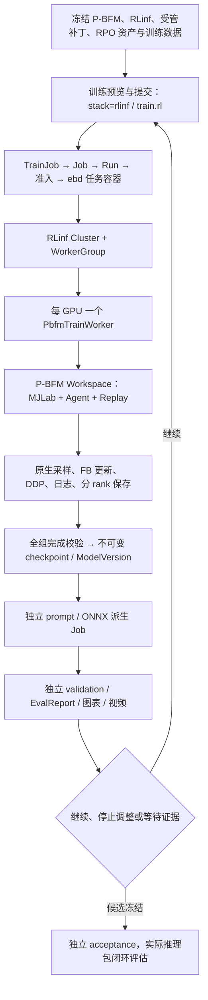

# 26 · P-BFM / RPO / RLinf 仿真训练接入设计

日期：2026-10-20（Asia/Shanghai）。

状态：**源码分析确认存在可行的接入路径；尚未实现、构建组合镜像或取得 P-BFM/RPO 运行证据。**

用户已明确首期范围：**RPO 在仿真中完成深度感知与地形运动训练，真机另设阶段；训练继续通过 RLinf，整体平台管线保持一致。** 本次交付设计，不启动训练，不提交 Git。以下新增标识、文件和协议均为实施目标，不表示已经存在。

遵循 [02 · 系统架构](02-system-architecture.md)、[04 · 模型与训练](04-model-training.md)、[05 · 评估与交付](05-evaluation-delivery.md)、[07 · 工作台与 API](07-workbench-api.md) 和 [12 · 环境目录](12-environment-catalog-and-selection.md)。复用 [25 · RLinf 承载 UFO 原生训练](25-ufo-native-training-integration.md) 的运行边界；P-BFM 的算法、观测、依赖和产物协议按本文单独定义，不改写既有 UFO、AMP、WBC、Flat 接口。

## 1. 结论与方案选择

**有条件可行，推荐“RLinf 基础 Worker 内运行 P-BFM 原生 Workspace”，并为 RPO 增加受管适配。** P-BFM 已有完整 FB-CPR-Aux 学习、深度编码、速度估计、分阶段 DDP、Replay、保存恢复和地形环境实现；平台已有实际承载 UFO 的 RLinf WorkerGroup 路径。这使接入不必重写训练算法或平台生命周期。

但它不是配置级接入：当前 P-BFM 显式只接受 G1，RPO 本体、相机、专家数据和评估都需要适配。现有公开 G1 能力不能推导 RPO 能力，现有 UFO 运行结果也不能作为 P-BFM 的运行证明。

| 方案 | 与要求的关系 | 决策 |
|---|---|---|
| RLinf 管理每个训练 rank；各 Worker 直接构建 P-BFM Workspace | 保留原生算法，同时使用真实 RLinf WorkerGroup、GPU 放置、RPC 和进程管理 | **首期采用** |
| 把 P-BFM 拆成 RLinf Env/Rollout/Actor worker，移植 Replay、loss、更新调度 | 可以做，但改动大，容易改变离策略采样、命令重标与多优化器语义 | 首期不采用；没有测得瓶颈前不做这项重构 |
| adapter 直接运行 P-BFM `torchrun`，或让单个 RLinf worker 启动外部训练 launcher | 能接入 Job，但训练 rank 并非由 RLinf 实际承载 | 不满足本任务约束 |

这里“通过 RLinf 训练”的可检查定义是：**每个 learner/environment rank 都是 RLinf WorkerGroup 的成员，在其进程内执行原生训练；有 PID、rank、GPU UUID、导入来源、更新与退出回执。** RLinf 不必成为 loss 的实现者，也不使用 PPO/SAC worker 包装成另一种算法。

首期保留 `fb_depth` 的 Actor、Forward/Backward、判别器 D、QD/QAux/QH/QV、target networks、normalizers、速度监督和更新顺序。网络按 RPO 的实际观测/动作空间构建，默认从零初始化。G1 权重、UFO 权重、已有任务 latent 均不作为可直接恢复的 P-BFM/RPO 状态；部分迁移如将来需要，单独定义 warm start 实验。

## 2. 分析基线与证据等级

| 对象 | 本次读取基线 | 证据边界 |
|---|---|---|
| P-BFM | `/data/kk/P-BFM`，HEAD `c6eacbdb49d6c050814b6f457bb0cb30a02a16ca`；检查时工作区干净 | 本文判断以这份本地代码为准 |
| RLinf | `/data/kk/RLinf`，HEAD `bcbef7370e70e9d17a70e38d1d3e3e60237dcc9c` | 读取基础 Worker、设备隔离和依赖声明，不修改源仓 |
| EmbodiedBein | HEAD `396eb1403cc0740d7876ed0094dc33606a8a8938`，存在大量已修改及未跟踪文件 | 尤其 UFO 训练实现不完全在该 HEAD 内；实施必须冻结实际内容，不能只记 commit |
| RPO 参考 | `contracts/ee_rpo_v2_ufo_native_23dof_v2.yaml`；`/data/kk/UFO/configs/robots/rpo_23dof.yaml` 及其 MJCF | 可作关节/动力学资料来源，不能直接当 P-BFM 契约 |
| 已有平台证据 | [UFO 接入执行记录](../progress/2026-10-18-ufo-native-training.md)、[UFO 100k 可视化评估](../progress/2026-10-20-ufo-native-100k-visual-eval.md) | 记录了 RLinf 承载、恢复与评估实践；本次未重新核验线上 Job，不移用其模型合格结论 |

P-BFM 官方说明描述的是 G1 的地形行为模型及其使用方式，可用于核对项目定位：[官方仓库](https://github.com/Roboparty/P-BFM)。其 README 声明保留 CC BY-NC 4.0，实施时须记录代码、机器人资产、动作数据、权重各自来源和许可；代码许可不能代替数据来源核验。

### 2.1 核心代码证据

下面 P-BFM 路径均相对于 `/data/kk/P-BFM/`。

| 路径/符号 | 已确认事实 | 接入含义 |
|---|---|---|
| `pbfm/train.py:build_ufo_mjlab_config`；`training/config.py:TrainConfig.build` | builder 返回配置，`build()` 构建 `Workspace` | 可以绕开原生 launcher，在 RLinf Worker 内直接调用 |
| `robots/training_spec.py:validate_g1_robot`、`resolve_robot_config_path` | 机器人名称及关节序列被限制为 G1 | 仅传入 `--robot-config rpo.yaml` 会被拒绝 |
| `train.py`、`configs/legacy_large.json` | builder 从归档 G1 配置开始，包含 robot metadata、Hydra overrides 和续训课程 | 必须覆盖完整 RPO 语义并检查最终生效配置 |
| `training/workspace.py:Workspace.train_online` | 环境、专家数据、命令 context、Replay、更新、内部评估与保存共置 | 保持原生循环，不拆成 PPO rollout |
| `agents/execution.py:enable_distributed_gradient_sync` | 原生按优化器阶段建立 DDP reducer，也有手动梯度平均路径 | 同步由 P-BFM 管理，不能再叠加 RLinf FSDP/DDP |
| `envs/mjlab/observations.py`、`agents/nn_models.py:DirectDepthActor` | Actor 使用本体感知、深度、heading/velocity command；速度真值仅用于训练监督 | 需要防止 simulator-only 输入进入部署 Actor |
| `agents/buffers/trajectory.py`、`training/checkpoint.py` | 显式后继、稀疏存储、深度时序重建、分 rank Replay、深度契约检查 | 不能套用 UFO 的 Replay loader 或仅登记 policy 权重 |
| `inference/runtime.py`、`inference/reward.py`、`inference/goal.py` | 推理也存在 G1 限制和 G1 默认资产/任务 | 训练能启动不等于推理/评估能接上 |
| `evaluation/terrain.py` | 楼梯诊断使用 G1 足尖/足跟偏移及关节名称 | RPO 必须派生自己的几何诊断，不能沿用 G1 量尺 |

## 3. 保持一致的端到端管线



职责不变：

- 控制面仅做模板、冻结、校验、准入、作业及血缘；不 import P-BFM/Torch/MJLab 执行训练。
- `ebd` 唯一持有 Docker 权限，负责快照、容器、资源、日志、大文件和媒体。训练任务不加入 Compose。
- RLinf 负责训练进程与资源放置；P-BFM 负责数值算法、环境、Replay 和原生训练状态。
- 外部 P-BFM、UFO、RLinf 及资产来源只读。新增补丁进入本仓 `deploy/patches/pbfm/`，在受管源码副本或镜像构建阶段应用，保存输入 SHA、补丁 hash、输出 manifest；不修改外部仓。
- 训练、数据转换、prompt 推导、导出与评估均使用现有 JobKind 和 Job/Run/Artifact 生命周期。平台 Agent 仍只能走 ToolBus。

建议新增标识：

| 类型 | 拟定标识与用途 |
|---|---|
| 本体 | 复用 `emb_roboparty_rpo` |
| 新接口 | `ee_rpo_v2_pbfm_depth_23dof_v1`；新建 draft，核实后发布 |
| 训练模板 | `rpo_pbfm_fb_depth_native`；`stack=rlinf`、`kind=native_rl`、`train.rl` |
| 任务 | `tsk_rpo_pbfm_terrain_locomotion_v1` |
| Profile | 分别创建训练、validation、acceptance Profile，不共用可变阈值 |
| 模型族 | `mf_rpo_pbfm_depth`；与 UFO、G1 权重严格区分 |
| 任务镜像 | `eb/rlinf-pbfm:rpo-depth-v1`；实际运行固定 digest |

这些 ID 只是接口设计，不要求为了文档立即创建数据库记录。能力在相应阶段才从 `discovered` 提升，不因模板出现而标为可训练或已验证。

## 4. RPO 适配：不能只替换 G1 名称

### 4.1 机器人配置与物理模型

复用现有 RPO 23 关节的明确顺序、MJCF、mesh、关节限位、质量/惯量、足部和 torso 语义作为来源；生成独立的 P-BFM robot package，并记录内容 hash。

需要补齐：

1. 把 G1 专属校验改成受控的机器人配置校验，至少分别验证 G1 与 RPO 的身份、显式关节序列、body/frame、执行器和资产 hash。保留未知机器人/缺项拒绝逻辑，不能通过删除所有校验放行。
2. P-BFM `RobotTrainingSpec` 要求 `training.hydra_robot`，而当前 UFO RPO YAML 使用 `task_overrides` 等结构。增加受管 RPO Hydra robot 配置，显式转换字段；不能原样复制 UFO YAML 或让 G1 默认值补缺。
3. 明确携带 `action_rescale`、normalize/clip、控制频率、motion extensions、obs scales、奖励 body 与踝关节名称。`to_env_dict`/Hydra patch 当前并不传递所有 UFO 字段，必须逐字段验证最终配置。
4. `training.actuator.source=yaml` 已有实现，可承载 RPO 的 effort/velocity/armature/friction；不得走 G1 mode-15 的电机参数分支。所有 23 关节都需参数，名称匹配必须唯一。
5. 当前 RPO MJCF 的 `meshdir` 指向外部绝对路径。导出 self-contained 受管资产包或严格只读映射并冻结全部 mesh；包括 include、collision 与材质依赖。P-BFM 环境会移除 XML actuators 再创建 MJLab actuators，必须验证实际控制顺序、限矩和延迟。
6. 保留原 RPO 400 Hz 物理、50 Hz policy、`dt=0.0025`、decimation=8 作为首期目标；P-BFM 自带 simulator 默认是 200 Hz/4，必须显式覆盖，并在 runtime 回执核对。
7. 地形重置验证 root clearance、foot penetration、躺卧初始化、参考姿态和越界处理。越界自动 reset 不是任务完成；跌倒恢复的允许条件与普通 locomotion 终止规则分开。

首期动作目标按 RPO 原生语义冻结：

```text
u = clip(a * 5, -5, 5)
gain[j] = 0.6 * effort_limit[j] / kp[j]
q_target[j] = q_default[j] + default_offset[j] + delayed(u)[j] * gain[j]
```

这里 `a` 是策略归一化输出，`u` 是归一化后裁剪命令，delay、offset 是配置明确启用时的运行状态。评估可固定随机化关闭，但 train/eval codec 的映射必须一致，PD 与限矩按 RPO 参数执行。此公式是接入目标，不是声称未修改 P-BFM 已使用它。

### 4.2 新观测契约

首期沿用四帧本体历史、50 Hz policy。若最终 RPO body 列表保持 24 个刚体且无虚拟扩展，特权状态由 `compute_humanoid_observations_max` 推得 `15×24−2=358`；必须由 runtime 实际空间与数值检查确认，不能按旧接口直接填入。

| 输入 | 预期 RPO 形状 | 语义与验证 |
|---|---:|---|
| `state` | 52 | 23 q 相对默认姿态、23 dq、3 重力方向、3 base angular velocity；使用最终 obs scales/noise |
| `last_action` | 23 | P-BFM 当前读 `self.actions`，即已归一化裁剪、但尚未经过 motor delay 的命令；不能误写成 applied action |
| `history_actor` | 300 | 四个过去时刻，按 term 排序、每项 newest-first；不含当前帧，部分 reset 不污染其他 env |
| `heading` | 2 | 原生零中心误差 `[valid*(1−cos(error)), valid*sin(error)]`，不是 yaw 标量或绝对 heading |
| `velocity_command` | 3 | 当前 yaw 坐标下 `[target_vx,target_vy,valid]`；`[0,0,1]` 是停止，`[0,0,0]` 是无指令 |
| `depth_image` | 8×18×32 | 环境/Replay 为 uint8；Actor 原生处理；ONNX 输入转换为 float32 [0,1] |
| `z` | 256 | 与当前模型 Backward encoder 绑定的行为 context，独立于机器人传感器观测 |
| `privileged_state` | 按 FK 推导，候选 358 | 身体状态；地形上 root height 使用 clearance，训练与专家参考转换需一致 |
| `terrain_priv` | 按冻结 ray grid 推导 | 仅训练端 F/critics 等已声明分支使用，不能提供给部署 Actor |
| `velocity_target_yaw` | 3 | 当前真实速度监督；必须与观测同一时刻，不能当 Actor 输入 |

Actor 标量输入为 `52+23+300+2+3=380`，另带深度与 z。速度估计器只读本体感知 375 维与深度 latent 256 维，因此 RPO 候选输入为 **631**，而 G1 为 721。这个 631 是**内部速度估计器输入**，与旧 UFO 的 `375+z256` ONNX Actor 输入语义完全不同，禁止按维度相同复用。

`DirectDepthActor` 从空间动态推导维度，因此不需要重写网络；但 G1 权重不能直接整包加载。P-BFM 默认角速度 scale 为 0.25，必须保留并写入新 codec，不能直接使用旧 UFO 编码器。特权分支、Backward 输入与四组 critics 不应压成一个未经定义的 `critic_dim`。

平台 `Observation` 已支持 `modalities` 和 `concat=false`，优先使用现有 schema 表达 380 维标量与 depth modality；history 标为已展开。命令、z、输入顺序、尺度、normalizer 与训练端字典布局由版本化 codec manifest 补全。只有真实字段无法表达且有调用者需要时才扩现有 schema，不伪造一条大向量兼容旧接口。

### 4.3 深度相机是机器人接口的一部分

保留 P-BFM `optical_z_maxcrop18_reset_v2`：36×64 光学深度 → Crop18 输出 18×32；历史 ages 为 `[35,30,25,20,15,10,5,0]`，50 Hz 时跨度 0.7 秒；最大距离/无效值 2.5 m、一次 uint8 量化、ONNX 端只做一次 `/255`。同时冻结 optical top-down 图像约定、滤波、延迟、reset 填充与安装误差分布。

RPO 需要自己的仿真相机外参，不继承 G1 `torso_link` 下约 0.438 m 高的安装偏移。首期可选择符合 RPO 几何的虚拟安装位，但必须经过静态与运动姿态检查并发布为 `simulation_only`，不是宣称真机已有该相机。

相机清单包含：mount body、坐标/四元数顺序、位置与朝向、FOV、near/far、geom groups、自遮挡、采样周期、安装随机化、时延及失帧规则。检查平地、坡面、台阶正反方向、身体遮挡与无回波画面；同时记录 metric depth、网络实际输入和相机姿态用于诊断。数据契约 hash 必须包括实际外参和相机设置；原生 checkpoint 的 depth contract 没覆盖全部安装/环境语义，平台要补齐。

历史和训练时序必须来自真实传感器帧；不能以 terrain height map 冒充 depth，也不能以全零图像声称深度感知完成。privileged height map 可以保留在原算法训练分支，但与 Actor 感知证据分开。

## 5. 动作数据、行为先验与初始化

P-BFM 是离策略 FB 学习加行为先验，不能把“无监督 RL”理解为不需要动作数据。推荐首期复用已有 RPO 动作来源，派生新的 **P-BFM/RPO DatasetVersion**，在目标 runtime 中重新验收。

1. 原始记录先按 episode/take/session/subject 或可追溯祖先分组，再划分 train/validation/acceptance。切窗、镜像、重定向副本不能跨 split；地形生成 seed/layout 也独立划分。
2. 首选已具备 root pose、关节名、q、fps 和 RPO 身份的 RobotState；使用 P-BFM `motion/data/robot_state_convert.py` 及实际 RobotSpec 生成 MotionLib 输入。若复用现有 UFO RPO PKL，也要逐项核对身体列表、关节轴、单位、坐标、root、fps、FK 和速度，生成新的 loader receipt。
3. P-BFM 的 `root_trans_offset[T,3] / pose_aa[T,J,3] / fps` 基础校验既不重定向骨架，也不足以证明 RPO 兼容。`J` 是 body 数，不是简单等于 DOF；校验有限值、长度、限位、关节顺序、脚接触/足滑和 reference→FK 一致性。
4. G1 LaFAN 29DOF 不能删除六列后充当 RPO 23DOF。若采用人类 LaFAN 原始动作，应经现有重定向路线转成 RPO，再记录重定向/筛选质量；本接入不另造通用重定向系统。
5. 现有 UFO 进度曾记录 official 动作祖先/许可未完全明确。可在标注限制的训练研究中复用合适来源，不能因此宣称独立泛化 acceptance；不清楚的祖先不能进入“确认未见”的 holdout。
6. 训练容器只挂载训练 split 与所需资产，不挂 validation/acceptance。原生内部 tracking 会修改专家采样优先级，只能看训练数据；独立评估不得反馈采样器。
7. expert/FK 缓存 key 绑定数据内容、robot/body/asset、观测构造与代码 hash。缓存写到受管目录，不写源仓、已发布 DatasetVersion 或共享用户 HOME。

首期固定 `prior_plane_envs=0`，与当前 `fb_depth` 模板一致；行为先验仍开启，不能把该值解释成关闭 D/专家先验。代码虽然存在独立 plane collector，**当前 QV v1 会在 update 中拒绝 dedicated prior Replay**；因此预览阶段就禁止 `prior_plane_envs>0`，不能把它当作可随意调节的扩容参数。另行研究原生消融时才讨论该拓扑及其采样/恢复语义。

训练无需额外地形专属动作演示的架构前提可以保留；但 RPO 的数据覆盖、站稳与越障能力仍须实测。第一版从零训练，已有 UFO 模型仅作匹配条件下的参考基线。

## 6. RLinf Worker 与组合运行时

### 6.1 最小 Worker 边界

新增 `PbfmTrainWorker(rlinf.scheduler.Worker)`，实现与现有 UFO 路径相同用途的 runtime 身份检查和有界 `run_segment`：

1. RLinf `Cluster` + `PackedPlacementStrategy` 创建已租用的 W 个隔离 GPU workers，一卡一 rank。
2. Worker 使用全局 `RANK/WORLD_SIZE`，局部 CUDA device 固定为其可见的 `cuda:0`。`isolate_gpu=True` 时 `LOCAL_RANK=0` 不代表所有 worker 都是全局 rank 0。
3. 校验 GPU UUID 唯一、CUDA/EGL 映射、实际 P-BFM/RLinf 导入路径；在导入重型框架前配置可写缓存与只读源码。
4. 建立唯一训练 NCCL process group，所有 ranks 同时进入训练调用。禁止调用会重设 EGL 的 P-BFM `_select_device_and_rank`、`run_train`/`launch` 或嵌套 torchrun。
5. 调用原生 builder，应用冻结的 RPO/scratch 配置，`cfg.build()` → `Workspace.train()`。全局 base seed 与原生 rank seed 偏移显式记录。
6. `gradient_sync=auto` 在 W>1 时使用 P-BFM 原生阶段 DDP；单卡保留原生行为。禁止同时启用手动平均与 DDP，保持 FB loss 的 rank-local 定义，不承诺 world size 改变后学习等价。
7. 只回传计数、状态和产物索引，不把 Replay、图像或大模型张量搬进 Ray object store。

优先复用现有 `rlinf_ufo_entry.py`/`worker.py` 中已验证的放置、隔离、超时和回执边界。它们硬编码 UFO import、375/358 空间、五优化器证据和 Replay loader，不能改包名后直接用。只抽取确实共同的 runtime helpers；P-BFM 配置、算法状态、数据和 codec 校验保持专属。

### 6.2 依赖隔离

| 项目 | 当前声明/实现 | 设计决定 |
|---|---|---|
| P-BFM | Python 3.10，Torch ≥2.7,<2.8，MJLab 1.4.0，MuJoCo ~3.8.0，W&B ≥0.26.0 | 首先保留这组数值依赖，解析成精确 lock |
| 当前 UFO 训练镜像 | MJLab 1.6.0、MuJoCo 3.11.0、Torch 2.7.1+cu128 | 不能直接作为 P-BFM 的已兼容运行环境 |
| RLinf 完整项目 | W&B <0.25.1，默认 uv Torch override 2.11.0 | 与 P-BFM 默认安装冲突；继续采用最小 scheduler 依赖 Profile |
| P-BFM rollout | 代码拒绝 Gymnasium <1.0，而声明允许 ≥0.29 | lock 必须满足实际路径，不能只以依赖解析成功为准 |

新镜像固定 Python/Torch/CUDA/NCCL/MJLab/MuJoCo/Warp/Ray/Gymnasium/NumPy/HDF5/ONNXRuntime 及其来源，保留构建回执、`pip check`、导入 probe。不能通过先后覆盖包或机械复制 UFO 的元数据补丁解决冲突；如确需 packaging 补丁，应记录具体差异和验证依据。

原生模板里历史 `/home/xue/...` 路径必须全部重定位；`config_path`、Hydra、mesh、数据、checkpoint/export 的来源引用在任务容器内均可解析。运行时禁用 W&B 外连，缓存与日志写入本 Run。镜像通过 `make images` 的专属目标构建，平台服务更新仍走 `make up`。

### 6.3 Ray 生命周期与失败

单任务容器拥有专属 Ray；拒绝外部 `RAY_ADDRESS` 和共享发现目录。现有 UFO 已有 `network=none + hostname=localhost` 的记录，可作为候选配置，但 P-BFM 组合镜像必须重测 reset、真实深度、EGL/NCCL、进程退出和网络隔离。

所有 CPU/RAM/shm/磁盘都进入 JobSpec 预算；Ray object store 不按宿主总内存无限增长。超时分启动、通信、训练段、保存与总 Job；保存大 Replay 的正常耗时不能被过短的通信超时误杀。

任何 rank 失败、OOM、NCCL 超时或取消都使本段失败/取消；有界终止本 Job 所有 ranks 和 Ray，不连接或清理其他任务。取消走平台 API，不假设 SIGTERM 自动保存。成功 receipt 只能在全部 rank、保存验证、证据生成和正常清理成功后发布；失败保留最后已发布完整版本与故障日志。

## 7. 更新计数、分阶段训练和地形课程

### 7.1 训练 step 的唯一含义

本方案训练阶段的 step 使用 P-BFM `_optimizer_steps`：每次完整 `agent.update` 成功返回后加 1，称 **agent 联合更新数**。一次 update 内有多个 optimizer，不能把各 Adam 的 step 相加；也不能把 W 个 rank 的联合更新计数相加。RLinf 的一次 RPC 是整段，不能称为一个训练 step。

同时记录 `local_time`、`global_time`、本段采样增量、各优化器真实更新数、E、W、local/global batch、Replay 占用与重用率。P-BFM 默认 E=1024、`num_seed_steps=10240`（local）、`update_agent_every=1024`、每轮 16 次 agent 更新、batch=1024/rank；global main transitions = local_time × W。

原生日志在一次采样/更新后仍使用该轮起点的 `global_time`，checkpoint 使用保存边界计数。平台保留原始轴并注明这个相位差；进度与阶段放行以 checkpoint/全 rank 回执的联合更新数为准，不用 CSV 最后一行猜终点。

保持原生 16 次一组时，平台默认阶段采用向上对齐：

| 档位 | 实际累计目标 | 判据 |
|---|---:|---|
| 100-step 流程档 | 112 | 真更新、无 NaN/OOM、完整保存/恢复、独立快评与可访问媒体；此时不要求已经会走 |
| 500/1000-step 趋势档 | 512 或 1008 | 相同冻结 validation 的指标支持改善；证据不足就停在此档 |
| 5000–10000-step 正式档 | 5008 或 10000 | 趋势已改善、资源/预算充足、周期快评与恢复已验证 |

默认流程段末在 112 快评；趋势档以不超过 256 次新增更新为区间，正式档以不超过 1008 次为区间，所有端点按 16 对齐，末段不足间隔也评估。提交前列出实际端点清单和预算。阶段目标与快评间隔分别冻结；不能直接无条件串联至 10000。

E=1024、冷启动、原生 seed/更新条件不变时，首次更新发生于 local_time=11264 的采样轮，112 次更新的结束点为 local_time=18432、global_time=18432×W。恢复 checker 会从源 local_time 重新起算，不能简单按冷启动公式减去已完成量。改变 E、更新间隔、Replay warmup 后必须从实际循环推导并测试端点；现有 UFO `segment_endpoint` 的可选 E 与公式不能无条件复用。

原生 `--smoke` 会修改 warmup、每轮更新数、Replay 大小并关闭评估/Replay 保存；它只用于依赖探测，不能替代以上流程档。

### 7.2 地形课程不能沿用归档续训时钟

`legacy_large.json` 的结束目标为 384040960 global transitions，课程起点为 192020480，间隔为 19200000。`scripts/train_legacy_scratch.py` 才把起点设为 0、目标改为 192020480。RLinf 不调用该 launcher，因此 builder 后必须显式应用等价的 scratch 起点并记录 `start_mode`。

即使起点为 0，112→10000 次更新也通常远小于原始 192M 环境预算。以 E=1024、W=4、每轮16更新估算，10000 次更新约 260万主环境 transitions，未达到默认第一档 1920万课程间隔；**跑满10000不等于完成全部地形难度课程**。

首期安排：

- 保留七类 `training_mix`（flat、perlin rough、两类 stairs、low platforms、inverted slope、boxes），允许在低难度上验证深度训练和地形泛化。
- scratch 从 0 开始，课程由 global transitions 驱动，按原生 reset-only 规则应用；恢复不重置时钟。每段记录最大允许 level 与实际采样 level/family。
- 初期保留原生间隔作为保守基线；若目标预算不足以覆盖所需难度，先报告范围限制。要缩短间隔或修改 RPO 的物理高度、坡度、摩擦、台阶深度，必须派生并冻结新 recipe/Profile，说明与原版差异，再做趋势验证。
- 课程时钟只控制训练采样，独立评估按预先冻结的难度运行；不能用 curriculum 上限替代实际通过证据。正式 acceptance 只声明实际覆盖且通过的难度范围。

原生推荐八卡和约 1.92 亿环境步是 G1 recipe 背景，不是当前四卡 RPO 的训练时长/效果承诺。超过默认阶段的更大预算需要在趋势证据基础上另行确定。

## 8. GPU、Replay 和吞吐

按当前平台 4×24 GiB 的设计边界规划，但实际空闲卡、其他作业和资源由实施时 Doctor/准入核实。首期候选拓扑为 W=1/2/4；只能对取得证据的拓扑开放训练，DDP 不分摊单卡模型/Replay。

不能套用 UFO 的“每 transition 两份完整 float 观测”估算：P-BFM 已使用 `explicit_next=true`、`sparse_next=true` 和 compact depth。普通后继共享下一 collector row，reset 边界及最新后继单独保存；每行存一张 uint8 深度，采样时重建八帧。无论节约多少，边界密度、batch reconstruction 和写盘峰值都必须计入。

单卡预算至少包含：

```text
模型 + target networks + gradients + Adam states
+ 主 Replay（本体状态/privileged/terrain/命令/qpos/qvel/latent/flags/单深度帧）
+ 稀疏后继与reset边界 + 采样重建的八帧/next batch
+ 专家/FK缓存 + MJLab/Warp/相机 + DDP buckets
+ 保存CPU副本及HDF5 staging + EGL/视频所需余量
```

原生每 rank 512万 transitions，仅一张 18×32 uint8 深度就约 **2.75 GiB**；这不是总 Replay 或总显存。不能用“四卡96 GB”判断能否装入一份完整 rank，也不能用小 Replay 的短测推断满容量安全。

实施先做有界组合 probe，记录加载、update、深度采样、Replay 逼近计划容量、checkpoint 与渲染各阶段峰值，再冻结 E/B/C/W。必要时缩小 Replay/环境数，但显式记录 `C/E` 时间长度、数据留存、local/global batch、LR 与更新/采样比；不为了 GPU 利用率盲目扩环境或缩网络。

比较 transitions/s、agent updates/s、评估 cases/s、区间墙钟和任务指标。优先优化已测得瓶颈；四卡性能差可选择较小训练拓扑，把其余空闲资源用于获准独立评估。训练与评估重叠时分别准入，否则分段结束并释放资源后评估。

## 9. Checkpoint、恢复与不可变发布

原生 checkpoint 包括 agent/config、init kwargs、model/target/normalizer state、optimizers、train_status，以及 train/prior Replay（启用时）。多卡目录按 `train_rank_<r>` / `prior_rank_<r>`，单卡路径为 `train` / `prior`；不能照搬 UFO loader 的类名/路径假设。

必需规则：

1. `checkpoint_buffer=true`；W>1 时所有 rank 保存。当前 recipe 只接受 main Replay；启用 dedicated prior 的配置/状态拒绝进入该 recipe，原生能序列化 prior 不代表 QV 支持它。
2. 只允许原生 `load_for_training` 可消费的 Replay；旧 `explicit_next` 缺失格式不可通过篡改 metadata 强行兼容。稀疏边界、最新后继、深度重建状态和 qpos/qvel 必须完整保存。保留真实 reset 前的 successor，区分 terminated 与 truncated；原生主分支 discount 使用 terminated，不能由桥接层把 timeout、评估引起的截断和物理终止统一成一种 done。
3. model 权重文件已有临时写后替换，但整个 checkpoint 的 optimizer/Replay/status 不是一个原子事务。原生训练目录仅是 writable staging，不能直接发布；所有 rank 完成、原生回读、计数与 hash 核对后，生成独立不可变 snapshot 和原子完成 manifest。
4. 完成 manifest 绑定 source Run、更新数/环境步、全文件大小/hash、全 rank、接口/数据/相机/地形/源码/补丁/镜像/训练配置与恢复模式。下一次保存不能覆盖已发布版本或删掉最后完整版本。
5. 原生 agent load 使用 `strict=False` 加载 model state，平台需额外核对完整 key/shape、target/normalizer、所有应有 optimizer 及非有限值；不能只凭 loader 没抛异常认定完整。
6. 源 checkpoint 只读挂载；恢复到新 Run 的独立 staging。保持 world size、E、Replay 布局/容量、batch、模型、robot、相机、数据、recipe 一致，正常续训只允许增加目标与名称。原生从 checkpoint 加载 agent config，必须检查实际生效值，不能让 UI 参数与恢复结果分离。

首期明确使用专属模式 `pbfm_native_state`：恢复原生模型/优化器/Replay/计数，**环境、RNG、命令上下文、专家动态优先级及课程采样现场不承诺精确延续**。原生恢复会结束存储中的 episode 并 reset 环境；不标 `exact`，也不借用要求 RNG 完整的通用 `trainer_state` 标签。

缺 Replay 或改变拓扑/数据/相机的输入默认拒绝正常续训。若以后支持模型权重初始化，标 `warm_start`，新实验重新计数并执行明确采样 warmup；不能悄悄降级后仍称同一实验继续。原生 model-only recovery 参数与平台 warm start 的语义要分开。

训练暂不承诺运行中 pause/resume。采用“正常段末保存 → 全组退出 → 发布 → 独立快评 → 决策 → 派生 Run 恢复”；恢复未验证前不进入长期训练。

## 10. Prompt、导出和独立评估

### 10.1 首期能力范围

首期覆盖 RPO 参考动作 tracking 与 heading/velocity 条件化的地形 locomotion；站立与平地前行是回归项，地形通过是核心出口。奖励 prompt 仅在 RPO relabel body/sensor/任务函数已适配并验证后开放。G1 goal frame 预设、任意全身技能和真机均不纳入首期合格声明。

新权重的 z 由对应 Backward encoder 重新推导，绑定模型 hash、参考动作/Replay、算法与采样配置。不能复用旧 UFO/G1 latent，也不能把“给了目标速度”当作完整任务 prompt。tracking 使用原生对齐的参考窗口及 heading/velocity validity；reward/goal z 不自动携带参考速度指令。

prompt 推导和导出使用独立派生 Job，仅向 staging 写。原生推理脚本可能向 model folder 写文件，必须让它操作派生目录，不能写已发布模型。数据派生继续复用受控 `data.convert` operation，具体输入和输出回执版本化。

### 10.2 完整推理包

使用 `pbfm/inference/export/depth_policy.py` 的完整 policy ONNX：包括 observation normalization、depth CNN/GRU、current-velocity estimator 与 Actor；Backward 单独导出或预计算 prompt。不能调用 UFO actor-only exporter 后宣称已导出 P-BFM。

包中必须包含 robot/asset、动作/history/depth codec、输入名/shape、normalizer、context/任务定义、相机与地形 Profile、来源和许可证。推理包不含全量 Replay/optimizer，恢复 Artifact 独立保留。

测试除了 ONNX 输出数值，还要覆盖 uint8/float 输入只归一化一次、无指令/有效停止/移动命令、history reset、实际动作→PD target、一段真实 RPO 深度 trace 的输出一致性。默认原生 ONNX 误差检查可作为数值基线，容差在验证前固定。

### 10.3 评估矩阵与成功函数

训练内 tracking / same-z terrain 只是训练反馈。周期 validation 和最终 acceptance 都由独立 `eval.sim` Job 执行，冻结模型/推理包、prompt、case/seed、地形布局、reset、DR、预算、阈值及成功函数 hash。

| 测试组 | 必须证明的内容 |
|---|---|
| 平地回归 | 站立、有效停止、0.3 m/s 直行；与已有 RPO 基线匹配输入和判据后再比较 |
| 七类地形 | 按 family、难度与方向分组的路线通过、进度、跌倒、姿态、足滑/碰撞、越限和超时 |
| 跟踪 | body/joint tracking 误差与真实物理存活/行进；不能只有 EMD 或 reward |
| 感知有效性 | 保存真实 depth 输入；同 case/seed 做正常深度与固定遮挡/延迟诊断对照，检查策略和任务结果变化 |
| 时序/边界 | 停止/移动切换、heading变化、auto-reset、深度历史清理、失帧、tile边界 |
| 导出一致性 | 同一冻结场景下 PyTorch 与实际 ONNX 包的动作和闭环表现 |

地形成功要求达到预设目标区域/通过路径，且无禁止接触、越限或跌倒；只站在出生平台存活不算爬楼梯。额外记录出生区与通过区、signed progress、真实高度变化、足底接触来源、足尖净空和 action/torque saturation。G1 足尖/足跟常数和诊断关节列表必须替换成 RPO 几何。

`low_stairs_down` 从中心向外可能实际是上楼；case 的上/下坡标签依据几何与运动方向生成，不能直接按 family 名解释。越过整个 terrain grid 的 boundary reset 按 Suite 的失败/无效定义处理，不能被算成一次新的成功 episode。

建议流程快评采用七类低难度 × 两个固定 seed 的 14 个 locomotion case，另加两个平地站立/停止 case；每例最多20秒并全部录像。具体参考动作/命令、距离、阈值和可行路径在首个训练 Job 前用 RPO 几何检查冻结，不能先观察候选表现再调整。高难度、感知干扰、重复次数与 acceptance 样本预算另行冻结，不把这16例当统计充分的正式验收。

趋势主指标使用路线完成率及未完成 case 的归一化进度，辅助看速度误差、跌倒、越限、足滑和 tracking。建议连续两个决策区间无改善则停止调整；0成功但进度改善只能在预先限定的热身窗口内继续。NaN/Inf、契约失配、资源越界直接停止；case/媒体缺失或 infra failure 则等待证据。具体退化容差在训练前与 Suite 一起固定。

最终候选在 validation 上选定后只运行独立 acceptance，不能看 acceptance 再挑另一个模型。成功率报告分母、分组和置信区间；小样本只作诊断。MuJoCo/MJLab 双后端可作为后续仿真一致性检查，但同属 MuJoCo 系，不能宣称独立物理引擎泛化或真机验证完成。首期如未实现第二后端，则明确未覆盖部署级 sim2sim。

## 11. 指标、图表与媒体

沿用 ebd/Rust 大字节采集与工作台展示。优先复用现有 UFO CSV collector，但单独验证 P-BFM 列表和文件协议；CSV 动态表头、文件替换、重复扫描、尾行半写、非数值列和累计/增量 step 都必须正确处理。

训练保存原始 CSV、有效配置、指标字典和时序分析，至少包含：

- FB/orthogonality、D、各 Q、Actor、aux normalizer 与 velocity estimator 指标；保留原生名称/聚合，不合成一个“总 loss”推断模型质量。
- 各优化器真实 step、每段参数变化/有限性、跨 rank 同步、local/global samples、有效 batch、Replay 留存。
- 地形 family/level 实际分布、reset/fall/boundary、深度无效比例、命令有效比例及感知延迟。
- 采样/更新/保存/内评/独立评估墙钟与 GPU/RAM/shm/磁盘峰值。缺少的观测点只补只读 instrumentation，不重算或重写原生 loss。

每个独立 EvalReport 保留 plan、planned/completed/valid/invalid/infra_failed/cancelled 数量、逐 case 原始指标和失败原因、趋势/分组图，以及可访问的成功和失败视频索引。未出现某类别如实注明，不补造。缺失、损坏或不可映射视频标 incomplete，不能删掉不利 case。

录像至少包括机器人与地形；感知诊断提供带相同 case/时间戳的真实网络深度输入。动作参考可视化与模型物理 rollout 清楚标识。验证文件完整性、可解码、HTTP/鉴权及 Range 访问；录制本身影响吞吐时单独报告。

## 12. 平台最小改动清单

下表是现有代码中的接线点，不要求复制一套 UFO 业务服务。

| 位置 | 必要工作 |
|---|---|
| `contracts/`；`backend/eb/bootstrap.py` 及本体注册 | 新 P-BFM/RPO 接口、任务与能力；保留旧接口不变 |
| `backend/eb/domain/rlinf_form.py`、`environment_catalog.py` | 新 `native_rl` recipe、用途分开的 Profile、受控参数和能力状态 |
| `backend/eb/api/routes_train.py` | 当前多个 `kind=native_rl` 分支直接调用 UFO；改为按已注册 recipe 选择解析/恢复服务，预览与提交共用校验 |
| `backend/eb/adapters/rlinf.py`、`adapters/__init__.py`、`orchestrator/service.py` | 明确分发、来源冻结、只读挂载、资源、幂等、取消及恢复租约；不能误入 UFO 部署或普通 PPO 分支 |
| `backend/eb/runners/rlinf_pbfm_{entry,worker,runtime}.py`（拟新增） | 最小 RLinf 承载边界、P-BFM config、来源/设备/空间检查、分段和回执 |
| `deploy/patches/pbfm/`（拟新增） | 有范围且失败即停的 RPO robot/Hydra、推理/评估语义适配；不重写 agent loss |
| `deploy/images/`、`Makefile` | 专属镜像、scheduler Profile、依赖锁/来源与 probe |
| `backend/eb/checkpoints.py`、`orchestrator/collect.py` | P-BFM checkpoint/schema、model family、native_state、回读/发布；现有 UFO 模板特判需完整覆盖 |
| 数据/模型来源与能力注册；`adapters/data_convert.py` | RPO/P-BFM DatasetVersion、prompt/export operation 与 loader/receipt；仅在支持外部权重导入时增加来源入口 |
| `rust/crates/eb-runner/`、`eb-collector/`、`ebd/` | 核对 P-BFM 源码与资产快照白名单、CSV/大产物/媒体；已支持的通用机制直接复用 |
| `routes_eval.py` 及现有 RPO 评估分发/runner | 新 suite/codec、场景/感知证据与模型族校验；拒绝把新包当 UFO 包 |
| `frontend/src/views/TrainNew.vue`、`TrainJobDetail.vue`、`ModelDetail.vue` 等 | 模板可用状态、真实更新/采样、深度与课程配置、恢复能力、评估/媒体入口；移除错误的 UFO 专属展示假设 |
| `backend/tests/`、前端测试 | 见下节最小行为集合；既有 UFO 路线回归 |

若 schema 只新增 recipe 与元数据值，无需为算法新建 JobKind/表；确有枚举或持久字段变化再做相应迁移。控制面仍 Python 3.11，任务 runtime Python 3.10；不要让新入口 import 只在3.11可用的控制面代码。

## 13. 实施顺序、验收门槛与停止条件

| 阶段 | 交付 | 退出条件 |
|---|---|---|
| A：静态与输入适配 | 冻结源/patch、RPO 资产与新 robot/Hydra、深度契约、数据转换与 split | G1 限制改为受控多机器人校验；RPO loader/FK/空间/动作/相机一致，来源缺口清楚 |
| B：组合 runtime | 专属镜像和真实 RLinf workers | 实际导入、GPU/EGL/NCCL、RPO reset/step、深度画面、G1 回归、整组失败退出通过 |
| C：平台完整链路 | recipe/preview/submit、Job/Run、日志、checkpoint/模型、独立评估与媒体 | 112 次真实联合更新、全 rank 保存回读、派生恢复、真实视频齐全；不要求质量已合格 |
| D：趋势 | 累计512或1008，固定区间 validation、曲线与决策 | 任务进度/质量有可解释改善，无硬停止项；否则调整输入/配置，不直接长训 |
| E：正式仿真训练 | 累计5008或10000，必要时另行确定更大预算 | 各段证据及继续结论完整；明确实际课程覆盖 |
| F：独立验收 | 冻结候选、prompt、实际ONNX包与独立Suite | 质量与证据分别满足冻结标准；通过才提升对应仿真能力 |

阶段A/B的失败不意味着数学上不可行，但在解决前不能开放训练模板。24 GiB 无法承载计划配置、RPO 动作质量不足或模型没有趋势改善时，必须据证据调整并派生配置；不得把流程成功包装成模型合格。

最小验证集合：

1. 契约/数据：23关节与资产失配拒绝，G1仍可用；RobotState→MotionLib→FK；错误根坐标/四元数、NaN、错误body数、train/holdout祖先重叠。
2. 深度/动作：RPO零命令/单关节/PD target，噪声与缩放、delay前后命令、history顺序、partial reset；depth crop/方向/时序/归一化与privileged隔离。复用并扩展 P-BFM 原有相关测试。
3. 更新：用相同冻结输入/seed/拓扑比较原生入口和RLinf入口的有效配置、更新顺序、参数变化与数值容差；至少覆盖FB、D、四Q、Actor/速度监督对应优化器，不复制UFO“五Adam”检查。
4. 分布式/容量：1卡及计划使用的2/4卡真实更新、设备唯一性与同步；完整计划Replay容量、深度/保存峰值；单rank失败、OOM/NCCL/超时/取消后全组回收。
5. 恢复：正常段末回读与首个更新、单卡/多卡不同路径、缺train shard、不受支持的dedicated prior状态、缺target/optimizer、半写/内容hash错误、depth外参/数据/world size失配；源Run不变且不悄悄从头。
6. 平台：preview/submit hash一致、重复提交/收集幂等、native_rl按recipe分发、Python版本隔离、无源码写入/出网、失败不发布、CSV和模型/评估血缘。
7. 评估：G1足部常数不进入RPO成功函数，地形上下方向、站在平台不算通过、边界reset、正常/遮挡感知对照、ONNX实包闭环；报告与视频缺失必须降为incomplete。

适用测试必须在容器执行。已有测试文件存在不等于其已运行通过；本次设计工作未运行这些算法或平台测试。

## 14. 多轮反思与遗漏修正

以下为本次静态复核记录；按证据改变方案，不把自查轮数当运行验收。

| 轮次 | 反问 | 发现与处理 |
|---|---|---|
| 1：架构/算法 | 是把“P-BFM模型”放进PPO就能训练吗？ | P-BFM持有完整FB/D/多Q/Replay/context更新；选择RLinf基础Worker承载Workspace，保留loss与更新所有权 |
| 2：本体/配置 | 仓库有RobotSpec就代表RPO可用吗？ | 训练和推理显式只支持G1；UFO YAML还缺P-BFM要求的Hydra结构，补受管robot/Hydra与全字段核对 |
| 3：动作/感知 | 23DOF、375或631维相同就兼容吗？ | pre-delay命令、角速度0.25、heading/velocity、速度估计器631均与旧codec不同；新增契约，拒绝维度冒充语义 |
| 4：物理/评估 | 换MJCF后，camera和楼梯指标会自动正确吗？ | G1外参、足尖/足跟和诊断关节存在硬编码；RPO资产、相机、success函数全部绑定版本 |
| 5：训练/资源 | 原生八卡、192M、10000steps能直接对应当前阶段吗？ | 分清联合更新与global transitions；scratch课程起点、日志相位、恢复checker、DDP/batch和Replay峰值均单独处理；最终复查发现QV拒绝dedicated prior，补预览拒绝规则 |
| 6：恢复/失败 | checkpoint存在，是否就能完整恢复？ | 全包非原子、strict=False、rank Replay/depth元数据和RNG/环境缺项；补全组回读/完成manifest，明确native_state非exact |
| 7：数据/泛化 | 有RPO PKL或G1 LaFAN能否直接证明训练数据足够？ | 基础schema不验证骨架；祖先未知限制holdout结论；重新验证FK、来源、split与缓存血缘 |
| 8：交付/可视化 | 有reward、ONNX或视频就算接入完成吗？ | 独立prompt/部署包/地形通过/感知对照/逐case与媒体完整性缺一不可；训练内评估不替代acceptance |

综合复核后，没有发现必须替换 RLinf 或重写 P-BFM 算法才能接入的结构性障碍；已经发现的阻塞点集中在 **RPO 语义移植、深度/地形接口、依赖组合、完整恢复与独立证据**。这些有明确实施路径，但其效果、成本和容量须后续实验确认。

## 15. 后续实施前需固定的输入

首期仿真范围和RLinf承载方向已经确认，不再作为待选项。以下运行决策不阻碍本文交付，但必须在相应Job前确定：

| 项目 | 建议 | 需要补的具体信息/证据 |
|---|---|---|
| 数据 | 从可追溯RPO动作派生P-BFM版本 | 实际DatasetVersion、来源/许可、祖先隔离、覆盖与loader报告 |
| 相机 | RPO torso上的仿真虚拟深度相机 | 具体安装位/FOV/遮挡图与坐标验证；不需要首期已有真机相机 |
| 任务与难度 | 低难度七类地形＋平地回归，原生FB训练 | 参考动作/命令、RPO可行路线、Suite阈值、最终要声明的地形范围 |
| 资源预算 | 实测后选择1/2/4卡及Replay/E/B | 可用GPU、CPU/RAM/shm/磁盘、总墙钟上限、评估/录像预算与调整轮数 |
| 扩大课程 | 先保留原生scratch课程语义 | 若预算不足，选择降低声明范围、派生课程或另行扩大预算；不能自动压缩课程 |
| 验收 | validation选候选，acceptance独立 | 正式case数、置信要求和通过阈值在候选结果出现前冻结 |

## 16. 本次交付与可复查摘要

本次完成：外部仓和工作区只读检查；P-BFM builder→Workspace→Agent/DDP/Replay/checkpoint、RPO配置/动作/深度、RLinf Worker与平台分发、推理导出/评估路径分析；上述八轮静态复核；新增本设计及设计索引。

本次未做：实现补丁、运行数据内容验收、构建镜像、运行测试/训练、GPU容量或吞吐测量、线上作业/数据库变更、模型合格或真机声明、Git提交。现有工作区改动保留。

以下SHA-256定位本次P-BFM分析内容；后续执行仍需完整source/patch/asset manifest：

| `/data/kk/P-BFM/` 下的文件 | SHA-256 |
|---|---|
| `pbfm/train.py` | `1b1421060eceba4a06ad98cb32946c2e0936331912d6ef1d9d2f046baaaa5e9e` |
| `pbfm/training/workspace.py` | `ec413c1961056cd53e9c4e58446d78dac307c0f46d958301e5dc3b8b1ec8e1ea` |
| `pbfm/robots/training_spec.py` | `c82e832e98823b497937d37ad60bd3c84acf434cb0034915948a6fde8f3c3472` |
| `pbfm/configs/legacy_large.json` | `69d47005588d6031935bf16ab683be3f6dccde863db86e048737807d91d1e62e` |
| `pbfm/configs/depth_contract.json` | `ea6c9ebd23ffb08080bad1112498451912c36a67daa7b17639ef38a8a593d1c5` |
| `pyproject.toml` | `aad4368e92c830fe7c6e89bd77cc1594fae2a399fc355935cde96cf31792d7c5` |
