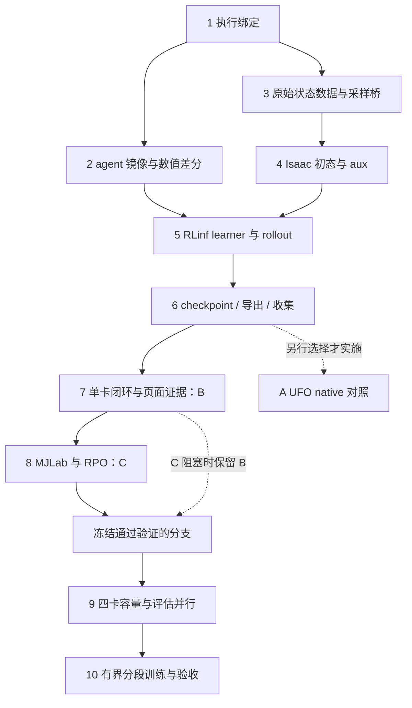

# UFO → RLinf → RPO BFM-Zero Implementation Plan

> **For agentic workers:** REQUIRED SUB-SKILL: Use superpowers:subagent-driven-development (recommended) or superpowers:executing-plans to implement this plan task-by-task. Steps use checkbox (`- [ ]`) syntax for tracking.

**Goal:** 让 RLinf 真正调用 UFO 原生 BFM agent，在 RPO 上完成更新、完整训练状态恢复、独立评估和可视化闭环，再用有界训练验证能否达到正常行走标准。

**Architecture:** 主线先实现方案 B：RLinf 管理 worker/通信/生命周期，UFO `FBcprAuxAgent` 独占网络、六个优化器与 targets，环境继续使用 RPO Isaac。B 通过资格验证后进入方案 C，接入 UFO/MJLab 环境及 RPO 配置；随后对选定且已验证的分支实测四卡、分段训练和验收。方案 A 的 UFO native 是独立可选对照，不是 B 的前置条件，也不计作 RLinf 训练。

**Tech Stack:** Python、FastAPI/Pydantic v2、RLinf/Ray/Channel、UFO/PyTorch、IsaacLab、MJLab/MuJoCo、ONNX Runtime、Vue/TypeScript；复用现有 Job/Run/ebd、TSDB、Artifact 和评估报告。

**Spec:** [设计20：UFO/BFM/RLinf](../design/20-ufo-bfm-rlinf-integration.md)、[设计21：运行与产物契约](../design/21-training-runtime-contracts.md)。数据来源与隔离遵循[设计18](../design/18-bfm-reference-prior-and-g1-rpo-retarget.md)，分段决策和行走验收遵循[设计19](../design/19-bfm-staged-walking-training.md)。

日期：2026-10-10，Asia/Shanghai。**状态：待执行。本文中的新字段、文件、镜像和 recipe 是实施目标，不代表当前 API 已支持。**本次只编写计划；执行时顺序使用 `superpowers:executing-plans`，不默认启动子 Agent。

## Global Constraints

- 不训练教师，不执行 Git commit，不覆盖工作区已有改动；不把历史失败模型完整恢复到不同算法配方。
- 训练、GPU 资格 probe、数据转换、导出和评估均经过 API → Job/Run → ebd → 任务容器。单元检查容器化；外部 RLinf/BHL/ego 仓只读，补丁仅作用于镜像内副本。
- 固定 UFO `0b89378de02f77712072d983bc43ec2a46455dc0`；RLinf 固定执行前实读 revision/content hash，不编造 commit。旧 LeCAR 来源 `318cf44a3262e5bdec5944f82f1a5f509b95d09b` 单独保留。
- 官方 RPO 原始片段和已标定 G1→RPO 输出继续使用；仅本地非商业研究，不分发派生动作，保留 UFO/LAFAN/资产各自许可。祖先 group、split、valid 区间先冻结再切窗。
- B 保持 `state52 + last_action23 + history300 = actor375`、`privileged358`、`critic733`、`z256`、`action23` 和 v1 codec；不加载 G1 权重。改变 history、动作单位或排列时派生接口、数据视图和 recipe，不修改已发布 v1。
- 真实主进度为 `learner_joint_updates`；一次联合更新包含六个优化器，不能乘六。warmup 可以零更新，sampling round、transition、控制步另计。
- 首期一个 learner；四卡先验证 **1 learner + 3 sampler**，不宣称 DDP。native gradient collective 只能覆盖 learner，禁止双 optimizer/双同步所有者。
- 每段最多新增 1000 联合更新；达到边界后保存、正常结束、释放 GPU、独立快评和决策，再恢复下一段。不依赖当前无条件 `pipeline_next` 自动续训。
- validation 为 seed `61000–61015`；acceptance 为 `62000–62099`。每例 20s/1000 控制步，平移 RMSE ≤0.20m/s、yaw RMSE ≤0.30rad/s，无跌倒/NaN/硬限位；至少 80/100 且证据完整才验收通过。
- 保持旧 Job/Run/模型/数据/Profile/Suite/镜像只读；Job succeeded、smoke_passed、qualification=pass 分别报告。

## Review Focus

1. 未知 runtime、伪造 provider/image 或 `stack` 与 binding 冲突：预览和提交均拒绝，不落入默认 Isaac adapter。归属任务1。
2. 短片段、invalid 帧、相邻切窗/映射副本跨 split：不得拼成 250 步或泄漏到专家/norm/提示校准。归属任务3。
3. bootstrap 重复读、部分 reset、timeout 与内部 auto-reset 叠加：历史/提示只推进一次，terminal 与下一 episode 首状态分离。归属任务4/5/8。
4. 半写 checkpoint、缺 target/optimizer/RNG/z-pool、计数不符或跨 recipe 恢复：不发布、不提供完整恢复候选，不退回初始化。归属任务6。
5. 多卡 pool 只同步 model state、case 重复/缺失、错 step 报告或损坏录像：不能放行训练下一段和最终验收。归属任务5/7/9/10。

---

## 路线、预算与阶段出口



| 阶段 | 必须交付的证据 | 不满足时 |
|---|---|---|
| P0/P1：任务1–3 | 固定 source/image receipt、原始状态版本、原生 agent 与桥接更新差分 | 停止 GPU 扩容；修依赖/字段，不另写 loss |
| P2：任务4–7，B | 单卡真实更新→完整恢复→独立快评→图表/全部 case 录像→取消释放 | 仅保留 adapter/dependency 状态，不称接入完成 |
| P3：任务8，C | RPO MJLab 动力学与状态桥、短训闭环、跨后端评估证据 | 记录 C blocked；B 可继续，不降低物理验收标准 |
| P4：任务9 | 新分支的组合容量、计数/采样/sync/恢复、多卡评估等价证据 | 使用通过验证的较小规模，并解释瓶颈 |
| P5/P6：任务10 | 每1000实际更新的决策台账、best、独立 acceptance、推理包评估 | 输出 fail/incomplete，不无限追加训练 |

长训预算仍待明确；[设计19](../design/19-bfm-staged-walking-training.md)建议最多3配置、累计20,000联合更新、训练与评估总24h，**不是已授权预算，也不是收敛承诺**。任务7/8/9的资格运行同样先冻结更新/采样/墙钟/媒体上限；本文建议各选定分支单卡 `16→24` 更新、一次四卡16更新及相应快评，禁止通过多次 probe 暗中累积长训。

## 文件结构与复用范围

新模块仅承担 UFO 接入所需职责，不搭建通用训练引擎或插件市场：

| 新文件 | 职责 |
|---|---|
| `backend/eb/domain/training_recipe.py` | 静态批准 recipe、typed execution binding；无 IO、无 Torch |
| `backend/eb/runners/bfm_ufo_agent.py` | 原生 agent 构建、字段边界、数值诊断；不实现六种 loss |
| `backend/eb/runners/bfm_ufo_replay.py` | online/expert 原生消费接口、来源比例、采样状态 |
| `backend/eb/runners/rpo_ufo_motion.py` | 从冻结原始源派生 RobotState/速度与 lineage manifest |
| `backend/eb/runners/rpo_ufo_isaac.py` | 新训练 Profile 的参考初态、具名 aux、terminal/cache |
| `backend/eb/runners/bfm_ufo_worker.py` | RLinf Worker RPC、真实联合计数、同步和保存入口 |
| `backend/eb/runners/bfm_ufo_policy.py` | RLinf rollout 所需原生 actor/B/norm/提示状态 |
| `backend/eb/runners/bfm_ufo_checkpoint.py` | native 完整状态、严格恢复、原子发布 |
| `backend/eb/runners/bfm_ufo_artifact.py` | native actor/prompt 的导出桥，复用现有 ONNX/评估协议 |
| `backend/eb/runners/rpo_ufo_mjlab.py` | C 分支的 RLinf env adapter 与 native codec 边界 |
| `backend/eb/runners/config/rpo_bfm_ufo_isaac.yaml`、`rpo_bfm_ufo_mjlab.yaml` | 分开冻结算法、运行、模拟器和资源配方 |
| `deploy/images/rlinf-ufo-agent.Dockerfile`、`rlinf-ufo-mjlab.Dockerfile` | 分开构建 agent-only 与 MJLab 镜像 |
| `deploy/patches/rlinf/patch_rpo_ufo.py` | 镜像内 worker/model/env 注册及有界 runner 改动 |

既有调用链修改范围：`domain/rlinf_form.py → api/routes_train.py → adapters/{__init__,rlinf}.py → runners/rlinf_entry.py → checkpoints.py → orchestrator/collect.py → api/routes_eval.py → environment_catalog.py/bootstrap.py → frontend Train/Eval 页面`。数据分支复用 `routes_data.py / data_convert.py / data_validation.py / data_worker.py`。不更改 Rust 生命周期；若发现既有 collector/租约确有缺口，先报告具体缺口再扩展现有 crate。

任务中运行模块简称沿上表展开为 `backend/eb/runners/` 下对应文件；`test_*.py` 简称均在 `backend/tests/unit/`，Vue简称在 `frontend/src/views/`。新runtime脚本与镜像路径均明确列出。

## 容器验证约定

下文 `U(test_path)` 表示实际执行以下命令并保存输出，不是新平台工具：

```bash
docker run --rm --network none -v "$PWD:/workspace:ro" -v /data/kk:/data/kk:ro \
  eb/test:local python -m pytest -q -p no:cacheprovider TEST_PATH
```

将 `TEST_PATH` 替换为任务指定的 `tests/unit/...`，一次覆盖该任务及被影响的旧测试。镜像缺失时按[工具手册](../../.agents/tools.md)构建测试镜像。含 UFO/Torch 的实际 agent 测试使用任务2构建的镜像；GPU/真实环境 probe 作为固定 operation 的 Job 提交，不复制 equivalent-command 运行训练。

前端验证复用容器内 `node --test tests/train-workbench.test.mjs`、`npx vue-tsc --noEmit` 和 `deploy/api.Dockerfile` 的 web 构建阶段。每个任务完成后记录修改/验证证据至 `docs/progress/2026-10-10-ufo-rlinf-implementation.md`（新建）；不提交 Git。

### Task 1：执行绑定、保护参数与旧入口兼容

**Files:** Create `backend/eb/domain/training_recipe.py`、`backend/tests/unit/test_training_recipe.py`；Modify `backend/eb/domain/rlinf_form.py`、`backend/eb/api/routes_train.py`、`backend/eb/adapters/__init__.py`、`backend/eb/adapters/rlinf.py`；Test `test_rlinf_form.py`、`test_rlinf_adapter.py`、`test_train_bindings.py`。

**Interfaces:**
- `ExecutionBinding(BaseModel)`：冻结 `schema_version/recipe_id/algorithm_id/provider_id/runtime_id/simulator_id/progress_unit/checkpoint_format/topology_id`，`extra="forbid"`、`frozen=True`。
- `execution_binding(spec: JobSpec) -> ExecutionBinding | None`：有新 binding 时按静态注册校验；旧 Job 无该字段时保留原解释，禁止修改历史对象。
- 给 `TrainIn`、`ResumeTrainIn` 增加 `target_learner_updates: int | None`：累计绝对目标。UFO recipe 与 `max_epochs/max_steps` 混用拒绝；单段增量≤1000，native checkpoint step允许0。`TrainIn.purpose: Literal["qualification", "training"]="training"`：资格路径只允许已批准且dependency_ready的组合、累计目标≤24及冻结资源/墙钟上限；普通training必须smoke_passed。purpose不是门禁豁免；底层adapter同样校验，不能改走`POST /jobs`绕过。冻结目标和purpose，兼容指纹仅排除这些非学习终止/用途字段，不排除 batch/LR/拓扑等语义。

- [ ] **1. 写 RED 测试**：`test_ufo_binding_rejects_conflict` 断言 `runtime_id="unknown"`、伪造 provider、`stack="isaaclab"` 与 `runtime_id="rlinf"` 冲突均抛 `ValueError`；`test_ufo_update_target_bounds` 断言恢复 `24→1024` 可通过、`24→1025` 拒绝；`test_qualification_is_bounded_and_not_a_bypass` 断言未过dependency_ready/资格目标25/绕过TrainAPI的相同非法Job均拒绝；旧 preview/submit 快照保持相同命令。
- [ ] **2. 运行 RED**：`U(tests/unit/test_training_recipe.py)`，确认因尚无 binding/目标字段失败，而不是环境依赖失败。
- [ ] **3. 实现上述接口**：B recipe 使用 `rpo_bfm_ufo_agent_rlinf_isaac_v1 / bfm_fb_cpr_aux / ufo / rlinf / isaaclab / learner_joint_update / ufo_agent_state_v1`；首期 `topology_id=single_learner`，四卡能力另绑定 `one_learner_three_samplers`。新 recipe 初始不可普通提交，受管资格 probe 单独允许；未知 runtime 拒绝。沿原 `RenderedJob` 渲染，不加 CPU/RAM 字段或新 ORM 表。
- [ ] **4. 运行 GREEN/回归**：运行本任务全部 Test 文件；核对服务端 preview/submit 使用同一 validator、旧 SFT/PPO/AMP/eval snapshot 不变。
- [ ] **5. 记录证据**：保存 JSON binding、preview、拒绝样本及原模板回归结果；状态最多 `adapter_ready`。

### Task 2：原生 agent 镜像、依赖与逐更新差分

**Files:** Create `bfm_ufo_agent.py`、`deploy/images/rlinf-ufo-agent.Dockerfile`、`deploy/patches/rlinf/patch_rpo_ufo.py`、`backend/tests/runtime/bfm_ufo_agent_smoke.py`、`backend/tests/unit/test_ufo_source_contract.py`、`backend/eb/runners/config/rpo_bfm_ufo_isaac.yaml`；Modify `Makefile`、`backend/eb/adapters/mujoco.py` 的 `ToolsAdapter`、`backend/eb/orchestrator/collect.py` 的固定probe回执校验；Test `test_rlinf_patch_contract.py`。

**Interfaces:** `build_agent(obs_space: gymnasium.spaces.Dict, cfg: dict, *, device: str) -> FBcprAuxAgent`，action_dim 固定23；`to_ufo_observation(obs: dict[str, Tensor]) -> dict[str, Tensor]` 仅将 `states` 改成 `state`；固定 probe operation `probe_rpo_bfm_ufo_agent` 输出 `probe.json`、source receipt 和数值差分，不跑 UFO Workspace。

- [ ] **1. 写 RED 测试**：`test_agent_only_source_receipt` 断言同时存在 UFO/RLinf commit、content hash、patch hash、实际包版本及许可；`test_native_update_matches_bridge` 断言两实例同权重、固定 batch、相同 RNG 后 loss/gradient/参数 delta/4 targets/norm/6 Adam steps/z-pool 相符，FP32 `atol=1e-6, rtol=1e-5`，不能只比较 loss。
- [ ] **2. 运行 RED**：`U(tests/unit/test_ufo_source_contract.py)`；实际 agent 差分脚本先在目标镜像中做 CPU 小网络测试，再由固定 GPU probe 复验，记录哪项接口尚缺。
- [ ] **3. 构建最小 agent 桥与镜像**：新增 `make images-rlinf-ufo-agent`，生成 `eb/rlinf:rpo-bfm-ufo-agent-v1` 并登记实际 digest。provider源来自经hash验证的受管固定revision快照，不能把临时分析缓存当正式依赖；保留LICENSE及完整source receipt。只装 agent 传递依赖，不导入 MJLab Workspace；在现有 Python3.11/Torch2.7 基线上验证，失败时派生兼容 RLinf 镜像，不强制改 API Python。compile/cudagraphs 先关闭，learner group world_size=1；只做必要的小补丁，不重写 loss。
- [ ] **4. 运行 GREEN/固定更新**：用批准 source 构建 agent 并真正 backward/update；六组优化器步数各为1，参数变化非零且有限。CPU 差分 fixture 用64宽/1块/z256；首期 GPU recipe 用已标明的1024宽/3块、有限 replay，不声称复现2048×6。模块 LR 固定 `3e-4/1e-5/1e-5/3e-4/3e-4/3e-4`，FB pessimism=0、actor/Q=.5、relabel=.8、clip禁用、norm按每次 replay 更新。
- [ ] **5. 记录证据**：保存安装依赖、两端固定输入/RNG、数值误差、实际 optimizer names/steps、模型和 replay 字节估算；任一差分失败，先分析桥，不进入真实环境短训。

### Task 3：原始 RobotState、连续专家与 online replay

**Files:** Create `rpo_ufo_motion.py`、`bfm_ufo_replay.py`、`backend/tests/unit/test_rpo_ufo_motion.py`、`backend/tests/unit/test_bfm_ufo_replay.py`；Modify `backend/eb/api/routes_data.py`、`backend/eb/adapters/data_convert.py`、`backend/eb/data_validation.py`、`backend/eb/data_worker.py`；复用 `rpo_bfm_motion.MotionView`、已有标定/FK；Test `test_rpo_bfm_sources.py`、`test_g1_pool.py`。

**Interfaces:**
- `convert_robot_state(source_manifest: Path, output: Path, *, asset_manifest: Path) -> dict`：固定 operation `convert_rpo_ufo_robot_state`；拟新增 `POST /api/v1/datasets/rpo-ufo-robot-state` 仅接收已登记父 DatasetVersion IDs，不接任意路径。
- 状态数据 `eb/rpo-robot-state/v1`：root_pos/root_quat、q/dq、世界系root线/角速度、fps、关节/body顺序、valid、motion/source/group/split/hash；原始世界平移/yaw保留。明确文件 quaternion=wxyz，进入 UFO 的 `RobotStateMotion` 时转换xyzw并校验。
- `UFOReplayBridge.append(transitions: dict) -> int`、`.sample(batch_size: int) -> dict`；`UFOExpertSlicer.sample(batch_size: int, seq_length: int=8) -> dict`；两者 `.state_dict() -> dict`、`.load_state_dict(state: dict) -> None`。组成原生 `{"train": replay, "expert_slicer": expert}`。

- [ ] **1. 写 RED 测试**：`test_robot_state_cannot_be_rebuilt_from_codec_view` 拒绝仅52+358输入；`test_expert_windows_respect_valid_and_ancestor_split` 断言8/250步均不跨invalid、motion或group，短片段不进入250分支；`test_replay_keeps_behavior_and_terminal` 断言返回原动作/z/terminal，非下一episode reset状态；`test_sampler_resume_next_draw` 断言恢复后 source/window 抽样序列一致。
- [ ] **2. 运行 RED**：`U(tests/unit/test_rpo_ufo_motion.py)`、`U(tests/unit/test_bfm_ufo_replay.py)`。
- [ ] **3. 实现状态转换与采样接口**：回到冻结官方RPO pickle和已标定 retarget NPZ，限定 pickle 来源/hash，不逆推丢失的root。新版本与当前专家视图祖先/valid区间同源；每来源独立train窗口表，首配方官方RPO/G1各0.5，源内初始均匀、后续优先级只接受train tracking。8帧/250帧分别校验来源资格，配置为正权重的源无合格窗口直接拒绝，不静默改比例。online保留terminated/truncated/episode/cursor/policy版本；native observation嵌套字段、action、z、具名aux与 `next.terminated: bool` 严格对齐。首期可使用受测CPU transition存储并注明与native trajectory差异，不隐式宣称完全等价。
- [ ] **4. 运行 GREEN/数据 Job**：通过转换/验证 Job 派生新 DatasetVersion；复核现有 train 基线8步11,922窗口、250步2,210窗口/15片段（9G1+6官方），差异须解释而非硬写计数。对全部候选源报告接受/拒绝及原因；“30官方+G1片段数”不能代替有效窗口/来源权重。与原 FK/codec 重编码对账，运行本任务回归。
- [ ] **5. 记录证据**：保存源与输出hash、许可、split祖先、四元数/速度换算、窗口计数及实际抽样比例；缺train长窗口或source发生漂移就阻止连续提示/RSI分支。

### Task 4：RPO Isaac 参考状态初始化、aux 与终态语义

**Files:** Create `rpo_ufo_isaac.py`、`backend/tests/unit/test_rpo_ufo_isaac.py`、`backend/tests/runtime/rpo_ufo_environment_smoke.py`；Modify `backend/eb/environment_catalog.py`、`backend/eb/bootstrap.py`、`rpo_bfm_ufo_isaac.yaml`、`deploy/patches/rlinf/patch_rpo_ufo.py`；复用 `rpo_bfm_codec.py`，不改旧 `rpo_bfm_extension.py` 的发布行为。

**Interfaces:** `RPOUFOIsaacEnv` 满足现有 RLinf 环境 `reset/step` 的返回结构；内部 `reference_reset(env_ids: Tensor) -> None` 只读取任务3 train RobotState。派生训练 Profile `rpo_bfm_ufo_isaac_rsi_v1`；每真实control step缓存 v1 observation、terminal及原始具名aux。

- [ ] **1. 写 RED 测试**：`test_bootstrap_observation_is_idempotent` 断言两次读history/cursor相同；`test_reference_reset_is_train_only_and_partial` 断言仅指定env改变、root/q/dq/速度全部来自允许train区间；`test_timeout_uses_terminal_observation` 断言真终止discount=0、timeout读取终态bootstrap、下一episode不混入。
- [ ] **2. 运行 RED**：`U(tests/unit/test_rpo_ufo_isaac.py)`，确认缺少新Profile/缓存/RSI导致失败。
- [ ] **3. 实现新环境**：只复用旧物理资产与codec，在reset写参考完整状态并清理该env历史/提示；不添加G1概率.3的lie-down，不放宽评估阈值。输出 UFO 八个raw aux：torques/action_rate/dof_pos limits/torque limits/undesired_contact/feet_ori/ankle_roll/slippage；agent只加权一次，不传已乘dt三维奖励冒充八维。foot/ankle/contact索引从冻结RPO映射查得，缺字段直接拒绝。
- [ ] **4. 运行 GREEN/环境 probe**：固定姿态与动作验证 q/dq/FK、动作[-1,1]→目标q/PD、接触和每项aux；终止/超时各制造一次，检查reset/history只发生一次、非目标env不变。保存16env前的单env结果、原标准下失败录像以及No-teacher回执。
- [ ] **5. 记录证据**：冻结RSI、aux系数/原始单位、noise/DR/termination差异；模型使用新Profile，旧Suite和接口保持原身份。

### Task 5：RLinf 原生 Worker、rollout 与真实更新边界

**Files:** Create `bfm_ufo_worker.py`、`bfm_ufo_policy.py`、`backend/tests/unit/test_bfm_ufo_worker.py`、`backend/tests/unit/test_bfm_ufo_rollout.py`；Modify `deploy/patches/rlinf/patch_rpo_ufo.py`、`backend/eb/runners/rlinf_entry.py`、`rpo_bfm_ufo_isaac.yaml`；Test `test_rlinf_entry.py`、`test_bfm_mixed_pool.py`。

**Interfaces:** `UFOActorWorker(rlinf.scheduler.Worker)` 使用当前 `DictConfig` 构造；提供 `init_worker()->None`、`set_global_step(global_step:int)->None`、`async recv_rollout_trajectories(input_channel:Channel)->None`、`compute_advantages_and_returns()->dict`、`run_training()->dict`、`async sync_model_to_rollout()->None`、`save_checkpoint(save_path:str,step:int=0)->None`、`load_checkpoint(load_path:str)->None` 及实际 runner 的profile hooks。`UFOBFMPolicy.predict_action_batch(observation=None, *, env_obs=None, mode="train", **kwargs)->tuple` 保持旧rollout的action/result返回契约，`result["forward_inputs"]`含真实action/z及版本、episode/step；`rollout_state_dict()->dict / load_rollout_state_dict(state:dict)->None`显式承载pool/提示/RNG。

- [ ] **1. 写 RED 测试**：`test_warmup_has_zero_joint_updates` 断言10,240本learner接收样本warmup内不做Adam step；`test_six_optimizers_have_one_owner` 断言六个原生Adam且无FSDP/dummy optimizer；`test_joint_boundary_stops_without_overshoot` 断言目标24在16更新块后仅再更新8次；`test_mixed_pool_sync_and_repeated_read` 断言接收端pool/count/cursor/RNG/version一致，重复读不重采样。
- [ ] **2. 运行 RED**：运行新增worker/rollout单元测试，fake Channel/agent计数验证RPC顺序；不以fake通过取代任务7的RLinf实际运行。
- [ ] **3. 实现唯一学习所有者**：直接调用任务2的agent及任务3的buffer；复用RLinf Worker通信/weight sync/profile，不继承强制第二optimizer的FSDP manager。random-action warmup=10,240、累计样本触发阈值=1024、每触发最多16联合更新、首期batch128；按目标剩余量截断更新块。保留native `agent.update(..., step)` 的采样计数参数语义，同时另计真实joint updates；runner最大round/墙钟是保险上限，不用round×16冒报。
- [ ] **4. 实现并验证同步/提示**：同步actor、B、norm及Python z-buffer完整状态，不仅 `_model.state_dict()`；连续专家250步按native整批边界/有放回索引语义先复现，reset/bootstrap控制只推进一次。若改按env独立调度，另派生recipe并对照。四个计数入指标/回执，warmup和暂停阶段可空更新；新recipe学习tfevents的global_step使用真实joint updates，采样/资源指标另附单位、scope和wall time metadata，不能继续把旧runner round当learner横轴；解析沿任务容器/ebd。所有grad collective限定learner group。
- [ ] **5. 运行 GREEN/记录**：运行上述新测试和旧RLinf入口/mixed-pool回归；保存实际update次数、六optimizer step、pool同步hash及入/出Channel数据契约。batch1024/native大网络作为以后受测新recipe，不能静默替换首期配置。

### Task 6：native checkpoint、严格恢复、模型收集与导出

**Files:** Create `bfm_ufo_checkpoint.py`、`bfm_ufo_artifact.py`、`backend/tests/unit/test_bfm_ufo_checkpoint.py`、`backend/tests/unit/test_bfm_ufo_artifact.py`；Modify `backend/eb/checkpoints.py`、`backend/eb/api/routes_train.py`、`backend/eb/orchestrator/collect.py`、`backend/eb/api/routes_eval.py`、`backend/eb/adapters/rlinf.py`、`bfm_ufo_worker.py`；复用 `rpo_bfm_artifact.py`、`rpo_bfm_eval.py`、`rpo_bfm_parallel_eval.py` 的核验与报告；Test `test_train_resume.py`、`test_checkpoint_eval.py`、`test_bfm_eval_platform.py`。

**Interfaces:** `save_ufo_checkpoint(agent, replay:dict, rollout_state:dict, output:Path, *, receipt:dict)->dict`、`load_ufo_checkpoint(path:Path, *, agent, replay:dict, expected:dict, device:str)->dict`（加载到已构建对象，返回rollout状态和计数）；`export_ufo_policy(checkpoint:Path, resolved_config:Path, motion_root:Path, asset_sha256:str, output:Path)->dict`。平台 `resume_checkpoint/checkpoint_model/promote_rpo_model` 按批准recipe/checkpoint_format分发，旧DCP检查继续保留。native目录和manifest的step均为真实joint updates，sampling_round另存；旧recipe的step语义不改。

- [ ] **1. 写 RED 测试**：`test_ufo_checkpoint_rejects_partial_or_unknown_state` 覆盖缺4targets、6optimizer之一、z-pool/RNG、missing/extra keys、路径越界/符号链接、错误hash/step；`test_trainer_state_restores_next_update` 对照恢复后首batch/loss/delta/6step；`test_recipe_change_rejects_full_resume` 覆盖provider/data/codec/topology/LR变化；旧DCP候选仍可读。
- [ ] **2. 运行 RED**：运行新checkpoint/artifact与既有resume/DCP测试；失败必须来自新format尚未支持，不能通过删除DCP校验变绿。
- [ ] **3. 实现原子checkpoint/恢复**：native save保留，外层补six networks/four targets/norm/EMA、6Adam、适用scheduler/scaler、各rankPython/NumPy/CPU/CUDA RNG、replay/cursor/RNG、expert优先级/RNG、z-buffer及rollout状态/计数。staging写完hash/manifest后原子rename；按format明确coverage和not_applicable。先构建/加载模型和optimizer，再恢复RNG；环境重建标 `trainer_state`，reset新episode的history/context，不能把旧cursor施加新env，更不能标exact。
- [ ] **4. 实现导出/收集桥**：collector从冻结binding与真实manifest生成模型卡、IO字段/顺序/单位/history/norm/prompt/action decoder；禁止template字符串推断native结构。导出actor+goal/tracking/reward/command所需提示前端，norm与train-only校准库入hash；对Torch与ONNX golden trace比对，FP32 `atol=1e-5, rtol=1e-4`，给实际命令/历史边界输入，未知格式拒绝。
- [ ] **5. 运行 GREEN/恢复/导出**：完成真实native首更新对照和ONNX执行，不只检查文件存在；再运行本任务回归。保全被评/最佳Artifact和源完整checkpoint，错误恢复不得初始化兜底；保存 sourceRun/primary count/所有文件hash与模型 lineage。

### Task 7：B 分支单卡闭环、用户入口与证据可见

**Files:** Create `backend/tests/unit/test_bfm_ufo_platform.py`、`docs/progress/2026-10-10-ufo-rlinf-implementation.md`；Modify `backend/eb/environment_catalog.py`、`backend/eb/bootstrap.py`、`frontend/src/views/TrainNew.vue`、`TrainJobDetail.vue`、`EvalNew.vue`、`EvalReport.vue`、`frontend/tests/train-workbench.test.mjs`。运行证据存受管Run/Artifact，进度只存引用。

**Interfaces:** 复用 `/api/v1/train/{preview,}`、`/train/{tid}/resume/{preview,}`、`/evals/previews` 与现有评估提交/取消接口；从部署 `/api/openapi.json` 核对schema。能力状态按完整binding从dependency_ready到smoke_passed；未验证配方只能通过受管资格路径，不能普通提交长训。

- [ ] **1. 写并运行入口/页面测试**：`test_ufo_recipe_preview_submit_identity` 检查freeze一致和保护字段；`test_ufo_metrics_use_joint_updates` 检查warmup0、恢复偏移及旧Job仍按旧单位显示；`test_ufo_missing_media_is_incomplete` 检查缺case/损坏录像不变成功。容器内后端GREEN、Node测试/类型检查/Vite构建通过后执行 `make up`。
- [ ] **2. 冻结资格输入和预算**：获取Doctor/当前Job/GPU占用，选空闲单卡；保存B recipe、image digest、source/data/Profile/codec/prompt、physical UUID→logical rank、16env、batch128、L4、采样阈值/16更新块、replay容量、CPU/RAM/shm/磁盘与墙钟上限。建议CPU replay100,000起步，真实峰值不满足则派生小容量配方；不以反复OOM搜索。参考初态/aux和当前环境差异入receipt。
- [ ] **3. 跑基线和真实16更新**：冻结初始化模型先做同条件validation16-case基线；资格训练Job运行到16实际joint updates并正常保存/退出。检查六optimizer steps、参数变化、所有计数、无非有限值、原始源hash未变、pool/B/norm版本和训练曲线真实可读。
- [ ] **4. 恢复至24并独立快评**：源inactive后，通过resume preview/提交新Job，由16更新恢复到累计24；核对恢复首update与计数。对完整checkpoint/ModelVersion运行held-out tracking诊断与16-case command validation，保留逐case指标、失败原因、全部录像/hash/逐个解码、原始曲线和图表。成功0时如实写无成功录像，不把参考动作回放当策略录像。
- [ ] **5. 验证失败/取消/保全**：利用资格运行验证一个明确输入错误与一次API取消；容器退出、GPU租约释放、最后完整checkpoint可读、半写产物未发布。取消不要求凭空生成新checkpoint，失败必须保留日志与attempt。
- [ ] **6. 三轮复核并放行B**：①语义/许可/split/数值，②计数/GPU/恢复/取消，③图表/全部case/媒体入口。只有证据齐全才标smoke_passed；短训零成功不阻止后续有界研究，但不标正常行走或validated。

### Task 8：C 分支接 UFO/MJLab、RPO 配置与 sim2sim

**Files:** Create `rpo_ufo_mjlab.py`、`rpo_bfm_ufo_mjlab.yaml`、`deploy/images/rlinf-ufo-mjlab.Dockerfile`、`backend/eb/runners/config/ufo_rpo_robot.yaml`、`contracts/ee_rpo_v2_bfm_ufo_native_23dof_v1.yaml`、`backend/tests/unit/test_rpo_ufo_mjlab.py`；Modify `deploy/patches/rlinf/patch_rpo_ufo.py`、`backend/eb/domain/training_recipe.py`、`backend/eb/domain/rlinf_form.py`、`backend/eb/environment_catalog.py`、`backend/eb/bootstrap.py`、`Makefile`、`backend/eb/api/routes_eval.py`、`bfm_ufo_artifact.py`；使用任务4环境probe脚本增加MJLab模式。

**Interfaces:** `RPOUFOMjlabEnv` 注册新RLinf env_type，满足EnvWorker `reset/step`；内部持有唯一native Env，不构建Workspace。recipe `rpo_bfm_ufo_agent_rlinf_mjlab_v1`、simulator=mjlab、新native codec/Profile；RobotState读取任务3原始版本，按该codec派生专家视图与norm。新增独立tracking/command/sim2sim Suite，不合并不同后端结果。

- [ ] **1. 写 RED 测试**：`test_rpo_yaml_actuators_do_not_fallback_to_g1` 断言23关节effort/velocity/armature/friction/Kp/Kd完整、`training.actuator.source="yaml"`；`test_native_history_layout_and_terminal_cache` 验证feature-major/newest-first及重复读/timeout/partial reset；`test_mjlab_interface_rejects_v1_history_weights` 拒绝仅shape相同的v1权重/codec完整恢复。
- [ ] **2. 构建并验证依赖**：`make images-rlinf-ufo-mjlab` 产出 `eb/rlinf:rpo-bfm-ufo-mjlab-v1`，验证固定UFO、MJLab1.4/MuJoCo3.8、Torch2.7与RLinf的实际兼容版本；agent-only/Isaac镜像不混装MJLab。缺依赖时C blocked，不污染B镜像。
- [ ] **3. 实现RPO资产/数据/环境桥**：冻结XML/URDF、质量惯量/碰撞、23actuator/body/feet/ankle映射；robot_inspect输出只当draft。显式审查原生effort/Kp action_rescale与RPO增益，不套G1 mode15；速度/quaternion/body COM与link frame、初态/fps/FK一致。镜像内小补丁在内部reset前捕获terminal；cache保证每步一次history/reset，严格区分terminated/truncated。
- [ ] **4. 运行单env→少量env GREEN**：对每控制关节做有界impulse/PD/FK及零动作测试，探测terminal/timeout/partial reset和aux；再使用任务7的16→24真实更新/恢复/独立评估/录像流程，新初始化新模型，不跨B完整恢复。全部必需状态、增益、限位映射和媒体通过才提升C到smoke_passed。
- [ ] **5. 验证实际推理包跨后端**：派生 native MJLab→Isaac sim2sim Suite，在相同明确动作单位/控制频率下执行导出包，记录独立case和录像；对齐失败保留后端各自结果，不能平均或仅在容易后端称验收。记录继续C、修C或保留B的决定，再进入任务9。

### Task 9：四卡容量、采样效率、同步与并行评估

**Files:** Create `backend/tests/unit/test_bfm_ufo_four_gpu.py`；Modify `backend/eb/domain/training_recipe.py`、`backend/eb/domain/rlinf_form.py`、`backend/eb/capacity/estimator.py`、`bfm_ufo_worker.py`、`bfm_ufo_policy.py`、`backend/eb/runners/rpo_bfm_parallel_eval.py`、选定分支配置；Test `test_bfm_four_gpu.py`、`test_bfm_parallel_eval.py`、`test_capacity.py`。

**Interfaces:** 四卡binding=`one_learner_three_samplers`，learner world_size=1；sampler所用卡和env数量由批准placement冻结。评估每卡一个仿真进程、多个独立env，共享模型/场景资产，不共享case物理状态/RNG/指标。

- [ ] **1. 写 RED/GREEN 测试**：`test_ufo_four_gpu_has_one_learner_group` 断言sampler不参加nativecollective；`test_ufo_sampler_versions_match` 断言3rank actor/B/norm/pool版本一致；`test_eval_partition_is_complete_and_order_independent` 断言tail batch不重不漏、每case独立RNG、汇总逐case而非平均shard成功率。运行本任务新旧测试。
- [ ] **2. 冻结有界容量矩阵**：先读Doctor/占用/组合预估；对单卡sampler从64/128/256/512/1024候选逐级只探测预测安全档，最多3档，未实测不能称上限。逐卡留至少15%显存与主存预算余量，并计模型/target/6Adam/activation、replay/expert、通信、保存及渲染。原生5.12M replay仅float下界20.89GB，重复obs/next约35.90GB，禁止直接装入24GB卡或汇总四卡显存准入。
- [ ] **3. 运行组合资格Job**：选定B或C，不同时无预算开两条；一个learner+三个sampler实际16联合更新，覆盖同步、terminal接收、checkpoint完整恢复和峰值。记录UUID/role、transitions/s、updates/s、RSS/shm/I/O/保存峰值及actual source比例、replay留存、age/覆盖、draw/new。按全部新增样本和真正触发的更新区间统计，包含零更新warmup轮；保持batch/LR/更新阈值明确，不因env增加静默改学习语义。
- [ ] **4. 比较并冻结运行档**：与任务7同条件单卡比较有效吞吐；选择更新效率/留存/质量合理的最大受测env数，非“显存还能装就继续加”。四卡较慢时定位同步/CPU/IO瓶颈，允许保留小规模并报告闲卡原因。新拓扑不直接标与单卡完整恢复兼容；验证同四卡配置的恢复链路。
- [ ] **5. 四卡评估资格与快评**：训练释放后，validation先用4GPU×4env；在单卡/并行同冻结模型case上核对判据、case指标容差与逐例RNG。再有限测试每卡更多env，仅选择case/s加速且录像完整的档，保持独立case状态与全部媒体覆盖。保存组合容量、等价/差异及可访问证据后才放行四卡长训。

### Task 10：有界1000更新区间、三轮复核与最终行走验收

**Files:** 新建 `docs/progress/YYYY-MM-DD-ufo-bfm-training-evaluation.md` 及受管Artifact内原始指标/曲线/case/video索引；复用现有TrainJob/ModelVersion/EvalSuite，不新增无限workflow服务。

**Interfaces:** 每段 `target_learner_updates = source_joint_updates + min(1000, remaining_budget)`，同recipe、同拓扑用任务6 `trainer_state`；decision记录 `continue / stop_adjust / wait_evidence / budget_end`，绑定源Run、真实更新、checkpoint/model/hash、Suite/plan hash及剩余预算。

- [ ] **1. 冻结总预算和决策协议**：执行前落实任务/配置数量、更新/采样/墙钟/磁盘总上限，包含probe/排队/评估/录像。沿设计19，前2000联合更新为质量观察热身（不同于agent的10,240样本warmup），之后至少3窗口；连续3次无改善停止。与此前同Suite的best比较，validation成功数增加为改善；成功数相同时median存活控制步至少+10为改善。不得以loss下降继续；建议额外停止条件冻结为连续3窗口动作饱和率≥90%且median存活比best下降≥10步，报告实际阈值与单位。
- [ ] **2. 运行首个区间并停止**：批准模板提交至实际1000新增更新或剩余目标；更新边界保存complete checkpoint、回读6Adam steps、正常退出/释放，再登记派生模型。采样轮可能有warmup或不同更新数，不能配置1000round冒称1000updates。
- [ ] **3. 完成独立快评与时序分析**：validation16case全量录像；保留raw曲线及50点均值、实际更新/墙钟/恢复偏移。分析F/B/D/Q/actor losses、LR/grad/delta、requested/applied action、饱和/越限/存活、速度RMSE、各source抽样、replay/吞吐；无指标则补采集或标证据缺失。training tracking、held-out tracking与command分别报告。
- [ ] **4. 做三轮复核并写决策**：①数据/本体语义与split，②GPU/step/周期决策/恢复失败预算，③图表/全部case/媒体完整性。NaN/Inf、损坏checkpoint、optimizer计数不符、必需媒体缺失或错step报告停止等待证据；持续高度饱和且存活退化停止调整。infra failure最多一次有原因修复重跑，task失败不换seed重试；决策未出前不提交下一段。
- [ ] **5. 仅按有效决策恢复后续区间**：continue且预算足够才从当前完整checkpoint提交新Run；不足1000的末段仍快评。stop_adjust产生新recipe/模型并回到小样本资格链，不能跨recipe拼连续曲线；预算耗尽不自动追加，也不把零成功称训练完成目标。
- [ ] **6. 固定best并最终验收**：只用validation选best，latest另记；固定推理包后独立acceptance62000–62099一次，4卡并行与每卡env遵任务9准入。报告成功分子/100与区间、失败原因、各case速度/存活/限位、成功及失败录像、全部视频hash/可解码/页面入口、训练与评估资源效率。至少80/100且原判据/证据完整才qualification=pass；native结果与Isaac/sim2sim结果分列，真机未验证明确注明。

### Optional Task A：UFO native 对照 runtime（默认不实施）

**前提：** 用户另行选择需要原生循环参考并明确其资源预算；A不能替代用户要求的RLinf主线。无需完成A才能实施B/C。只补第二runtime最小固定入口，不开发任意脚本插件。

**Files:** Create `backend/eb/adapters/ufo.py`、`backend/eb/runners/ufo_native_entry.py`、`deploy/images/ufo-rpo.Dockerfile`、`backend/tests/unit/test_ufo_native_adapter.py`、`backend/migrations/versions/20261010_train_ray_port_nullable.py`、`backend/tests/integration/test_train_runtime_migration.py`；Modify `backend/eb/domain/training_recipe.py`、`backend/eb/adapters/__init__.py`、`backend/eb/api/routes_train.py`、`backend/eb/store/models.py`、`backend/eb/environment_catalog.py`、`frontend/src/views/TrainJobDetail.vue`、`Makefile`；复用任务3/6的原始数据、checkpoint manifest和模型收集。

**Interfaces:** `UFOAdapter.render(spec:JobSpec, run_id:str)->RenderedJob`，仅批准 `runtime_id=ufo_native` 的固定argv；不分配Ray端口、不伪造Hydra字段。当前 `TrainJob.ray_port` 为非空int且默认6390；仅在实施A时迁移为nullable、移除ORM默认，RLinf继续显式分配，native存NULL，旧行原值保留，页面按binding隐藏不适用字段。native入口包装Workspace的有限预算/完整状态/原子产物；跨RLinf↔native不支持完整恢复。

- [ ] **1. 写并运行adapter/迁移边界测试**：已知native recipe命令/mount/output快照通过；未知runtime、任意import/CLI/mount拒绝，旧RLinf模板不变。隔离PG容器验证空库及现有库升级：旧ray_port值不变、native行NULL可插入、旧RLinf提交仍有合法端口；不对部署库盲跑迁移。
- [ ] **2. 实现固定native入口**：新增 `make images-ufo-native` 生成 `eb/ufo:rpo-native-v1` 并登记digest；镜像内pin完整依赖，有限循环明确sample与joint计数，用native own六optimizer，不套RLinf子进程。严格补齐RNG/sampler/z/replay、阶段回执和媒体路径；仅在隔离迁移通过且核对部署库备份后发布nullable变更。
- [ ] **3. 完成自身小样本资格链**：通过Job/Run/ebd更新、保存/恢复、取消/收集、独立评估/录像，分别报告native和RLinf身份；只在同数据/初态/batch/随机过程明确的范围比较差分，禁止跨后端恢复伪装连续训练。
- [ ] **4. 保存结论**：指出原生循环与RLinf分支仍有的采样/物理差异；未执行A不影响主线B/C的完成判据。

## 计划编写的三轮复核与交付边界

1. **设计/算法/本体/数据：** P0/P1落在任务1–3；RSI在任务3→4有原始RobotState依赖；native codec在任务8另立版本。复用原生初始化/LR/loss/重标记/norm，无教师；8/250窗口、source比例、train优先级和split有具体验证。设计20/21的身份/格式解耦没有演变为重写平台。
2. **GPU/step/周期决策/恢复失败：** P2/P4/P5落在任务5–7/9/10；单learner、10240样本warmup、真实联合计数、六Adam回读、Python pool同步、原子状态覆盖、环境重建、故障取消、实测准入、长训预算与逐段决策均有出口；无未知runtime fallback、双optimizer或无条件pipeline。
3. **图表/媒体/质量证据：** P3/P6落在任务8/10；tracking、command、sim2sim各立证据，validation/acceptance隔离，Torch/ONNX实际执行；指标横轴、所有case/视频、decode/hash/索引和fail/incomplete判定都落实到任务6/7/9/10。

执行交付必须列出实际完成的勾选项、相关Job/Run/模型/Suite/Artifact、测试输出、未验证项及剩余预算。**本计划不保证有限更新能学会行走；正常行走由冻结的独立验收证明，不由换用UFO、loss下降或GPU忙碌度证明。**
