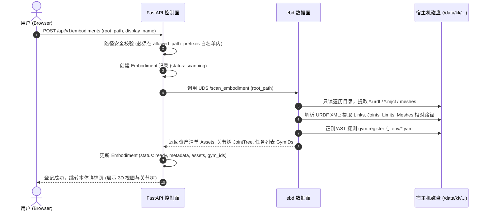

# 01 · 本体模块深度详规与架构设计

本体模块是 EmbodiedBein 连接真实机器人代码库与 3D 物理资产的枢纽。

---

## 1. 用户需求与设计原则

- **代码方式接入**：本体存放于宿主机指定路径（如 `/data/kk/Berkeley-Humanoid-Lite`），平台通过路径登记接入，不做平台代 clone、不写入代码仓。
- **3D 资产解析与可视化**：平台自动扫描代码目录下的 `*.urdf`、`*.mjcf`、`*.usd` 及 3D 网格文件（STL/OBJ/DAE），在前端实现高保真 3D 渲染与关节交互。
- **多 URDF 变体支持**：针对 Berkeley Humanoid Lite 等具备多种形态（Humanoid 22DoF / Biped 12DoF / WBC 22DoF / FixedHand 10DoF）的机器人，支持在详情页自由切换不同的 URDF 模型。
- **只读快照与任务探测**：从代码中自动嗅探已注册的 Gym ID 与 RLinf 仿真配置，作为后续训练表单的选项来源。

---

## 2. 系统交互与扫描流程时序



---

## 3. 多 URDF 变体与 3D 静态资产代理机制

### 3.1 资产拓扑与相对路径痛点
在真实的具身开源库（以 BHL 为例）中，URDF 文件通常位于子目录，并使用相对路径或 `package://` 语法引用网格模型：
```xml
<!-- berkeley_humanoid_lite.urdf -->
<link name="base_link">
  <visual>
    <geometry>
      <mesh filename="../meshes/stl/base_link.stl" scale="1 1 1"/>
    </geometry>
  </visual>
</link>
```
如果浏览器端直接加载 URDF，Three.js 的 `URDFLoader` 将无法跨域读取宿主机本地磁盘上的 `base_link.stl`。

### 3.2 资产代理服务设计
后端提供专用的受控静态资产代理路由：
```
GET /api/v1/embodiments/{embodiment_id}/assets/{asset_relative_path:path}
```
**安全防御与处理逻辑**：
1. 解析 `asset_relative_path`，进行 `os.path.abspath` 规范化。
2. 校验目标文件是否严格处于该本体的 `root_path` 目录树内（严防 `../` 路径穿越攻击）。
3. 识别文件 MIME 类型（`application/sla`、`model/gltf-binary`、`text/xml` 等），以高效流式传输返回。
4. 前端 `URDFLoader` 配置 `packages` 根 URL 为 `/api/v1/embodiments/{id}/assets`，实现网格纹理的透明化自动加载。

### 3.3 多 URDF 变体识别与切换
扫描时将目录内所有合法 URDF 均注册为变体（Variants）：
- **Variant 1**: `humanoid_22dof` (`source/assets/urdf/humanoid_22dof.urdf`) —— 22 自由度双臂双足全形态
- **Variant 2**: `biped_12dof` (`source/assets/urdf/biped_12dof.urdf`) —— 12 自由度纯下肢双足形态
- **Variant 3**: `wbc_22dof` (`source/assets/urdf/wbc_22dof.urdf`) —— 22 自由度全身控制专用形态
- **Variant 4**: `fixedhand_10dof` (`source/assets/urdf/fixedhand_10dof.urdf`) —— 10 自由度固定手部形态

前端详情页提供下拉切换开关，切换时重新驱动 Three.js 渲染对应 URDF 并重置关节树。

---

## 4. 关节树解析与 3D 姿态交互 (Forward Kinematics)

为了让使用者能够直观校验机器人关节极限与坐标系方向，系统在解析 URDF 时提取结构化的关节元数据：

```json
{
  "name": "leg_pitch_joint",
  "type": "revolute",
  "parent": "base_link",
  "child": "leg_pitch_link",
  "origin": {"xyz": [0.0, -0.08, -0.15], "rpy": [0, 0, 0]},
  "axis": [0, 1, 0],
  "limit": {
    "lower": -1.5708,
    "upper": 1.5708,
    "effort": 80.0,
    "velocity": 12.0
  }
}
```

### 3D 画布交互能力
1. **轨道相机控制器**：支持旋转（Orbit）、平移（Pan）、缩放（Zoom），支持自适应居中（Frame Robot）。
2. **关节交互滑杆**：右侧列表展示所有可旋转/平移关节，拖动滑杆可动态更新 3D 机器人的关节旋转角 $\theta$，实时观察极限姿态。
3. **坐标轴可视化**：支持开启/关闭 Link 局部坐标轴（RGB: XYZ），方便开发者核对传感器与执行器安装朝向。
4. **一键复位 (Zero Pose)**：快速恢复到默认 0 姿态。

---

## 5. 仿真任务 (Gym / RLinf) 自动探测

扫描器通过 AST/正则分析代码，提取仿真环境信息：
1. **Gym ID 探测**：探测 `gym.envs.registration.register(id="...", ...)`。
   - 例如：`Isaac-Berkeley-Humanoid-Lite-WholeBody-v0`
2. **RLinf Env 配置探测**：扫描 `env/*.yaml`，提取其与 URDF 资产的绑定关系与默认输入输出维度。
3. **接口快照（只读参考）**：
   - 提取建议的 `obs_dim`、`action_dim`、`policy_hz`。
   - **注意**：此处仅作为信息呈现与表单缺省参考，**不再作为强制性提交卡口**。

---

## 6. 元数据结构 (PostgreSQL Schema)

```sql
CREATE TABLE embodiments (
    id VARCHAR(64) PRIMARY KEY,                  -- 格式：emb_xxx
    display_name VARCHAR(128) NOT NULL,          -- 显示名称，如 "Berkeley Humanoid Lite"
    root_path VARCHAR(512) NOT NULL,             -- 宿主机代码绝对路径，如 "/data/kk/Berkeley-Humanoid-Lite"
    status VARCHAR(32) NOT NULL DEFAULT 'ready', -- ready | scanning | error
    error_message TEXT,                          -- 扫描失败详细信息
    default_urdf VARCHAR(256),                   -- 默认渲染的 URDF 相对路径
    urdf_variants JSONB NOT NULL DEFAULT '[]',   -- 全部 URDF 变体列表及其元数据
    joint_tree JSONB NOT NULL DEFAULT '{}',      -- 结构化关节树与限位数据
    gym_ids JSONB NOT NULL DEFAULT '[]',         -- 探测到的 Gym / Isaac 环境 ID
    interface_snapshot JSONB,                    -- 观测/动作维数与控制频率快照
    scanned_at TIMESTAMP WITH TIME ZONE,         -- 最后一次扫描时间
    created_at TIMESTAMP WITH TIME ZONE DEFAULT NOW(),
    updated_at TIMESTAMP WITH TIME ZONE DEFAULT NOW()
);

CREATE INDEX idx_embodiments_status ON embodiments(status);
```

---

## 7. 页面交互规范

### 7.1 本体列表页 (`/embodiments`)
- **网格卡片布局**：每个本体卡片展示机器人缩略图、显示名、路径、URDF 变体数、探测任务数、就绪状态。
- **右上角操作**：提供「登记本体」主按钮。

### 7.2 本体登记页 (`/embodiments/new`)
- **表单项**：
  - 本体名称（可选，默认为目录名称）
  - 代码绝对路径 `root_path`（输入框带白名单前缀提示）
  - 备注说明
- **交互**：点击「扫描并登记」后进入实时扫描进度展示，成功后自动跳转到详情页。

### 7.3 本体详情页 (`/embodiments/:id`)
- **左右分栏布局**：
  - **左侧 (65%)**：Three.js 3D 渲染大画布，顶部提供 URDF 变体选择下拉框（如 BHL 4 变体），底部浮动 3D 控制工具栏（复位、网格、坐标系、全屏）。
  - **右侧 (35%)**：
    - **Tab 1: 关节与自由度 (Joints)**：列出全部 Joint 滑杆，支持微调与观察。
    - **Tab 2: 仿真任务 (Tasks)**：展示探测到的 Gym IDs 及 RLinf 对应 yaml。
    - **Tab 3: 资产文件 (Assets)**：文件树查看扫描到的全部 URDF 与 mesh 清单。
    - **顶部动作**：提供「重新扫描」按钮（代码修改后刷新）与「用此本体发起训练」快捷入口。
