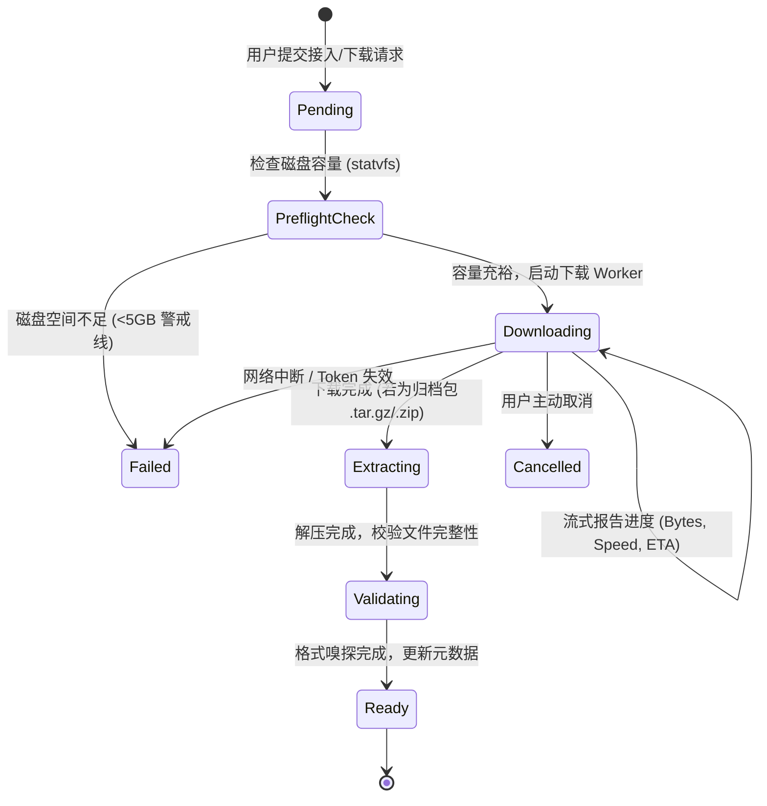

# 02 · 数据模块深度详规与架构设计

数据模块负责管理具身训练所需的数据集资产，支持多源数据的高效接入、异步下载与内容高保真浏览。

---

## 1. 用户需求与设计原则

- **多源数据接入**：
  1. **本地路径直挂 (Local Path)**：最常用模式。如宿主机已有 `/data/kk/berkeley_ego_data`，直接登记即可使用，默认不产生冗余数据拷贝。
  2. **Hugging Face Hub 下载**：支持从 Hugging Face 仓库（如 `lerobot/pusht` 等）异步拉取，支持配置私有数据集的 `HF_TOKEN`。
  3. **HTTP / URL 下载**：支持通过 HTTP/HTTPS 链接下载压缩包或文件归档，并在下载完成后自动解压至指定目标目录。
- **内容高保真浏览**：
  - 支持数万文件规模的**惰性加载文件树**。
  - 支持具身 Episode 视频（`.mp4`）的 **HTTP Range 流式点播**与时序曲线预览。
- **存储自适应**：
  - 数据集存储真源直接对应宿主机磁盘目录。
  - 训练时通过 Docker `-v /host/path:/workspace/data/<dataset_id>:ro` 只读挂载进容器。

---

## 2. 异步下载任务生命周期与状态机

对于几十 GB 的具身数据集，下载是一个长周期耗时任务。必须建立严密的异步工作流与状态机：



### 2.1 任务执行器（Worker）实现机制
- 数据下载任务由后台异步任务执行器统一调度（独立异步任务池，不阻塞 FastAPI 主事件循环）。
- **Hugging Face 下载**：基于 `huggingface_hub` snapshot_download，传递 `token`，并在流式下载回调中周期性向 Redis/内存推送下载进度。
- **HTTP 下载**：基于 `httpx.AsyncClient` 流式写入本地临时文件，计算 sha256 校验和，支持断点续传（`Range` 请求头）。
- **取消机制**：提供 `DELETE /api/v1/datasets/{id}/download` 接口，向 Worker 发送取消信号并自动清理未完成的临时文件。

---

## 3. 磁盘容量预检与配额防护 (Pre-flight Check)

为避免大文件下载导致宿主机磁盘被撑爆从而引发全系统崩溃，系统在下载前执行容量预检：
1. 调用 `os.statvfs(target_dir)` 探测目标磁盘分区的剩余可用字节 `f_bavail * f_frsize`。
2. 预估下载所需空间（若为压缩包，解压预估空间为压缩包大小的 2.5 倍）。
3. **阈值保护**：
   - 剩余空间 < 目标空间 + 10GB 时，阻断下载并给出明确告警。
   - 剩余空间占磁盘总容量比例 < 10% 时，触发磁盘高危水位警告。

---

## 4. 大规模数据集高性能浏览与媒体流

### 4.1 惰性展开文件树 (Lazy File Tree)
大型数据集（如 44GB 的 `berkeley_ego_data`）包含上万个文件。系统禁止一次性返回全量 JSON，而是采用**按需逐层展开** API：
```
GET /api/v1/datasets/{id}/tree?path=raw/clips&page=1&page_size=50
```
- **请求参数**：`path`（相对路径）、`page`、`page_size`。
- **返回数据**：当前目录下的子文件夹与文件列表、文件大小、修改时间及总子项计数。

### 4.2 Episode 媒体与视频流式播放
对于包含具身录像的数据集：
1. **HTTP Range 请求支持**：后端通过 `StreamingResponse` 完整支持 `Accept-Ranges: bytes`，使前端 `<video>` 标签可以实现毫秒级跳转（Seek）播放。
2. **多视角回放**：如果目录中包含多个相机视角（如 `cam_high.mp4`、`cam_left_wrist.mp4`），详情页提供多分屏同步播放器。
3. **格式自动识别**：自动嗅探 `lerobot_v2`、`hdf5`、`rosbag` 或通用多媒体格式，若识别为标准具身格式，直接解析并展示 Episode 总数、动作帧率与总时长。

---

## 5. 元数据模型 (PostgreSQL Schema)

```sql
CREATE TABLE datasets (
    id VARCHAR(64) PRIMARY KEY,                  -- 格式：ds_xxx
    name VARCHAR(128) NOT NULL,                  -- 数据集显示名称
    source_kind VARCHAR(32) NOT NULL,            -- path | huggingface | http
    source_uri TEXT NOT NULL,                    -- 来源 URI (本地路径 / repo_id / URL)
    dest_path VARCHAR(512) NOT NULL,             -- 宿主机存储绝对路径
    format VARCHAR(32) NOT NULL DEFAULT 'unknown', -- lerobot_v2 | hdf5 | raw_video | mixed
    status VARCHAR(32) NOT NULL DEFAULT 'ready', -- ready | pending | downloading | extracting | failed
    total_bytes BIGINT DEFAULT 0,                -- 数据集总大小 (Bytes)
    download_progress JSONB DEFAULT '{}',        -- {downloaded_bytes, total_bytes, speed, eta_sec}
    summary_stats JSONB DEFAULT '{}',            -- {episodes_count, total_frames, fps, cameras}
    error_message TEXT,                          -- 错误详情
    created_at TIMESTAMP WITH TIME ZONE DEFAULT NOW(),
    updated_at TIMESTAMP WITH TIME ZONE DEFAULT NOW()
);

CREATE INDEX idx_datasets_status ON datasets(status);
```

---

## 6. 页面交互规范

### 6.1 数据列表页 (`/data`)
- **表格列**：
  - 数据集名称（带格式徽章，如 `LeRobot v2`、`Raw Video`）
  - 来源类型（`Local Path` / `HuggingFace` / `HTTP`）
  - 存储路径 `dest_path`
  - 数据集大小（格式化为 GB/MB）
  - 状态（`Ready` 绿色 / `Downloading 64% 45MB/s` 蓝色进度条 / `Failed` 红色）
- **操作**：右上角「接入数据」按钮。

### 6.2 接入数据弹窗/页面 (`/data/new`)
- **三标签页切换**：
  1. **本地路径 (Local)**：输入绝对路径（带白名单前缀检测）及显示名称，即刻完成接入。
  2. **Hugging Face**：输入 `Repo ID`（如 `lerobot/pusht`）、目标目录（默认为 `/var/lib/eb/datasets/<id>`）及可选的 `HF_TOKEN`。
  3. **HTTP / URL**：输入压缩包下载链接及解压选项。
- **提交校验**：自动校验磁盘剩余空间并给出预检结果。

### 6.3 数据详情页 (`/data/:id`)
- **顶部摘要卡片**：展示总大小、文件数、Episode 数量、关联存储路径。
- **分栏查看器**：
  - **左侧：惰性文件树**（支持点击文件夹异步展开、搜索文件名）。
  - **右侧：内容预览区**：
    - 选中 `.mp4` 时加载流式视频播放器。
    - 选中 `.json` / `.yaml` / `.txt` 时加载代码/文本高亮查看器。
    - 选中 `.parquet` / `.h5` 时解析并展示第一级特征列与样本维度。
