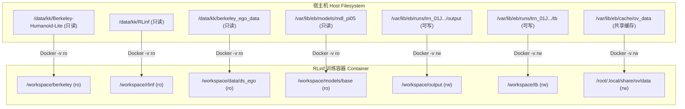
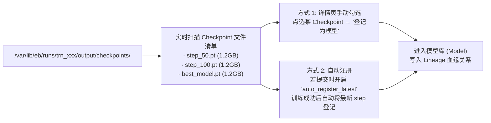

# 04 · 训练模块与 RLinf 深度适配详规

训练模块是 EmbodiedBein 的核心生产力中心。本版将原设计中分散的「实验 / 提交任务 / 队列」彻底合并为**统一的「训练」模块**，全方位深度适配 RLinf 具身强化学习与模仿学习框架。

---

## 1. 用户需求与设计原则

- **深度适配 RLinf**：针对 RLinf 框架的 Hydra 配置体系、Ray 分布式多卡拓扑及组件调度进行无缝衔接。
- **三层递进表单**：
  1. **模板选择**：内置经过实机验证的 RLinf 典型任务模板。
  2. **常用核心字段**：仅暴露研发人员高频修改的参数（卡数、Epoch、环境数、学习率、基座模型、数据集）。
  3. **高级 Overrides**：支持自由填写 Hydra 键值覆盖，兼顾易用性与极客灵活性。
- **配置实时双向预览**：在提交前实时生成解析后的 Hydra 覆盖清单与**等价的单机复现 `docker run` 命令**。
- **多卡隔离与零侵入挂载**：强制重定向训练输出至 `/var/lib/eb/runs/<train_id>/output`，杜绝写脏只读代码仓。
- **全要素实时观测与产物闭环**：毫秒级 WebSocket 日志流、TensorBoard 标量实时曲线，以及 Checkpoint 产物一键/自动入库。

---

## 2. RLinf 模板体系与参数映射表

平台内置三大标准具身模板（配置文件由平台直接引用宿主机 `/data/kk/RLinf` 仓内真实文件）：

| 模板标识 (`template_id`) | RLinf 原始配置文件 | 任务类型 | 默认并行环境 | 推荐 GPU 拓扑 |
|---|---|---|---|---|
| `berkeley_wbc_ppo_mlp` | `examples/embodiment/config/berkeley_wbc_ppo_mlp.yaml` | 全身控制强化学习 (PPO) | 1024 | 2 卡或 4 卡 (actor,env,rollout 分布) |
| `berkeley_reach_sft` | `examples/sft/config/berkeley_reach_sft_openpi_pi05.yaml` | 视觉语言动作 (VLA) SFT 模仿学习 | - | 2 卡或 4 卡 (actor_rollout) |
| `collect_berkeley_reach` | `examples/embodiment/config/collect_berkeley_reach.yaml` | 仿真数据采集 Rollout | 256 | 1 卡或 2 卡 |

---

## 3. 多卡调度、Ray 端口隔离与组件放置计算

### 3.1 动态 Ray 端口分配
在一台 4×4090 机器上，支持多任务并发（例如同时跑两个 2 卡任务）。为避免不同容器因使用相同 Ray 端口（如 6379 或 6390）而在宿主机产生端口冲突或混淆：
- 调度器在为任务分配 GPU（如分配到 GPU 0,1 或 GPU 2,3）时，依据任务 ID 计算独立的 Ray Head 端口：
  $$\text{ray\_port} = 6390 + (\text{crc32}(\text{job\_id}) \pmod{50})$$
- 注入环境变量 `RAY_PORT` 与启动参数 `ray start --head --port ${ray_port}`。

### 3.2 Component Placement 智能生成算法
不同任务类型在 RLinf 中具有不同的多卡分配语法，Adapter 根据表单选择的卡数自动计算：
- **PPO 强化学习任务**：
  - 1 卡：`cluster.component_placement.actor,env,rollout=0`
  - 2 卡：`cluster.component_placement.actor,env,rollout=0,1`
  - 4 卡：`cluster.component_placement.actor,env,rollout=0,1,2,3`
- **SFT 模仿学习任务**：
  - 2 卡：`cluster.component_placement.actor_rollout=0,1`
  - 4 卡：`cluster.component_placement.actor_rollout=0,1,2,3`

---

## 4. 容器化隔离挂载矩阵与启动命令生成



### 4.1 强制注入的系统级 Hydra Overrides
为确保只读隔离与产物归档，Adapter 自动追加以下覆盖项，用户不可在表单中删除：
```bash
runner.logger.log_path=/workspace/output
runner.logger.experiment_name={job_name}
runner.checkpoint.save_dir=/workspace/output/checkpoints
hydra.run.dir=/workspace/output/hydra
```

---

## 5. 实时遥测：日志环形缓冲与 TSDB 指标解析

### 5.1 日志流式传输 (Fast Log Stream)
- 容器 stdout/stderr 由 `ebd` 通过 Docker API 实时捕获。
- `ebd` 维护一个 5000 行的**内存环形缓冲区 (Ring Buffer)**，并通过 WebSocket 以 100ms 为周期批量（Batch）推送到前端。
- 前端使用虚拟列表渲染日志，支持关键词搜索、错误高亮与一键下载完整日志。

### 5.2 TensorBoard 标量实时提取
- `ebd` 监听 `/workspace/tb/` 目录下的 `events.out.tfevents.*` 文件变动。
- 提取关键标量指标：
  - `train/reward`（训练总奖励曲线）
  - `train/actor_loss` / `train/critic_loss`（损失函数曲线）
  - `perf/fps`（环境步进吞吐率）
  - `train/episode_length`（存活步数）
- 解析结果写入轻量时序数据表，前端以 ECharts 实时动态绘制多指标网格。

---

## 6. Checkpoint 产物管理与双轨登记

训练完成后，系统提供两种模型入库策略（满足用户选择）：



---

## 7. 元数据模型 (PostgreSQL Schema)

```sql
CREATE TABLE train_jobs (
    id VARCHAR(64) PRIMARY KEY,                  -- 格式：trn_xxx
    name VARCHAR(128) NOT NULL,                  -- 任务名称
    status VARCHAR(32) NOT NULL DEFAULT 'queued',-- queued | running | succeeded | failed | cancelled
    template_id VARCHAR(64) NOT NULL,            -- 所选模板 ID
    image_digest VARCHAR(128) NOT NULL,          -- 绑定的 Docker 镜像 Digest
    embodiment_id VARCHAR(64) NOT NULL,          -- 绑定的本体 ID
    dataset_ids JSONB DEFAULT '[]',              -- 挂载的数据集 ID 列表
    base_model_id VARCHAR(64),                   -- 依赖的基座模型 ID (可空)
    gpus_allocated JSONB DEFAULT '[]',           -- 分配的物理 GPU 索引列表，如 [0, 1]
    ray_port INT DEFAULT 6390,                   -- 本任务分配的 Ray 端口
    params JSONB NOT NULL DEFAULT '{}',          -- 常用表单参数 (epochs, lr, num_envs, seed...)
    hydra_overrides JSONB NOT NULL DEFAULT '[]', -- 最终生效的全部 Hydra 覆盖清单
    run_dir VARCHAR(512) NOT NULL,               -- 宿主机真实运行目录 (/var/lib/eb/runs/trn_xxx)
    auto_register_latest BOOLEAN DEFAULT FALSE,  -- 成功后是否自动登记最新权重
    metrics_summary JSONB DEFAULT '{}',          -- 最终指标快照 {final_reward, best_reward, total_steps}
    error_message TEXT,                          -- 失败原因详细排查信息
    started_at TIMESTAMP WITH TIME ZONE,
    finished_at TIMESTAMP WITH TIME ZONE,
    created_at TIMESTAMP WITH TIME ZONE DEFAULT NOW(),
    updated_at TIMESTAMP WITH TIME ZONE DEFAULT NOW()
);

CREATE INDEX idx_train_jobs_status ON train_jobs(status);
CREATE INDEX idx_train_jobs_created ON train_jobs(created_at DESC);
```

---

## 8. 页面交互规范

### 8.1 训练任务列表页 (`/train`) —— 产品第一入口
- **状态筛选 Tab**：全部 / 运行中 (Running) / 排队中 (Queued) / 已完成 (Succeeded) / 异常 (Failed)。
- **高密表格列**：
  - 任务名称（点击进详情）
  - 状态（带微光动画的 Running、成功绿色、排队橙色、失败红色）
  - 模板标识
  - 关联本体与数据集
  - GPU 占用（如 `2 卡 [0,1]`）
  - 核心指标预览（如 `Reward: 14.8` / `Step: 200k`）
  - 运行时长与创建时间
- **右上角操作**：醒目的 **「新建训练任务」** 主按钮。

### 8.2 新建训练任务页 (`/train/new`)
- **左侧：参数配置表单 (60%)**：
  - **基础信息**：任务名称、训练镜像（默认选择 Isaac Lab 镜像）、GPU 数量选择（1 / 2 / 4 卡）。
  - **代码与任务**：选择本体（下拉）、选择仿真环境 Gym ID / RLinf yaml。
  - **资产挂载**：选择输入数据集（可选）、选择基座模型（可选）。
  - **核心超参**：`max_epochs`、`total_num_envs`、`learning_rate`、`seed`、`save_interval`。
  - **产物选项**：勾选框「训练成功后自动将 latest checkpoint 登记为模型」。
  - **高级 Overrides**：多行代码编辑器，支持自由输入追加的 `foo.bar=val`。
- **右侧：实时双向预览区 (40%)**：
  - **Tab 1: 生效的 Hydra Overrides**（实时高亮渲染将传递给 python 脚本的参数）。
  - **Tab 2: 容器挂载矩阵**（展示所有 ro/rw 路径映射）。
  - **Tab 3: 等价 `docker run` 命令行**（一键复制，供工程师在宿主机终端手动调试）。
- **底部操作**：点击「提交训练」，自动执行参数校验并跳转至任务详情页。

### 8.3 训练任务详情页 (`/train/:id`)
- **顶部状态栏**：任务名称、运行状态徽章、GPU 卡号、耗时、终止/取消按钮。
- **核心三栏布局**：
  - **左上：实时指标图表**（Reward 曲线、Loss 曲线、FPS 吞吐率，支持全屏放大与平滑切换）。
  - **左下：实时终端日志**（黑底绿字高亮终端，带自动滚屏、关键字过滤、暂停滚动开关）。
  - **右侧：产物与模型登记区**：
    - 列出 `/workspace/output/checkpoints/` 扫描到的全部 `.pt` / `.safetensors` 文件。
    - 每个文件右侧提供 **「登记为模型」** 按钮，点击弹窗输入模型名称即刻入库。
    - 展示生成的 `spec.json` 与 `hydra_resolved.yaml` 冻结快照。
