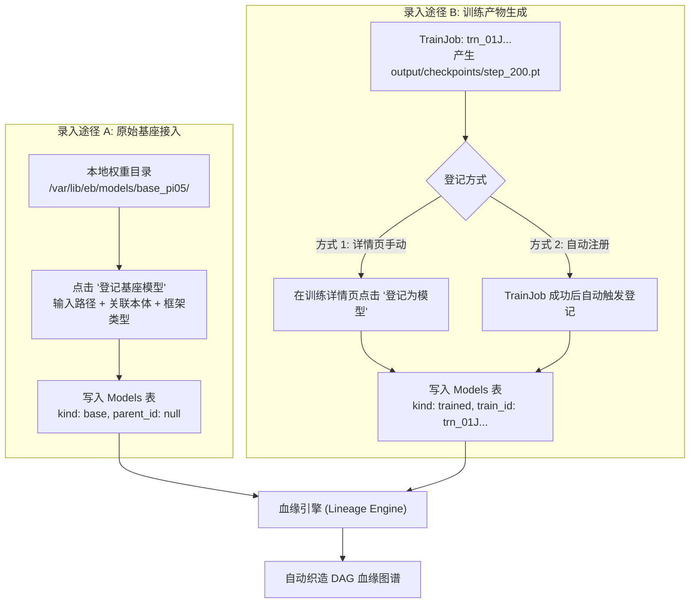

# 05 · 模型模块与 DAG 血缘图谱深度详规

模型模块负责管理具身控制策略的权重资产，涵盖原始基座模型（Base Model）与训练产出模型（Trained Model），并完整构建多维有向无环图（DAG）血缘网络。

---

## 1. 用户需求与设计原则

- **基座与产物双轨管理**：
  1. **原始基座模型 (Base Model)**：由用户放置在磁盘指定目录的预训练权重（如 OpenPI π₀.₅ 基座权重、开源 VLA 权重或历史 ONNX 策略）。
  2. **训练产出模型 (Trained Model)**：由平台某次 RLinf 训练任务（TrainJob）成功产出的 Checkpoint 权重。
- **全要素 DAG 血缘图谱**：
  - 彻底摆脱单一线性的父子关系描述，真实刻画具身 AI 训练的**多输入多输出因果网络**：
    $$\text{本体代码} + \text{数据集} + \text{基座模型} + \text{仿真镜像} \xrightarrow{\text{TrainJob}} \text{训练产出模型}$$
- **轻量实用，不做虚构卡口**：
  - 放弃对 ModelCard 论文级长篇元数据的强制要求，以实际权重文件、框架格式、关联本体、参数量和血缘链路为核心。

---

## 2. 基座模型与训练产物的录入流



---

## 3. 多维 DAG 血缘拓扑模型

一次典型的具身策略演进包含多次迭代（如 Pretrain → SFT 模仿学习 → RLFT 强化微调）。系统通过关系边表自动推导并渲染全景 DAG：

```
                    ┌─────────────────────────┐
                    │ 本体: Berkeley Humanoid │
                    └────────────┬────────────┘
                                 │ (used)
 ┌──────────────────────┐        ▼        ┌──────────────────────┐
 │ 基座: OpenPI-π₀.₅    │───────────────► │ 模仿学习: reach-sft  │ ◄─────── 数据集: EgoData
 └──────────────────────┘                 └──────────┬───────────┘
                                                     │ (produced)
                                                     ▼
                                          ┌──────────────────────┐
                                          │ 策略: bhl-reach-v1   │
                                          └──────────┬───────────┘
                                                     │ (trained_from)
                                                     ▼
                                          ┌──────────────────────┐
                                          │ WBC微调: wbc-ppo-02  │
                                          └──────────┬───────────┘
                                                     │ (produced)
                                                     ▼
                                          ┌──────────────────────┐
                                          │ 最终模型: bhl-final  │
                                          └──────────────────────┘
```

### 3.1 血缘边关系定义 (Relation Kinds)
- `trained_from`（模型 $\rightarrow$ 模型）：当前模型是由哪个父模型微调/热启动而来。
- `produced_by`（模型 $\rightarrow$ 训练任务）：当前模型是由哪次训练任务产出的。
- `used_dataset`（训练任务 $\rightarrow$ 数据集）：训练任务消费了哪些数据集。
- `used_embodiment`（训练任务 $\rightarrow$ 本体）：训练任务绑定了哪个机器人本体代码。
- `used_image`（训练任务 $\rightarrow$ 镜像）：训练任务在哪个 Docker 镜像环境下运行。

---

## 4. 元数据模型 (PostgreSQL Schema)

```sql
CREATE TABLE models (
    id VARCHAR(64) PRIMARY KEY,                  -- 格式：mdl_xxx
    name VARCHAR(128) NOT NULL,                  -- 模型名称，如 "pi0.5-reach-sft-step100"
    kind VARCHAR(32) NOT NULL DEFAULT 'trained', -- base (原始基座) | trained (训练产出)
    path VARCHAR(512) NOT NULL,                  -- 宿主机权重文件或目录的绝对路径
    framework VARCHAR(32) NOT NULL DEFAULT 'pytorch', -- pytorch (.pt) | safetensors | onnx | openpi
    size_bytes BIGINT DEFAULT 0,                 -- 权重文件大小
    embodiment_id VARCHAR(64),                   -- 关联的本体 ID (可空)
    train_job_id VARCHAR(64),                    -- 若为 trained，指向来源 TrainJob ID
    parent_model_id VARCHAR(64),                 -- 若基于某模型微调，指向父模型 ID
    metrics_at_checkpoint JSONB DEFAULT '{}',    -- 该 Checkpoint 产生时的训练指标快照
    created_at TIMESTAMP WITH TIME ZONE DEFAULT NOW(),
    updated_at TIMESTAMP WITH TIME ZONE DEFAULT NOW()
);

CREATE TABLE lineage_edges (
    id BIGSERIAL PRIMARY KEY,
    src_type VARCHAR(32) NOT NULL,               -- model | train_job | dataset | embodiment | image
    src_id VARCHAR(64) NOT NULL,                 -- 源实体 ID
    dst_type VARCHAR(32) NOT NULL,               -- model | train_job
    dst_id VARCHAR(64) NOT NULL,                 -- 目标实体 ID
    relation VARCHAR(32) NOT NULL,               -- trained_from | produced_by | used_dataset | used_embodiment
    created_at TIMESTAMP WITH TIME ZONE DEFAULT NOW(),
    CONSTRAINT uq_lineage_edge UNIQUE (src_type, src_id, dst_type, dst_id, relation)
);

CREATE INDEX idx_lineage_src ON lineage_edges(src_type, src_id);
CREATE INDEX idx_lineage_dst ON lineage_edges(dst_type, dst_id);
```

---

## 5. 页面交互规范

### 5.1 模型列表页 (`/models`)
- **筛选器**：全部 / 基座模型 (Base) / 训练产物 (Trained) / 按本体筛选。
- **表格列**：
  - 模型名称（点击进入详情）
  - 类型徽章（`Base` 蓝色徽章 / `Trained` 紫色徽章）
  - 格式与大小（如 `PyTorch · 1.24 GB`）
  - 关联本体（如 `Berkeley Humanoid Lite`）
  - 来源训练（若为产物，显示 `trn_wbc_4gpu` 链接）
  - 创建时间
- **右上角操作**：提供 **「登记基座模型」** 按钮。

### 5.2 登记基座模型弹窗
- **表单项**：
  - 模型名称（如 `OpenPI-π₀.₅-Base`）
  - 宿主机权重路径（必须在允许白名单前缀内）
  - 模型框架格式（`PyTorch (.pt/.pth)` / `SafeTensors` / `ONNX` / `HuggingFace Repo`）
  - 适配机器人本体（下拉选择）
- **校验**：后端自动探测路径下文件是否存在，并计算总大小。

### 5.3 模型详情与 DAG 血缘可视化页 (`/models/:id`)
- **顶部摘要卡片**：展示模型名称、存储路径、权重大小、格式、训练时评估指标。
- **全景 DAG 血缘交互画布 (Lineage Graph)**：
  - 基于 Vue Flow / D3.js 渲染高保真节点连接图。
  - 节点根据类型赋予不同科技色调（本体: 蓝色, 数据: 青色, 基座模型: 紫色, 训练任务: 黄色, 产出模型: 亮绿）。
  - 支持鼠标滚轮缩放、拖拽平移、点击任何节点跳转到对应本体/数据/训练/模型详情页。
- **下游训练与模型列表**：展示所有以本模型作为基座（Parent Model）发起的后续训练任务。
