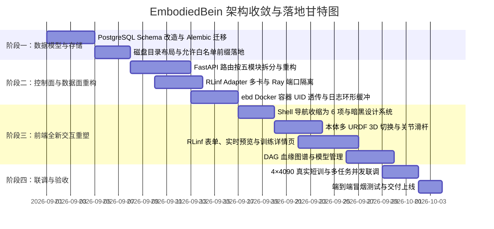

# 08 · 工程迁移与落地实施计划

本计划给出了从现有 v0.1 骨架代码库平滑演进至 **再审版（RLinf 训练工作台）** 的具体工程实施路线。

---

## 1. 总体架构演进与瘦身对照

```
[现行代码状态]                                      [演进目标]
backend/eb/api/routes.py (965行大杂烩) ───► 拆分为 6 个高内聚路由模块
31 个 Vue 路由与视图页面             ───► 精简为 6 大核心模块 + 设置抽屉
CAS 内容寻址存储与 MinIO 依赖         ───► 磁盘直接挂载 + Postgres 目录元数据
复杂的三层 Experiment/Job/Run       ───► 单层 TrainJob + 实时日志/指标 TSDB
手动 Obs/Act YAML 契约卡口          ───► 本地代码扫描 + 多 URDF 变体解析
```

---

## 2. 实施分期路线图 (4 周冲刺)



---

## 3. 各阶段实施任务清单

### 阶段一 · 数据模型与存储重构 (第 1 周)
1. **数据库迁移 (Alembic)**：
   - 新增表：`embodiments`, `datasets`, `sim_images`, `train_jobs`, `models`, `lineage_edges`, `system_settings`。
   - 保留旧表结构用于只读兼容或平滑迁移。
2. **磁盘管理与安全白名单**：
   - 实现 `eb.settings` 中的 `EB_ALLOWED_PATH_PREFIXES`。
   - 编写统一的路径校验与规范化工具函数 `validate_allowed_path(path: str)`。

### 阶段二 · 控制面与数据面重构 (第 2 周)
1. **API 模块拆分**：
   - 将 `backend/eb/api/routes.py` 拆分为：
     - `api/routes_embodiment.py`（本体接入、扫描、3D 资产静态代理）
     - `api/routes_data.py`（数据集登记、HF/HTTP 异步下载、文件树浏览、视频流）
     - `api/routes_env.py`（镜像探测、拉取、环境 Doctor 自检）
     - `api/routes_train.py`（训练列表、提交校验、详情指标/日志 WS、产物扫描）
     - `api/routes_model.py`（基座录入、产物登记、DAG 血缘查询）
     - `api/routes_settings.py`（白名单、RLinf 路径、默认镜像）
2. **RLinf Adapter 升级**：
   - 注入动态 Ray 端口计算与组件放置（Component Placement）。
   - 固化 `runner.logger.log_path=/workspace/output` 覆盖。
3. **数据面 ebd 升级**：
   - 增加 Docker pull 进度流解析。
   - 完善容器 UID/GID 透传机制。

### 阶段三 · 前端 Vue 3 核心重构 (第 3 周)
1. **Shell 与路由瘦身**：
   - `Shell.vue` 导航精简为：总览、本体、数据、环境、训练、模型，底部挂「设置」抽屉。
   - 路由表收敛至 10 个核心视图。
2. **核心视图开发**：
   - **本体详情**：集成 Three.js + `URDFLoader`，支持多 URDF 变体下拉切换，提供关节滑杆。
   - **训练提交**：实现模板选择 + 常用超参 + 高级 Overrides + 实时参数/命令预览。
   - **训练详情**：实现 ECharts 多指标实时折线图 + 虚拟列表日志终端 + Checkpoint 产物列表。
   - **模型详情**：实现基于 Vue Flow 的全要素 DAG 血缘交互图谱。

### 阶段四 · 真实硬件全流程集成测试 (第 4 周)
1. **全链路冒烟测试**：
   - 登记 `/data/kk/Berkeley-Humanoid-Lite`，验证 4 个 URDF 均能正常 3D 渲染。
   - 登记 `/data/kk/berkeley_ego_data`，验证文件树与 MP4 视频正常点播。
   - 提交 `berkeley_wbc_ppo_mlp` 训练任务（2 卡），验证 Ray 启动正常、指标正常回显、无写脏代码仓。
   - 训练完成后将 `step_100.pt` 登记为模型，验证 DAG 血缘完整生成。
2. **并发压力测试**：
   - 在 4 张卡上同时启动两个 2 卡训练任务，验证 GPU 调度与 Ray 端口无任何碰撞。
