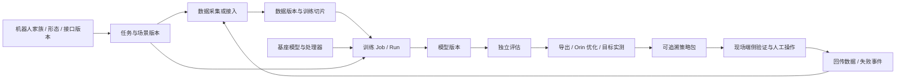
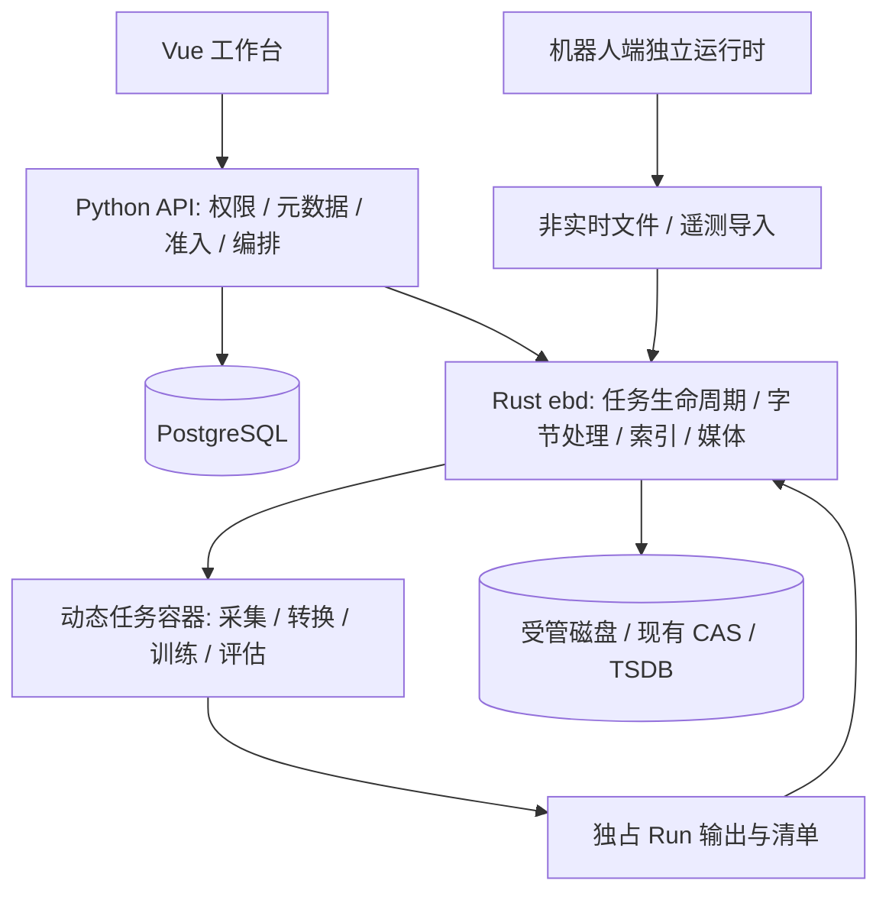

# 01 · 通用领域与架构

## 1. 统一的是生命周期与语义约束



所有步骤有版本化输入、输出、执行状态和资源预算。SO101 joint target、BHL position offset、G1 全身控制及 VLA 末端动作可以共用流程，**不能共用未经映射的动作向量**。

## 2. 领域对象与现有代码映射

| 对象 | 核心字段和职责 | 最小落地 |
|---|---|---|
| Embodiment 家族 | SO101 / Unitree G1 / BHL，来源和资产集合 | 复用 EmbodimentRow |
| 形态与资产版本 | 单臂、固定上肢、双足、全身；URDF/USD/MJCF、依赖哈希 | 复用 RobotAssetRow；形态配置挂环境版本 |
| EmbodimentEnv 接口版本 | observation/action/control/sensors/frames/limits/controller | 扩展既有不可变 `ee_*`；草稿可编辑，发布只增版本 |
| Robot 实例 | 真实序列号、硬件形态、标定、固件、当前包 | 复用 Robot；G1 当前只有仿真配置，不创建虚假在线实例 |
| Task 任务定义 | 行为目标、成功/失败函数、时间上限、环境绑定 | 复用 TaskRow；区别于一次训练作业 |
| Scenario 场景版本 | 物体、初始分布、地形、随机化、语言模板 | 首期受管 JSON manifest + Artifact 引用，不先建设资产市场 |
| RuntimeProfile | 镜像 digest、架构、依赖版本、设备需求、能力 probe | 扩展 SimImage；训练/采集/转换/评估/部署分别配版本 |
| Dataset / DatasetVersion | 逻辑集合 / 不可变内容与 episode 索引 | 复用现表；细粒度数据见 02 |
| DataSlice | 显式成员、分组划分、训练分布与 normalization | manifest + DatasetVersion/Artifact 引用；复用切片能力 |
| ModelVersion | 权重、处理器、norm、action head、源 Run、验证结果 | 以既有模型版本为发布真源，WeightModel 做接入兼容 |
| Pipeline / Job / Run | 计划 / 单个逻辑作业 / 一次尝试 | 一套引擎；TrainJob 只作 UI 投影 |
| EvalSuite / EvalReport / Bundle | 固定评测条件 / 结果 / 交付物 | 扩展已有实体 |

“环境”页面显示运行镜像与仿真器；机器人详情中显示“控制接口”。既保留直观产品词，又不丢掉 `EmbodimentEnv` 的校验作用。

## 3. 接口版本必须比维度更完整

共同最小字段：

- `joint_names` 有序列表；`actuated_joint_names`、`observed_joint_names` 分开；DOF、策略动作维度、夹爪通道数分别记录。
- `action.representation`：joint_position / joint_position_offset / joint_velocity / torque / eef_pose / base_velocity / 组合；单位、坐标系、absolute/delta、scale、offset、夹爪开闭方向。
- `observation.features`：状态、图像、深度、力觉、语言等命名字段；shape、dtype、缺失规则、历史窗口；不能把多模态强行串成 obs_dim。
- `control`：物理步长、执行频率、策略推理触发频率、action chunk 长度和消费规则、端侧控制器版本。`chunk_horizon` 不等于控制频率。
- `sensors`：相机逻辑名与实际设备映射，内外参、畸变、图像布局和颜色、时间基准；相机改变需要新 sensor/calibration 版本。
- `frames`：每项明确父坐标系、单位、轴向与四元数顺序；不要全局假设所有上游遵循同一约定。
- `limits/controller`：关节速度/位置/力矩、工作空间和允许控制模式；存在软限幅和硬件限位时分别标注执行者。

兼容性分四步：结构一致→语义一致→时间一致→数据/模型实际运行验证。不同接口间只能用登记了输入/输出、映射证据和误差报告的转换器；不凭 shape 自动重排或补零。

数据源登记/下载可以没有机器人接口，混合数据版本可以引用多个接口；因此新版 JobSpec 的接口绑定按 kind 校验，通用导入/索引允许空集合，采集/训练/闭环评估必须显式绑定适用接口集合或单接口 recipe。现有单值 `embodiment_env_id` 作为兼容输入映射，不能给无机器人视频随便填一个 BHL ID。模型支持合训时也必须声明多接口映射与 mask。

BHL 四份现有接口维数及频率保持：humanoid 75/22/25Hz；biped 45/12/25Hz；WBC 85/22/50Hz；fixedhand 10+image/10/20Hz，concat=false。当前 RLinf Reach 的 task id 与契约里的 Gym id 名称有差异，必须核对映射或新增版本，不能悄悄改已发布 YAML。

## 4. 执行边界



- `make up`/Compose 仍是平台唯一部署入口；训练和数据工具不变成常驻新服务。
- 原生 Rust 扫描在容器化 ebd 内执行；需要 Python/HDF5/LeRobot/ffmpeg/Isaac 的工作放入 ebd 创建的工具容器。禁止 API 自己搬大文件、解析视频或运行训练。
- 只有 ebd 持有宿主 docker.sock。任务容器、API、平台 Agent、robot-agent 均不得持有。重计算不通过 API 的 `asyncio.create_task` 获得生命周期。
- 对外媒体入口鉴权后由 ebd 处理字节与 Range；沿用现有 UDS 转发可做无缓存流式代理，禁止在 Python 读入整个媒体。无需为文档设计立即引入另一套公共网关。
- 现有 Redis 固定 6380。Job/Run 状态与幂等以 PG 为准，不能靠内存锁；轮询 reconcile 可继续用。Streams 的可靠事件消费按原设计增量接入，不先建 Kafka。
- Agent 保持 ToolBus 白名单；新增数据工具也不能赋予任意路径写入、任意出网/命令执行、真机放行或 gate.override 权限。

## 5. 存储与无 git 复现

```text
/var/lib/eb/
  datasets/<dataset_id>/<version_id>/  # 发布后不可变目录
  runs/<run_id>/                      # spec/resolved-config/logs/output
  snapshots/<content_hash>/           # 代码和配置快照，外部仓只读
  models/<version_id>/                # 权重、处理器、统计量
  cas/<prefix>/<hash>                 # 兼容已有 Artifact
  tsdb/<run_id>/                      # 复用现有指标存储
  media/                             # 可重建预览，绝不当训练原始图像
  staging/<run_id>/                   # 未发布输出，失败不自动覆盖
```

读根与写根分离：外部 `/data/kk` 的登记来源按具体源对象授权；业务写入只在平台受管目录。额外 leisaac/IsaacLab/lerobot/openpi 源码也按只读处理。路径 canonicalize、符号链接逃逸、相对路径越界与目标存在检查在 ebd 端执行，不能只靠前端限制。

**不使用 git 的代码冻结方案**：ebd 读取允许文件集，复制或文件系统 reflink 到平台快照区，生成每文件 SHA-256 和依赖清单；复制前后检测变更，不稳定则失败重试；以快照本身哈希作 code_ref。不能 hardlink 可写源；排除 `.git`、缓存与输出但显式包含实际导入的源码和子模块目录。大量 USD/mesh 依赖单独版本化，不把外部链接漏掉。外部工具生成输出一律改到 Run 区，`PYTHONDONTWRITEBYTECODE` 或运行期缓存目录防止隐式写回。

原始大数据可以先按路径发现，状态 `discovered`；正式使用时必须是受管不可变副本、可靠只读文件系统快照，或具备等价不可变保证的对象版本。普通 bind mount `ro` 加 mtime 检查不算冻结。空间不够时允许浏览而阻断正式训练版本发布，不承诺零复制同时获得不可变性。

## 6. 编排一致性

Pipeline 模板 revision 冻结后产生一次 PipelineRun；在现有 Pipeline 之外添加独立运行记录，以支持重复补采、稳定 URL 和节点恢复。每个节点绑定一个 Job，失败重试产生新 Run attempt。最先新增的是**节点依赖、类型化 output_ref 和幂等键**，不是通用脚本 DSL。

状态：pending→ready→queued→running→validating→succeeded；失败进入 failed/infra_failed/cancelled，等待设备或外部证据为 blocked，不能当作 succeeded。发布阶段属于 validating，不因容器 exit 0 就放行。

幂等键由 pipeline_run_id、node_id、输入版本指纹、展开的 shard_id 组成；PG 唯一约束阻止重复建 Job。采集中的逻辑 attempt_key 另固定为 session+scenario+seed+attempt_index，进程重试不能改写同一已提交 episode。

提交采用数据库事务写 Job/节点关联；ebd 创建容器使用固定 run_id label 并可查询重认领。容器退出且 output manifest 校验完成后，资产登记/血缘/节点成功在同一 PG 事务完成。evidence 文件已落盘但 DB 未提交时，下次 reconcile 根据 hash 重放登记；不重新采集。

初期管线模板只支持顺序步骤、有限 map(shards) 和 all-required join；缺失必需 shard 阻断 publish，失败 shard 可重试。可选节点必须显式列明，不能自动忽略错误。循环式数据改进通过开启新一轮 PipelineRun 表达，保持单次运行是无环图。
