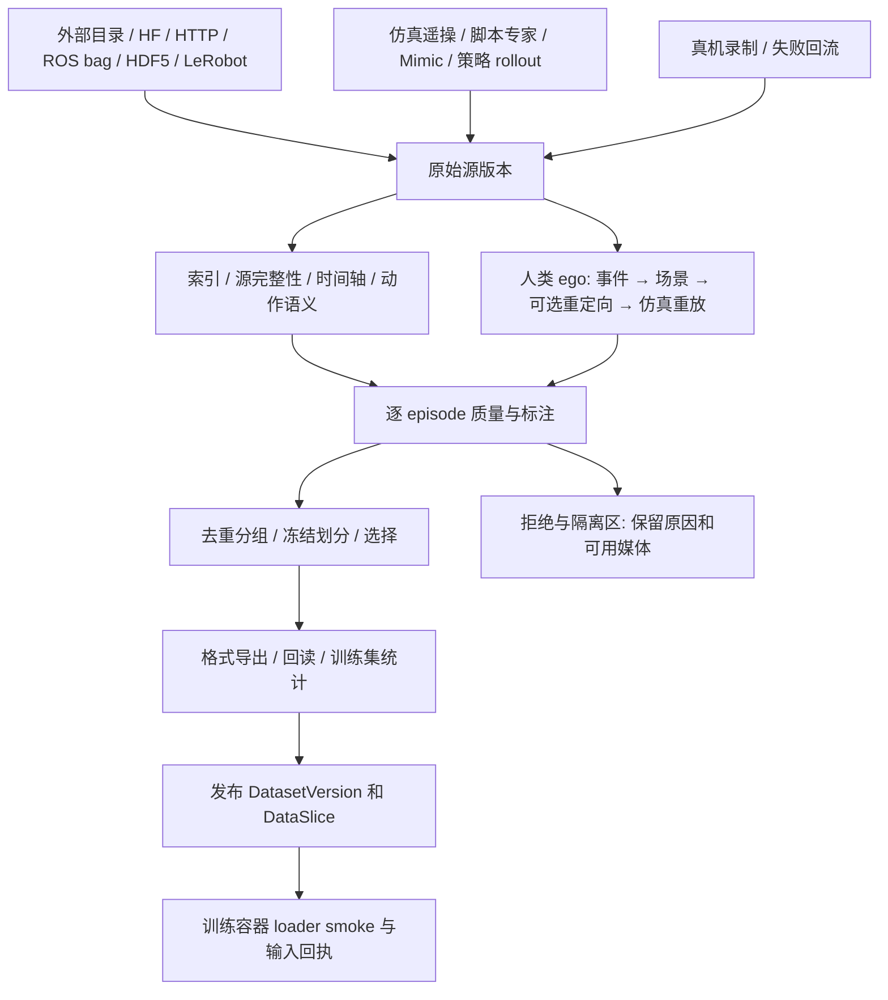

# 02 · 数据管线：从来源到训练可用资产

## 1. 输入与输出总图

管线的最终输出不是“下载完成的文件夹”，而是：**不可变原始来源、可查询 episode 索引、质量与转换报告、无泄漏的固定划分、可被目标模型加载的数据版本，以及能够解释这一切的可视化**。

## 2. 六层语义保留，按来源走不同路径

| 原设计层 | 通用定义 | 机器人原生数据 | 人类 ego 数据 |
|---|---|---|---|
| L0 DataSource | 来源、凭据引用、许可、只读根 | 仿真 Session / 真机录制 / 外部数据源 | 来源数据集与许可 |
| L1 RawArchive | 不可变原始文件与 manifest | 原始 episode、状态、图像、实际动作、失败记录 | 视频、标注、位姿文件 |
| L2 CanonicalEvent | 有时间边界的事件语义 | 抓取、接触、失败、人工接管等索引 | 事件、语言、时间窗口 |
| L3 Scenario | 可实例化场景与成功判据 | 引用采集时场景版本；不重新合成 | 从事件生成场景；可失败，属于研究路径 |
| L4 DatasetVersion | 校验通过、带接口的数据资产 | 索引和导出后直接进入 | 必须获取真实有效机器人动作，单有场景不够 |
| L5 DataSlice | 固定成员、划分与消费视图 | train/val/test/OOD/calibration 等 | 同样遵循谱系分组与许可约束 |

这六层不要求六份物理复制，也不要求每个导入都编译场景。L2/L3 可以是 manifest 引用。模型需要的格式由 export profile 决定，不因平台统一而把所有数据强制转换成同一种字节布局。

## 3. 每个阶段的输入输出与成功条件

| 阶段 | 输入 | 持久输出 | 成功条件 |
|---|---|---|---|
| discover/import | 只读路径或 source revision | source manifest、文件清单、缺失项 | 来源可识别；未知格式保留 unknown，不假报可训练 |
| acquire | 来源 revision、目标容量租约 | staging 文件、下载断点 | 文件全部完成且校验；原始源不覆盖 |
| record | 接口/场景/控制器、seed/attempt 计划 | 原始记录、attempt ledger、实时统计 | 有终止原因、时间和数量账；未达预算目标不可发布成功集 |
| index | 原始文件、格式 reader 版本 | episode index、stream refs、时间统计 | 全部可定位，损坏对象隔离 |
| align/convert | 时间映射、动作转换、传感器标定 | 对齐视图、转换 manifest、有效 mask | 没有未来信息泄漏；动作单位和参考帧明确 |
| annotate/validate | episode、规则集 revision | 质量报告、标注 revision、拒绝表 | 必需规则通过；警告可追溯 |
| dedup/split | 来源谱系、场景族、session、划分 seed | 固定成员 manifest | 所有衍生亲缘组只进入一个隔离分组 |
| select/export | 成员与 export profile | LeRobot/训练器视图、train-only norm | 目标版本 reader 回读；样本一致性检查 |
| publish | 内容 hash、报告、映射 | 不可变 DatasetVersion、DataSlice、血缘 | 文件和 DB 提交完成，所有必需 shard 齐全 |
| consume | 固定 DataSlice、模型 recipe | loader smoke、输入回执、实际采样摘要 | 同时满足数据/模型/机器人接口契约 |

source revision、数据版本、筛选规则和导出版本必须分开。修改一条筛选规则只生成新 Slice；修改动作或图像内容生成新的派生 DatasetVersion；改名不改变内容版本。

## 4. 最小数据契约

DatasetVersion manifest 必须包含：`schema_version, dataset_id, version_id, source_refs, content_hash, format, format_version, storage_ref, interface_refs, scene_refs, episode_index_ref, validation_ref, license_refs, producer_run_id`。其中 content_hash 覆盖排序后的成员 hash 与语义 manifest，不包含易变的 UI 名称或访问令牌。

每个 episode 的记录分成四组：

| 分组 | 字段 |
|---|---|
| 身份与来源 | episode_id、source_episode_id、session_id、attempt_key、parent_episode_ids、origin（sim/real/human_ego/generated）、robot family/variant/instance（可空）、interface_revision |
| 行为条件 | task/scenario revision、seed、随机化采样实值、policy/controller revision、操作者匿名标识、指令文本与语言、对象/地形身份、成功判据 revision |
| 时间与数据 | 起止时间、各 stream 时间基准、时钟映射、帧数、有效帧数、时长、sample/PTS 定位、calibration_ref、action_schema、observation_schema |
| 结果与审计 | success / failure / timeout / aborted / invalid / unknown、termination_reason、质量规则结果、标注者与 revision、丢帧/接管区间、license_refs、split_group_id |

**unknown 不等于 failure，failure 不等于 invalid。** 策略失败但数据完整的 episode 可用于评估、失败分析和有支持的 RL/纠正学习；缺失动作或时间错误的 invalid 数据不得静默混入监督学习。

动作至少分别表示 `action_requested`、`action_applied` 和 `state_measured`。如果上游只记录一种，必须声明含义，其他字段为 unavailable，不能把下一帧关节状态重命名为动作。夹爪归一化开闭量与实际关节角分开。RL 额外需要 reward、terminated、truncated、bootstrap 规则和 rollout policy version；DAgger/人工纠正需要 intervention mask 和 expert target，不混淆执行动作与专家标签。

## 5. 时间轴与多模态对齐

1. 仿真记录 physics step、control step、策略推理时间、相机渲染时间；真实设备记录传感器 capture timestamp、主机 receive timestamp、clock domain 和误差界。墙上时间只用于关联事件，episode 对齐优先用单调时间。
2. 相机/状态到控制时间轴的映射 `t_control = a*t_sensor+b` 保存标定区间、残差、漂移估计和版本。机器人与相机不同机时，不把接收时间直接当采集时间。无法建立足够精度的映射时降级为不可用于该时序任务。
3. 训练样本 `o_t` 只能使用在决策时间已可获得的观测；默认选择最近过去且在 age budget 内的帧。最近邻若取到未来帧会泄漏，必须禁止。缺帧通过有效 mask 表达；不同频率的 sensor 不要求行数相等。
4. 连续状态插值可用于离线诊断；若训练使用插值，须证明不会引入部署时得不到的未来信息。离散动作不做线性插值；姿态转换明确旋转插值、四元数顺序和 frame。
5. `fps` 元数据不能代替重采样。60Hz 仿真输出标为 30fps 会改变时长；必须保存真实采样间隔、下采样方法与原始索引。30Hz 图像+200Hz 关节时，“视频帧数==状态行数”不是通用规则。
6. action chunk 窗口不能跨 episode/reset；结尾采用显式 padding+loss mask 或丢弃规则；观测历史、标签窗口和已执行部分都可审计。

每个接口定义 `max_observation_age_ms` 与 `max_alignment_error_ms`。草稿可用“半个控制周期”作为诊断参考，但最终门限必须由任务与实际采集确定，不全平台写死 10ms。超阈值时隔离该流/片段并报告影响，不能仅给绿色“同步播放”。

## 6. 格式与版本适配

- 输入：LeRobot v2.1/v3、Isaac HDF5、ROS bag/MCAP、原始视频+状态日志、人类 ego manifests。先实现本机需要的 reader，其他格式允许登记但显示 reader_missing。
- 内部：复用原始 payload，加版本化 episode/stream 索引与审核 sidecar，不再造一种全量 tensor 存储格式。PG 保存可筛选的 episode 摘要，逐帧数据在 Parquet/HDF5/原生文件，不能逐帧写 PG。
- 输出：以**实际训练镜像中的 loader**为准，分别生成通用 LeRobot、BHL successful-view、特定模型 repack 等 export profile。物理格式一致不代表 feature key、norm 或 action mask 一致。
- LeRobot v3 使用共享分片和 metadata 定位 episode；不能再以 `episode_12.mp4` 文件名查找。该变化可由官方 [LeRobotDataset v3 文档](https://huggingface.co/docs/lerobot/en/lerobot-dataset-v3)核对。
- 本地 LeIsaac v3 转换脚本注明 `lerobot==0.4.2`、`numpy==1.26.0`；这是该脚本的依赖证据，不能推广成整个 RLinf 镜像的通用版本。工具容器固定版本，导出后用消费端 reader 回读。
- 本地转换器会跳过头 5 帧、丢弃小于 10 帧的 episode，且短 tensor 索引可能回退到第 0 帧。接入前须验证并阻断该数据错位路径；审计记录原始帧区间→导出帧区间。不能只运行脚本并检查 exit 0。

## 7. 质量不是一个总分

| 检查层 | 必查内容 | 默认处理 |
|---|---|---|
| 容器/文件 | 完整、可解码、hash、分片齐全、无越界索引 | 损坏隔离；发布失败 |
| schema | 必需 key/dtype/shape、有序关节、单位/参考帧、相机映射 | 阻断不兼容的用途 |
| 时序 | 单调、重复/回退、采样间隔、漂移、帧 age、reset 边界 | 输出可定位区间，按用途规则阻断 |
| 物理 | 关节越限、速度/加速度异常、碰撞、夹爪和对象关系 | invalid 与策略失败分开 |
| 任务 | 成功判据、成功保持时间、终止原因、人工标注冲突 | unknown 单列；严禁仅凭高 reward 标成功 |
| 分布 | 覆盖、类别失衡、场景族、来源比例、重复程度 | 提醒补采；训练配比显式冻结 |
| 消费 | 相机 resize/color、norm、chunk/mask、实读 batch | loader smoke 不通过则 training_ready=false |

规则结果包含 `rule_id, version, severity, episode/stream/time_range, observed, expected, evidence_ref`。漏斗明确单位：文件、attempt、episode、帧、时长分别统计，不能直接计算“17 文件→9 episode”的留存率。

同一级拒绝原因可能多选：提供主原因的互斥计数用于漏斗，同时提供可重叠的问题标签。示例账：100 次尝试=70 success+20 failure+5 timeout+3 aborted+2 invalid；若合格 success 只有 64，训练选中数为 64，不能把采集成功率说成 64/64。

原始尝试账永久随版本保留；失败视频可以按明示保留策略采样，删除媒体须留 tombstone、hash 与摘要。采集支持高价值失败保留及成功集过滤，不支持通过删除失败改变分母。

## 8. 去重、划分与多机器人混合

固定步骤是：建立来源谱系→重复/近重复分组→划分 group→在 train 内扩增与采样→计算 train-only normalization。不能先 Mimic 增广再随机按帧分 train/test。

- group 至少考虑 source session、原始示教祖先、Mimic parent、相同轨迹重导出、连续录制片段。近重复检测记录算法版本和阈值；判断不确定的组保守合并或人工检查。
- train/validation/test/OOD 的成员清单一次冻结，改变划分产生新版本。训练随机化区间与 OOD 场景支持集分别冻结，仅换 seed 不一定构成 OOD。
- calibration slice 从 train 或专门采集的校准集合派生，不能用最终 acceptance 的样本拟合量化参数。calibration 与 train 可以有明确重叠关系，**不能与最终验收集合或其祖先/派生物重叠**。
- 自动失败回流可以进入下一版本候选池。若来自已公开的 test case，该 case 此后不再能作为未见测试；最终 acceptance 隔离，不能为了补数据反向拉入训练。
- 同一 Task 的不同机器人数据可以共用语言与对象标签；合训必须指定 model-specific embodiment token/action head、joint mapping、padding mask、norm 分组与采样权重。若模型不支持多接口，则分开训练；不自动 zero-pad 成“通用 32 维”。
- 默认按机器人接口、task、sim/real、success/failure 展示配比，采样率用 episode 或有效时长说明，避免长 episode 无意获得更高权重。跨机器人 normalization 不默认混算。

DataSlice 保存：成员版本、成员 episode/区间、group 划分、筛选规则 revision、排序、权重、seed、有效 action mask 与 normalization_ref。版本统计永不通过当前可变查询重算成另一批成员。

## 9. 下载与持久生命周期

`registered → queued → acquiring → verifying → indexing → validating → published`；failed/cancelled/blocked 为明确终态或等待态。来源登记成功与可训练发布分开，浏览器关闭和 API 重启不影响已提交 Job。

HTTP 下载检查状态码、Content-Length（可未知）、ETag/Last-Modified、服务器 Range 支持。恢复时发送校验条件；源变化或服务器退回整文件响应时重新下载到新 staging，不能把完整响应追加到旧尾部。HF 指定 `repo_type=dataset`、固定 revision、file allowlist，token 用 secret_ref 注入工具容器，不存入 Pipeline JSON、日志或来源 URL。

URL 下载仅允许声明的 HTTP(S) 来源；重定向每跳重新检查目标，默认拒绝 loopback、云 metadata、未经登记的内网段；内网数据源需要操作者明确登记的域名/地址范围。归档拒绝路径穿越、逃逸符号链接、设备节点、超量文件和解压炸弹。未知解压倍率按硬字节/文件数上限执行，不把“2.5 倍”当安全保证。

外部 pickle、带自定义代码的 dataset/model loader 和不可信 engine 不能在 API 或 scanner 中直接执行。先作惰性元数据识别，必须执行的解析放入无凭据/无出网/受限挂载的工具容器；需要自定义代码时按已审查的镜像/recipe 固定版本，不由文件内容自动获得执行权限。

磁盘预算按文件系统挂载点租约预留：下载/原始产物+展开/转换+并行分片+checkpoint/缓存+安全余量；API 展示估计区间，实际写入持续计量。容量不足停止新 shard 并完成可提交记录，禁止撑满 PG 所在分区。初始安全余量建议取 `max(20GiB, 分区容量的10%)`，是可调整策略而非硬件事实；未知数据大小必须设置 max_output_bytes。

取消默认保留有期限的未完成 staging 和断点账，已发布版本绝不删除；用户可单独清理失败输出。重试只恢复相同来源 revision 的未完成 shard，不重复提交已完成 episode。已损坏的 partial 文件不能假设可恢复，HDF5 单 writer/单 shard，不让多个 worker 同时追加一个文件。

## 10. 原子发布、并发与垃圾清理

1. 每个 shard 独占 staging；writer 关闭/flush 后写包含文件 hash、数量、接口、schema 的 manifest，最后写完成标记。
2. ebd 验证实际文件与 manifest；同一文件系统 rename 到最终不可变路径；跨文件系统先复制到目标 staging、重新校验再 rename。
3. PG 事务登记 DatasetVersion、引用、质量与血缘，再把节点标成功。文件已发布但 DB 失败的孤儿由 reconcile 补登记或过期清理；DB 不可引用尚未完成的文件。
4. 训练作业绑定 published 版本，持有资产引用/租约；GC 在再次核对引用后清理未被保留的完整版本，不按 mtime 删除正在使用的目录。

GC 区分：可重建预览缓存、失败 staging、原始记录、数据版本、模型和发布包。移除登记不等于删除外部源。现有 CAS 与受管目录统一使用 storage_ref，不为迁移复制所有历史数据。PG 备份和资产 manifest/hash 清单一起备份，恢复验收必须验证媒体、模型和血缘可定位，不能只验证数据库能启动。

## 11. 数据可视化验收

| 页面 | 必须回答的问题 | 下钻行为 |
|---|---|---|
| 来源/采集 Session | 数据从哪来？当前采集了多少、为何停止？ | 尝试账、来源 revision、容量、日志、失败 shard |
| 数据版本概览 | 有效 episode/小时、机器人/任务/来源分布、质量和用途？ | 所有统计链接到固定筛选结果；显示分母、单位和索引版本 |
| 漏斗/质量 | 哪条规则丢了多少数据？ | 主拒绝原因→episode→对应时间段；敏感度通过新 dry-run Job 真算 |
| Episode 工作台 | 模型看到了什么、做了什么、为什么失败？ | 多相机、状态/实际动作/目标动作、事件、语言、3D 共用游标 |
| Slice 构建器 | 选中了哪些数据，有没有泄漏/不兼容？ | 预览成员、group 交集、类别配比、norm 来源和导出预检 |
| 转换对照 | 转换有没有裁剪/丢帧/改变动作语义？ | 原始与导出同步回看，关节映射、frame map、误差 |

Episode 的多视频同步是诊断视图，不能保证浏览器帧精确。显示每流实际 PTS、age 和同步误差；暂停后按样本定位读取准确帧。3D 缺资产时退回真实曲线与文本，图像缺失时显示缺失，不画零线或用其他 episode 视频补位。

默认视频预览使用代理编码和缩略图，标注“预览”；训练数据使用原始图像或明确发布的压缩版本。像素级比较使用原始帧。大列表 cursor 分页；时序由 ebd 分桶返回 min/max 保留尖峰，深入查看时请求原始区间；禁止浏览器一次读取完整 HDF5 或整个视频分片。

## 12. 必须留下的可运行验收用例

- 合法 SO101/BHL episode 的导入→索引→选择→导出→目标 reader 回读；确认动作、图像索引、时长和指令对应。
- 30Hz 相机/200Hz 状态，夹入未来图像、时钟回退、漏帧：应检测并给出区间；禁止训练使用未来帧。
- LeRobot v3 两个 episode 共用一个 MP4：各自播放器只能显示对应 offset 区间；不能按文件名猜。
- Mimic 的同一个祖先拆到 train/test：发布失败；calibration 与 acceptance 相交也失败。
- 下载中重启 API/ebd、源 ETag 改变、磁盘告警、writer 被杀：已提交版本不损坏、任务能恢复或明确失败。
- “100 次尝试/64 条入选”账目可对齐；多标签拒绝不会重复扣减分母。

这些是后续实现验收，不是本轮已运行结果。
