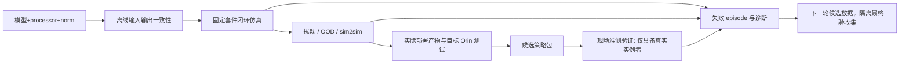

# 05 · 独立评估与 sim2real

## 1. 评估是独立生产管线

输入必须固定模型内容、预后处理、机器人接口、场景/任务、评估套件、seed/case 列表、runtime 与指标定义。输出为逐 episode 结果、失败媒体、汇总和判定证据，训练 reward 不能代替它。

## 2. EvalSuite 契约

suite revision 固定：task/interface/scene hash、训练/验证分布定义、case IDs、seed、重复次数、超时、success/failure 定义、指标单位、判定阈值与置信要求、媒体采样规则。模型参评前先冻结，不能看结果后换 seed 或降低门限。

每次报告固定 `model_artifact_hash, processor_hash, norm_hash, runtime_hash, hardware_profile, suite_hash, evaluated_case_ids, per_case_ref, aggregate_ref, validity, gate_results`。同一个模型在不同量化配置或 Orin 软件版本下产生不同报告。

case 状态分 success、task_failure、timeout、invalid、infra_failed、cancelled。模型正常运行但超时完成不了任务，计入任务失败；仿真进程起不来属于 infra_failed，不能当成功或默默删掉。报告同时给出 planned/completed/valid/invalid/infra_failed，必需 case 未完成则整体 incomplete，禁止拿剩余成功样本排名。

评估 Job 成功表示运行与报告完整，`qualification=pass/fail/incomplete` 表示模型是否满足套件目标，两者分开；模型表现差不会触发无意义的基础设施重试。下游交付明确要求适用报告 qualification=pass，而不是只判断 Job.status=succeeded。

## 3. 各任务的指标与证据

| 任务族 | 主指标 | 诊断指标 | 不能使用的替代判断 |
|---|---|---|---|
| SO101 单臂抓放/到达 | 固定成功判据下成功率、完成时间 | 物体最终位姿、保持时间、接触/碰撞、轨迹平滑、夹爪失误、动作越限 | 机械臂移动过或 reward 高即成功 |
| G1 locomotion | 完成率/摔倒率、速度跟踪误差 | 地形分组、足滑、接触、力矩/功率、姿态、恢复能力 | 用 Reach 成功率比较走路策略 |
| G1 上肢/全身操作 | 任务成功且基座稳定 | 双手/末端误差、控制器切换、支撑约束、动作延迟 | 高层目标准确即可忽略底层摔倒 |
| BHL biped/WBC | 对应接口的跟踪、稳定、终止原因 | 关节/躯干误差、越限、能耗、接触、fall/timeout | 同维 ONNX 就是兼容模型 |
| BHL fixedhand | 选定手/目标任务成功率 | 左右手分组、目标距离、关节余量、语言指令响应 | 混在一起的均值掩盖单侧失效 |
| VLA 离线 | action/pose 误差、有效 mask 内误差 | 各关节/末端、chunk 位置、语言/视觉消融 | offline loss 低即闭环有效 |
| 部署运行 | sensor-to-action p50/p95/p99、deadline miss | 观测 age、动作 age、功耗/温度、峰值内存 | 单算子 GPU FPS 即机器人实时性 |

success detector 必须由任务实现提供，并固定代码 hash。脚本专家是一个参照基线，**不是数学上界**；专家可能有系统性失败。BHL 当前 JSON parser 可复用，但重复解析同一 JSON 不等于两次独立容器评估。

## 4. 比较、样本量与泄漏

- 成功率用 valid episode 的明示分母与 Wilson 区间；存在场景/session/示教祖先相关性时按 group 聚合或 cluster bootstrap。近邻 Mimic 轨迹不能当独立样本数。
- 模型比较使用同一组 case/seed、同一环境条件；配对差值通过相应配对区间呈现。不同机器人/接口/任务的分数分榜，不能直接排名。
- 验证集用于模型选择；最终 acceptance 集仅在候选冻结后运行。回归集可以包含已知失败，但必须和未见测试分开标注。
- 示例：20 次全部成功的 95% Wilson 下界约 84%，不足以宣称真实成功率≥95%。质量验收需要事先定义目标置信下界与样本规模，不能只要求“跑 20 条全绿”。
- 首次冒烟可用 10–20 个 case 检查协议和日志；正式评估的 case 数由允许误差/目标成功率和场景覆盖确定，并写入 suite。随机性不可完全消除时记录容差和重复测量，不承诺逐浮点一致。

失败墙的每个卡片关联 model/suite/case/seed、原因、视频与时间定位。自动分类保留 unknown 与多标签，人工修正产生新标注版本，不改原始运行结果。

## 5. sim2sim 与 sim2real 的检查顺序

1. **资产与接口一致性**：关节顺序、零位、方向、单位、质量/惯量、关节限制、执行增益、相机与坐标系、控制器。不同仿真器中的映射显式版本化。
2. **处理链一致性**：训练和部署使用同一 resize/color/tokenizer/norm、state 构造、action 解码/裁剪/chunk 消费规则。
3. **部署产物一致性**：用准备交付的 ONNX/engine/模型包做评估，不能只评 PyTorch checkpoint。量化产物必须重新走适用的闭环评估。
4. **扰动测试**：延迟、抖动、丢帧、噪声、标定偏差、摩擦/质量、光照/相机位置、观察分布外条件；来源与参数固定。
5. **目标设备测试**：在 Orin 实际 runtime 测推理与整条 sensor-to-action 处理链；本机 4090 通过不能代替它。
6. **现场端验证**：仅对具备真实实例的 SO101/BHL 进行，遵守下一节边界；G1 当前标明 hardware_unavailable。

sim2sim 不是所有任务都已有通道：BHL 的 MuJoCo 先核对资产与输入；G1 需要匹配模型；SO101 若没有相同场景和动力学实现，显示“未覆盖跨仿真器”，使用 Isaac 扰动测试可补证据但不得标 sim2sim passed。视觉数据分布不同，需要真实校准/离线感知验证；领域随机化不是消除 sim2real gap 的证明。

## 6. 真机边界与安全状态

平台现有真机放行/门禁豁免拒绝保持不变，包括 Agent 禁止集与相关 403 路径。本设计里的“交付/现场阶段”是**提供包、列出证据、导入现场结果**；不新增平台远程放行动作或实时遥控能力。

现场操作者使用独立端侧工具完成加载、校准、急停检查、受限运行与安全回滚；平台最多记录结果及其设备证据，不能通过修改 PG 记录让机器人运动。真实 safety 约束必须由端侧执行，不把包里存在 `watchdog_ms` 当作已执行。

| 阶段语义 | SO101 单臂 | BHL / 未来 G1 真机 |
|---|---|---|
| 离线/无驱动检查 | 设备、相机、单位、零位、动作范围、急停 | 资产/固件/接口、关节序、控制器、急停 |
| 受约束低风险检查 | 清空工作区、低速、无负载、限制夹爪/关节 | 按硬件与现场规程采取支撑/约束和低幅度检查 |
| 受限任务验证 | 软目标、有限次数与速度、现场监护 | 受约束姿态/移动、有限时长、现场监护 |
| 现场确认运行 | 以实例适用限值和场景边界运行 | 同样以实例/控制模式决定，不能照抄统一“保持姿态” |

具体阈值由接口/现场工程验证设置，本设计不提供通用电机参数。悬挂不会消除全部风险；不同机器人不能通用 hold_pose 或断电策略。看门狗动作必须是该机器人已验证的安全模式。

异常时首先由端侧控制器进入安全状态；仅在停机/安全姿态下切换包或重启，不能在机器人运动中热切旧 policy 并清空 recurrent/chunk 状态。active/previous 本地保留并校验，离线能恢复；robot-agent、网络、API 或数据库故障不进入控制环。

## 7. 遥测回流

端侧异步记录运行 Session、设备/包/标定/软件版本、控制延迟、观测 age、关节摘要、温度、电流与事件。关键事件可保留前后环形缓冲区；日常摘要与有限媒体采用独立存储预算，不阻塞推理或控制。

上传支持 seq、chunk hash、断点和去重；迟到/乱序按端侧时间排序，时钟映射误差可见。事件→失败案例→候选数据需要一次显式质量与标签审核；最终验收来源的样本保持隔离规则，不自动训练。

## 8. 许可证与来源约束

保留 source/model/asset 的许可证引用及用途许可、人工审查状态；合并数据时保留逐来源限制，不用字符串包含 `nc` 替代完整决策。原设计对 NC 数据分享存在互相矛盾的表述，本轮保守裁决为**公开分享与对外导出需独立授权校验**，内部研究可见性也由来源条款决定，不自动允许公开。

量化/训练派生保留来源，不声称所有许可证都以同一法律规则“传染”。技术门禁记录用途许可决定与证据；不通过模型压缩、重命名或分享链接绕过来源限制。
